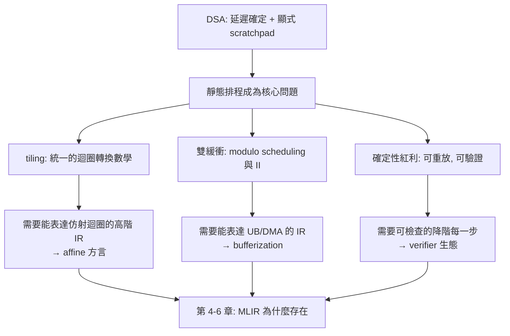

# 3.2 靜態排程、張量分塊與雙緩衝：DSA 編譯器的核心課題

3.1 節建立了 DSA 的硬體畫像：延遲確定、scratchpad 顯式管理、計算單位是矩陣塊。本節把焦點轉到編譯器：在這樣的硬體上，排程第一次變成**可以在編譯期完整求解的問題**——而這既是機會（可精確最佳化），也是負擔（所有決策都要有人做）。

## 3.2.1 為什麼 DSA 必須靜態排程

對比三種硬體的排程責任分配：

| | CPU | GPU | TPU/NPU |
|---|---|---|---|
| 指令順序 | 硬體 OoO 重排 | warp 排程器硬體決定 | 編譯器完全決定 |
| 記憶體搬移 | 硬體快取 | 硬體快取 + 程式員管 SMEM | 編譯器完全決定 |
| 延遲遮蔽 | 亂序 + 預測 | 多 warp 切換 | 編譯器排定重疊 |
| 延遲已知性 | 動態（快取命中否） | 半確定 | **確定** |

DSA 必須靜態排程的根本原因是**沒有東西能替編譯器做**：沒有亂序引擎、沒有快取、warp 排程器不存在。而靜態排程之所以**可行**，是因為延遲確定：一次 MXU 塊運算 $t_{\text{mxu}}$ 、一次 UB 讀寫 $t_{\text{ub}}$ 、一次 HBM 傳輸 $t_{\text{hbm}}$ （帶寬 × 大小）都是已知常數。編譯器掌握全部成本模型，可以求解整個時間軸。

形式化地，這是一個**資源受限的排程問題**（Resource-Constrained Scheduling）：

$$\min \; T_{\text{makespan}} \quad \text{s.t.} \quad \forall \text{op}: \text{start}(op) \ge \text{end}(\text{pred}(op)),\; \text{資源容量約束（MXU、DMA 通道、UB 容量）}$$

它近似於排程理論中的 job-shop 問題（NP-hard），實務用啟發式（list scheduling、modulo scheduling）+ 局部搜尋求解。**「NP-hard 但規模小且確定」——這是 DSA 編譯器的甜蜜點**：GPU 上對應的問題因為延遲不確定反而無法精確求解。

## 3.2.2 張量分塊（Tiling）：三層次嵌套的統一數學

DSA 上的 tiling 同時服務三個約束（比 CPU 的單一目標豐富）：

1. **UB 容量**：一個 tile 的激活 + 權重必須裝進 UB；
2. **MXU 形狀**：tile 尺寸是 MXU 維度的倍數，否則 padding 浪費；
3. **HBM 流量最小化**：最大化算術強度（Roofline，2.2.3 節）。

以矩陣乘法 $C = A B$ 為例，經典的迴圈嵌套經過 tiling 後變成多層：

```
for ci in 0..M step Mc:          # HBM → UB 的 A/C 子塊
  for cj in 0..N step Nc:
    for ck in 0..K step Kc:      # HBM → UB 的 B 子塊
      # 以下整段在 UB 內完成
      for m in 0..Mc step Mx:    # UB → MXU 的輸入塊
        for n in 0..Nc step Nx:
          for k in 0..Kc step Kx: # MXU 一次 Kx 步的脈動
            C[m:m+Mx, n:n+Nx] += A[m:m+Mx, k:k+Kx] @ B[k:k+Kx, n:n+Nx]
```

選擇 $(M_c, N_c, K_c, M_x, N_x, K_x)$ 的約束與目標：

* UB 容量： $M_c K_c + K_c N_c + M_c N_c \le \text{UB}_{\text{size}}$ （以元素字節數計）；
* MXU 對齊： $M_x, N_x, K_x$ 為陣列維度的因數倍；
* 目標：最小化 HBM 流量 $\approx O(\frac{MNK}{K_c} + \frac{MNK}{N_c} + \frac{MNK}{M_c})$ ——**塊越大流量越小**，但被 UB 容量頂住。

在數學上，這個變換是 **loop transformation 的組合**：循環交換（interchange）、循環合併（fusion）、循環分裂（strip-mining）。polyhedral 編譯（第 6.2 節）提供統一的代數框架來表達與驗證這些變換。

### Tiling 的決策時點問題

與 CPU 不同，DSA 的 tiling **不能留到執行期或後端**：

* UB 位址配置依賴 tile 形狀 → 配置在 tiling 之後；
* DMA 排程依賴 tile 邊界 → 排程在配置之後；
* 指令序列依賴全部上述決策。

所以 DSA 編譯器有一條**嚴格的依賴鏈**：


每一步的錯誤都會向下游傳播且**無法在執行期補救**。這解釋了 DSA 編譯器（XLA、各家 NPU SDK）為什麼比 LLVM 後端更依賴**對形狀的靜態掌握**——動態形狀（unknown dim）在 DSA 上是根本性困難，因為整條鏈都要參數化。

## 3.2.3 雙緩衝（Double Buffering）：用空間換重疊

即使排程完美，若「搬移 → 計算 → 搬移」是串行的，MXU 會在每次 HBM 傳輸期間空轉。設 tile 計算時間 $T_c$ 、傳輸時間 $T_t$ ，串行總時間為 $n(T_c + T_t)$ ；若兩者重疊，則為 $T_c + (n-1)\max(T_c, T_t) + T_t$ 。**重疊的前提是 buffer 分身**：計算讀 buffer A 時，DMA 正在填 buffer B。

雙緩衝的資源帳：

* UB 空間 ×2（或 pipeline 深度 $p$ 倍）；
* 週期級的精確排程：DMA 通道與 MXU 的爭用必須錯開。

在模數排程（modulo scheduling，源自 VLIW 軟體流水 soft pipeline，Rau 1992）的框架下，軟體流水把迴圈體按**啟動間隔（Initiation Interval, II）**錯位重疊：

$$II \ge \max\left(II_{\text{res}},\; II_{\text{dep}}\right)$$

其中 $II_{\text{res}}$ 來自資源約束（MXU 每拍只能做一次塊運算、DMA 通道有限）， $II_{\text{dep}}$ 來自依賴約束（循環攜帶依賴除以距離）。**達到 $II_{\text{res}}$ 即「資源飽和」是 DSA 排程的成功判據**——這個數字在 TPU 上對應「MXU utilization」，在 NVIDIA Hopper 上對應 `wgmma` 的發射節奏。

迴圈攜帶依賴是 II 的硬上限來源，因此 DSA 編譯器會積極做：

* **累加鏈拆分**：K 維度的部分和如果駐留在 accumulator 上，要拆成多個 accumulator 輪替，避免依賴距離 1；
* **融合與重排**：把 elementwise（bias、activation、scale）掛到 MXU 流水線的空檔，避免獨立的 UB round-trip。

## 3.2.4 靜態排程的驗證問題：確定性的紅利與風險

靜態排程給了 DSA 一個 CPU/GPU 沒有的紅利：**執行是確定的**。同一模型、同一形狀、同一編譯器版本 → 位元級相同的執行軌跡。這帶來：

1. **可重現的數值**：推理結果可逐位元比對，驗證容易；
2. **可驗證的排程**：排程器的輸出（時間表）可以用模擬器或形式模型重放檢查（資源不超賣、依賴不違反）；
3. **效能是編譯產物**：不需要執行期調優，「這份二進位在這代硬體上多快」是編譯完成即知的常數。

但硬幣反面：

1. **形狀爆炸**：每個形狀 bucket 需要單獨編譯與 tuning，模型導出/部署的編譯時間成為工程痛點；
2. **泛化脆弱**：編譯器對「訓練時沒見過的算子組合」可能產出糟糕排程，甚至無法編譯（算子覆蓋率問題）；
3. **調優空間巨大**：tiling 參數 × 緩衝深度 × 融合集的組合空間，靠啟發式覆蓋不全 → 這正是 **auto-tuning（Ansor、Meta Schedule）與後來 LLM 輔助搜尋（第 8 章）的用武之地**。

## 3.2.5 小結與通往第二部的橋



第二部的問題式在此成形：**這一整套「tiling → layout → buffer → 排程 → 指令」的決策鏈，需要什麼樣的 IR 才能自然表達？** LLVM IR 的答案被證明是不夠的——下一章從那裡開始。

---

**參考與延伸閱讀**

* Rau (1994). "Iterative Modulo Scheduling." *IJPP*.
* Google XLA 文檔與 TPU Performance Guides.
* Zheng et al. (2020). "Ansor: Generating High-Performance Tensor Programs for Deep Learning." *OSDI*.
* Feng et al. (2023). "TensorIR: An Abstraction for Automatic Tensorized Program Optimization." *ASPLOS*.
