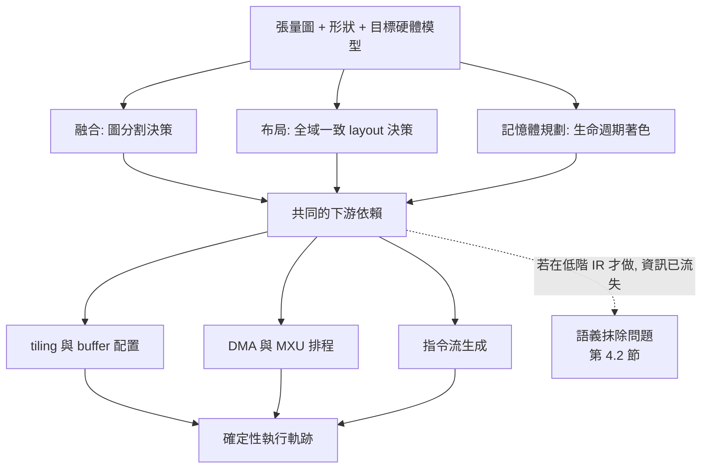

# 3.3 算子融合、記憶體布局轉換與靜態記憶體規劃

本節完成第一部：把 DSA 編譯器的三項關鍵工程——融合、布局、記憶體規劃——放在一起看。它們有一個共同點：**全部是「全域決策」，全部需要在程式還保持高階形狀語意時完成**。這個事實是第二部「多層 IR」的終極論證。

## 3.3.1 算子融合：張量世界的 strength reduction

### 為什麼融合是 AI 編譯器第一優化

一個典型 transformer 塊的張量圖由大量小算子組成：LayerNorm → MatMul → BiasAdd → GELU → MatMul → …。每個算子在 DSA 上單獨執行，都要：

* 從 HBM 讀輸入（寫出到 HBM 的中間結果再讀回來）；
* 在 UB 中占一塊空間；
* 付一次 kernel 啟動/同步的固定成本。

融合（fusion）把相鄰算子合併成一個執行單位，**中間張量不再落到 HBM，甚至不落到 UB——直接在暫存器/累加器裡傳遞**。融合的收益用 Roofline 語言說就是提升算術強度：

$$I_{\text{fused}} = \frac{\text{FLOPs}_{A} + \text{FLOPs}_{B}}{\text{Bytes}_{\text{in}} + \text{Bytes}_{\text{out}}} > \max(I_A, I_B)$$

對於 elementwise 算子（ $I \approx 0.25$ ），融合後可以把 $I$ 拉高到接近 matmul 的水平，**總時間從頻寬受限跳到計算受限**——這是數量級的差別，不是百分之幾的微調。

### 融合的約束：為什麼不能無腦全融

融合不是免費的，它的約束系統有三層：

1. **記憶體（最硬）**：融合體的 tile 中間結果要全部駐留暫存器/UB，融合太大 → 預算爆炸 → occupancy 或 pipeline 崩潰；
2. **形狀相容**：不同算子對 tile 切法的要求可能衝突（conv 要求空間 tile，matmul 要求 K 維累加方向）；
3. **並行性**：融合兩個可並行維度不同的算子，可能切掉某一邊的並行度。

因此融合是一個**組合優化問題**：在融合圖空間中尋找「tile 後資源可行且 Roofline 最優」的分割。工業做法的分級：

| 策略 | 代表 | 特點 |
|------|------|------|
| 手工模式 | 各框架 eager kernel（Conv+BN+ReLU） | 快，覆蓋有限 |
| 規則驅動 | XLA fusion（輸出驅動、horizontal fusion） | 啟發式，泛化中等 |
| 搜尋驅動 | Ansor/Meta Schedule 的 sketch + 搜尋 | 空間大，編譯慢 |
| 生成輔助 | LLM 提出融合候選（第 8 章） | 開放空間，需驗證 |

**融合決策必須在張量層（有形狀與 tile 語意時）完成**——一旦降階到 LLVM IR，算子邊界已經不存在，「這兩段代碼原本是兩個算子」的資訊被抹除了。這是「語義抹除」的第一個具體案例，第 4.2 節將系統化展開。

## 3.3.2 記憶體布局轉換：NCHW、NHWC 與 tiled layout

### 布局為什麼是效能問題

同一個張量在記憶體中的線性化方式決定了每個硬體單元的存取模式：

* **NCHW**（batch, channel, height, width）：PyTorch/Caffe 傳統。conv 對空間維連續 → CPU 向量化友好；
* **NHWC**：channel 最內 → conv 對 channel 累加時相鄰線程連續 → GPU 合併存取與 tensor core 友好；
* **Tiled layout**（如 NC/32HW32）：把 channel 按硬體向量寬度預先分塊 → DSA 的 tile 載入直接對齊 MXU 形狀。

實測上，錯誤的布局可以讓同一個 conv 差 3–5 倍。**布局的選擇本質上是「為哪個硬體單元優化」的選擇**，因此它必須是目標感知的編譯決策。

### 布局轉換的代價與傳播問題

更微妙的是：**布局轉換本身是昂貴的運算**（一次全量讀寫）。於是編譯器面對一個傳播問題：

> 為了讓算子 $A$ 用它的最優布局，會不會逼出中間的轉換開銷超過收益？

最優解通常不是「每個算子各取所好」，而是**整張圖採用一個（或多個）一致的布局**，使轉換總次數最小。這要求編譯器在**圖層**對所有算子的布局偏好做全域求解——又是第 4 章主題的預演：**布局資訊在低階 IR 中不存在，這類全域決策必須前移**。

MLIR 的對應設計：`linalg` 的 indexing map（親和矩陣表達式）、`memref` 的 stride/offset、以及 IREE 的 layout 與 encoding 屬性（例如把「這個 tensor 是 matmul 的 LHS、按 16×16 tile 編碼」記為型別屬性），都是把布局變成 **IR 可推理、可變換、可在降階前最佳化**的一等公民。

## 3.3.3 靜態記憶體規劃：scratchpad 上的生命週期分配

### 問題形式化

DSA 的 UB/scratchpad 沒有快取替換，**所有緩衝都要編譯器分配**。給定張量圖 $G$ （節點 = 算子，邊 = 張量）與執行順序（排程結果），每個張量有一個生命週期區間 $[t_{\text{def}}, t_{\text{last-use}}]$ 。記憶體規劃 = 給每個區間分配 UB 位址，**重疊區間不得衝突**，目標是最小化峰值記憶體。

這是經典的 **interval graph coloring** 問題（1.2.3 節暫存器配置的親戚——事實上就是「scratchpad 上的暫存器配置」）：把張量當作 live range、UB 當作暫存器檔。生命週期錯開的張量可以**共用同一塊 UB 位址**（in-place reuse），峰值記憶體可以遠低於「所有中間張量同時存在」的 naive 總和。

### 反向重用與動態規劃的升級

兩個工業級技巧：

1. **反向重用（out-of-place → in-place）**：elementwise 鏈（act → bias → scale）可以原地覆寫；殘差流的 add 可以指定輸出重用其中一個輸入；
2. **優化執行順序降低峰值**：同一張圖的不同執行順序（拓撲序）給出不同的生命週期重疊模式 → 峰值記憶體不同。**記憶體規劃與排程互相耦合**（與 1.2.3 節「排程 vs RA」的耦合同構！），最優做法是聯合求解或迭代。

峰值記憶體的實際意義：**決定模型能有多大的 batch、多長的 context**。LLM 推理的 KV cache 管理就是這套理論的動態版（KV cache 隨 token 增長，生命週期延伸到序列結束）——paged attention（vLLM, 2023）本質上是把「靜態生命週期分配」升級為「分頁虛擬記憶體」的 runtime 技術。

### 驗證維度

靜態記憶體規劃產生的配置可以**形式化驗證**：對每對張量，檢查生命週期區間與位址區間不同時重疊。這是一個純語法的檢查（SMT 或簡單的掃描線），構成 DSA 編譯器 verifier 的一部分——**在 compiler 端排除「越界互踩」這一整類 bug**。當第 7 章討論 LLM 生成的排程/配置時，這種「機器可檢查的配置證明」將成為信任鏈的關鍵環節。

## 3.3.4 三件事的統一視角：都是「在正確的高度做全域決策」

三項決策共享三個特徵：

1. **全域性**：單看任何局部都無法決定（融合要看圖，布局要看全圖偏好，記憶體要看全生命週期）；
2. **目標依賴**：CPU/GPU/DSA 的最優解不同；
3. **資訊時效性**：所需的資訊（形狀、tile、生命週期）只在 IR 的特定高度存在。

把這三點寫成一條設計公理，就是第二部的出發點：

> **決策應該放在「決策所需資訊恰好完整、且變換能力恰好可用」的那一層 IR 上。** 單一 IR 無法同時容納張量層與純量層的決策，所以需要多層 IR 與漸進降階。

第一部到此完成。我們已經看清三種硬體各自「希望編譯器在哪裡留什麼選擇空間」：CPU 要 SSA 級的依賴與別名資訊，GPU 要 tile 與 lane 映射的決策權，DSA 要整條「融合→布局→記憶體→排程」鏈的編譯期控制。第二部要回答的問題是：**什麼樣的編譯器基礎設施能同時服務這三份需求清單？**

---

**參考與延伸閱讀**

* Anderson et al. (2021). "First-Party Tensor Compilation: TensorRT, XLA, and the Case for Fusion." 及 XLA: fusion 文檔.
* Ragan-Kelley et al. (2013). "Halide: A Language and Compiler for Optimizing Parallelism, Locality, and Recomputation." *PLDI*（schedule 與演算法分離的開山之作）.
* Kwon et al. (2020). "MAESTRO: An Open-Source Infrastructure for Mapping Dataflows Through Memory Hierarchies."（dataflow 映射的形式化）
* Kwiatkowski (vLLM team) et al. (2023). "Efficient Memory Management for Large Language Model Serving with PagedAttention." *SOSP*.
