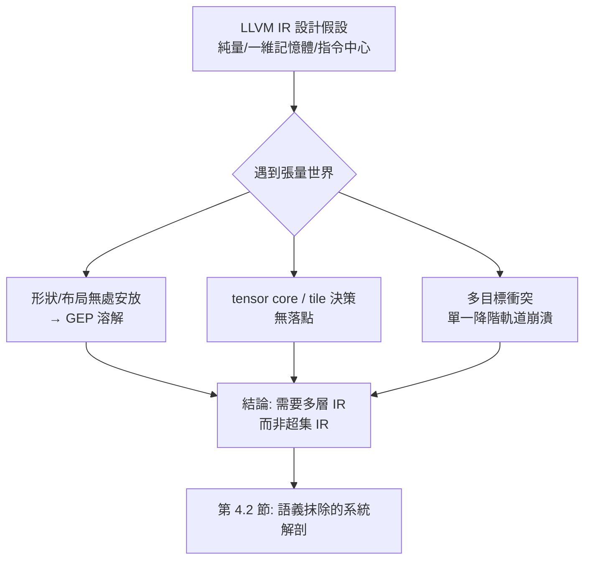

# 4.1 LLVM IR 的純量本位：為什麼它裝不下高維張量

第一部結尾我們把問題式定為：**單一 IR 能否承載從張量到機器碼的整條降階鏈？** 本節從 LLVM IR 出發做正面解剖。結論先行：LLVM IR 是純量世界的巔峰之作，但它的三個設計假設——無限寬的純量暫存器、一維位址空間、控制流中心——恰好與張量編譯的需求正面衝突。

## 4.1.1 LLVM IR 的三大設計假設

回顧 1.2 節，LLVM IR 的核心資產是 SSA + 型別化的純量值 + 顯式控制流圖。它的隱含假設：

1. **值的粒度是純量或定寬向量**：`i32`、`float`、`<4 x float>`，甚至 scalable vector——但**沒有形狀**。一個 `<vscale x 16 x float>` 不知道自己是 $4\times4$ 矩陣還是 $16\times1$ ；
2. **記憶體是一維位址的線性空間**：`getelementptr` 做指標算術，stride 資訊溶解在加法裡；
3. **執行的基本單位是指令**：沒有「kernel」「tile」「裝置」的概念，平行性靠函式呼叫約定（如 OpenMP）在 IR 外約定。

這三個假設在過去二十年服務 C/C++/Rust 非常成功。但對照第 2、3 章的硬體需求清單，會發現張量編譯器需要的資訊**恰好全部落在假設之外的空隙**。

## 4.1.2 空隙一：形狀與布局無處安放

考慮一個 $1024\times1024$ 的 float 矩陣乘法。在 LLVM IR 層，它只存在為：

```llvm
; 兩個指標 + 一維長度, 僅此而已
define void @matmul(float* %A, float* %B, float* %C, i32 %n) {
  ; ... 800 行左右的位址算術與迴圈 ...
}
```

丟失的資訊清單：

| 資訊 | 在 LLVM IR 的狀態 | 為什麼必要 |
|------|------------------|-----------|
| 維度與形狀 | 只剩一個 `i32 %n` | tile 尺寸合法性、padding 決策 |
| 布局/stride | 溶解在 GEP 的常數裡 | 合併存取（2.2.2）、轉置判定 |
| 批次維度 | 不可見 | 融合邊界、並行映射 |
| dtype 語意 | 只有浮點寬度 | BF16 的縮放、量化回旋（requantize） |
| 算子邊界 | 不存在 | 融合（3.3.1）的前提 |

「溶解在 GEP 裡」值得展開。NHWC 的 `C[i][j][k][c]` 到位址的映射在 IR 中變成一串乘加常數，理論上可以反推，但**反推的可靠性極差**：別名、循環變換後的表達式重寫，都會破壞「這是第 $(i,j,k,c)$ 個元素」的可識別性。現代做法（MLIR 的 `memref` 型別）是把 stride/offset 作為**型別的一部分**直接攜帶：

```mlir
// memref 型別: 形狀 + 步長 + 位址空間全部在型別上
memref<1024x1024xf32, strided<[1024, 1], offset: ?>>
```

型別攜帶 vs 位址溶解，是「能不能做全域布局推理」的分水嶺。

## 4.1.3 空隙二：張量級最佳化在 IR 層失去落點

用 1.2 節的四重奏檢驗張量編譯的需求：

**指令選擇**：LLVM 的 ISel 把 IR 操作映射為指令。但 tensor core 指令（`mma`、`wgmma`）的「指令語意」是 warp 級協作——32 個執行緒共同完成一個矩陣片段運算。**這在以單執行緒為單位的 LLVM IR 裡根本無法表達**：你寫不出「這 32 份執行緒各自的部分一起構成一條 mma」。結果是 WMMA/mma 只能以 intrinsics + 手寫 layout 的方式存在，編譯器無法自動做出「把這個 GEMM 映射到 mma」的決策。

**暫存器配置**：2.1.4 節指出 GPU 上 RA 是 occupancy 決策。LLVM 的 RA 目標函數是「最少 spill」，不知道暫存器預算會影響常駐 warp 數。NVPTX 用命令列參數傳遞上限——**全域資源預算被降格為一個外部標量**。

**排程**：GPU 的「排程」核心是 SMEM pipeline（雙緩衝，2.3 節），這是 tile 級資料移動的重疊問題。LLVM IR 沒有 tile 概念，這個決策無處落地。

**向量化**：LLVM 的 vectorizer 試圖從純量迴圈「重建」平行性——分析依賴、證明獨立、再生向量代碼。這是一條昂貴且脆弱的路：**先壓平、再重建**。張量編譯器（linalg）的路線是反過來：**平行性從未消失**，IR 直接以張量/結構化迴圈形態存在，向量化只是最後一步的形狀映射。兩條路線的差別就像「把文件壓縮成 zip 再解壓讀取」與「直接讀原始文件」。

## 4.1.4 空隙三：多目標與單一降階軌道的衝突

第 1–3 章已確立：CPU、GPU、DSA 各自需要**不同的決策在**不同的高度完成。LLVM 的架構是一條**單一降階軌道**：IR → ISel → MIR → 機器碼。它默認「所有目標共用同一條 IR 語言與同一組優化 pass」。

張量世界做不到。同一個 matmul：

* 對 CPU 後端：vectorize + unroll + RA；
* 對 GPU 後端：tile 到 SMEM → mma 映射 → SMEM pipeline；
* 對 DSA 後端：融合 → 布局 → UB 配置 → DMA 排程。

三條路徑的**中間形態互不兼容**——GPU 的形態裡有 lane layout（純 CPU 不需要），DSA 的形態裡有 UB 位址（GPU 用 SMEM 表達，語意又不同）。如果強行用一套 IR 承載，就會出現兩個壞選項：

1. **IR 爆胖**：塞進所有目標的所有概念，每個後端只用一小角，pass 之間的互動組合爆炸；
2. **重複建模**：每個後端自己維護一套私有中間形態（各家 NPU SDK 的現狀），成果不能共享，正確性各管各的。

LLVM 社群的因應是「往上長」：Polly（polyhedral）、MLGO（ML 引導的 pass 決策）、各種 loop pass。但這些是**外掛在線性管線上的補丁**，改變不了「核心 IR 沒有張量語意」的事實。

## 4.1.5 一個診斷性的思想實驗

把 LLVM IR 設計者請來，問一個問題：「如果要讓 LLVM IR 直接表達 $C = AB$ 並讓後端自動用 tensor core，要改什麼？」

逐項盤點就會發現改不動：

* 需要形狀型別 → 觸碰所有 pass 的型別系統；
* 需要 layout 語意 → 觸碰 memory model；
* 需要 warp 協作語意 → 觸碰執行模型的根基；
* 需要 tile 級資源語意（SMEM、預算）→ 觸碰目標描述。

每一步都不是加一個 pass，而是**挖 IR 的地基**。地基動不了的結論：**張量語意需要自己的 IR 層級，而不是 LLVM IR 的超集**。

## 4.1.6 小結：不是 LLVM 的失敗，是抽象層級的必然



需要公平地指出：**LLVM IR 沒有做錯任何事**。它是「把已確定的計算變成機器碼」這個問題的最優抽象；它只是**不是**「決定計算該如何組織」這個問題的抽象。張量編譯器的瓶頸不在最後一公里，而在前面十公里——而前面十公里需要不同的地圖。

---

**參考與延伸閱讀**

* Lattner et al. (2021). "MLIR: Scaling Compiler Infrastructure for Domain Specific Computation." *CGO*（對「為什麼不是 LLVM」的官方論述）.
* Grosser et al., Polly: LLVM 的 polyhedral 嘗試（2011 起）.
* El Zarwi et al. (2022) 對 CPU tensor 指令（AMX）與 LLVM 表達力的討論.
* Treweek et al. (2020). "MLIR and Polyhedral Compilation"（MLIR affine vs Polly 對照）.
