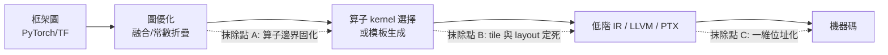
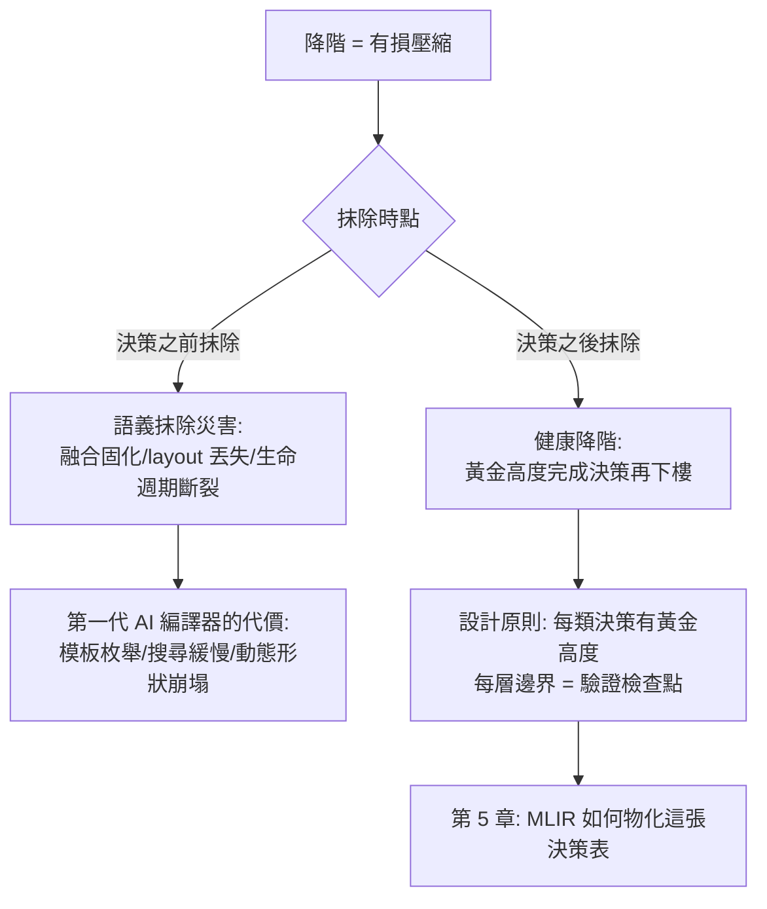

# 4.2 語義抹除：計算圖降階為低階指令時丟失了什麼

4.1 節以 LLVM IR 為例證明了「單一低階 IR 裝不下張量語意」。本節換一個更普適的視角：**任何一次降階都是資訊的有意捨棄**。我們把這個現象命名為**語義抹除**（semantic erasure），分析它抹掉什麼、什麼時候該抹、以及第一代 AI 編譯器（計算圖 → 低階指令的直落式管線）如何在這裡付出代價。

## 4.2.1 語義抹除的定義

> **語義抹除**：在 IR 降階過程中，上層語意中被捨棄的資訊，使得某些原本可行的全域決策，在更低層變得不可行或不可證明。

精確地說，設 IR 層級 $L_1 > L_2$ ，降階函數 $\ell: L_1 \to L_2$ ，決策集 $D_1, D_2$ 分別為兩層可表達的決策。語義抹除的程度可以刻畫為：

$$\text{loss} = \{ d \in D_1 \mid d \text{ 在 } \ell \text{ 之後無法恢復或重新表達} \}$$

注意兩個細節：

* **「無法恢復」**：不是資訊理論的不可逆（位元仍在機器碼裡），而是**決策者不可用**——pass 無法可靠地從 $L_2$ 反推 $L_1$ 的結構；
* **「重新表達」**：有時可以用代價高昂的分析（alias analysis、依賴分析）部分重建，4.1 節的 vectorizer 正是「重建者」。

## 4.2.2 抹除發生在哪裡：張量編譯器管線的逐站檢查

第一代 AI 編譯器（以 TVM v0.x、TensorRT 早期、以及「圖引擎 + 手寫 kernel」模式為代表）的管線大致是：

**抹除點 A（圖 → kernel）：算子邊界的固化。**
圖優化階段決定「哪些算子融合成一個 kernel」。這個決策一旦做出，kernel 邊界就成了硬邊界：後續任何階段都無法再跨越它重新融合或拆分。問題是**此時 tile 資訊還不存在**——決策者是在不知道「融合後 tile 是否裝得下暫存器」的情況下拍板的。結果是兩種系統性錯誤：過度融合（資源爆炸，被迫 split）與融合不足（錯失 Roofline 提升機會）。

**抹除點 B（kernel → 低階 IR）：tile、layout、並行映射的定死。**
模板生成器（TVM schedule、Halide schedule、CUDA 模板）在生成低階代碼時，把 tile 大小、迴圈順序、layout 全部展開成具體代碼。此後：
* 改 tile = 重新生成（成本高、無法與其他決策聯合優化）；
* IR 中再無「這是 $m \times n$ tile」的語意，除非模板作者手工留註記。

**抹除點 C（低階 IR → 機器碼）：一切的終點。**
一維位址、指令序、暫存器名——這是 1.2 節四重奏正常工作的世界，抹除在此是**健康的**（後端本來就該只管純量）。

診斷：**抹除本身不是 bug；抹除的「時點」錯了才是 bug。** 4.2.4 節把這句話變成設計原則。

## 4.2.3 抹除的具體受害者：四個經典案例

**案例一：TVM 的 schedule 與其瓶頸。** TVM v0.x 的 Halide 式 schedule（compute 定義與 schedule 分離）是抹除點 B 的精緻版本：schedule 決定一切映射。它的問題在於**schedule 空間是人工枚舉的**（每個算子手寫 schedule 模板），新算子沒有 schedule 就沒有代碼。Ansor（OSDI 2020）用「sketch + 搜尋」部分自動化，但代價是搜尋時間以小時計——**因為決策空間的表達不夠代數化，只能靠窮舉**。

**案例二：量化資訊的流失。** INT8 推理的 requantize（ $scale$ 、 $zp$ ）語意屬於「這個值曾經是量化整數」。降階到浮點 IR 後，後端無法再判斷哪個乘法是 scale 回旋（可用固定點乘法加速），哪個是普通浮點乘。整數量化資訊必須在**圖層**被轉成顯式算子，否則抹除即成損失。

**案例三：動態形狀的崩塌。** 若圖在編譯期形狀未知（dynamic batch），抹除點 B 的模板生成會為每個 bucket 生成一份代碼，或生成帶執行期檢查的通用版本——**效能與編譯時間的雙輸**。DSA 上更糟（3.2.2 節：整條決策鏈都要形狀）。MLIR 的對策是把「形狀未知」顯式建模為型別（`?x128xf32`），並提供 shape dialect 做形狀推理——**把不確定性變成 IR 語意，而不是假裝它不存在**。

**案例四：記憶體生命週期的斷裂。** 3.3.3 節的靜態記憶體規劃需要「張量 $T$ 的最後一次使用在第 $k$ 個算子」。框架圖層這資訊是精確的（每個 tensor 有明確的 def 與 uses）；降到低階 IR 後，指標拷貝、視圖、就地更新讓生命週期分析退化為保守的別名分析——**規劃品質直接下降**。

## 4.2.4 「在正確的高度做決策」：抹除的工程對策

把前兩節合成一條實踐原則：

> **每一類決策都有它「資訊最完整且變換仍可行」的黃金高度；抹除應該發生在決策完成之後，而不是之前。**

以張量編譯器為例，把 3.3 節的決策鏈與 4.2.2 的抹除點對齊，得到一張「決策—高度」對照表：

| 決策 | 黃金高度 | 抹除點 B（過早）的後果 |
|------|---------|----------------------|
| 算子融合 | 張量圖（tile 感知的融合） | 邊界固化，無法回頭 |
| 布局 | 張量層（型別攜帶 stride） | 全域一致性無法保證 |
| Tiling | 結構化迴圈層（affine） | 展開後只能重生成 |
| Buffer 配置 | 記憶體層（memref + 生命週期） | 退化为保守分配 |
| 指令映射 | 向量/機器層（vector/llvm） | （此時抹除是健康的） |

**MLIR 的哲學正是這張表的物化**：每個 dialect 就是一個「黃金高度」的守門員，決策在其上完成、然後降階，**抹除被安排在正確的位置、以正確的粒度發生**。第 5 章將解剖這個體系。

## 4.2.5 語義抹除與驗證的關係（前瞻）

語義抹除還有一個常被忽略的維度：**它使跨層驗證變難**。

* 在高層驗證「融合不改變數值」是可行的（對 indexing map 做恆等式檢查）；
* 在低層驗證「這 800 行 machine code 與原圖等價」是不可能的（除非有證明鏈）；
* 所以**每一層降階都應該自帶該層的驗證義務**（verifier），讓正確性在抹除發生的當下被錨定。

這條思路直通 1.3 節的翻譯驗證與第 7 章的 LLM 驗證體系：**多層 IR 的每一層邊界，同時也是正確性檢查點**。「語意分層」與「信任分層」在此合流——這是 MLIR 架構最深刻的副產品之一。

## 4.2.6 小結

---

**參考與延伸閱讀**

* Chen et al. (2018). "TVM: An Automated End-to-End Optimizing Compiler for Deep Learning." *OSDI*.
* Zheng et al. (2020). "Ansor." *OSDI*.
* Ragan-Kelley et al. (2013). "Halide." *PLDI*.
* Lattner et al. (2021). "MLIR." *CGO*.
* Vasilache et al. (2018/2019). "Tensor Comprehensions / Composable Kernel Representations in MLIR"（linalg 的設計動機文檔）.
