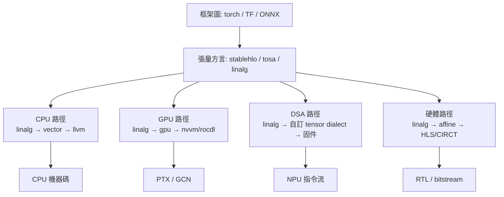

# 4.3 從線性管線到多層降階：編譯器架構的範式轉移

前兩節完成了「單一 IR 不夠」的論證。本節把鏡頭拉遠，回答一個架構史問題：**編譯器為什麼曾經選擇線性管線，為什麼現在要轉向多層降階，這次轉移的驅動力與代價是什麼？**

## 4.3.1 線性管線的黃金時代與它的成立條件

經典教科書管線（Aho–Sethi–Ullman 的「龍書」架構）：

這個架構在 1980–2010 年的成功不是偶然，它依賴三個成立條件：

1. **單一主流目標**：CPU（先 SISC 後加上 SIMD）——目標模型相對同質；
2. **語言語意近純量**：C/Fortran 的抽象層級與 IR 的抽象層級差一階（型別、陣列、迴圈），一層 IR 足以橋接；
3. **決策可以下沉**：向量化、tiling 這類決策就算晚做，也還來得及（資訊可以用分析重建）。

當三個條件**同時**成立時，線性管線是簡潔的、可維護的、充分表達的。第 1 章的 LLVM 後端管線就是這個架構的工業化巔峰。

## 4.3.2 條件的相繼崩塌

**條件一的崩塌：目標多元化。** 第 2、3 章已詳述：GPU 的 SIMT 與 DSA 的靜態資料流，與 CPU 的 OoO 是三種**互不包含的執行模型**。單一降階軌道無法為三者同時保留各自的黃金決策高度（4.2.4 節的對照表）。

**條件二的崩塌：語意升維。** 深度學習把一等公民從純量變成形狀確定的多維張量，並引入布局、量化、混合精度、動態形狀等新語意軸。語言層（框架圖）與 IR 層的**抽象差距從一階擴大到三、四階**：

$$\text{框架圖} \xrightarrow{\text{差距} \sim 4} \text{LLVM IR}$$

差距越大，一次降階抹除的越多（4.2 節），中間態越不可推理。

**條件三的崩塌：決策不可下沉。** 這是最根本的一條。第一章我們看到 CPU 的大部分決策（排程、暫存器）確實可以下沉到後端——因為語意資訊可以用分析重建（SSA + 別名分析夠用）。但張量世界的核心決策**不可重建**：

* 融合邊界：kernel 邊界是硬的；
* 布局：溶解在位址算術裡不可反推；
* 資源預算（UB/SMEM）：低階 IR 根本沒有這個概念。

三個條件同時失效，線性管線的簡潔性換來的是**表達力的破產**。範式轉移勢在必行。

## 4.3.3 多層降階：新的形狀

新範式的核心主張：

> **編譯器是一組分層的語意空間，每層有自己的一等公民與決策集；降階是層間的、可選路徑的、每步自帶驗證的變換。**

關鍵的三個屬性：

**屬性一：分層的一等公民。** 每層 IR 為該高度的決策量身定做型別與操作——張量層的一等公民是形狀與 indexing map；迴圈層是仿射邊界；記憶體層是 stride 與生命週期；向量層是 lane 映射。**沒有任何一層試圖包辦一切。**

**屬性二：降階是選路，不是單行道。** 同一個高層 IR 可以降向多條路徑（CPU 走 vector、GPU 走 gpu dialect、DSA 走自訂方言），路徑的選擇本身是編譯決策。管線從「鏈」變成「**有向非循環圖**」：

**屬性三：每層邊界即驗證點。** 每次降階後執行該層的 verifier（形狀一致、支配性、記憶體效果合法），錯誤被攔截在**距離引入點最近的一層**。這是工程上最值錢的性質：傳統管線的 bug 常常在多層之後才爆出來（4.2.5 節），多層架構把除錯半徑縮到一層。

## 4.3.4 範式轉移的驅動力排序

為什麼是 2019 年（MLIR 開源）而不是更早？把驅動力按作用時間排列：

1. **2012–2016：目標多元化啟動**（深度學習硬體浪潮，TPU、各種 NPU 出現）——條件一失效；
2. **2015–2018：語意升維**（框架圖 + 動態形狀 + 量化成為常態）——條件二失效；
3. **2016–2019：決策不可下沉被工業界確認**（TVM/Halide 的 schedule 瓶頸、各家自建 IR 的碎片化）——條件三失效；
4. **2019–2021：收斂點出現**——LLVM 基礎設施成熟、SSA 普及、驗證文化（verifier）成型，MLIR 以「LLVM 的分層化」姿態出現，迅速成為行業收斂點。

注意最後一點的時機論：**範式轉移需要理論成熟 + 基礎設施成熟 + 收斂動機三者同時到位**。多層 IR 的思想（Maximal Munch 之外，如 Middle-end 的階層化、COMPAZZO、與研究性的多層 IR 提案）早已存在，但沒有統一基礎設施，每個項目都在重造 dialect 機制。MLIR 的真正貢獻不在「提出分層」，而在**把分層變成可複用的工程平台**（第 5 章展開）。

## 4.3.5 代價與批評

範式轉移不是免費的，誠實列出成本：

1. **設計複雜度**：每個 dialect 的設計都是一次小型語言設計（語意、型別、變換、驗證），設計錯誤的成本高（linalg 經歷了數次大改版才穩定）；
2. **轉換的組合爆炸**：dialect 間的 conversion 模式需要維護， $N$ 個 dialect 的兩兩轉換最壞 $O(N^2)$ （MLIR 用「以中間方言為樞紐」的 conversion 框架緩解，見 5.3）；
3. **認知負擔**：工程師需要理解多層抽象與它們的邊界，學習曲線陡峭；
4. **文件與工具鏈的維護面積**：每層都要有 dump、可視化、測試基準。

批評的聲音主要有兩類：一是「過度工程」（對單一目標的專案，多層 IR 是奢侈）；二是「方言碎片化重演」（人人自建 dialect，回到 2018 年的孤島）。第二條的回應是**生態治理**：linalg/stablehlo/tosa 等公共方言承擔互操作樞紐，自訂方言被鼓勵「只做自己的硬體那一層」。第 12 章會回到這個治理問題。

## 4.3.6 小結：範式對照表

| 維度 | 線性管線（LLVM 時代） | 多層降階（MLIR 時代） |
|------|---------------------|---------------------|
| IR 數量 | 1（+MIR） | $N$ 層，各有語意 |
| 一等公民 | 純量、控制流 | 隨層變化（張量→迴圈→記憶體→向量） |
| 降階 | 單向鏈 | 有向圖，多路徑 |
| 決策位置 | 集中在中/後端 | 分配到各層黃金高度 |
| 驗證 | 依賴測試（+少數 verifier） | 每層邊界即驗證點 |
| 新硬體成本 | 改後端 + 補丁中端 | 新增目標方言 + 複用上層 |

---

**參考與延伸閱讀**

* Aho, Sethi, Ullman. *Compilers: Principles, Techniques, and Tools*（龍書，線性管線的經典表述）.
* Lattner et al. (2021). "MLIR: Scaling Compiler Infrastructure for Domain Specific Computation." *CGO*.
* Chris Lattner, "MLIR: Accelerating AI/ML Compiler Development"（LLVM Developers' Meeting 2019 演講）.
* Kjolstad et al. (2017). "The Tensor Algebra Compiler." *OOPSLA*（以語意驅動 code generation 的先驅）.
