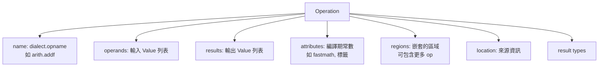
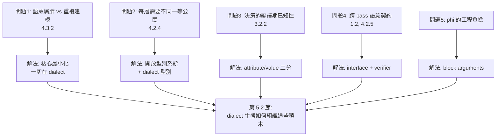

# 5.1 Operation、Region、Block：MLIR 的核心抽象

第二部第二站：MLIR 的核心資料結構。本章的目標不是 API 手冊，而是理解**每個抽象為什麼存在、它替上一節的哪個問題買單**。先給一張總圖，再逐層拆解。

## 5.1.1 設計出發點：不承諾任何語意

MLIR（Multi-Level Intermediate Representation，Lattner et al., 2019 開源，CGO 2021 論文）的第一原則寫在它的設計文檔裡：

> **核心 IR 不包含任何固定的指令、型別或語意——一切由 dialect 擴展。**

這是一個大膽的設計：LLVM IR 把 `add`、`br`、函式型別全部焊死在核心；MLIR 的核心**只有容器的形狀**（Operation、Region、Block、Value），內容全部可插拔。這個決策直接回應 4.3.2 節的「IR 爆胖 vs 重複建模」兩難——它選了第三條路：**核心最小化，語意全部分層外掛**。

## 5.1.2 Operation：一切的單位

MLIR 中所有東西都是 **Operation（op）**——包括函式定義、模組、甚至常數。一個 op 的結構：

```mlir
%result = "arith.addf"(%a, %b) {fastmath = "reassoc"} : (f32, f32) -> f32
```

解剖圖：



四個關鍵設計決策及其動機：

**（1）結果可以是多個。** LLVM IR 的指令只有一個結果，多返回值要靠 struct 或記憶體。張量世界裡「一個算子產多個張量」太常見（如分解、拆分、LSTM 雙狀態），原生支援減少人為包裝。

**（2）op 可以攜帶 Region（嵌套作用域）。** 這是相對 LLVM IR 最大的結構升級。函式體不再是唯一的作用域，任何 op 都可以擁有自己的控制流子空間。動機直接來自領域需求：

* `scf.for` 的迴圈體是 region；
* `gpu.launch` 的 kernel 體是 region；
* 未來的異步操作、事務、異常區域都有了統一的語法載體。

**（3）Attribute 與 Value 的嚴格二分。** 編譯期常數（如形狀 `[128, 128]`）是 attribute，執行期值（如指標、runtime 變數）是 value。這個二分強制了「**什麼在編譯期已知**」的顯式化——直接服務 3.2 節「DSA 需要靜態形狀」的需求：形狀是 attribute 就一定可靜態推理。

**（4）Location 系統。** 每個 op 帶來源位置（檔案/行，或「來自哪個 pass 的改寫」）。在多層降階中，這讓「這條指令是從哪個框架圖節點來的」全程可追溯——除錯與驗證的基礎設施。

## 5.1.3 Region 與 Block：作用域的新語法

層級結構是：

$$\text{Module} \to \text{op} \to \text{region} \to \text{block} \to \text{op} \to \cdots$$

* **Region**：一個 op 的嵌套體，內含若干 block。語意上 region 可以聲明自己的性質（SSA 的、允許非結構跳轉的、圖形的）；
* **Block**：基本塊，內含線性 op 序列，帶參數（block arguments 取代了 LLVM 的 phi——**phi 是 SSA 機制的實作細節，block argument 才是它的本質語意**）。

phi → block argument 的替換值得停一下。LLVM 的 phi 節點有著名的可用性問題：phi 的操作數指向「前驅塊」，使基本塊之間的邊攜帶隱式資料流，变换 pass（如 split edge、jump threading）要小心處理。Block argument 把資料流放到**顯式的邊參數**上，資料流與控制流在語法上分離，且支配關係的表達更自然。MLIR 把這個經驗（來自 Swift SIL、GHC Core 等的先例）制度化為核心設計。

## 5.1.4 Value、Type 與 SSA 的繼承與擴展

MLIR 完整繼承 SSA：每個 value 定義一次、使用指向定義、**支配關係必須成立**（1.2.1 節）。在此之上擴展：

* **Type 可以是 dialect 定義的**：`tensor<128x128xf32>`、`memref<?xf32, strided<[4,1]>>`、`!gpu.pipeline`——型別系統是開放的；
* **介面（Interfaces）**：型別/op 可以聲明實作某個介面（如 `InferTypeOpInterface` 形狀推導、`MemoryEffectOpInterface` 記憶體效果）。介面是 pass 寫「目標無關變換」的契約——pass 問「你有沒有實作這個能力」，而不是問「你是不是某個具體 dialect」。

介面的意義怎麼強調都不為過。1.2 節說 LLVM 的 pass 對 op 語意的依賴是隱式的（「我假設你沒有副作用」），MLIR 把這種假設**變成機器可檢查的契約**。Verifier 在每次 pass 執行後檢查 IR 的合法性（形狀一致、支配成立、介面契約滿足）——**4.3.3 節「每層邊界即驗證點」由這套機制落地**。

## 5.1.5 一個小例子：三層形態看同一個計算

用一個 4×4 矩陣乘法在三個方言中的形態感受分層：

```mlir
// 高層: linalg —— 有形狀語意, 無迴圈細節
%c = linalg.matmul ins(%A, %B : tensor<4x4xf32>, tensor<4x4xf32>)
                   outs(%C0 : tensor<4x4xf32>) -> tensor<4x4xf32>

// 中層: 降階為結構化迴圈 (linalg.generic 或 scf)
%0 = scf.for %i = %c0 to %c4 step %c1 iter_args(%acc = %C0) -> tensor<4x4xf32> {
  %1 = scf.for %j = %c0 to %c4 step %c1 iter_args(%a2 = %acc) -> tensor<4x4xf32> {
    // ... 內積累加 ...
  }
}

// 低層: memref + arith —— 位址與標量運算
%ld = memref.load %Am[%i, %k] : memref<4x4xf32>
%mul = arith.mulf %ld, %ld2 : f32
%add = arith.addf %acc, %mul : f32
```

三段代碼是**同一計算在三個決策高度**的形態：高層只說「做矩陣乘」，中層暴露了迴圈結構（tiling 可施展），低層攤開了記憶體與標量運算（1.2 節的四重奏可接管）。**降階就是沿著這條樓梯逐層完成決策。**

## 5.1.6 核心抽象對前四章問題的總結帳



---

**參考與延伸閱讀**

* Lattner et al. (2021). "MLIR: Scaling Compiler Infrastructure for Domain Specific Computation." *CGO*.
* MLIR Documentation: *Language Reference*, *Rationale*（phi vs block argument 的論述）.
* Swift SIL 與 Rust MIR 文檔（block-argument 式 SSA 的先例）.
