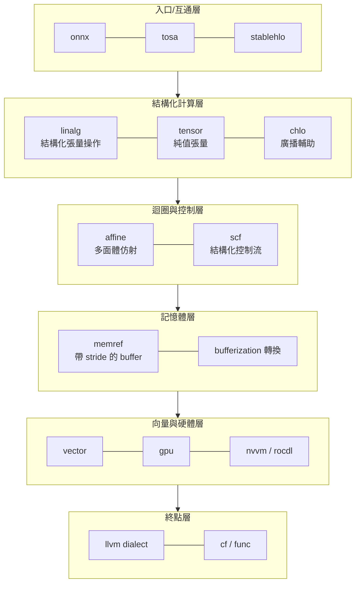

# 5.2 Dialect 生態系：從 linalg 與 stablehlo 到 memref 與 llvm

5.1 節給了 MLIR 的「語法地基」。本節走進它的「住戶」——dialect 生態。重點不是羅列方言，而是理解**方言之間的分工邏輯**：誰是入口、誰是樞紐、誰是終點，以及為什麼這個分層恰好對應 4.2.4 節的「決策—黃金高度」表。

## 5.2.1 方言的分層鳥瞰



一條通用的分層原則浮現：**越上層，值語意（value semantics）越重（tensor 是不可變的數學對象）；越下層，記憶體語意（buffer semantics）越重（memref 是可變的位址空間）。** 兩個世界的切換由 **bufferization**（5.3 節）完成——這是 MLIR 生態中最重要的單一降階之一。

## 5.2.2 入口層：stablehlo、tosa、onnx

**StableHLO**（Portable HLO，Google 2023 整理開源）是 XLA 的 HLO 圖方言的穩定化版本。它的定位：

* **框架圖的可遷移錨點**：JAX/TF/PyTorch(XLA) 都能落到 StableHLO，且**序列化有版本兼容承諾**——這是「計算圖的通用匯率」，解決各家框架圖私有不兼容的問題；
* 攜帶完整的張量語意：形狀、dtype、廣播規則、量化參數。

**TOSA**（Tensor Operator Set Architecture，Arm 主導）是另一個入口層方言，設計目標偏向**推理與嵌入式可移植性**，算子集刻意精簡且語意嚴格（明確的精度語意），被 Arm 的 ML 編譯棧與多家 NPU SDK 採用。

**ONNX** 不再贅述其定位（框架互換的既有標準），但它進 MLIR 生態時需要降階到 stablehlo/tosa/linalg——入口層方言之間的競合本質是**語意保真度 vs 生態覆蓋**的權衡。

入口層的黃金決策：**圖級優化**——常數摺疊、shape 推導、圖級融合候選、量化傳播。此時算子邊界與全局形狀資訊完整（4.2.4 節）。

## 5.2.3 結構化計算層：linalg 的設計哲學

`linalg` 是第二部最重要的方言，值得仔細解剖。它的核心是 **`linalg.generic`**：用一組 **indexing map**（仿射映射）描述「輸入/輸出張量的每個元素如何對應到迭代空間」：

```mlir
#map = affine_map<(i, j, k) -> (i, k)>        // A: MxK
#map1 = affine_map<(i, j, k) -> (k, j)>      // B: KxN
#map2 = affine_map<(i, j, k) -> (i, j)>      // C: MxN
%c = linalg.generic {
    indexing_maps = [#map, #map1, #map2],
    iterator_types = ["parallel", "parallel", "reduction"]
  } ins(%A, %B : tensor<4x8xf32>, tensor<8x4xf32>)
    outs(%C0 : tensor<4x4xf32>) {
  ^bb0(%a: f32, %b: f32, %c: f32):
    %m = arith.mulf %a, %b : f32
    %s = arith.addf %c, %m : f32
    linalg.yield %s : f32
} -> tensor<4x4xf32>
```

三個設計亮點：

**（1）iterators 把「這是 matmul」編碼成代數。** `parallel`/`reduction` 的組合 + indexing map 完全確定了這個操作的資料存取模式。矩陣乘、卷積、池化、attention 分數——全部可用同一形式表達。**語意從「命名的算子」升級為「代數結構」**，這使融合（把兩個 generic 拼成一個）、tile（對迭代空間分塊）、向量化（把迭代空間映射到 lane）變成**同一套機制的三種用法**。

**（2）region 承載逐元素函數。** 上面 `^bb0` 是逐點計算（乘加），它與存取模式**正交**——換成 exp 就變成 softmax 的一部分。這種「骨架/內容分離」使融合的分析與內容無關。

**（3）張量與 buffer 雙形態。** linalg 同時支援 `tensor`（值語意）與 `memref`（buffer 語意）操作數，讓「融合在 tensor 層做完，再 bufferize」的管線自然成立。

linalg 對 4.2 節問題的直接回應：**融合決策的黃金高度就在這裡**——indexing map 讓「兩個算子能不能融」變成 map 可組合性的代數判斷，而不是圖啟發式。

## 5.2.4 迴圈層：affine 與 scf 的分工

**`scf`**（Structured Control Flow）：`scf.for`、`scf.if`、`scf.while`——**有結構的控制流**（不像 `cf` 的任意 CFG）。它是「迴圈級決策」的通用載體：任意的 tiling、交換結果都可以落在 scf 形態。

**`affine`**：scf 的**受約束子集**——迴圈邊界與索引必須是迭代變數的仿射函數。約束換能力：

* **多面體分析可全域套用**：依賴分析、單射性判斷、依賴距離，全部可在 polyhedral 框架（整數集合/映射，isl 庫）中機械化求解（6.2 節展開）；
* **變換可組合且可驗證**：tiling/interchange/fusion 表示為迭代空間映射的組合，正確性由多面體理論保證。

「affine 是 scf 的受限子集」這個關係正是 1.3 節形式驗證精神的 IR 化：**你願意放棄多少表達力，換取多少機械可驗證的變換能力。** 張量編譯器的主幹路徑（矩陣乘、卷積）幾乎總是仿射的，所以 affine 能承載 DSA 編譯最關鍵的 tiling 決策；非仿射部分（資料依賴的控制流）退回 scf，接受較弱的分析。

## 5.2.5 記憶體層：memref 與 bufferization

**`memref`** 型別攜帶：形狀、元素型、**stride/offset**（布局！）、位址空間：

```mlir
memref<1024x1024xf32, strided<[1024, 1], offset: ?>> : memref<...>
memref<...x...xf32, 3>                          : memref<...>  // 3 = private address space（GPU shared memory）
```

4.1.2 節「布局溶解在 GEP 裡」的問題在此正面解決：**stride 是型別的一部分，隨值流動，pass 可推理**。位址空間（`3` = SMEM、`1` = global 等）讓「資料在哪級記憶體」成為型別語意——3.2.2 節的 UB/SMEM 決策有了落點。

**bufferization**（tensor → memref 的降階）是整個生態的**樞紐變換**，其本質是：**為值語意的張量分配 buffer 並決定 aliasing 與 in-place 重用**——正是 3.3.3 節「靜態記憶體規劃」的 IR 層實作。bufferization 的品質直接決定峰值記憶體與拷貝次數，因此它是一門仍在快速演進的技術（bufferization 框架的 alias analysis + 一組逐 op 的決策介面）。

## 5.2.6 硬體層：vector、gpu 與 llvm

**`vector`**：定寬（或 scalable）向量操作 + **豐富的 shuffle/reshape/reduction 操作**。它是「SIMD 決策」的黃金高度：把 n-D 迭代空間映射到向量形狀、處理 lane 間的 permute——CPU 的 AVX 與 GPU 的 warp 都從這裡接手。

**`gpu`**：`gpu.launch`（grid/block 維度）、`gpu.barrier`、shared memory 分配、GPU 模組的邊界。它是 2.3.5 節說的「在 PTX 之上的一層可操作 GPU 資源的 IR」。

**`nvvm`/`rocdl`**：直接包裝 NVIDIA/AMD 的 intrinsic（如 `mma`、`cp.async`），是 tensor core 映射的最後一個結構化落點。

**`llvm`**：MLIR 對 LLVM IR 的鏡像方言。`llvm` dialect 與 LLVM IR 之間是**機械轉換**（lossless），標誌著「張量世界與純量世界的交界」——此後就是 1.2 節的經典四重奏。

## 5.2.7 生態分工的統一圖景

把 4.2.4 的「決策—黃金高度」表與方言對齊，得到生態的完整邏輯：

| 黃金決策 | 責任方言 | 上一章的對應問題 |
|---------|---------|----------------|
| 圖融合候選、量化、shape 推導 | stablehlo / tosa | 3.3.1、4.2.3 |
| 融合的代數判定 | linalg | 3.3.1、4.2.3 |
| Tiling、迴圈變換 | affine（fallback: scf） | 3.2.2 |
| 布局與 stride | memref 型別 + linalg map | 3.3.2 |
| Buffer 分配與生命週期 | bufferization + memref | 3.3.3 |
| SIMD/SIMT 映射 | vector | 1.1.4、2.1 |
| GPU 資源與 kernel 邊界 | gpu + nvvm | 2.3 |
| 純量後端 | llvm dialect → LLVM | 1.2 |


---

**參考與延伸閱讀**

* StableHLO 規範（openxla/stablehlo）.
* TOSA 規範（Arm, mlplatform.org）.
* Vasilache et al. (2019). "Composable and Modular Code Generation in MLIR: A Structured and Retargetable Approach."（linalg 設計文檔）.
* MLIR Documentation: *Dialects* 各章.
* Zimmermann et al., bufferization 相關論述（MLIR bufferization 框架文檔）.
