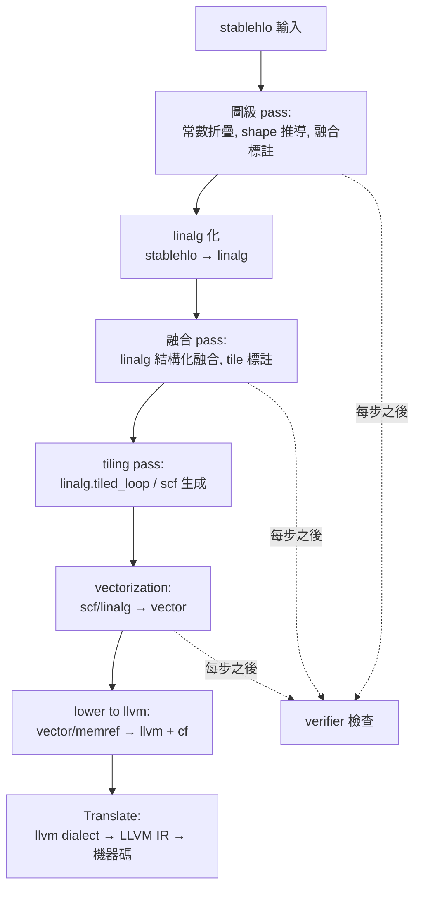
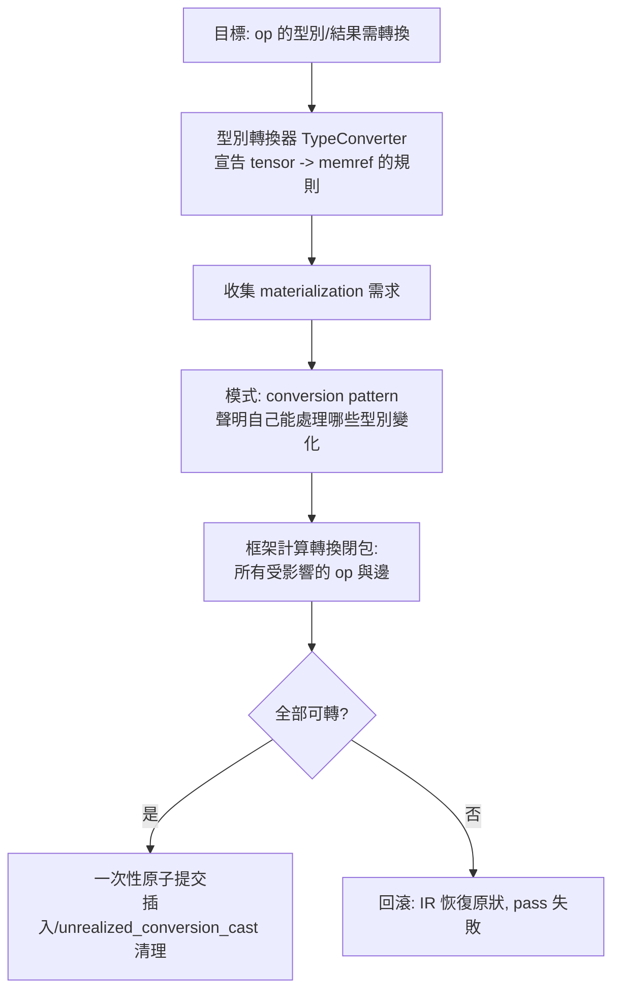
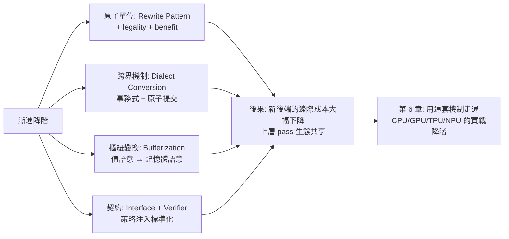

# 5.3 漸進式降階與 Dialect Conversion 的工程實作

方言生態解決了「語意放哪裡」，本節解決「語意怎麼搬家」——**漸進式降階（progressive lowering）**的工程機制：Dialect Conversion 框架、Rewrite Pattern、與下降的驗證閉環。這是 MLIR 從「好想法」變成「可維護的工業平台」的關鍵一環。

## 5.3.1 漸進降階的整體編排

一條真實的 CPU 編譯管線（IREE/Torch-MLIR 風格）示意：



三個工程特徵：

1. **每個箭頭是一個（或一組）獨立的 pass**，可單獨開關、單獨測試、單獨調參；
2. **中間形態可以 dump 出來**成為可讀的 MLIR 文本——除錯不是「對著彙編猜」，而是「逐層 diff」；
3. **每一層都有合法形態（legality）的概念**：linalg 有 indexing map 完整性、affine 有仿射性、vector 有形狀一致性。**不合法即 fail-fast**，而不是留給下游爆炸。

## 5.3.2 Rewrite Pattern：變換的原子單位

MLIR 的變換被分解為 **Rewrite Pattern**——「匹配一個 op 形態，替換為新 op 們」的規則：

```cpp
// 概念示意: 把 linalg.matmul 且 tile 尺寸為 8 的情況映射到 mma
struct MatmulToMma : public OpRewritePattern<linalg::MatmulOp> {
  LogicalResult matchAndRewrite(linalg::MatmulOp op,
                                PatternRewriter &rewriter) const {
    if (!isMmaCompatible(op)) return failure();
    // 用 mma 序列替換原 op
    ...
  }
};
```

**組織模式的是 Legalization 的兩個概念**：

* **Legality（合法性）**：某形態的 op 在目標方言中是否合法；
* **Benefit（收益）**：多個模式都能匹配時，誰優先（如「特化模式 > 通用模式」）。

pass 驅動 pattern 的方式是 **greedy rewriter**（貪心地反覆套用直到不動點）或 **conversion driver**（見下）。這個「小規則 + 收益排序 + 到不動點」的架構，把傳統編譯器「每個 pass 是一段流程式代碼」重構為**聲明式的規則系統**——新增一個後端指令映射，就是新增一組 pattern，不動主流程。

## 5.3.3 Dialect Conversion 框架：跨方言邊界的正確性機制

當一次降階要**跨越方言邊界**（如 linalg → vector，或 tensor → memref），挑戰是：**中間狀態的 IR 可能不合法**——部分 op 已轉換、部分還沒，型別不匹配、值的使用者尚未更新。

Dialect Conversion 框架的解法是**事務式轉換（transactional conversion）**：



核心機制：

* **TypeConverter**：宣告型別的降階規則（`tensor<...>` → 對應的 `memref<...>`），並處理「舊型別值在新代碼中如何出現」（materialization）；
* **`unrealized_conversion_cast`**：轉換過程中的臨時膠水 op，明確標記「這裡有一個尚未完成的型別橋接」——**轉換閉包完成後它們被消除；若消不掉，轉換宣告失敗**。這個設計把「轉換到一半」變成 IR 中可見、可推理的狀態，而不是隱式的爛尾樓；
* **原子性**：任何不完整的轉換都回滾，IR 永遠停在合法形態。

這套機制回應的是 4.3.5 節的批評「轉換組合爆炸」：框架用「樞紐型別 + 閉包計算 + 原子提交」把 $O(N^2)$ 的兩兩轉換需求，縮減為「每個方言 → 樞紐」的 $O(N)$ 型別規則 + 一組 conversion pattern。

## 5.3.4 Bufferization：值世界到記憶體世界的正規交接

5.2.5 節把 bufferization 稱為樞紐，這裡展開它的工程面貌。tensor 是不可變的：`%y = linalg.add %a, %b` 不改動 `%a`。但物理硬體上，`%a` 一定在某塊記憶體裡，add 要麼讀兩塊寫第三塊（out-of-place），要麼覆寫其一（in-place）。**bufferization 決策 = 給每個 tensor 值分配 buffer + 決定哪些 op 可以原地覆寫**：

* 依據是 **alias analysis**：這個 tensor 的 buffer 還有沒有其他使用者會讀舊值？沒有 → 可以 in-place；
* 目標是最小化拷貝與峰值記憶體（3.3.3 節的目標在此落地）；
* 失敗模式：錯誤的 in-place 判定 = 資料被覆寫的**正確性 bug**——這是 bufferization pass verifier 與差分測試（對照 out-of-place 執行）的重點防區。

## 5.3.5 目標無關與目標相關的分界：interface 的作用

管線中「哪一段是目標無關的」是工程維護的關鍵。MLIR 用介面把**策略注入點**標準化：

* `TilingInterface`：一個 op 說「我支援怎麼被 tile」，tiling pass 就能處理任何實作此介面的 op（不論是 linalg 還是自訂方言）；
* `VectorizationInterface`（及舊式的 pattern 注入）、`DestinationStyleOpInterface`（說明 op 是 in-place 語意還是函數式語意）；
* 後端選擇（CPU/GPU/NPU）作為**管線分支**發生在 linalg 層之後——上層的圖級與融合優化完全共享。

這樣的分工有一個務實的後果：**新增一個 NPU 後端 = 實作一組 target dialect + 這些介面的實作 + 若干 conversion pattern；上層的數十個 pass 免費獲得**。這是第 6 章所有實戰堆疊（XLA-MLIR、IREE、Torch-MLIR）能夠共享投資的機制基礎。

## 5.3.6 漸進降階的測試文化

MLIR 社群的測試風格值得單獨一提：**FileCheck 式的中間形態測試**。每個 pass 的測試是「輸入一段 IR + 斷言輸出 IR 的形態」：

```mlir
// RUN: mlir-opt %s -linalg-fuse-elementwise-ops | FileCheck %s
// CHECK: linalg.generic
// CHECK-SAME: indexing_maps = [{{.*}}, {{.*}}]
```

這種測試的意義超出工程習慣：

1. **中間形態本身成為規範**——「這個 pass 應該產出什麼」被精確描述；
2. **回歸即分層定位**——壞了就知道在哪一層的哪個 pattern；
3. **為第 7 章 LLM 參與做鋪墊**——生成式變更（LLM 寫的 pattern/pass）同樣落在這套檢查網內，機率性輸出遇到的是**確定性的形態斷言**。

## 5.3.7 小結



---

**參考與延伸閱讀**

* MLIR Documentation: *Dialect Conversion*, *Pattern Rewriter*, *Bufferization*.
* Lattner et al. (2021). "MLIR." *CGO*（conversion 機制的原始論述）.
* FileCheck 與 mlir-opt 的測試基礎設施文檔.
* River707（River Riddle）, "MLIR Dialect Conversion Framework" 設計演講（LLVM/MLIR meeting）.
