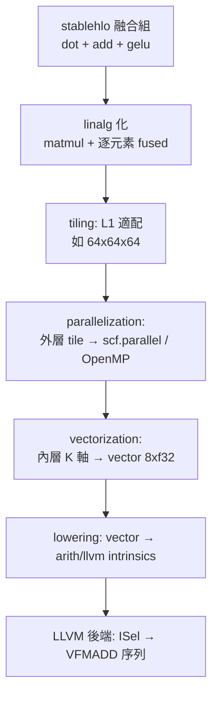
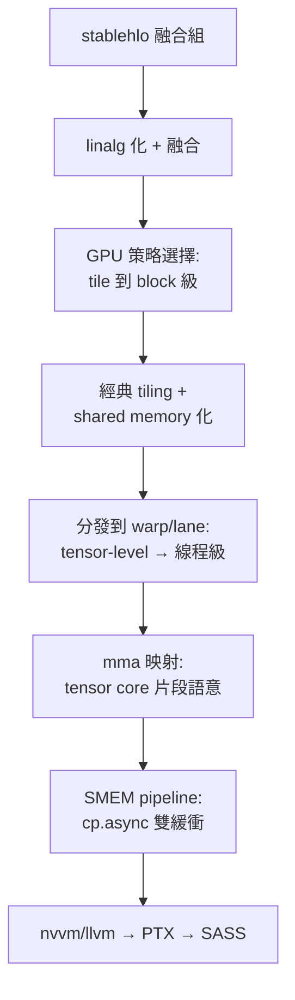
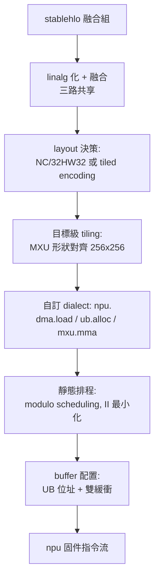

# 6.1 同一份計算圖的三條降階路：CPU、GPU 與 NPU 後端

第二部的高潮：把前五章的工具拼起來，追蹤**同一份張量計算**（我們選一個帶 bias 與 GELU 的矩陣乘法，即 transformer 的 FFN 核心）分別降階到 CPU、GPU 與 NPU 的完整旅程。本節展示「多層 IR + 漸進降階」如何讓一個決策鏈在三種硬體上走出三條路，而三條路共享上層的一切投資。

## 6.1.1 出發點：一份 StableHLO 計算

輸入（概念形態）：

```mlir
%h = stablehlo.dot_general %x, %w           // [M,K] x [K,N]
%b = stablehlo.broadcast_in_dim %bias       // [N] -> [M,N]
%s = stablehlo.add %h, %b
%y = stablehlo.custom_call @gelu %s         // 逐元素
```

第 0 步（入口層，三條路共享）：shape 推導、常數摺疊、廣播規格化、融合標註。到此為止，**沒有任何硬體知識被使用**——這是入口層的定義（5.2.2 節）。

## 6.1.2 路線 A：CPU 後端（AVX/NEON + vector）



各步的決策內容與來源章節：

* **tiling（64×64×64）**：由快取幾何決定（1.1.3 節）：L1/L2 容量 + 行主序 stride。在 MLIR 中以 `linalg.tile` 或 tensor-level tiling pass 完成，**tile 大小可以由 auto-tuner 決定**（6.3 節）；
* **並行化**：外層 $M$ 維 tile 交給 OpenMP 線程（多核供給，1.1.1 節）；
* **向量化**：把內層歸約映射為 `vector<8xf32>`，歸約用 shuffle/橫向加法。此時 1.1.4 節的證明義務（迭代獨立、對齊）已被 linalg 的語意結構**免去**——`reduction` iterator 語意上就允許拆分歸約軸（在浮點授權下）；
* **末端**：VFMADD 指令選擇由 LLVM ISel 完成（1.2.2 節）——**純量世界的最後一公里交還給 LLVM**。

CPU 路線的特徵：**決策鏈短、依賴的分析全在 IR 內**（快取參數可作為 pass 參數注入）。這是三條路中最接近傳統編譯器的。

## 6.1.3 路線 B：GPU 後端（gpu + nvvm → PTX）



GPU 路線多了三個 CPU 沒有的層級決策，每一個都對應第二/三章的概念：

1. **block 級 tiling + SMEM 化**：把 $C$ 的 tile 放進 block， $A$ 、 $B$ 的 tile 經 shared memory 重用（2.2.2 節）。`memref` 的**位址空間屬性**在此切換：global → workgroup shared；
2. **執行緒級分發**：把 block 的 tile 切給 warp/lane——**這是 Triton 的 layout pass 做的事**（2.3.3 節），在 MLIR 棧裡對應 vector-level 的「distribute to threads」變換。`vector` 方言的 lane 語意 + `gpu` 方言的執行緒索引，共同承載這個映射；
3. **mma 與 pipeline**：K 軸內層映射到 `nvvm.mma.sync`（warp 級片段），載入映射到 `cp.async` 並組成雙緩衝（2.3.1、3.2.3 節）。Hopper 上進一步映射到 `wgmma`（warp-group 級）。

GPU 路線的特徵：**決策鏈深、且有多個「資源預算」交錯**（暫存器 vs SMEM vs occupancy，2.2.3 節）。因此 GPU 策略幾乎總是**參數化 + auto-tuned** 的，而不是單一靜態決策。

## 6.1.4 路線 C：NPU/TPU 後端（自訂方言 → 靜態資料流）

第三條路最能檢驗 MLIR 的可擴展性主張：**用自訂方言表達一個 MLIR 生態沒有的硬體模型**。



關鍵步驟的解說：

* **layout/encoding**：用自訂型別屬性標記「這個 tensor 以 MXU 對齊的 tile 編碼」（類似 IREE 的 encoding 機制）——5.2.5 節的「布局即型別」的目標特化版；
* **自訂 dialect `npu`**：以 5.1 的機制（op + region + interface）定義 `npu.dma_load`、`npu.ub_alloc`、`npu.mxu_mma` 等操作。**MLIR 的承諾在此兌現：定義新硬體語意不需要改核心 IR**；
* **靜態排程與 buffer 配置**：3.2 節的 modulo scheduling 與 3.3.3 節的生命週期著色，在 `npu` 方言的 op 圖上執行。因為延遲確定，排程結果可以用**模擬器逐拍驗證**（資源不超賣、依賴不違反）；
* **產出**：不是 PTX，是 NPU 固件指令流（各家格式不同，很多是私有的位元組碼）。

## 6.1.5 三條路的對照：共享什麼、分歧什麼

| 階段 | CPU | GPU | NPU |
|------|-----|-----|-----|
| 入口層優化 | 共享 | 共享 | 共享 |
| linalg 化與融合 | 共享 | 共享 | 共享 |
| Tiling 依據 | 快取幾何 | SMEM/暫存器預算 | UB 容量 + MXU 形狀 |
| 並行映射 | OpenMP 線程 | grid/block/warp/lane | 靜態資料流（無執行緒概念） |
| 記憶體語意 | 快取（透明） | 位址空間切換 | 顯式 DMA + UB |
| 排程 | LLVM 後端 | warp 硬體 + pipeline | 編譯器 modulo scheduling |
| 驗證形態 | 差分測試 | 差分 + profile | 模擬器逐拍驗證 + 差分 |

**共享的部分**（入口層 + linalg 化 + 融合）恰好是 4.2.4 節「黃金高度在硬體中立層」的決策；**分歧的部分**恰好是需要硬體模型注入的層。這張表就是全書第一部到第二部的主論證的收官：

> **多層 IR 的價值不是「更酷的 IR」，而是精確地把「共享的決策」與「分歧的決策」切開，讓前者只做一次。**

## 6.1.6 一條實務鐵律：決策的不可逆性管理

三條路走通之後，實務上最大的坑是**決策過早固化**。例如：在入口層就把 layout 選成 NHWC（為 GPU 好處），結果 NPU 路線被迫全圖轉換（3.3.2 節的傳播問題）。對策是把「決策的可逆視窗」管理起來：

* **延後綁定**：layout 以 encoding 屬性攜帶，具體形態由各路線在 linalg→目標層的邊界才選；
* **決策參數化**：tile/組態一律作為 pass 參數，交給 tuner 或上層策略；
* **每步可回滾**：5.3.3 節的事務式轉換保證轉換失敗不留殘骸。

---

**參考與延伸閱讀**

* OpenXLA / IREE 文檔：CPU 與 GPU lowering 流程圖.
* IREE 論文與部落格：encoding 與 dispatch 策略.
* Torch-MLIR: from PyTorch to linalg 的 lowering 文檔.
* Feng et al. (2023). "TensorIR." *ASPLOS*（TensorIR 在類似分層中的定位對照）.
