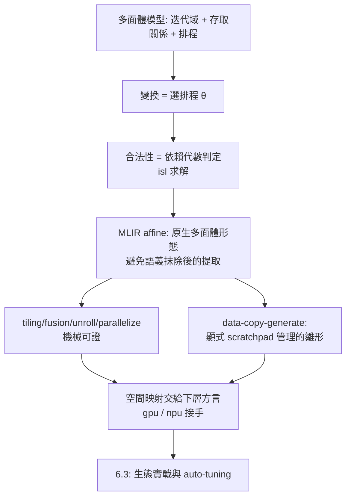

# 6.2 Polyhedral Model 與 Loop Transformation 在 MLIR 中的落地

6.1 節的三條路裡，「tiling」「交換」「融合」反覆出現——它們背後的統一數學就是**多面體模型**（Polyhedral Model）。本節先給出它的代數骨架，再看 MLIR 的 `affine` 方言如何把它工程化，最後誠實討論它的邊界。

## 6.2.1 多面體模型：迴圈嵌套的代數化

### 核心對象

多面體模型把（仿射）迴圈嵌套中的每個語句實例，當成**迭代空間中的一個整數點**：

* **迭代域**（iteration domain）：語句 $S$ 的實例集合，由仿射不等式定義：

$$D_S = \{ \mathbf{i} \in \mathbb{Z}^n \mid A\mathbf{i} + \mathbf{b} \ge 0 \}$$

例如 `for (i=0; i<N; i++) for (j=i; j<N; j++) S(i,j);` 的域是 $\{(i,j) : 0 \le i \le N-1,\ i \le j \le N-1\}$ 。

* **存取關係**（access relation）：實例 $\mathbf{i}$ 讀/寫哪些陣列元素：

$$R_S(\mathbf{i}) = \text{base} + M_S \mathbf{i} + \mathbf{c}_S$$

矩陣 $M_S$ 就是**索引函數**——MLIR 的 `indexing_maps` 正是它的方言化形態（5.2.3 節）。

* **排程**（schedule）：變換本身！一個仿射映射 $\theta_S: \text{迭代域} \to \text{新的執行時間軸}$ 。

### 變換 = 選排程

這是整個理論最優雅的一步：**所有經典迴圈變換統一為「選不同的 $\theta$ 」**：

| 變換 | $\theta$ 的形態 |
|------|----------------|
| 循環交換 | 交換 $\theta$ 的分量順序 |
| Tiling | $\theta(\mathbf{i}) = (\lfloor i/c \rfloor,\ i \bmod c,\ \ldots)$ 的分塊重寫 |
| Skewing（波前並行化） | $\theta = (i,\ j + s\,i)$ |
| Fusion/Fission | 多個語句的 $\theta$ 合併/錯開 |

**依賴分析也代數化**：語句 $S_1$ 的寫與 $S_2$ 的讀之間的依賴，是兩個存取關係的交集（整數線性規劃問題，用 Presburger 集合運算求解）。依賴存在則要求：

$$\theta_{S_2}(\mathbf{i}_2) > \theta_{S_1}(\mathbf{i}_1) \quad \forall \text{依賴 } (\mathbf{i}_1 \to \mathbf{i}_2)$$

**變換的合法性 = 排程不違反任何依賴**。這樣，「這個變換安不安全」從啟發式問題變成**整數集合上的機械判定問題**。

### 求解引擎：isl

實務上這些集合運算由 **isl**（Integer Set Library，Verdoolaege）承擔：Presburger 集合的交/并/投影、整數規劃、排程優化（Pluto 演算法的變體：最小化依賴向量在新時間軸上的分量，即「把最長依賴壓平」以最大化並行性與局部性）。

## 6.2.2 MLIR affine 方言：多面體的方言化

`affine` 方言把上述對象直接語法化：

```mlir
#map = affine_map<(d0) -> (d0 mod 4)>             // 仿射索引函數
#set = affine_set<(d0) : (d0 >= 0, d0 < 1024)>    // 迭代域約束
affine.for %i = 0 to 1024 step 4 {                // 仿射迴圈
  affine.for %j = 0 to 1024 step 4 {
    // tile 頭
    affine.for %ii = 0 to 4 {
      affine.for %jj = 0 to 4 {
        %v = affine.load %A[%i + %ii, %j + %jj] : memref<1024x1024xf32>
        // ...
      }
    }
  }
}
```

與研究性 polyhedral 編譯器（Polly、PPCG）的關鍵差異：

| | Polly（LLVM 外掛） | MLIR affine |
|---|---|---|
| 語意來源 | 從 LLVM IR **啟發式提取**多面體模型 | 語言**原生**就是多面體形態 |
| 提取失敗 | 模型破碎，變換無從施展 | 不存在提取問題 |
| 變換表達 | 內部 AST 重寫 | IR 級變換 + verifier |
| 目標 | CPU（+CUDA 代碼生成） | 多目標（含 DSA 與硬體層） |

**「原生 vs 提取」就是 4.2 節語義抹除問題的直接對策**：与其在低階 IR 上辛苦重建多面體模型（且常失敗），不如讓迴圈在 IR 中保持仿射形態直到變換完成。`affine` → `scf` 的降階是**單向的**：一旦放棄仿射性，多面體能力就永久關閉——這是「黃金高度」原則的又一例。

### affine 提供的變換 pass

* `affine-loop-fusion`：依賴安全的融合（多面體判斷 + 記憶體重用收益）；
* `affine-loop-unroll` / `affine-loop-unroll-jam`；
* `affine-loop-tiling` / `affine-parallelize`（tile 外層轉並行域）；
* `affine-data-copy-generate`：**自動插入顯式 copy**（快取式：在 tile 邊界插 `memref` 拷貝）——這個 pass 正是 DSA「顯式 scratchpad 管理」的雛形：同一機制，CPU 上生成軟體預取友好的 copy，NPU 上生成 DMA 序列。

## 6.2.3 一個完整例子：matmul 的多面體旅程

把 6.1.1 的 GEMM 走一遍多面體變換（CPU 路線）：

```
原始: for i for j for k: C[i][j] += A[i][k] * B[k][j]
  ↓ tiling (128) + parallelize(i-tile) + vectorize(k, 8)
for it (parallel):  for jt:
  for kt:  for i in tile  for j in tile  for kk in tile step 8:
             C[it:i][jt:j] += A[...][kt:kk+8] · B[kt:kk+8][jt:j]   (向量)
```

在 MLIR 中的形態流：`linalg.matmul → affine (或 scf) 嵌套 → vector`。每一步變換的**合法性由依賴關係保證**：歸約軸的依賴（ $C[i][j]$ 對自身）在 reduction iterator 語意下允許樹狀重結合（浮點需授權），空間軸無依賴——所以 tiling/parallelize/vectorize 全部機械可證。

## 6.2.4 多面體的邊界：它不適合什麼

誠實的工程判斷需要知道模型的失效區：

1. **非仿射控制流**：資料依賴的迴圈邊界（如 `while (a[i] > 0)`）、間接索引（`A[P[i]]`， $P$ 非仿射）——多面體模型直接失效，需退回 scf + 傳統分析；
2. **稀疏計算**：稀疏張量的索引模式非仿射。MLIR 的 `sparse_tensor` 方言用**另一條路**（存取模式的形式化規格 + 迭代器自動生成）而非多面體；
3. **組合空間的搜尋成本**：多面體排程優化（Pluto 式）在深嵌套 + 多語句時會組合爆炸，實務用啟發式截斷——這是 Ansor 類 auto-tuning 的市場（6.3 節）；
4. **與硬體資源的鴻溝**：多面體管的是「迭代怎麼排」，不管「排好的迭代怎麼映射到 MXU/tensor core 的資源」——空間映射（把迭代維度映射到 PE 陣列）需要**目標資訊**，在 MLIR 中由下層方言（gpu/npu）接手。3.1.5 節的「三種硬體是同一數學的投影」在此有了精確表述：**多面體負責時間軸與域的變換，空間映射是各後端方言的職責。**

## 6.2.5 小結



---

**參考與延伸閱讀**

* Feautrier (1992). "Some Efficient Solutions to the Affine Scheduling Problem." *IJPP*.
* Bondhugula et al. (2008). "A Practical Automatic Polyhedral Parallelizer and Locality Optimizer." *PLDI*（Pluto）.
* Verdoolaege. *isl: Integer Set Library* 手冊.
* Grosser et al., Polly 論文系列.
* MLIR affine 方言文檔與 transformation pass 列表.
