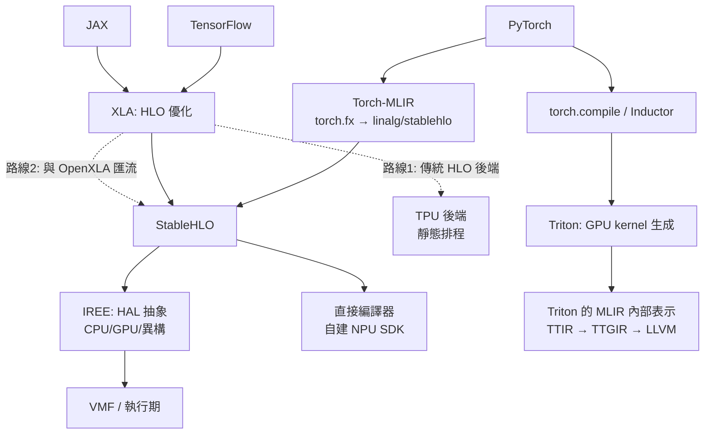
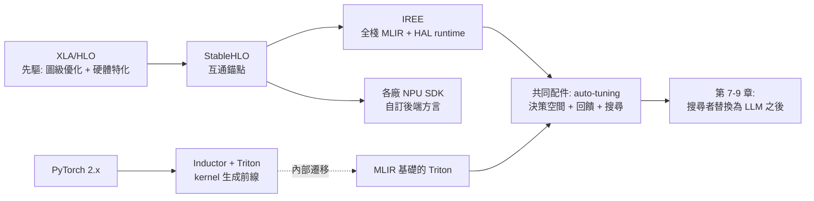

# 6.3 XLA、IREE 與 Triton 生態中的 MLIR 角色定位

第二部收尾：把鏡頭拉回工業生態，看三個代表性堆疊——XLA（Google）、IREE（OpenXLA）、Triton/Inductor（PyTorch）——**各自在多層 IR 光譜上的定位**，以及 auto-tuning 如何成為生態的通用配件。本節同時是第 7–9 章（LLM 參與編譯）的地形圖：LLM 將來要插入的位置，就是這些堆疊的接縫。

## 6.3.1 生態全景圖

三個堆疊回答三個不同的問題：**XLA 問「如何為特定硬體把 HLO 做到極致」；IREE 問「如何用一套編譯器服務異構部署」；Triton 問「如何讓 GPU kernel 生成可編程化」。** MLIR 在三者中扮演的角色深淺不一，正好構成光譜。

## 6.3.2 XLA：張量編譯器的先驅與它的 HLO

XLA（Accelerated Linear Algebra，2017 開源）早於 MLIR，它的中間表示 **HLO**（High-Level Optimizer IR）是張量圖優化的先驅：operator fusion、shape 推導、layout 選擇、以及針對 TPU 的深度客製。

XLA 的歷史地位與張力：

* **先驅**：HLO 證明了「張量圖級全域優化 + 硬體特化後端」的價值，TPU 的效能很大程度是 XLA 排程的功勞（3.2 節的靜態排程在 XLA 中實現）；
* **張力**：HLO 是**單層 IR**——它同時承載圖級語意與（內部的）排程決策，隨著硬體目標增多（TPU、GPU、CPU），HLO 內部的層級壓力增大；
* **演化**：HLO 的穩定子集被整理為 **StableHLO**（5.2.2 節），成為 OpenXLA 生態的互通錨點。Google 內部也在以 MLIR 重構部分後端（如對新硬體的 lowering）。

XLA 的故事說明：**第一代張量編譯器證明了需求，第二代（MLIR 系）提供了分層的工程載體。**

## 6.3.3 IREE：以 MLIR 為地基的異構部署編譯器

IREE（Intermediate Representation Execution Environment，OpenXLA 項目）是「原生 MLIR 堆疊」的代表。它的架構主張：

* **全程 MLIR**：從入口（stablehlo/torch-onnx）到 `flow`（圖級分派）、`stream`（非同步資料流）、`hal`（硬體抽象層）方言，再到各後端（`llvm-cpu`、`vulkan-spirv`、`cuda`、`rocm`、以及廠商的 `ukernel` 路徑）；
* **HAL（Hardware Abstraction Layer）執行期**：把「命令 buffer、非同步分派、記憶體分配」抽象為執行期介面，編譯器產出 HAL 執行檔——**編譯器與 runtime 的分界被形式化**，這是 10.3 節「編譯器與 runtime 共管記憶體」的先行實作；
* **_dispatch 粒度決策**：IREE 的獨特層是決定「計算圖切成幾個 dispatch、資料流之間如何非同步重疊」——本質上是 3.2 節靜態排程思想在異構系統級的推廣。

IREE 的意義在於展示**端到端的 MLIR 原生堆疊**可以同時覆蓋手機 CPU、桌面 GPU 與加速器，且上層優化（融合、tiling）全棧共享——6.1.5 節對照表的工業實證。

## 6.3.4 Triton 與 Inductor：kernel 生成的前線

2.3.3 節已解剖 Triton 的編譯器。這裡強調它在生態中的**位置與互動**：

* **PyTorch 2.0 的 `torch.compile`**：Dynamo 捕獲圖 → Inductor 生成代碼。GPU 路徑直接生成 **Triton**（融合 kernel），CPU 路徑生成 C++/OpenMP。Inductor 的 fusion 策略（水平融合 + 逐模式匹配）比 XLA 粗，但**編譯快、部署簡單**——工程取捨的典型案例；
* **Triton 內部的 MLIR 化**：OpenAI Triton 從 2023 年起將內部 IR 遷移到 MLIR 基礎（TTIR → TTGIR → LLVM），獲得 MLIR 的 verifier、pattern 基礎設施與 layout pass 的可維護性。**「DSL 自建 IR → 遷移到 MLIR」成為新 DSL 的標準路徑**（ Mojo、Flax 的實驗編譯器等都有類似軌跡）；
* **生態斷層的彌補**：Inductor/Triton 的 tile 參數由 autotune 實測搜尋決定——這是 auto-tuning 作為「決策空間的通用求解器」的時代。

## 6.3.5 Auto-tuning：決策空間的通用求解器

三個堆疊都遇到同一個問題：**tiling/layout/排程的決策空間太大，啟發式覆蓋不全**。通用解法是把決策外置為搜尋：

| 系統 | 搜尋對象 | 搜尋策略 |
|------|---------|---------|
| TVM Ansor | sketch（骨架）+ 參數 | 進化搜尋 + cost model |
| Triton autotune | BLOCK/num_warps/num_stages | 窮舉/剪枝實測 |
| IREE dispatch 策略 | 分派粒度與 tile | 啟發式 + 基準庫 |
| XLA (TPU) | 融合與 layout | 領域啟發式（模型知道 MXU） |

**搜尋的共同結構**是「決策空間的**代數化描述** + 執行回饋（latency）+ 適應度導向的搜尋」。這個結構有一個深遠的推論：**搜尋者的身分是可替換的**——從窮舉器到 cost model 到（第 8 章）LLM。MLIR 的分層使決策空間被顯式參數化，正是替換的工程前提。

## 6.3.6 生態的未竟之地

誠實標註三個生態缺口，它們構成後續章節的動機：

1. **NPU 的碎片化**：各廠商自建私有編譯棧，stablehlo 入口漸趨統一，但**後端方言與執行期仍各自為政**（5.3.5 節的機制提供了整合路徑，實務整合仍艱難）；
2. **動態形狀與編譯時間**：形狀 bucket 的靜態編譯在 LLM 服務（batching、多長度）下放大編譯時間與記憶體占用，動態形狀的 DSA 編譯仍是開放問題（3.2.2 節）；
3. **決策知識的沉澱**：tiling/layout 的好決策散落在 tuner 資料與工程師經驗中，缺乏可複用的知識表示——**這正是 LLM 進場的經濟動機**（第 7 章）：把「決策經驗」從工程師的腦內與 tuner 的日誌中，變成可生成的候選與可驗證的變換。

## 6.3.7 小結

第二部至此完成。工具鏈已就位：多層 IR 表達決策高度、pattern 與 conversion 實現降階、affine 承載迴圈數學、auto-tuning 求解決策空間。第三部把最後一塊拼圖放進來：**當決策的提出者從搜尋器變成語言模型，這座工廠的每一道閘門會怎樣重排？**

---

**參考與延伸閱讀**

* OpenXLA 項目文檔（stablehlo, iree, xla）.
* "XLA Layout 与融合" 相關技術部落格與 Jouppi et al. TPU 系列論文.
* Vaswani et al.（PyTorch 2.0 論文）(2023). *"torch.compile"：Dynamo 與 Inductor.*
* Zheng et al. (2020). "Ansor." *OSDI*；Feng et al. (2022). "TensorIR." *ASPLOS*.
