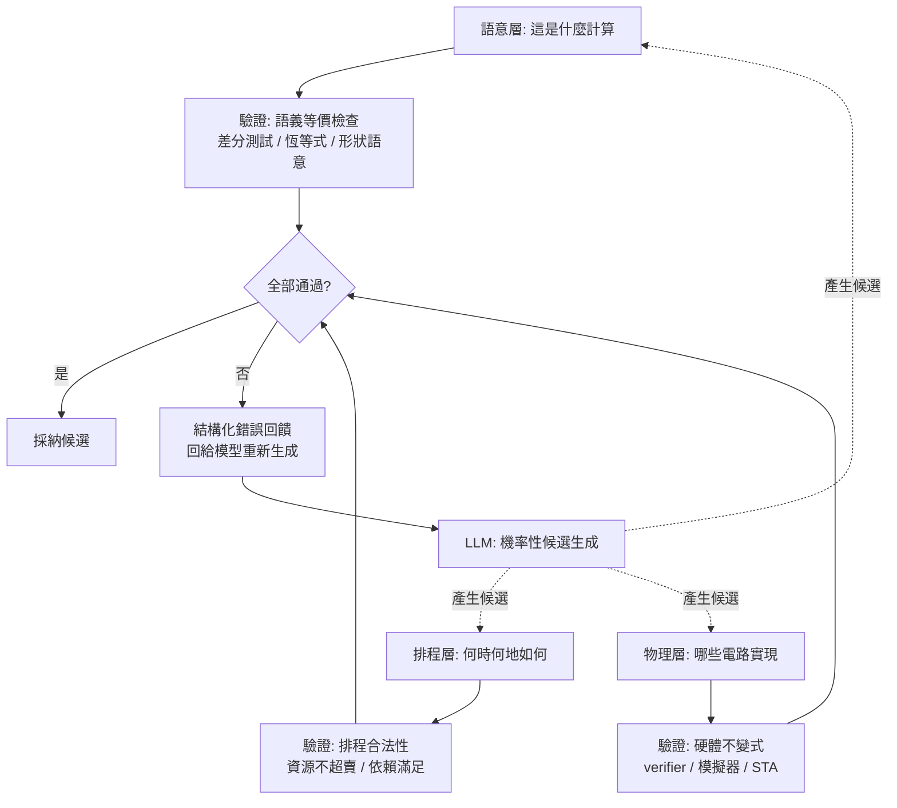

# 7.1 當模型參與編譯：從確定性語義到機率性候選生成

第三部開場。前六章建立了一座編譯器工廠：多層 IR 表達決策高度、pattern 實現降階、verifier 把守每層邊界、auto-tuning 搜尋決策空間。這座工廠的每一個環節都建立在**確定性**之上——同一輸入永遠產生同一輸出。2023 年之後，工廠大門走進了一個新的工人：**語言模型，它的每一步輸出都是機率性的**。本節解剖這個根本張力。

## 7.1.1 確定性契約：傳統編譯器的隱形公理

回顧 0.1.2 節的翻譯契約，傳統編譯器對它的履行方式有一個從未被明說、卻無所不在的前提：

> **編譯器的每一個 pass 是全純函數： $f(\text{IR}) = \text{IR}'$ ，且 $f$ 的正確性被一次證明/測試後，對所有未來輸入永久成立。**

這個「一次驗證、永久有效」的性質來自：

1. **規則是寫死的**：pattern、pass、轉換規則都是人類審查過的代碼；
2. **執行是機械的**：同樣的規則套同樣的輸入必然同樣的輸出；
3. **回歸測試有意義**：bug 修了就不會再出現（除非代碼又改）。

整個 1.3 節的驗證體系——CompCert 的證明、Csmith 的差分測試、MLIR 的 verifier——都建立在這個公理上。**測試的價值來自「今天測過的東西明天仍然一樣」。**

## 7.1.2 機率性生成的語意：LLM 是什麼樣的「函數」

語言模型的輸出過程是：

$$P(\text{token}_{i+1} \mid \text{prompt}, \text{token}_1 \ldots \text{token}_i)$$

取樣（sampling）使同一 prompt 可以產生不同輸出。這帶來與 7.1.1 每一條都相反的性質：

| 維度 | 確定性編譯器 | LLM 參與的編譯 |
|------|-------------|---------------|
| 輸出性質 | 純函數，可重現 | 分佈抽樣，同輸入異輸出 |
| 正確性語意 | 規則級證明/測試 | **只能逐個輸出驗證** |
| 回歸測試 | 一次修復永久有效 | 模型更新後行為漂移 |
| 錯誤模式 | 邏輯 bug，可定位 | 幻覺/細節錯誤，位置不定 |
| 覆蓋宣稱 | 「規則對所有輸入正確」 | 「這次輸出剛好正確」 |

第三行最容易被低估：**模型不是靜態工具，它隨版本更新而改變行為**。你的編譯器工廠今天檢驗通過的 LLM 生成 pattern，三個月後模型升級，同樣的 prompt 產出 subtly 不同的代碼——**回歸測試的「不變性」基礎消失了**。

但硬幣的另一面：機率性生成擁有確定性工具沒有的能力——**在開放的、無法窮舉的候選空間中探索**。6.3.5 節的 auto-tuning 只能在顯式參數化的空間裡搜（BLOCK 大小、tile 形狀）；LLM 能提出**結構級的新候選**（一種新的融合切法、一種新的 swizzle 方案）——這個空間傳統上只有人類工程師能進入。

## 7.1.3 張力的本質：生成器與驗證器的對稱互補

把兩者放進 0.1.2 節的三層框架，張力的結構就清晰了：

關鍵洞察：**張力不是「LLM 不能用」，而是「LLM 的角色必須重新定義」**：

* **LLM 不是編譯器，是候選生成器**（proposal generator）——它擴大搜尋空間；
* **正確性的載體不是模型，是驗證器**——1.3 節的全部武器（形式檢查、差分、verifier）在此成為信任鏈的實體；
* **模型的品質問題被轉化為「候選通過率」問題**——可以度量、可以迭代、可以回饋。

這個重新定義有一個優雅的名字：**生成-驗證鴻溝的管理**（generation-verification gap）。模型生成一個看起來正確的 kernel 可能只要幾秒；驗證它（跑差分、測效能、檢查資源）可能要幾分鐘。**體系的吞吐量瓶頸在驗證端**，所以第三部的工程問題全部圍繞「如何讓驗證又快又硬」與「如何讓生成一次就對」展開。

## 7.1.4 「看似正確」的三種危險形態

機率性輸出的錯誤不是均勻分佈的，有三種特別危險的形態：

**（1）表面正確、語意偏移。** 生成的 matmul kernel 在測試形狀（如 128×128）上數值完全正確，但對非對齊形狀（127×129）存在越界或錯誤歸約。測試集的形狀偏斜讓 bug 逃逸——**差分測試的輸入多樣性成為生死線**（1.3.3 節 YARPGen 教訓的再現）。

**（2）潛伏的不變式違反。** 生成的 MLIR pass 在常規輸入上正常，但遇到極端 IR（空 region、無前驅 block、無窮迴圈標註）時產生非法 IR。1.2.1 節的支配關係、9.1 節的全域不變式都是這類雷區——**verifier 的完備性決定這些雷會不會炸**。

**（3）效能回歸的隱蔽性。** 生成的代碼正確但效能差 30%（例如破壞了合併存取）。正確性測試抓不到它，**效能驗證（baseline 對比 + 顯著性判定）必須成為一等公民**——這在傳統編譯器 CI 中只是附屬品，在 LLM 工作流中是必需品。

三種形態的共同點：**它們都在「正常路徑」上看不出來**。這正是機率性生成的特有風險畫像：錯誤藏在分佈的尾部，而尾部只有靠**多樣性輸入 + 完備不變式 + 效能閘門**才能覆蓋。

## 7.1.5 張力的工程答案：縮小信任半徑

本節的核心結論，也是第 8、9 章的組織原則：

> **機率性生成不可怕；可怕的是讓機率性輸出跨越過大的信任半徑。** 對策是「小步生成 + 每步硬驗證」：每一次生成只承擔一個可獨立驗證的決策（一個 pattern、一個 kernel、一個測試程式），驗證器守住語意層、排程層、物理層各自的不變式，人類只在「證明鏈完整」的結果上簽名。

把信任半徑的框架與本書既有概念對齊：

* **MLIR 的分層**（4.3 節）＝天然的信任半徑劃分器：每層邊界即驗證點；
* **差分測試**（1.3.3 節）＝對「無 oracle 生成」的普適驗證器；
* **效能回饋**（2.3.4 節）＝對「候選品質」的適應度函數；
* **全域不變式**（第 9 章）＝不能委託給生成者的硬邊界清單。

---

**參考與延伸閱讀**

* Cummins et al. (2023). "Large Language Models for Compiler Optimization."（Meta，LLM 生成 pass 的先驅工作）
* Cummins et al. (2024). "Meta Large Language Model Compiler."
* Ji et al. (2023). "Survey of Hallucination in Natural Language Generation." *ACM Computing Surveys*.
* Chen et al. (2023). "Teaching Large Language Models an Intermediate Language Accelerates Program Synthesis."（IR 中介降低生成難度）
