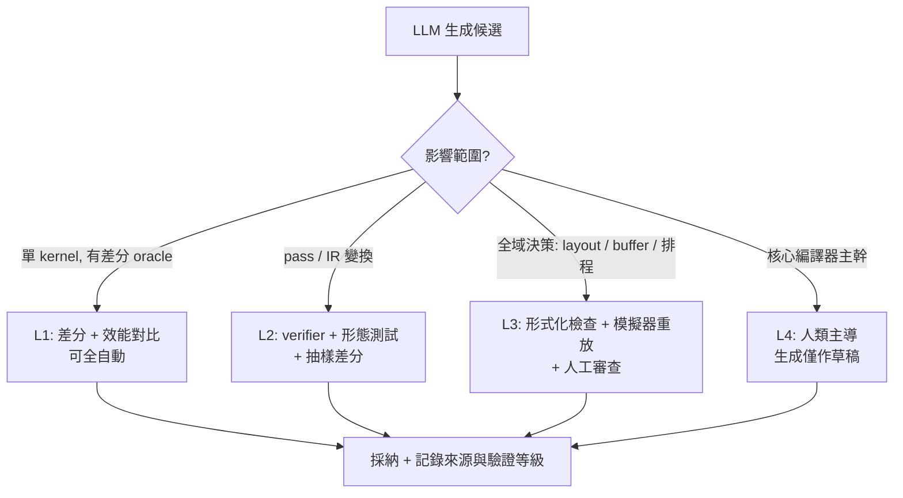
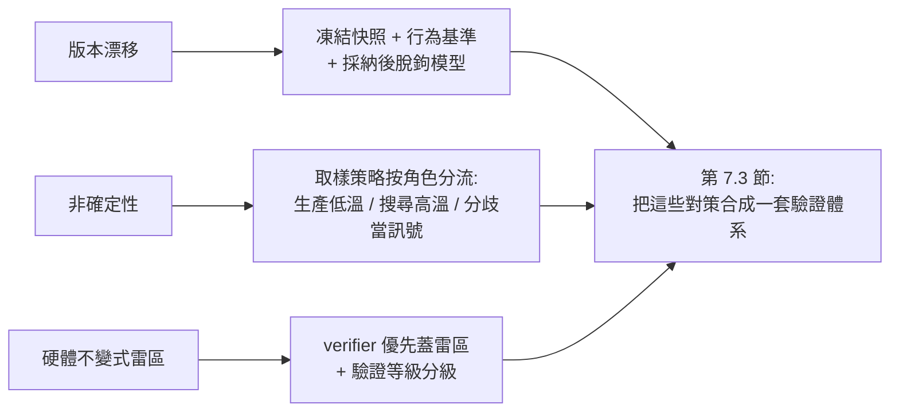

# 7.2 版本漂移與非確定性輸出：看似正確卻違反不變式的風險

7.1 節給了「生成-驗證」的框架。本節深入兩個最棘手的工程現實：**模型版本漂移**（同一系統的行為隨時間改變）與**非確定性輸出**（同一 prompt 的行為隨取樣改變），以及它們如何與「硬體不變式」發生碰撞。

## 7.2.1 版本漂移：基礎設施視角的「移動地基」

### 漂移的三個層次

**層次一：模型權重更新。** 供應商推送新版本（GPT-x → GPT-x+1、開源模型 fine-tune 迭代），生成分佈整體移動。具體到編譯器工坊的後果：

* 同一 prompt 的輸出風格、API 使用、慣用法改變；
* **此前通過審查的模式可能不再出現**，新的危險模式可能出現；
* 為舊版本調好的 prompt（few-shot、格式約束）可能失效甚至反效果。

**層次二：隱式版本行為。** 即使宣稱「同一版本」，供應商可能更新溫度預設、系統提示、安全過濾器——輸出分佈仍會漂移。**無法假設「版本不變 = 行為不變」**，這是與傳統依賴管理（semver）的根本差異。

**層次三：自建模型的演化。** 團隊若用自家微調模型（在專案代碼上訓練），每輪再訓練都改變行為——**你的「編譯器組件」每月都在靜默重寫**。

### 漂移的工程對策

把漂移從「意外」變成「受管理的常態」：

1. **凍結與可重現**：生產管線綁定具體模型快照（權重雜湊、推理參數、種子），如同綁定編譯器版本；
2. **行為基準（behavioral benchmark）**：維護一組代表性任務 + 期望輸出性質，每次模型更新跑一遍，量化分佈移動；
3. **審查與生成解耦**：模型生成的代碼**一旦通過驗證併入主線，其正確性歸屬於驗證與測試體系，與模型脫鉤**——「模型是彈藥工廠，不是槍」。併入主線的 pattern/pass 回到確定性世界（有測試、有回歸保護）；
4. **prompt 作為代碼管理**：版本化、測試化（prompt 的輸出過 FileCheck 式斷言）。

對策 3 是架構核心：**機率性只存在於「生成→驗證→採納」的漏斗中，採納後的世界回到確定性**。整個系統的可維護性取決於這條單向閥門是否紮實。

## 7.2.2 非確定性輸出：取樣、溫度與多樣性的三重身分

### 取樣參數的雙面性

$$\text{temperature} \uparrow \;\Rightarrow\; \text{分佈更平緩} \;\Rightarrow\; \text{多樣性} \uparrow \text{且錯誤率} \uparrow$$

非確定性在編譯器工坊中有**三重身分**，不能一刀切：

* **敵人（生產路徑）**：正式併入的代碼需要可追溯、可重現——生產路徑要求低溫/貪心取樣 + 種子固定 + 快照綁定；
* **武器（搜尋路徑）**：8.2 節的錯誤搜尋恰恰需要**高多樣性**——溫度拉高、prompt 變異、多模型並行，刻意製造輸入空間的覆蓋；
* **訊號（診斷路徑）**：同一 prompt 多次取樣的**輸出分歧度**是「模型對此任務的把握程度」的代理指標——分歧大 = 模型不確定 = 需要更強的驗證或人工審查。

### 自一致性（self-consistency）與它的局限

對確定性問題（如「這個變換合法嗎」），一種誘人的做法是多次取樣投票： $k$ 個樣本中多數同意即採納。必須嚴肅指出其**致命局限**：

> **模型的錯誤是相關的**——它們共享訓練資料與先驗，一個系統性的誤解（例如誤以為某架構的 shared memory 是自動同步的）會在所有樣本中以不同措辭反覆出現。**多數投票放大的是「模型族群的共識」，不是「硬體的真值」。**

結論：自一致性可以用作**風險標記**（高分歧 = 高風險），但**永遠不能替代對硬體的驗證**。真值只有三個來源：規格書、形式化模型、實測。

## 7.2.3 硬體不變式：機率性輸出最密集的雷區

把鏡頭對準「看似正確卻違反不變式」的高發區。每一代硬體都有一組**代碼看似合法、語意卻踩雷**的不變式清單：

### GPU 的經典雷區（對應第 2 章）

| 不變式 | 違反樣態 | LLM 高發原因 |
|--------|---------|-------------|
| shared memory 內寫後讀需 `__syncthreads()` | 省略屏障，race condition | 訓練語料中正確/錯誤樣本混雜，屏障常被「看似可有可無」 |
| warp collective（shuffle/reduce）需全 warp 參與 | mask 寫錯或條件包裹 collective | 語意細膩，短代碼看不出 |
| coalescing 依賴 lane-位址線性映射 | 索引寫反（tid 與維度對應錯） | **正確且高效能**的索引有多種等價寫法，模型混淆行主/列主 |
| occupancy 預算（暫存器/SMEM） | tile 開太大 → 編譯過但 occupancy 崩 | 編譯器不報錯，錯誤無聲 |

### DSA 的雷區（對應第 3 章）

| 不變式 | 違反樣態 |
|--------|---------|
| UB 位址不重疊（除非生命週期已斷） | 生成的 buffer 配置互踩 |
| DMA 與計算的依賴序 | 雙緩衝的 barrier/事件序錯誤，看似能跑、特定時序下讀到舊資料 |
| 精度路徑（INT8 需 requantize） | 量化參數套錯軸或漏 per-channel scale |

### MLIR IR 的雷區（對應第 5、9 章）

| 不變式 | 違反樣態 |
|--------|---------|
| SSA 支配關係 | 生成的 pass 把值移到定義不支配的位置 |
| buffer 別名與 in-place 合法性 | bufferization 決策錯誤，覆寫仍在使用的值 |
| memory effects 標註完整性 | 漏標副作用 → 下游 DCE/CSE 誤刪 |

這些清單的共性：**每一條都是「人類專家也常踩的雷」，而且錯誤在局部代碼中不可見**。它們正好構成第 9 章「全域不變式」清單的原型，也是驗證器投入的優先序：**哪裡的雷區密度最高、且機器可檢查，verifier 就先蓋哪裡。**

## 7.2.4 風險的量化管理：從「對/錯」到「驗證等級」

把 7.1.4 節的三種危險形態與本節的雷區合成一個可操作的框架——**按後果給輸出分級，按等級配驗證**：

兩個設計要點：

1. **等級由「不變式是否機器可檢查」與「後果是否全域」決定**，不由「代碼長短」決定——一個 5 行的 buffer 配置錯誤比 500 行 kernel 更危險；
2. **來源與驗證等級寫進提交記錄**——審計鏈使「這段代碼是誰（模型/人）、過了哪些閘門」永久可查。7.3 節的簽名鏈將此制度化。

## 7.2.5 小結

---

**參考與延伸閱讀**

* Wang et al. (2023). "Self-Consistency Improves Chain of Thought Reasoning." *ICLR*（方法與適用邊界）.
* Hou et al. (2024). "Large Language Models Meet Software Supply Chain."（依賴與版本治理視角）
* NVIDIA/AMD 各架構的 correctness guidelines（shared memory、collectives 的規範）.
* MLIR Memory Effects 與 bufferization 文檔（不變式標註機制）.
