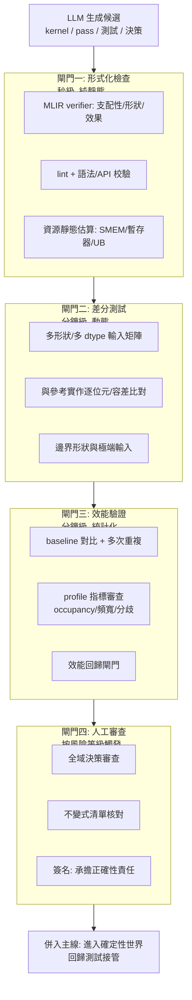
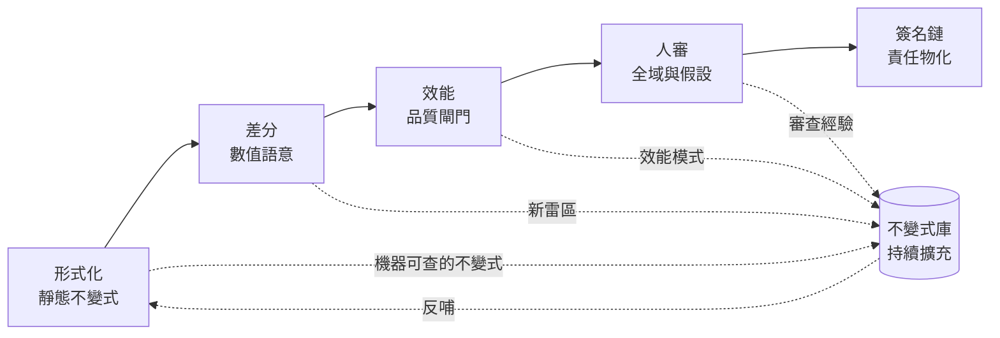

# 7.3 驗證體系的強化：形式化檢查、差分測試與人工審查簽名鏈

前兩節確立了「生成-驗證」框架與風險分級。本節把它們合成一套**可運轉的驗證體系**：四道閘門（形式化檢查、差分測試、效能驗證、人工審查）與一條貫穿始終的簽名鏈。這是 1.3 節「守門人」思想在 LLM 時代的完整形態。

## 7.3.1 體系總覽：漏斗與閘門



設計原則：**閘門按成本遞增排列，便宜的先擋**。形式化檢查（秒級）攔截 80% 的粗錯誤，讓昂貴的差分測試聚焦在「靜態檢查抓不到」的深層問題上。這個排序直接繼承 5.3.6 節 FileCheck 測試文化與 1.3.2 節翻譯驗證的「證明義務分層」思想。

## 7.3.2 閘門一：形式化檢查——把不變式變成代碼

第 5 章的 verifier 機制在此成為第一道防線：

* **MLIR verifier**：每次降階後自動執行（形狀一致、SSA 支配、介面契約）。LLM 生成的 pass 產出的 IR 若非法，**當場失敗且定位到層級**——7.2.3 節 IR 雷區的主要防禦；
* **靜態資源估算**：從 IR 推算暫存器/SMEM/UB 用量，在編譯期就拒絕「occupancy 必死」的候選——比實測快三個數量級；
* **效果標註檢查**：memory effects 的完整性（漏標 = 下游誤優化）。這是機器可查的，所以必查。

形式化檢查的能力邊界也要明說：它只能查**語法級與局部語意級**的不變式。數值正確性、併發時序、跨 op 的生命週期互動——這些要靠後面兩道閘門。**形式化是漏斗的寬口，不是終點。**

## 7.3.3 閘門二：差分測試——無 oracle 的普適驗證器

1.3.3 節的核心思想（多個理論上等價的觀測點 + 比對）在 LLM 時代升級為標準配件：

### 輸入空間的設計（比 oracle 更重要）

差分測試的成敗取決於**輸入矩陣**：

* **形狀矩陣**：對齊/非對齊、素數尺寸、batch=1 與大 batch、動態維的極端值——針對 7.1.4 節「表面正確」的形狀偏斜攻擊；
* **數值矩陣**：零、denormal、大動態範圍、NaN/Inf 的行為——量化與精度語意的雷區；
* **變異輸入**：同一 prompt 的高溫取樣生成**多個語義等價候選**互相比對——**把模型的多樣性反轉為測試資產**（與 8.2 節的生成式模糊測試同構）。

### oracle 的分層

| oracle | 適用 | 精度 |
|--------|------|------|
| 參考實作（PyTorch eager / naive kernel） | 通用 | 逐位元（同精度）或容差（混合精度） |
| 代數恆等式重寫（1.3.3 節） | 可重寫的計算 | 逐位元（整數域） |
| 屬性測試（invariant properties） | 特定領域 | 如 softmax 輸出和為 1、卷積的平移等變性 |
| 執行期反證（memory checker、race detector） | 併發類錯誤 | 事件級 |

**容差的設定本身是個陷阱**：太緊 → 誤報淹沒訊號；太鬆 → 真錯誤逃逸。實務做法是「逐位元優先，容差作為後備且必須記錄容差理由」——混合精度的合法容差要與量化分析（rounding error）掛鉤，而不是拍腦袋。

## 7.3.4 閘門三：效能驗證——把「正確但慢」擋在門外

7.1.4 節指出效能回歸的隱蔽性。效能閘門的工程要點：

1. **baseline 的選擇**：與「當前主線」比，且 baseline 本身要穩定（隔離環境、鎖頻、多次運行取中位數）；
2. **統計化判定**：延遲測量有雜訊，需要足夠重複 + 顯著性判定（如 bootstrap CI），避免「看起來快了 3%」的雜訊驅動決策；
3. **profile 指標的診斷回饋**：不通過時附上定位訊息（occupancy 掉了 / 合併率低了 / 分歧高了，2.2.5 節指標表）——**回饋給生成迴圈**（8.3 節），而不是只給人類；
4. **效能回歸閘門**：正確且慢的候選不併入，除非有明確的取捨理由並記錄。

## 7.3.5 閘門四：人工審查與簽名鏈

前三道閘門全自動化，第四道是人的位置。關鍵設計問題：**人審什麼？**

答案是 7.2.4 節分級的 L3/L4：

* **全域決策**（layout 策略、buffer 規劃、排程方案）——機器可查局部、不可查全域合理性；
* **不變式清單核對**——7.2.3 節的清單變成審查 checklist（「這個 kernel 的所有 warp collective 是否全 warp 參與？」）；
* **隱含假設的識別**——生成的代碼往往攜帶未言明的假設（「假設輸入已對齊」「假設單 batch」），人類的獨特價值是識別並顯式化這些假設。

### 簽名鏈：把責任鏈物化

每一個併入主線的生成產物，附帶一條可機器驗證的元資料記錄：

```yaml
provenance:
  generated_by: {model: "snapshot-a3f9", temp: 0.8, prompt_hash: "e12c..."}
  gates:
    - {gate: mlir-verifier,   result: pass,  cmd_hash: "5d21..."}
    - {gate: differential,    result: pass,  shapes: [64, 128, 129, 4096], oracle: "torch-eager"}
    - {gate: perf,            result: pass,  delta: "+12.4%", n_runs: 30}
  reviewed_by: "engineer-id"
  merged_at: 2026-11-20T10:00:00Z
```

簽名鏈的三個功能：

1. **審計**：出問題時可回溯「誰生成的、過了哪些閘門」；
2. **信任傳遞**：下游（CI、發佈）可以按驗證等級決定信任程度；
3. **知識沉澱**：失敗案例（哪個閘門抓到什麼）成為 8.2 節測試生成與 prompt 改進的素材。

## 7.3.6 體系的不變量：四道閘門的角色分工



注意最外圈的**反哺迴路**：每次人工審查發現的新雷區，應該盡快轉化為機器可查的不變式（verifier 規則或差分輸入模式），使下一次同類錯誤被前三道閘門自動攔截。**人審的位置因此是移動的**——隨著不變式庫的擴充，人審範圍收窄到真正的全域與假設問題。這是體系的長期演化方向：**人類審查的價值不在重複檢查機器能查的，而在把機器查不了的變成機器能查的。**

---

**參考與延伸閱讀**

* Livinskii et al. (2020). "Random Testing of C/C++ Compilers with YARPGen."（輸入矩陣設計）
* Chen et al. (2024). "HumanEval-style evaluation of LLM-generated kernels" 及各類 kernel benchmark（KernelBench 等）.
* SLSA 框架（supply-chain integrity，簽名鏈思想的來源）.
* MLIR FileCheck 測試文化與 verifier 文檔.
