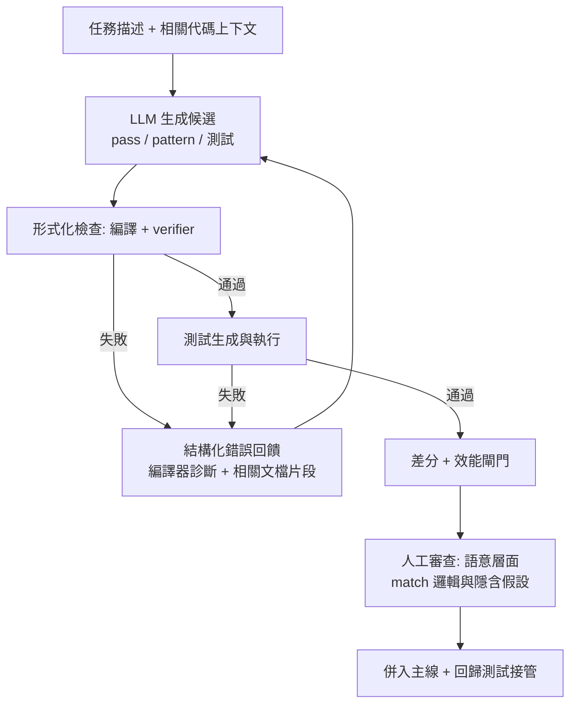
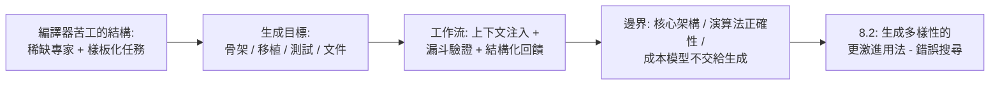

# 8.1 輔助開發：Pass 骨架與後端移植樣板的生成

第三部第二站：LLM 在編譯器與 kernel 工程中的三條路線。第一條——**輔助開發**——離「傳統編程助手」最近，但編譯器工坊的特殊性（少數人精通、知識密集、苦工密集）使它在這裡的槓桿比一般軟體開發更大。本節以「生成什麼、為什麼 LLM 擅長、邊界在哪」三問組織。

## 8.1.1 為什麼編譯器工程是「苦工密集」的

編譯器工程的勞動結構有一個尖銳的特徵：**每個具體任務都不難，但任務的數量與樣板性極高**：

* 新增一個 LLVM 後端：數千行的目標描述（instruction patterns、calling convention、register classes）；
* 新增一個 MLIR dialect：op 定義 + parser/printer + verifier + conversion patterns + 文件——大量機械性腳手架；
* 移植一個 pass 到新方言：模式匹配邏輯相同，API 翻譯是苦工；
* 每代硬體更新：intrinsic 包裝、成本模型微調、測試更新。

而精通這些工作的人是稀缺的（全世界深度理解 MLIR conversion 框架的工程師以百計）。**供給稀缺 + 需求樣板化 = 生成式 AI 的最大槓桿區。**

## 8.1.2 生成什麼：三類樣板產物

### 類別一：Pass 與 Pattern 的骨架

以 MLIR 為例，一個 pass 的「腳手架—邏輯」比很高：

```cpp
// LLM 高質量可生成的部分: 腳手架
struct MyFusionPass : public PassWrapper<MyFusionPass, OperationPass<func::FuncOp>> {
  MLIR_DEFINE_EXPLICIT_INTERNAL_INLINE_TYPE_ID(MyFusionPass)
  void runOnOperation() override {
    RewritePatternSet patterns(&getContext());
    patterns.add<MyFusionPattern>(&getContext());
    if (failed(applyPatternsAndFoldGreedily(getOperation(), std::move(patterns))))
      signalPassFailure();
  }
};
```

**人類的貢獻收窄到 pattern 的 `match` 判斷與 `rewrite` 語意**——這正是 5.3.2 節「小規則 + legality + benefit」架構的紅利：變換邏輯本來就是小而獨立的，適合逐個生成、逐個驗證（7.3.1 節漏斗）。

Meta 的 LLM Compiler 工作（Cummins et al., 2024）證實了這條路線的可行性：在 LLVM 的 pass/IR 語料上微調後，模型可以生成「合理形態的 pass 骨架」，並以測試通過率為選擇訊號。

### 類別二：後端移植與 intrinsic 包裝

典型的移植任務：「把這個 conv lowering 從 nvvm 目標加一份 rocdl 版本」。模型的優勢：

* 兩個 ISA 的 intrinsic 知識都在訓練語料中（PTX 文檔、ROCm 文檔都是公開資源）；
* 源代碼就在眼前（in-context），翻譯是「映射 + 適配」而非「發明」；
* 產物可以走 7.3 的完整漏斗（verifier + 差分 + 效能）。

風險點同樣明確：**ISA 語意的細節錯誤**（如對 `wgmma` 的 OperandLayout 理解偏差、對 memory ordering 的誤用）——表面正確、特定輸入下錯誤。對策是 7.2.3 節的雷區清單 + 邊界輸入矩陣。

### 類別三：測試與文件

* **單元測試生成**：對給定 pass 生成 FileCheck 測試（5.3.6 節風格）——模型擅長「從實作推導斷言」，且測試本身就是驗證物；
* **文檔與註解**：dialect 文檔、變換說明——低風險、高收益；
* **commit message / PR 描述 / 審查摘要**：編譯器 PR 的閱讀成本極高，摘要生成是純粹的溝通槓桿。

## 8.1.3 工作流的形態：漏斗內的循環

把 8.1.2 的產物放進 7.3 節的體系，輔助開發的典型迴圈：



三個工程要點：

1. **上下文工程是品質的第一變數**：給模型的不是「寫一個 fusion pass」，而是「這個 dialect 的 op 定義 + 三個相似 pattern 的範例 + 這個任務的 legality 條件」。**編譯器知識以範例形式注入，比模型自由發揮可靠一個量級**；
2. **錯誤回饋的結構化**：把編譯器診斷、verifier 錯誤、測試 diff 原樣回給模型，修復率高於「重試」——7.1.3 節「回饋迴圈」的具體化；
3. **產物規模小**：每次生成的單元是「一個 pattern / 一個測試 / 一個 intrinsic 包裝」，而不是「一個完整 pass 套件」——**信任半徑最小化**（7.1.5 節）。

## 8.1.4 能力邊界：輔助開發不碰什麼

明確三條不建議交給生成的區域（與第 9 章呼應）：

1. **核心 IR 與管線架構**：dialect 的語意設計、層級邊界的劃分——這是「決定整個系統表達力」的決策，錯誤代價全域（4.3.5 節）；
2. **演算法級的變換邏輯**：polyhedral 排程器的核心、依賴分析的完備性——正確性證明依賴數學性質，生成的「看起來合理」不足以背書（1.3.2 節）；
3. **成本模型與效能策略的基準**：模型的「效能知識」來自語料的分佈（哪些寫法常見），而效能真值取決於具體硬體代次——常見 ≠ 最快（2.2.3 節的 trade-off 誤區）。

一個實用的檢驗準則：**這個任務的錯誤能不能被現有閘門完整攔截？** 能（有 verifier、有差分、有效能測試）→ 交給生成循環；不能（錯誤要靠領域判斷發現）→ 人主導，生成只作草稿。

## 8.1.5 小結



---

**參考與延伸閱讀**

* Cummins et al. (2024). "Meta Large Language Model Compiler."（pass 生成與 IR 語料微調）
* Rozière et al. (2023). "Code Llama."（代碼生成的基礎能力）
* MLIR 文檔：Op Definition Spec、Pass Infrastructure.
* Hou et al. (2024). "LLM4Compile" 等系統性評測.
