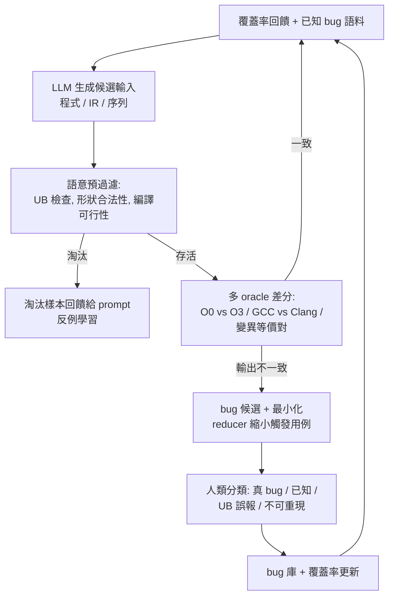
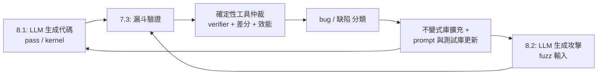

# 8.2 錯誤搜尋：以生成多樣性挖掘編譯器深層 Bug

8.1 節把 LLM 當「生產力工具」用。本節反轉視角：把 LLM 當**攻擊者**用——生成語法與語義多樣的輸入，去炸編譯器優化 pass 與後端的深層 bug。這條路線的理論根源正是 1.3.3 節的差分測試；LLM 的加入改變的是**輸入空間的覆蓋方式**。

## 8.2.1 編譯器 bug 的空間結構：為什麼「隨機」不夠

回顧 1.3.3 節的結論：編譯器 bug 藏在**輸入空間的結構性角落**：

* 優化 pass 的觸發條件是脆弱的——一個循環的特定形態、一次別名關係的特定組合，才會走進 pass 的罕見分支；
* UB 與未定義語意的邊界（Csmith 的教訓）：隨機生成的程式大量落入 UB，差異都是「合法的」；
* 組合態爆炸：pass A 的輸出餵給 pass B 的分支組合，數量指數增長。

傳統生成器（Csmith、YARPGen）用**手工規則**保證語法與語意約束，但它們的覆蓋上限由規則作者的想像力決定。**LLM 改變的是這個上限**：

1. **語法多樣性**：模型見過海量真實代碼，能生成「像人寫的怪代碼」——罕見但合法的組合（函式指標陣列、複雜的別名結構、刻意的整數環繞）；
2. **語義引導**：可以用自然語言描述「觸發這個 pass 的分支」——**定向模糊測試**（targeted fuzzing），傳統生成器做不到；
3. **對 oracle 的理解**：模型能寫出「同一計算的多種等價寫法」（恆等式重寫），直接構造差分對。

## 8.2.2 LLM 驅動的模糊測試：工作流

五個環節的技術要點：

**（1）生成目標的三層**：
* **源碼層**：C/C++/Python 程式（炸前端與優化器）；
* **IR 層**：直接生成/變異 LLVM IR 或 MLIR——**跳過前端，直接攻擊中端與後端**。IR 層生成的優勢：空間純粹（無 UB 干擾）、可以精確控制形態（支配結構、循環嵌套深度）；
* **pass 序列層**：對同一 IR 變換 pass 順序與參數組合——攻擊 pass 間的交互 bug（組合態爆炸的重災區）。

**（2）預過濾是效率關鍵**：LLM 生成的程式有相當比例語法錯/UB/不可編譯。用靜態工具（sanitizer 靜態分析、UBSan 編譯檢查）先淘汰，成本比模型重生成低得多。

**（3）覆蓋率回饋**：傳統 fuzzing 的靈魂（coverage-guided）在 LLM 版本中轉化為「把未覆蓋的 pass 分支描述給模型，請它生成觸發該分支的形態」——**覆蓋率從統計訊號變成 prompt 的一部分**。

**（4）最小化（testcase reduction）**：發現不一致後，用 reducer（如 LLVM 的 `llvm-reduce`、C-Reduce）把數百行的觸發用例縮到最小——這一步仍以確定性工具為主，LLM 可輔助（建議刪除方向）。

**（5）bug 分類的人類角色**：最小化後的用例仍需人判斷「真 bug 還是誤報」——特別是浮點容差與 UB 邊界的灰色地帶。**但人類的負載從「找 bug」轉為「分類 bug」，數量級下降。**

## 8.2.3 戰果與實證：這條路線的效果

學術與工業的已驗證結果：

* **傳統生成器的基準戰果**（1.3.3 節）：Csmith 在 GCC/LLVM 找出數百個錯誤；YARPGen 針對後端又找到數百個。**證明編譯器的 bug 庫遠未枯竭**；
* **LLM 的增益實證**（研究方向，2023–2025 的多篇工作，如利用 LLM 生成 GPU kernel 變體做差分、LLM 輔助的 LLVM 模糊測試）：在**同等預算下**，LLM 驅動的生成在「觸發深層分支的樣本比例」上顯著高於純隨機生成——尤其對優化 pass 的罕見分支；
* **模糊測試的邊際成本結構**：LLM 生成貴（token 成本 + 延遲），但**每個存活樣本的資訊量高**——「昂貴但精準」vs「便宜但粗放」的取捨，實務用混合策略（隨機生成打底、LLM 定向攻擊）。

## 8.2.4 為什麼這條路線的風險最低

與 8.1（生成生產代碼）與 8.3（生成 kernel）相比，錯誤搜尋有一個獨特的風險結構：

> **生成的輸入不需要正確——只需要合法。模型的幻覺、錯誤、怪異風格，在這裡不是缺陷而是覆蓋。**

系統中最壞的後果是「浪費了測試資源」；所有的正確性責任仍在編譯器本身的修復流程中。**這是三條路線中唯一「模型錯誤無害」的路線**——因此它可以最激進地利用模型的多樣性與創造性，包括最高溫度的取樣、最開放的 prompt。

這個觀察給出一個一般原則：**LLM 在確定性系統中的部署位置，應該優先選擇「錯誤成本為零」的縫隙。** 模糊測試是原型；同構的還有：生成邊界測試用例、生成對抗性的 profile 場景、生成壓力測試的執行緒排程擾動。

## 8.2.5 與第 7 章驗證體系的整合

錯誤搜尋不是孤立的攻擊工具，它反哺整個驗證體系：

1. **新雷區 → 不變式庫**（7.3.6 節的反哺迴路）：模糊測試發現的 bug 模式轉化為 verifier 規則，永久攔截同類錯誤；
2. **覆蓋率地圖**：持續標註「哪些 pass 分支從未被觸發」，指導 8.1 節的生成任務（補測試）與人類的審查焦點；
3. **對 LLM 自身生成的代碼的攻擊**：一個自洽的閉環——8.1 節 LLM 生成的 pattern，由 8.2 節 LLM 生成的測試轟炸。**生成者攻擊生成者，確定性工具仲裁**。這個閉環是「人機協作邊界」（第 9 章）最穩定的形態之一：人類不再做第一線的對抗，只做對抗結果的裁決。

---

**參考與延伸閱讀**

* Yang et al. (2011). "Csmith." *PLDI*；Livinskii et al. (2020). "YARPGen."
* Chen et al. (2024) 與後續工作：LLM 輔助編譯器模糊測試（arXiv 系列研究）.
* Zalewski, american fuzzy lop 文檔（coverage-guided fuzzing 的奠基）.
* Regehr 與 John Regehr 團隊的 compiler fuzzing 系列部落格（實務經驗的濃縮）.
