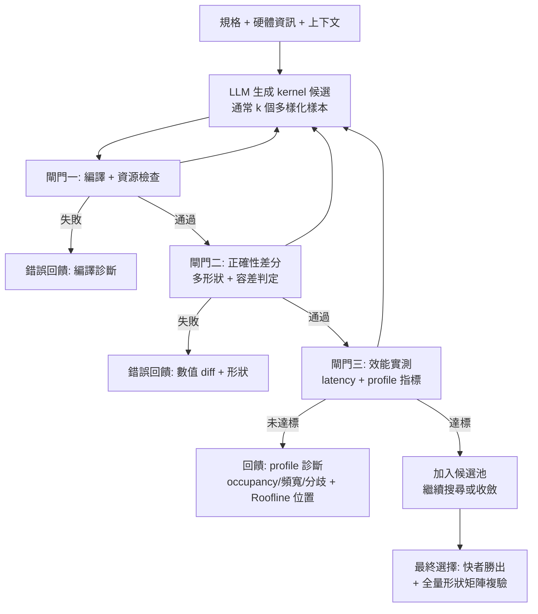
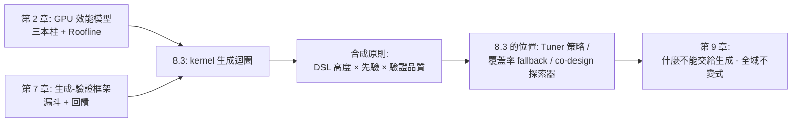

# 8.3 Kernel 生成：效能回饋驅動的迭代式程式合成

三條路線的最後一條也是最深的一條：**LLM 直接生成 GPU/NPU kernel**，以執行時效能為適應度函數迭代改進。這是第 2 章（GPU 模型）與第 7 章（生成-驗證框架）的匯流點，也是「從張量到邏輯閘」整條鏈上最接近「自動化端到端」的一環。

## 8.3.1 問題的形式化：kernel 合成的目標函數

給定：一個張量計算的規格（如 matmul + GELU 融合）、目標硬體（A100/H100/MI300/某 NPU）、正確性 oracle（參考實作）。

求：一個 kernel 程式 $k$ ，使得

$$k = \arg\min_{k' \in \mathcal{K}} \; \text{latency}(k') \quad \text{s.t.} \quad \forall \text{輸入 } x:\; \text{out}(k', x) \approx \text{out}(\text{ref}, x)$$

與 6.3.5 節 auto-tuning 的對比揭示了本質差異：

| | Auto-tuning（Ansor/Triton autotune） | LLM kernel 生成 |
|---|---|---|
| 決策空間 | 顯式參數化（tile 尺寸、排程參數） | **開放程式空間**（任意代碼） |
| 搜尋者 | 窮舉/進化/貝氏 | 模型（先驗 + 回饋引導） |
| 起點 | 隨機/模板 | **模型的先驗知識**（見過海量 kernel） |
| 結構級創新 | 不可能（空間預定義） | 可能（新演算法變體、新資料流） |
| 正確性 | 模板保證 | 必須驗證 |

LLM 的真正價值不是「搜得更快」，而是**把決策空間從參數空間擴大到程式空間**——可以提出 Split-K、flash attention 式的 online softmax、新的 swizzle 模式這類**結構級候選**。

## 8.3.2 迭代迴圈：生成-驗證-效能的閉環

與 7.3.1 節漏斗的差異在**迴圈性**：漏斗是單向的（生成→採納或淘汰），kernel 生成是**多輪迭代**的——每一輪的失敗訊息（編譯錯誤、數值 diff、profile 診斷）都回饋給下一輪生成。這就是「效能回饋驅動」的含義：**適應度函數不是事後裁判，而是過程導航**。

### 回饋訊息的設計是成敗關鍵

實證經驗（KernelBench 系列與相關研究）指出，回饋的**資訊密度**決定收斂速度：

* **低效回饋**：「效能不佳，請改進」——模型只能盲改；
* **高效回饋**：「achieved occupancy 12%（目標 40%+）、暫存器/執行緒 = 168、SMEM/block = 96KB（超過 H100 上限的一半）、DRAM 頻寬利用率 18%——判斷：tile 過大且未使用 tensor core。請將 BLOCK_M/N 降至 64、改用 tl.dot」——**把 2.2.5 節的指標表與 Roofline 定位（2.2.3 節）翻譯成模型的行動建議**。

這個翻譯層（profile → 診斷 → 建議）本質上是把人類效能工程師的判斷邏輯顯式化——**它本身可以是規則引擎（確定性工具），LLM 只負責最後的代碼修改**。

## 8.3.3 目標語言的選擇：Triton 為什麼勝出

8.3.2 的迴圈在不同目標語言上的成功率差異巨大。實證與理論都指向 **Triton 是當前的最優選擇**：

1. **抽象高度恰好**（2.3.3 節）：tile 語意消除了 thread 映射、shared memory 管理、bank conflict 這三大雷區——**模型的錯誤面大幅收窄**。CUDA 中最容易出錯的部分（__syncthreads 位置、warp collective 語意）在 Triton 中不存在；
2. **驗證容易**：與 PyTorch eager 的差分天然成立（同一生態）；
3. **訓練語料充足**：torch.compile 普及使 Triton kernel 樣本爆炸；
4. **效能天花板夠用**：編譯器的 layout pass 承擔了 CUTLASS 級的底層工作，模型專注演算法與 tile 策略。

對比之下：**CUDA 的生成成功率顯著較低**（雷區密集，7.2.3 節清單全中），**彙編級（SASS/PTX）幾乎不可行**（模型對私有 ISA 的語意掌握稀薄）。這驗證了一個一般原則：

> **LLM kernel 生成的工作高度 = DSL 抽象高度 × 模型先驗 × 驗證閉環品質。三者相乘，任何一項歸零則整體歸零。**

## 8.3.4 效能的邊界：LLM 生成 vs 專家手寫

誠實的效能畫像（基於 2024–2025 的公開實證，如 KernelBench 及各家報告）：

| 任務類型 | LLM 生成（迭代迴圈後）的相對水準 |
|----------|--------------------------------|
| elementwise / 簡單 reduction | 接近或等於專家（torch.compile 已證明） |
| 標準 GEMM / conv | 可用，通常落後 cuBLAS/CUTLASS 10–40% |
| 結構級創新（flash attention 變體） | 能提出候選，超越普通工程師、接近專家的情形已有實例 |
| 極限調優（超長流水線、跨代次 hand-tuned） | 顯著落後（這是專家 + 模板庫的堡壘） |

三個結論：

1. **LLM 生成的效能帶寬在「工程師與專家之間」**：它穩定超過一般工程師的手寫（尤其在非熱點路徑），在熱點路徑上仍需專家；
2. **「先驗知識的時代性」是持續變數**：模型的 kernel 知識凍結在訓練截止，新硬體代次（新 ISA、新記憶體層級）的先驗是空的——**新硬體的 kernel 生成需要再訓練或強化上下文注入**（把架構白皮書、 intrinsic 手冊放進 prompt）；
3. **迭代迴圈的價值隨任務難度上升**：簡單 kernel 一發即中，難 kernel 的多輪迭代（生成→失敗→診斷→再生成）是主要的成本與突破所在。

## 8.3.5 系統整合：生成的 kernel 如何進入編譯器生態

最後把這條路線放回第 6 章的堆疊圖中，指出三個整合點：

* **作為 Tuner 的一種策略**：在 Ansor/Meta Schedule 的搜尋框架中，LLM 是「候選生成器」的一種實作——與 sketch、規則模板並列，共享同一套驗證與選優機制；
* **作為 fallback 路徑**：編譯器沒有覆蓋的算子（新 attention 變體）自動觸發生成迴圈，產出 kernel 並緩存——**算子覆蓋率問題（3.2.4 節）的軟體解**；
* **作為 co-design 的探索器**（第 12 章）：生成器甚至可以反過來提硬體需求——「這個 kernel 需要 128KB SMEM 才能高效」成為下一代硬體規格的輸入。

## 8.3.6 小結

---

**參考與延伸閱讀**

* Tillet et al. (2019). "Triton." *MAPL*.
* Ouyang et al. (2025). "KernelBench: Can LLMs Write Efficient GPU Kernels?"（效能基準的代表性工作）
* Zheng et al. (2020). "Ansor." *OSDI*（Tuner 框架的原型）.
* Wei et al. (2024). 各种 LLM kernel 生成系統報告（如 Meta 的 TVM-Unity 嘗試、各家 GPU 廠商的生成工具）.
