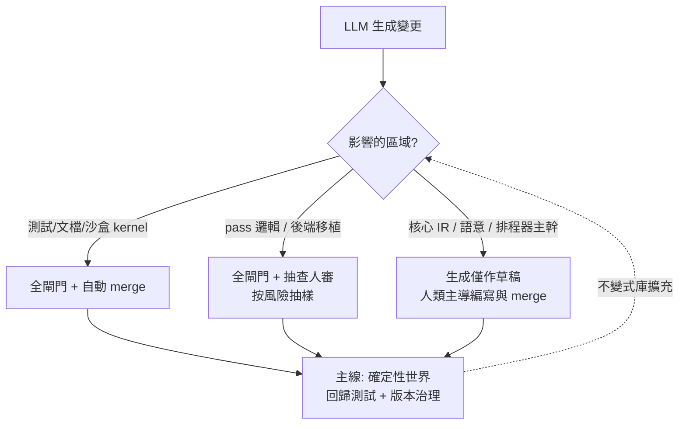

# 9.2 為什麼核心編譯器的 Merge 權限不能交給模型

9.1 節給出了全域不變式的清單與守護現狀。本節把它推向最尖銳的問題：**隨著模型能力提升，編譯器專案的合併（merge）決策——「這段生成代碼可以進入主線」——能否最終自動化、甚至完全交給模型？**

本節的答案是否定的，並給出論證的完整結構。

## 9.2.1 先釐清問題：三種自動化程度

「交給模型」不是一個二值命題。光譜上至少有三檔：

1. **自動建議**：模型提 PR、寫分析、跑測試——人類 merge。已普遍實行；
2. **自動 merge（受閘門約束）**：漏斗全綠且 diff 在低風險區 → 自動併入。低風險區（測試、文檔、樣板移植）已可實行；
3. **全權 merge**：模型對包括核心 IR、後端、排程器在內的所有變更擁有併入權。**本節論證這一檔不可行——且論證不依賴「模型還不夠聰明」這類暫時性理由。**

論證若只基於能力，就會隨模型進步失效。以下四個論證刻意避開它。

## 9.2.2 論證一：驗證的不完備性是結構性的，不是暫時的

7.3 節的漏斗依賴「不變式可機器查」。9.1.7 節的表格顯示：**關鍵不變式中有整整一類（效果語意、別名正確性、異步生命週期、異常完備性）只能抽樣驗證**。

為什麼這個不完備是結構性的？

* 語意等價問題在一般意義上不可判定（Rice 定理的推論）：不存在演算法能對任意程式變換判定語意等價；
* 實務的對策全部是**抽樣**（差分測試、模糊測試）——抽樣只能證明「在測過的輸入上正確」，對沒測過的輸入無承諾；
* 確定性編譯器的開發模式用「規則的演繹推理 + 人類審查」補上抽樣的洞。**人類 merge 的本質功能，就是對抽樣驗證覆蓋不到的空間做歸納外的判斷。**

推論：**只要驗證是抽樣的，就存在一個「測試全綠但代碼錯」的空間。自動 merge 對這個空間的防禦是零**——它沒有演繹能力，也沒有責任承擔能力。模型能力再強，改變的只是它掉進這個空間的機率，而不是空間的存在。

## 9.2.3 論證二：錯誤的系統性與回歸保護的失效

傳統回歸測試的邏輯：「bug X 曾在 commit C 出現，測試 T 抓住它，此後 T 永久守護。」這個邏輯的成立條件是**代碼是靜態的**。

若 merge 權限交給模型，出現一個新形態的錯誤結構：**系統性錯誤（systemic error）**。

* 模型的錯誤不是獨立的——同一個誤解（例如對某 ISA memory ordering 的系統性誤讀）會在**多個變更中以不同表面形式重複出現**（7.2.2 節的相關性論證）；
* 回歸測試抓住的是「這個 bug 的這個形態」，模型的下一次犯錯是**新形態**——回歸保護對分佈移動的防禦能力天然受限；
* 更危險的是：**模型的錯誤傾向會自我強化**——若 repo 中已混入帶有某種錯誤模式的代碼（被抽樣驗證漏過），後續以 repo 為上下文的生成會**學習並放大該模式**。人類 merge 的審查是這個正回饋迴路唯一的阻尼器。

推論：**核心編譯器的正確性依賴「錯誤模式的多樣性審查」，而模型恰恰缺乏跨模式的多樣性——它的多樣性是分佈內的，不是分佈外的。**

## 9.2.4 論證三：信任鏈需要一個可追責的錨點

軟體供應鏈的信任結構（1.3 節開頭的信任鏈論述）：編譯器是所有下游軟體的根。飛控、醫療、金融系統的供應鏈審核都會問一個問題：**「這個編譯器的這行代碼，誰為它負責？」**

* 簽名鏈（7.3.5 節）的末環必須是**能承擔責任的主體**——人類或人類組織；
* 模型無法承擔責任：它沒有法律主體性，其行為隨版本漂移（7.2.1 節），其「決策依據」不可還原為可審計的推理鏈；
* 這不是技術問題，是**信任體系的公理**：審計鏈的每一環必須可問責。模型可以出現在鏈的中段（生成、建議、預篩），**末環——併入決策——必須是人**。

進一步的工程含義：merge 決策不僅是「代碼對不對」，還包括**「這個變更應不該存在」**的判斷——它與專案的方向、技術債、維護成本、安全姿態有關。這些判斷的輸入是組織的價值與長期承諾，不在任何 prompt 的表達範圍內。

## 9.2.5 論證四：核心編譯器的變更頻率與風險不對稱

對比兩類變更的風險-頻率結構：

| 變更類型 | 頻率 | 單次風險 | 累積風險 | 自動 merge 適用性 |
|----------|------|---------|---------|------------------|
| 測試、文檔、樣板移植 | 高 | 低 | 線性 | **適用**（閘門足夠） |
| 新 kernel 候選（沙盒內） | 高 | 零（沙盒隔離） | 無 | 適用 |
| pass 邏輯變更 | 中 | 中 | 超線性（pass 交互） | 謹慎 |
| 核心 IR / 語意 / 後端主幹 | 低 | **極高** | **全域性**（9.1.2 節傳播半徑） | **不適用** |

最後一行的要害是**不對稱**：核心變更頻率低（不值得為自動化節省人力），單次風險極高（一次失誤毒化整個生態的信任）。自動化的經濟動機（省人力）與風險代價（全域污染）在這裡方向相反。

歷史的旁證：編譯器社群對「破壞性變更」的保守文化（LLVM 的 stage 分支、GCC 的 regression 必修文化）不是官僚主義，而是**對「全域不變式是生態地基」的集體認知**。

## 9.2.6 邊界的形狀：一條移動的、有原則的線

必須誠實地指出：這條邊界**不是固定的**。隨著兩個變數移動：

* **不變式庫的擴充**（7.3.6 節反哺迴路）：人審發現的雷區轉化為機器可查規則 → 自動化適用範圍擴大；
* **沙盒技術的進步**：更強的執行期檢測（形式化的執行模型、更完備的 race detector）→ 抽樣驗證的覆蓋率上升。

但移動有**方向原則**：

> **自動 merge 的邊界，只能朝著「不變式從抽樣性變為機器可查」的方向推進；凡是仍處於抽樣驗證覆蓋下的全域不變式，merge 決策歸屬人類。**

把這條原則寫成管線形態：

## 9.2.7 小結：四個論證的共同點

回望四個論證，它們有一個共同的哲學核心：

> **機率性系統可以承擔「探索」的功能（擴大搜尋空間、提高覆蓋率），但不能承擔「保證」的功能（把某個命題從或然變為確定）。而 merge 決策的本質是把一段代碼從「候選」升格為「保證的一部分」——這個升格動作本身屬於確定性世界。**

第 9.3 節將把這個結論落實為正面的人機協作分工。

---

**參考與延伸閱讀**

* Rice, "Classes of Recursively Enumerable Sets..."（等價判定不可判定性的理論根源）
* SLSA / in-toto 框架：供應鏈信任的工程化表達.
* LLVM Developer Policy（對核心變更的審查要求）.
* Cummins et al. (2024) 與後續討論（自動化程度的實務光譜）.
