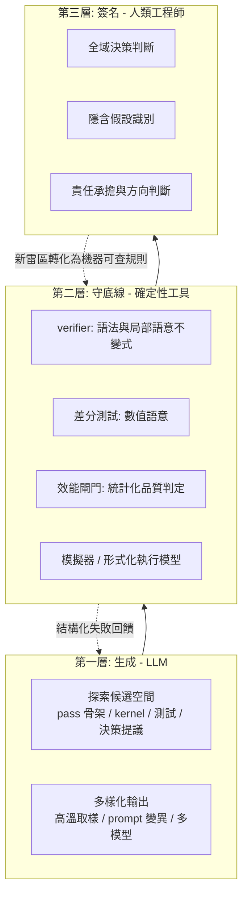

# 9.3 人機協作邊界：生成探索、工具守底線、工程師簽名

第三部的收束。前兩節分別證明了「生成有巨大價值」（第 8 章）與「保證的職責不可下放」（9.2 節）。本節把兩者合併，給出人機協作的正面設計：**誰生成、誰驗證、誰簽名**，以及這個分工如何隨系統演化而移動。

## 9.3.1 協作的三層分工

三層的本質是**知識類型的分工**：

* **生成層（歸納知識）**：模型從海量語料歸納「什麼樣的代碼通常對、通常快」——擅長探索廣闊但不需要演繹保證的空間；
* **驗證層（演繹與實證知識）**：確定性工具執行**機器可查的不變式**（演繹）與**可重現的測量**（實證）——它們是信任的實體，7.3 節的漏斗是它們的組織形態；
* **簽名層（判斷與責任）**：人類做三件機器做不了的事——全域決策的價值判斷、隱含假設的識別、以及 9.2.4 節論證的**責任錨點**。

## 9.3.2 邊界的具體刻畫：任務 → 歸屬映射表

把全書任務按歸屬整理成一張總表（綜合第 7–9 章的結論）：

| 任務 | 生成 | 驗證 | 決策 | 理由 |
|------|------|------|------|------|
| 測試用例 / fuzz 輸入 | LLM（激進） | 執行結果自證 | 自動 | 錯誤成本為零（8.2.4） |
| kernel 候選（沙盒） | LLM 迭代 | 差分 + 效能 | 閘門自動 + 人審樣本 | 失敗可逆（8.3） |
| pass 骨架 / 移植樣板 | LLM | verifier + FileCheck + 差分 | 人審（按風險抽樣） | 局部可驗證為主 |
| buffer / layout / 排程決策 | LLM 提議 | 模擬器重放 + 靜態驗證 | **人類**（全域） | 全域不變式（9.1） |
| 核心方言 / IR 語意 | 人主導，LLM 草稿 | 形式化 + 演繹審查 | **人類**（9.2.5） | 全域且不可逆 |
| 管線架構 / 層級劃分 | 人 | — | 人 | 系統表達力的根源（4.3） |
| merge 進核心主幹 | — | — | **人類簽名** | 信任鏈錨點（9.2.4） |

表的閱讀要點：**生成權越往下越收窄，簽名權完全集中在底部**。這不是能力歧視，是 9.2.1 節「信任半徑」原則的任務級落地。

## 9.3.3 協作的動態：兩個反哺迴路

靜態的分工表只是起點。健康的協作系統有兩條反哺迴路，使邊界**隨時間向自動化方向移動**（9.2.6 節的方向原則）：

**迴路一：雷區的固化**（7.3.6 節）。人審每次發現的新錯誤模式 → 轉化為 verifier 規則 / 差分輸入模式 / 效能閘門 → 同類錯誤永久自動攔截 → 人審範圍收窄。

**迴路二：生成質量的提升**。漏斗的結構化失敗回饋（編譯診斷、數值 diff、profile 診斷）→ 進入 prompt 工程、fine-tune 語料、或作為 RL 的獎勵訊號 → 生成一次通過率上升 → 迴圈輪數下降、驗證成本下降。

兩條迴路的合力效應：**漏斗的「通過率」是協作系統的關鍵健康指標**。它把「模型能力」這個模糊概念操作化為可度量、可改進的工程量：

$$\text{通過率} = \frac{\text{一次生成通過全閘門的候選數}}{\text{生成候選總數}}$$

通過率的提升路徑（更好的上下文注入、更精的 profile 回饋、更對口的中間表示）本質上就是 8.3.2 節「回饋資訊密度」論述的系統級版本。

## 9.3.4 反直覺的一課：人類的價值隨自動化而**重新定義**而非消失

一個常見的焦慮：「自動化程度上升，工程師何用？」第三部的分析給出的答案是反直覺的：

1. **工程師的位置上移**：從寫 pattern → 設計 dialect 語意（決定系統能表達什麼）、設計漏斗（決定信任如何建立）、設計回饋層（決定模型能學到什麼）。**每一層都比原來的工作更根本**；
2. **新技能的誕生**：把領域知識轉化為「機器可查的不變式」與「高資訊密度的回饋」——這是傳統編譯器工程沒有、生成時代最稀缺的技能。本質上，它是 1.3 節形式驗證傳統（把語意變成可檢查的義務）的工程普及化；
3. **判斷力的溢價**：全域決策（架構、層級、取捨）的稀缺性隨生成的廉價化而**上升**——因為生成的產出越多，需要被整合與裁決的方向越多。

一句話概括：**生成把「寫代碼」的成本壓到近零，於是工程的價值全部沉澱到「決定寫什麼、如何證明它對、如何讓下一輪生成更好」上。**

## 9.3.5 與第四部的銜接

第三部的結論可以壓縮為一句話：

> **在確定性系統中部署機率性生成者的總原則：生成者擴大搜尋空間，確定性工具守住每一層可驗證的不變式，人類對跨層的全域決策與信任錨點簽名——並通過反哺迴路持續把人類的判斷固化為機器的規則。**

第四部把視野從「編譯器工坊的內部治理」拉回到更廣的問題：當編譯的終點從指令流延伸到邏輯閘（第 11 章）、當 ISA 與記憶體架構本身成為可設計的變數（第 10 章）、當算子與硬體同步演進（第 12 章）——這個「翻譯契約」的底層地基還能再往下挖多深？而第三部的協作原則，將在硬體設計的領域（HLS 生成、驗證 IP、協同探索）中再次以相同的結構重現。

---

**參考與延伸閱讀**

* 人機協作系統的工程文獻（human-in-the-loop ML, active learning 傳統）.
* Christiano et al. (2017). "Deep RL from Human Preferences."（回饋訊號設計的先驅）
* 7.3 節與 9.2 節的全部引文（本章是其綜合）.
