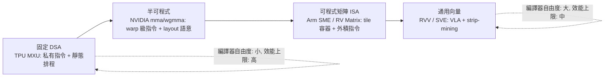
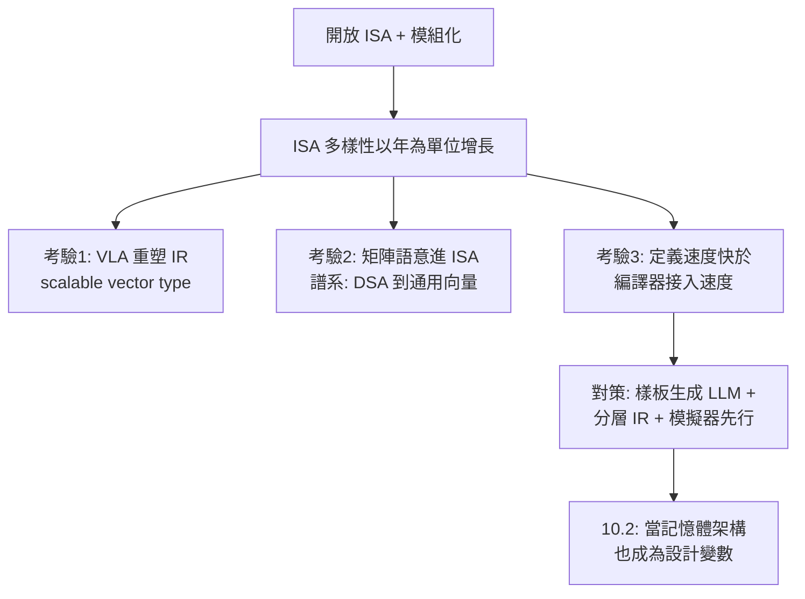

# 10.1 RISC-V 自訂擴充：向量、矩陣與 AI 擴充對編譯器的考驗

第四部開場。前三部假設 ISA 是給定的談判對象；本節把 ISA 本身變成變數。RISC-V 的開放性使「為特定領域客製指令」從半導體巨頭的特權變成產業常態——而這對編譯器的考驗是結構性的：**當 ISA 的壽命短於編譯器的開發週期，編譯器基礎設施必須重新設計。**

## 10.1.1 開放 ISA 的結構性意義

RISC-V（Krste Asanović 與 David Patterson 團隊，UC Berkeley，2010 起）的設計哲學：

* **基礎指令集極簡**（RV32I/RV64I：約 47 條基礎指令），一切擴充為模組；
* **標準擴充**：M（乘除）、A（原子）、F/D（浮點）、C（壓縮）、**V（向量，2021 凍結為 1.0）**；
* **自訂擴充空間**：保留 opcode 空間給廠商私有指令。

「開放 + 模組化」改變了 ISA 的經濟學：傳統上 ISA 演化由單一公司壟斷（x86、ARM 的授權模式），指令的增刪以十年為單位；RISC-V 生態中，**矽新創公司為差異化而自訂指令，ISA 的多樣性以年為單位增長**。

這對編譯器的考驗，用本書的語言說就是：**0.1 節的翻譯契約，其目標端變成了一個快速增殖的集合。**

## 10.1.2 向量擴充（RVV）：與 SVE 的設計對照

RVV 1.0 的核心設計決策——**向量長度不可知（vector-length agnostic, VLA）**：

* `vsetvli` 在執行期按硬體能力與剩餘元素數動態設定 VL；
* 程式不假設具體位寬（128/256/512 bit 皆可跑同一段碼）；
* 以「strip-mining 在執行期完成」的模型取代「編譯期假設寬度」。

與 Arm SVE（2016 凍結）的對照：

| | RVV | SVE |
|---|---|---|
| VLA 機制 | `vsetvli` 動態 VL + 暫存器分組 | `vl` 暫存器 + `pnflags`， scalable model |
| 暫存器分組 | 支援（lmul > 1） | 不支援（靠 predication 與長暫存器） |
| Predicate | 獨立向量 mask 暫存器 | per-register predicate 暫存器 |
| 編譯器 IR 表達 | LLVM scalable vector + RVV intrinsics | 同（`<vscale x N x T>`） |

**共同點比差異更重要**：兩者都迫使 LLVM 引入 **scalable vector type**（1.1.4 節埋的伏筆在此兌現）——IR 的型別系統必須表達「向量寬度在編譯期未知」。這是「硬體多樣性反向重塑 IR」的又一實例，與 MLIR 的動機同源。

RVV 對編譯器的具體考驗：

1. **VL 動態性與向量化**：循環的 strip-mining 在執行期展開，向量化 pass 必須生成「對任意 VL 正確」的代碼——歸約、shuffle、masked load 的語意都要 scalable 化；
2. **lmul（暫存器分組）的成本模型**：`lmul=4` 把一個邏輯向量映射到 4 個實體暫存器——增加計算吞吐但佔用 4 倍暫存器與更多指令。**這是 2.2.3 節 occupancy 取捨的 RVV 版**，成本模型必須建模；
3. **tail handling**：VL 不足整除時的 masked 處理，每一條向量指令都帶 mask——指令選擇與排程都要處理。

## 10.1.3 矩陣與 AI 擴充：ISA 特化的邊界

向量擴充之後，生態的下一步是**把張量語意壓進 ISA**：

* **Zve / 向量擴充的子集**：嵌入式場景的精簡向量；
* **矩陣擴充提案**（RISC-V Matrix Extension 的多個提案版本，如 Imagination、Tenstorrent 參與的草案）：類似 Arm SME（Scalable Matrix Extension, 2021/2023）的 tile 暫存器 + 外積指令（outer-product）模型——**在 ISA 層直接提供矩陣 tile 的操作**；
* **廠商自訂 AI 擴充**：各 NPU 玩家在 RISC-V 控制核上附加私有張量指令（第 3 章的 MXU 指令序列作為自訂 opcode）。

Arm SME 的設計值得作為參照：它以「tile 容器（ZA）+ 外積累加 + streaming SVE 模式」表達矩陣運算，把 3.1 節 MXU 的語意**部分地**搬進了可程式 ISA。這條「DSA 語意 → 可程式 ISA」的路線，與「固定脈動陣列 + 私有指令」的路線形成譜系：

譜系的編譯器含義：**越往左，編譯器的任務越接近第 3 章的靜態排程；越往右，越接近第 1 章的經典向量化。** MLIR 的分層恰好同時服務兩端——`linalg`/`affine` 承載左端的決策高度，`vector`/`llvm` 承載右端。

## 10.1.4 自訂擴充的編譯器工程學：三個層次的難題

### 難題一：定義速度 vs 驗證深度

廠商定義一條自訂指令可能只要一週（編碼 + 語意文檔），但把它接入編譯器要：

* LLVM：新增 `MachineInstr` 定義、ISel pattern、成本模型、組譯/反組譯、測試；
* MLIR：新增 dialect op 或 intrinsic 包裝、conversion pattern、verifier 規則。

**傳統流程的瓶頸正是第 8 章的「苦工密集」結構**——這也解釋了為什麼 RISC-V 生態是 LLM 輔助移植（8.1.2 類別二）最活躍的應用場景：樣板量最大、知識文檔公開、驗證閘門成熟。

### 難題二：可攜性 vs 專有性

自訂指令的本質矛盾：**用了它，代碼就綁定硬體**。編譯器的工程對策：

* **多版本代碼 + 執行期選擇**：函式多版本（target clones / IFUNC），按 CPU 特性偵測分發；
* **ISA 擴充的語意分層**：把「數學操作」與「指令實現」解耦（在 IR 層以 target-agnostic 形態存在，降階時才選指令）——這正是 MLIR 分層的直接受益；
* **上游化 vs 私有 fork 的治理**：LLVM/MLIR 社群的實踐是鼓勵「通用機制上游化、具體指令上游化但標記 experimental、公司內部 fork 承擔維護成本」——治理問題回到 4.3.5 節的生態批評。

### 難題三：軟硬同步演進的週期錯位

自訂擴充的完整鏈路：演算法需求 → ISA 設計 → RTL → 流片 → 矽回來 → 編譯器調優 → 軟體生態。**總週期 1–2 年，而演算法每幾個月換一代**（第 3 章開頭的算力需求增速）。這個錯位的工程對策構成第 12 章 co-design 的核心：

* **模擬器先行**（gem5、QEMU、FPGA prototype）：編譯器在流片前就開發；
* **FPGA 上的 ISA 快速迭代**：把 ISA 原型放在 FPGA 上，縮短「設計-驗證-修改」迴圈——這直接引出第 11 章的 HLS/HDL 主題。

## 10.1.5 小結

---

**參考與延伸閱讀**

* Waterman & Asanović (eds.), *The RISC-V Instruction Set Manual*（RVV 1.0 規範）.
* Arm SME 規格（Armv9 的新 matrix extension）.
* Sifive / Tenstorrent 的矩陣擴充提案與討論.
* LLVM RISC-V 後端文檔與 RVV intrinsics 規範.
