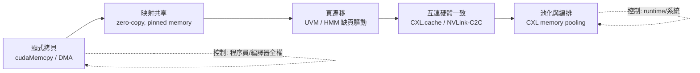
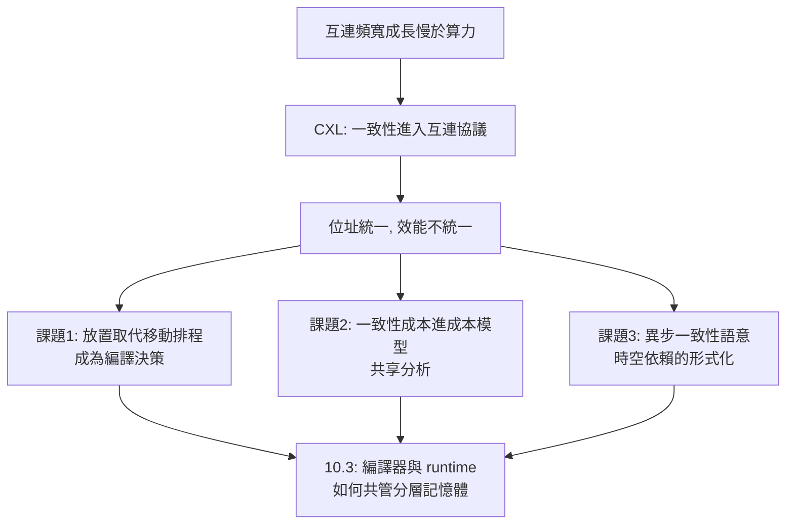

# 10.2 CXL 與統一位址空間：異質記憶體間的資料搬移與一致性

10.1 節把 ISA 變成變數；本節把**記憶體架構**變成變數。CXL（Compute Express Link）與統一記憶體的出現，動搖了異質計算的一個根本假設——「CPU 與加速器各守自己的記憶體，靠拷貝交換資料」。當位址空間可以互通、當記憶體可以池化，第 2、3 章的資料移動模型需要全面重寫。

## 10.2.1 傳統異質記憶體的假設與它的代價

第 2、3 章的模型隱含三個假設：

1. **位址空間分離**：GPU/NPU 的記憶體與主機記憶體是不同的位址空間；
2. **顯式拷貝**：資料跨越邊界必須 `cudaMemcpy` / DMA；
3. **一致性不保證**：加速器看到的是拷貝的副本，不是一致的全域視圖。

代價在張量工作負載下被放大：

* **拷貝開銷的比重**：一次推理的 HBM 流量中，若中間結果要在 CPU（預處理/後處理）與 GPU 間往返，PCIe 的頻寬（~64 GB/s，Gen5）與延遲成為瓶頸——**與 GPU 算力的增長速度相比，互連頻寬的成長慢一個身位**（摩爾定律失效的互連版）；
* **管線化的碎片化**：拷貝-計算-拷貝的序列使 pipeline 斷裂，異步性只在拷貝與計算重疊處存在；
* **程式設計模型的重複**：每個加速器一套記憶體 API（CUDA、各家 NPU SDK），張量編譯器要為每種組合寫資料移動邏輯（IREE HAL 存在的部分原因，6.3.3 節）。

## 10.2.2 CXL：把互連變成記憶體協議

CXL（Compute Express Link，Intel 主導，2019 CXL 1.0 → 2022 CXL 3.0）建構在 PCIe 物理層上，提供三個協議：

| 協議 | 功能 | 對本節的意義 |
|------|------|-------------|
| CXL.io | 類 PCIe 的 I/O 與配置 | 相容性基座 |
| **CXL.cache** | host 與 device 的快取一致性協議 | **加速器可以快取主機記憶體並保持一致** |
| **CXL.mem** | host 存取 device 附加的記憶體 | **主機可以把 device 記憶體當作自己的記憶體** |

CXL 2.0/3.0 加入**記憶體池化**（memory pooling）：多台主機通過 switch 共享記憶體池，記憶體成為可動態分配的資源（像塊儲存一樣的記憶體服務）。

### 一致性的語意：什麼變了

CXL.cache 使「CPU 寫的資料，GPU 直接讀（經過一致性協議）」成為可能——**沒有拷貝，只有共享**。這在語意上把異質系統向 **UMA（Uniform Memory Access）**方向拉動：

* **UVA（Unified Virtual Addressing）**：CUDA 的 UVA 與 managed memory（UVM）已是先驅——單一指標可以在 CPU/GPU 兩邊解引用；
* **HMM（Heterogeneous Memory Management）**：頁錯誤驅動的自動遷移（GPU 缺頁時從主機記憶體遷頁過來）；
* **CXL 的新意**：一致性不再依賴 device 的軟體棧（UVM 驅動的頁遷移），而是**互連協議層的硬體一致性**——延遲更低、語意更強。

注意 UMA 的「U」從來不是「延遲均勻」：NUMA 效應在 CXL 時代反而更尖銳（跨 CXL 的存取延遲比本地 DDR 高 ~100–300ns）。**統一的是位址與一致性，不統一的是效能。** 這個區分成為 10.2.4 編譯器課題的核心。

## 10.2.3 一致性層級的光譜：從顯式拷貝到硬體一致

把異質記憶體管理技術排成光譜：

光譜的張力是經典的：**越往右，程式設計簡單，效能控制權越低；越往左，效能可控，可攜性與正確性負擔越重。**

具體地：

* **顯式拷貝**（左端）：編譯器完全掌控移動時機（3.2 節的 DMA 排程），但需要靜態知道資料在何處被誰使用——**全域生命週期分析的負擔**（3.3.3 節）；
* **硬體一致**（右端）：程式像寫單機代碼，但**存取的放置（placement）決定效能**——放在本地記憶體快 5 倍，放錯就慢。**問題從「何時移動」變成「放在哪裡」。**

## 10.2.4 編譯器的新課題：從移動排程到放置決策

統一記憶體時代，張量編譯器與 runtime 的職責重心轉移：

### 課題一：放置（placement）成為編譯決策

資料張量在**分層的、可共享的記憶體拓撲**（本地 HBM、CXL 附接記憶體、遠端池化記憶體）中的放置，決定每個算子的有效頻寬與延遲。放置決策的輸入：

* 資料流圖：張量被哪些 device 上的算子讀寫、頻率多少；
* 拓撲模型：各記憶體段的頻寬/延遲/容量/一致性開銷；
* 目標：最小化全域執行時間（含通信）。

這個問題在形式上是**圖劃分與放置問題**（graph partitioning / placement，NP-hard），實務用啟發式（按通信量最小切割）+ 靜態分析。MLIR 的分層再次受惠：**放置決策的黃金高度在 flow/stream 層**（IREE 的 dispatch 劃分是雛形），因為那裡張量的使用全域可見。

### 課題二：一致性的成本要進入成本模型

硬體一致性不是免費的：CXL.cache 的 snoop/probe 開銷、快取行的所有權轉移，都在共享資料的熱路徑上計費。編譯器需要知道：

* 哪些資料是**真正共享的**（雙方都頻繁讀寫 → 一致性收益大）；
* 哪些是**假共享**（一寫多讀 → 遷移/複製反而更好）。

這把第 1 章的**別名分析**升級為**跨 device 的共享分析**——不變式清單（9.1.3 節）的又一擴展：跨 device 生命週期與共享語意的錯誤判斷，直接產生資料競爭或效能崩塌。

### 課題三：異步執行模型的一致性語意

統一記憶體 + 異步執行（streams、DMA、compute 重疊）的組合，使「一致性」從**空間問題**（資料在哪）變成**時空問題**（資料在什麼時刻對誰一致）。編譯器產出的執行計畫必須攜帶：

* **依賴序**：何時的寫對何時的讀可見（fence/sync 語意）；
* **放置遷移的時刻**：遷移本身是一個操作，要與計算重疊排程。

IREE 的 stream 方言與 CUDA 的 stream 語意都在逼近這個形式化——**9.1.4 節「異步生命週期不可完全靜態驗證」的判斷在此獲得新的重要性**：CXL 時代的錯誤形態（一致性違反）比拷貝時代（忘記拷貝）更隱蔽。

## 10.2.5 小結

---

**參考與延伸閱讀**

* CXL Consortium, *CXL Specification 3.0*.
* Sharma et al. (2023). "Memory Pooling with CXL"（Google/Intel 的池化論述）.
* NVIDIA UVM / HMM 文檔與 Stone et al. (2014) 的 GPU 頁遷移研究.
* IREE stream 方言文檔（異步資料流的形式化嘗試）.
