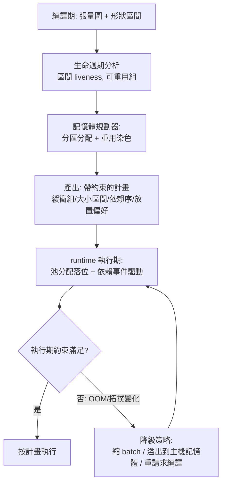
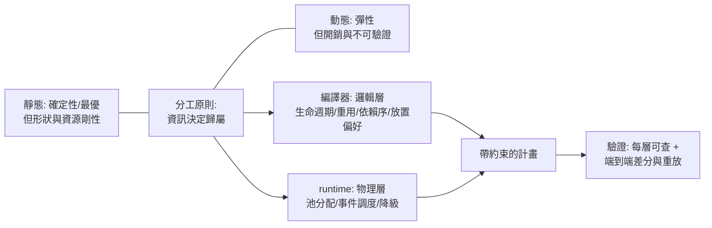

# 10.3 編譯器與 Runtime 在異質記憶體階層中的張量管理

前兩節確立了「ISA 可自訂、記憶體可統一」的硬體趨勢。本節回答系統層的問題：**在這樣的硬體上，張量的分配、遷移、重用、回收，應該由編譯器（編譯期決策）還是 runtime（執行期決策）管理？** 答案是一個分工譜系，而分工的原則恰好是本書第 0 章就埋下的：「決策放在資訊最完整的層」。

## 10.3.1 靜態 vs 動態：兩端的極端與它們的失效場景

### 極端一：全靜態（編譯器決定一切）

第 3 章 DSA 的模型：所有 buffer 位址、DMA 時刻、雙緩衝深度在編譯期定死（3.3.3 節）。

* **優勢**：確定性（可重現、可驗證）、零 runtime 開銷、排程可全域最優；
* **失效場景**：
  * **動態形狀**：batch 變化、序列長度變化 → 每個形狀重編譯或退回通用代碼（3.2.4 節形狀爆炸）；
  * **動態工作負載**：推理服務的多請求交錯、訓練的動態計算圖 → 靜態計畫與實際資料流不匹配；
  * **多租戶/池化記憶體**（10.2 節 CXL pooling）：記憶體資源在執行期才知道可用性。

### 極端二：全動態（runtime 決定一切）

傳統 eager 框架的模型：每個 op 執行時才分配（或由 allocator 快取）、遷移由缺頁/驅動處理（UVM/HMM）。

* **優勢**：形狀自由、部署簡單；
* **失效場景**：
  * **分配開銷與碎片化**：執行期分配的延遲與記憶體碎片，在 DSA 的顯式 scratchpad 上尤其致命（UB 是 MB 級的，沒有頁表與虛擬化）；
  * **失去排程的先見**：不知道未來的資料流，雙緩衝與重疊無法安排；
  * **驗證困難**：執行期決策不可重放、不可形式化檢查（9.1.4 節異步生命週期驗證的困難）。

結論顯然不是二選一，而是**分層分工**。

## 10.3.2 分層分工的原則：資訊決定歸屬

把張量管理拆成七類決策，按「什麼時候資訊完整」分配歸屬：

| 決策 | 編譯期資訊 | 執行期資訊 | 歸屬 |
|------|-----------|-----------|------|
| 緩衝容量需求（每 dispatch） | 形狀已知 → 精確 | 動態形狀 → 上界可推 | **編譯器**（以區間表達） |
| 緩衝的邏輯重用（in-place） | 資料流全域可見 | — | **編譯器**（3.3.3） |
| 實體位址/池分配 | — | 當時的空閒狀態 | **runtime** |
| 跨 device 放置 | 使用圖可見 | 拓撲擁塞動態 | **編譯器提議 + runtime 修正** |
| 遷移/預取時刻 | 資料流可見 | 實際延遲 | **編譯器排程 + runtime 補償** |
| 池化記憶體的租借 | — | 多租戶狀態 | **runtime** |
| OOM 的處理 | — | 突發 | **runtime**（重規劃/溢出） |

分配原則的陳述：

> **編譯器管「形狀與依賴決定的事」（邏輯層），runtime 管「資源狀態決定的事」（物理層），兩者以「編譯器產出帶約束的計畫、runtime 在約束內動態落位」的介面合作。**

這個原則有一個現成的實例：**IREE 的 HAL 設計**（6.3.3 節）——編譯器產出帶 memory type 約束與依賴序的 dispatch 計畫，HAL runtime 在各裝置的 allocator 內落位。CUDA 的 stream + memory pool API、各家 NPU SDK 的 arena 模型，都在這個譜系上。

## 10.3.3 張量生命週期管理的一致框架：帶約束的計畫

把 3.3.3 節的靜態記憶體規劃推廣為**帶約束的生命週期計畫**（constrained liveness plan）：

三個工程要點：

**（1）區間化的形狀**。動態形狀不是「未知」，而是「區間 + 依賴式」：`batch ∈ [1, 32]`、序列長度 ≤ 4096。生命週期與容量需求以**參數化區間**表達，編譯器產出「最壞情況可滿足」的計畫骨架——這是 4.2.3 節「動態形狀崩塌」的對策：**把不確定性形式化為約束，而不是假裝確定**。

**（2）依賴驅動的執行**。計畫中的執行不是線性序，而是**依賴事件圖**（dispatch 之間以張量可用性為邊）。runtime 的職責是在事件圖上做資源感知的調度——**編譯器給出邏輯依賴，runtime 決定物理交錯**。這是 3.2.1 節「靜態排程」與 6.3.3 節「非同步分派」的統一：DSA 上事件圖退化為線性（延遲確定、資源固定），異構系統上事件圖保留靈活性。

**（3）降級策略是計畫的一部分**。執行期約束不滿足時的反應（縮 batch、溢出、重編譯）應該在編譯期就被設計進計畫——**而不是 runtime 的即興發揮**。LLM 服務的 KV cache 管理（paged attention，3.3.3 節）是這個框架的成熟範例：邏輯上連續的 KV 序列映射到物理上的分頁塊，分配由 runtime 按 token 動態進行，而**分頁大小、表結構、驅逐策略由編譯器/系統設計期確定**。

## 10.3.4 分層管理的驗證面

第 9 章的原則（每層邊界即驗證點）在張量管理上的具體化：

* **編譯期可驗證**：邏輯重用組的無衝突（著色驗證）、依賴圖的無環與完備性、容量需求的區間滿足（對形狀區間做 SMT 檢查）；
* **runtime 可驗證**：實際分配不越界、事件序的執行期檢查（debug 模式的 race detector、sanitizer）；
* **端到端驗證**：差分測試（與 eager 執行比對）+ 確定性重放（同輸入同計畫同結果——靜態部分的紅利）。

第三部與第四部在此再次匯流：**異質記憶體的管理不變式（生命週期、依賴序、放置約束）正是「全域不變式」清單的擴展**；而 LLM 參與的生成式優化（如讓模型提議放置策略）同樣適用 9.3 節的協作框架——模型提議、模擬器驗證、工程師簽名。

## 10.3.5 小結與本章總結

第 10 章的三節共同完成了「地基擴展」：ISA 可以自訂（10.1）、記憶體可以統一（10.2）、管理可以分層（10.3）。它們把第 0 章的翻譯契約推向一個更深的問題：**當連「目標機器」本身都成為設計變數，編譯的終點在哪裡？** 下一章給出最激進的答案：終點可以是邏輯閘本身。

---

**參考與延伸閱讀**

* IREE HAL 與 stream 文檔.
* NVIDIA CUDA memory pool 與 stream 記憶體 API.
* Kwiatkowski et al. (2023). "PagedAttention." *SOSP*.
* MLIR `bufferization` 與 `async` 方言文檔.
