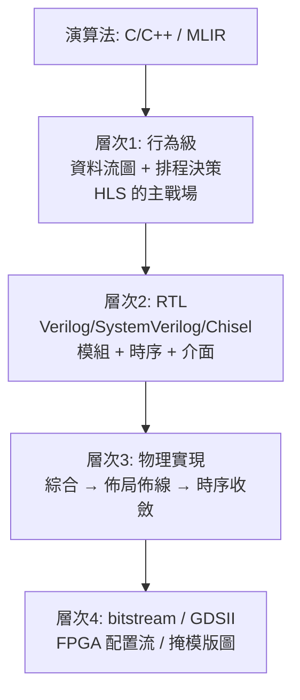
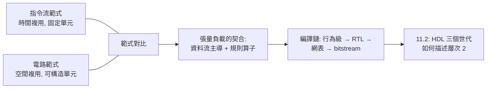

# 11.1 編譯終點的轉移：從指令流到邏輯閘與電路拓撲

第四部的核心章節開始。到目前為止，全書的「翻譯契約」都以**指令流**為終點——機器碼、PTX、NPU 固件。本章把終點推到底：**當目標是一塊 FPGA 或一顆 ASIC，編譯的產物不再是「在固定電路上執行的指令」，而是「電路本身的拓撲」**。這個轉移改變的不只是後端技術，而是「程式」與「機器」的本體論邊界。

## 11.1.1 兩種計算範式：指令流 vs 電路

馮紐曼機器的本質是**時間複用**（time-multiplexing）：一組固定的計算硬體（ALU），按時鐘節拍依次執行指令流中的不同操作。而電路範式是**空間複用**（space-multiplexing）：每個操作有自己專屬的硬體，它們**同時**存在、同時運作，以線連接成資料流。

| 維度 | 指令流（CPU/GPU/NPU） | 電路（FPGA/ASIC） |
|------|----------------------|------------------|
| 計算單元 | 固定，時間複用 | 可構造，空間複用 |
| 「程式」的形態 | 指令序列 | 連線網表 + 時鐘域 |
| 平行的代價 | 平行度受單元數限制 | 平行度受面積限制 |
| 控制流 | 分支、跳轉自然 | 有限狀態機（FSM）表達 |
| 迭代的形態 | 迴圈（時間上重複） | 展開（空間上複製）或時序迴圈 |
| 延遲 | 依賴執行狀況 | **完全確定**（每條路徑可靜態計時） |
| 更新成本 | 載入新程式 | FPGA 重配置（秒級）/ ASIC 重流片（月級） |

**延遲確定性**這一欄是關鍵差異。3.2.1 節說 DSA 的延遲確定使靜態排程可行；電路範式把確定性推到極致——**每一條訊號路徑的傳播延遲都可以靜態計算**（時序分析），因此「執行時間」不是統計量而是設計產物。

## 11.1.2 FPGA 與 ASIC：同一範式的兩種實現

* **ASIC**（Application-Specific IC）：電路直接固化在矽上。面積/功耗/頻率最優，但**一次流片數百萬美元起、不可更改**。第 3 章的 TPU 就是 DSA 型 ASIC；
* **FPGA**（Field-Programmable Gate Array）：電路由可程式單元構成——**LUT**（查找表，實現任意 $k$ 輸入布林函數）、**FF**（觸發器，時序狀態）、**BRAM**（塊記憶體）、**DSP**（硬乘加單元）、可程式互連。配置流（bitstream）定義它們的連接方式。**效能約為 ASIC 的 1/5 到 1/10（面積/頻率/功耗），但「流片」成本變成秒級重配置**。

FPGA 的資源帳（以現代雲端 FPGA 為例）：

| 資源 | 數量級 | 對應軟體世界的概念 |
|------|--------|-------------------|
| LUT | 數百萬 | 「邏輯門預算」——每個運算花幾十個 LUT |
| FF | 數百萬 | 狀態/管線暫存 |
| BRAM | 數十 MB | scratchpad（軟體可定址記憶體） |
| DSP | 數千 | 硬體乘加單元（INT8/FP32 路徑） |

**資源預算的「全域性」比 GPU 更硬**：GPU 的暫存器超了會 spill（慢但不會失敗），FPGA 的 LUT/DSP 超了**直接無法佈局**（place & route 失敗，整個設計編譯不出來）。這使資源估算（11.3 節）成為硬約束滿足問題而非軟目標。

## 11.1.3 編譯終點的三個層次

「把軟體變成硬體」的編譯鏈實際上有三層產物，逐層下沉：

* **層次 1（行為級）**：描述「算什麼、資料怎麼流」——這正是 HLS 編譯器的入口（11.3 節），也是 MLIR 進入硬體世界的入口（12.2 節）；
* **層次 2（RTL，Register Transfer Level）**：描述「寄存器之間每拍傳輸什麼」——模組化、時鐘、握手協議。這是 HDL（11.2 節）的地盤；
* **層次 3（物理實現）**：綜合（RTL → 邏輯閘網表）、佈局佈線（netlist → 幾何）、時序收斂（確保所有路徑滿足時鐘週期）。這由 EDA 工具（Vivado、Synopsys DC、Cadence）自動完成，但**工程師通過約束與層次 2 的寫法深度影響它**；
* **層次 4（物理產物）**：FPGA bitstream 或 ASIC 的 GDSII 版圖——字面意義的「邏輯閘」。

本書標題「從張量到邏輯閘」的「邏輯閘」，指的就是這條鏈的末端。而**編譯器技術的角色從層次 1 到層次 2 之間最濃**：把行為描述轉換為高效的 RTL，正是 HLS 的定義（11.3 節）。

## 11.1.4 為什麼張量工作負載特別適合空間範式

深度學習運算與電路範式有天然的契合度，原因有三：

**（1）控制流極少、資料流主導。** 神經網路的前向推理幾乎沒有資料依賴的分支（量化 gate、skip connection 都是靜態的）。電路範式的弱點（控制流表達笨拙）正好不觸發，而強項（大規模資料流平行）全力發揮。

**（2）算子是規則的、可參數化的。** 一個 $K\times K$ 卷積核的電路是「乘加樹 + 移位暫存器」的規則結構，**硬體可以從形狀參數自動生成**——這正是 HLS 的甜蜜點：同一份行為描述， $K=3$ 與 $K=7$ 生成不同但同構的電路。

**（3）張量編譯器的決策鏈直接對應硬體資源。** 3.3 節的決策鏈（融合 → 布局 → 記憶體規劃 → 排程）在電路世界幾乎一一映射：融合 → 電路合併、記憶體規劃 → BRAM 配置、排程 → 管線化與 FSM。**MLIR 的張量/迴圈層決策（第二部）可以直接作為 HLS 的輸入**——這是 12.2 節的橋樑。

## 11.1.5 代價與適用邊界

空間範式的三個代價界定了它的適用邊界：

1. **編譯時間**：FPGA 的綜合+佈局佈線以**小時計**（vs GPU kernel 編譯的秒/分鐘）。迭代速度的劣勢使 FPGA 適合「部署固定計算」，不適合快速變化的模型——除非引入「虛擬化/覆蓋（overlay）」技術：把一個固定的張量引擎電路做成可配置的（本質上 FPGA 上蓋了一個小 DSA）；
2. **控制流與動態性**：資料依賴的分支、動態形狀、指標追逐——這些在電路世界要退化為 FSM 序列執行，效能急劇下降。**張量編譯器必須保證輸入給 HLS 的部分是「資料流化的」**；
3. **數值與精度的靈活性是雙刃劍**：電路可以自訂任意位寬（如 12-bit 定點乘法器，GPU 做不到），但每一種精度組合都是一份新的電路與驗證負擔。

## 11.1.6 小結

---

**參考與延伸閱讀**

* Hennessy & Patterson (2019). "A New Golden Age for Computer Architecture." *CACM*（領域特化架構的宣言，涵蓋空間範式）.
* Kuon & Rose (2007). "Measuring the Gap Between FPGAs and ASICs." *IEEE TCAD*.
* Xilinx/AMD 7 系與 Versal 架構文檔（LUT/BRAM/DSP 資源模型）.
