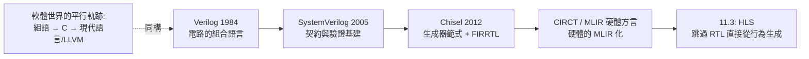

# 11.2 Verilog、SystemVerilog 與 Chisel：HDL 的三個世代

11.1 節給了電路範式的本體論；本節講述**描述電路的語言**如何演化。三個世代——Verilog（1984）、SystemVerilog（2005）、Chisel（2012）——的每一躍遷，都是對上一世代「抽象層級不足」的回應，而這個演化軌跡與軟體語言史（組合語言 → C → 現代語言）驚人地平行。

## 11.2.1 第一世代：Verilog——硬體的組合語言

Verilog（Gateway Design Automation, 1984；標準化為 IEEE 1364）把電路描述為**兩種並行執行的語意**：

```verilog
// 資料流/行為描述: 一個乘加單元
module mac #(parameter W = 16) (
    input  wire clk,
    input  wire signed [W-1:0] a, b, c,
    output reg  signed [2*W-1:0] out
);
    always @(posedge clk) begin
        out <= a * b + c;      // 每個時鐘上升沿, 這個行為被求值一次
    end
endmodule
```

兩種語意必須同時理解：

* **可綜合語意**：`always @(posedge clk)` + 非阻塞賦值（`<=`）描述「這些寄存器在時鐘沿更新什麼」——綜合器把它變成觸發器與組合邏輯；
* **測試語意**：延遲（`#10`）、初始塊、隨機化——只存在於模擬。

Verilog 的歷史功績：**它把「硬體設計」變成了「可以像寫代碼一樣寫、像跑測試一樣驗證」**。它的遺留問題也成為後兩個世代的動機：

1. **抽象層級低**：每個模組都是具體電路，重用靠複製貼上 + 參數化宏；
2. **鬆散的型別系統**：`reg`/`wire` 的語意微妙（常常不是它名字暗示的意思），位寬錯配默認靜默截斷——**硬體界的「未定義行為」**；
3. **並行語意的隱患**：多個 always 塊寫同一信號 = 未定義行為，競態問題與軟體多執行緒如出一轍但更難調試。

## 11.2.2 第二世代：SystemVerilog——工程化補全

SystemVerilog（IEEE 1800，2005 併入 Verilog）在其上疊加了兩類能力：

**設計端**：

* `logic` 型別統一 reg/wire 的語意混亂；
* `interface` 抽象模組間的通信協議（AXI、握手）——**匯流排成為一等公民**；
* `always_ff`/`always_comb` 區分意圖，讓工具檢查「時序塊裡混了組合邏輯」這類錯誤；
* struct/enum/typedef——起碼有了現代型別的形狀。

**驗證端**（這是 SV 對產業的最大貢獻）：

* **UVM**（Universal Verification Methodology）：基於 class 的測試台框架——物件導向、工廠、序列、記分板；
* **constrained random verification**：聲明約束（`constraint c { addr inside {[0:4095]}; }`），求解器生成隨機但滿足約束的激勵——**這就是 8.2 節「生成式錯誤搜尋」在硬體世界的三十年前身**，且思想完全一致：覆蓋率驅動 + 約束求解 + 差分比對（reference model）；
* **SVA**（SystemVerilog Assertions）：把不變式寫進代碼（`assert property (@(posedge clk) req |-> ##[1:3] ack)`）——硬體版的 verifier。

SystemVerilog 的定位：**它沒有提高抽象層級，而是把「描述正確性」的工程基礎設施補齊了。** 對本書主題的啟示：硬體世界的驗證文化（constrained random + assertion + 覆蓋率）比我們在第三部講的軟體驗證漏斗**更早、更成熟**——因為硬體的不可修復性（流片後不能打補丁）逼出了這套紀律。

## 11.2.3 第三世代：Chisel——把硬體當程式寫

Chisel（Bahmann et al., UC Berkeley, 2012）的立場：**HDL 應該是嵌入式領域語言（DSL）——硬體用通用程式語言（Scala）的抽象機制來構造**。

```scala
// Chisel: 參數化的 MAC 陣列, 生成對應位寬與數量的電路
class MACArray(val n: Int, val w: Int) extends Module {
  val io = IO(new Bundle {
    val a    = Input(Vec(n, SInt(w.W)))
    val b    = Input(Vec(n, SInt(w.W)))
    val acc  = Input(SInt((2 * w).W))
    val out  = Output(SInt((2 * w).W))
  })
  val macs = Seq.tabulate(n) { i =>
    io.a(i) * io.b(i) + (if (i == 0) io.acc else macs(i - 1))
  }
  io.out := macs(n - 1)
}
```

關鍵躍遷：**Verilog 描述的是「電路的形狀」，Chisel 執行的是「生成電路的程式」**。Scala 的迴圈、函式、型別參數都成為硬體生成的元程式能力——`Seq.tabulate(n)` 生成 $n$ 份 MAC 電路，這在 Verilog 中是 `generate` 塊 + 宏的笨拙世界。

Chisel 的實戰驗證：**Rocket Chip**（Berkeley 的 RISC-V SoC 生成器）與 **BOOM**（亂序 RISC-V 核心）證明了「參數化生成整個處理器」的可行性——10.1.4 節「ISA/硬體快速迭代」的工程基礎正是它。硬體生成器（hardware generator）範式：**硬體配置（cache 大小、核數、ISA 擴充）成為程式參數**，同一份 Chisel 程式生成從微控制器到伺服器核心的整個產品線。

同類思想的現代延伸：**SpinalHDL**（Scala）、**Amaranth/nMigen**（Python）、**MLIR 的 CIRCT 項目**（把硬體 IR 化，12.2 節）。

## 11.2.4 三世代的對照與抽象層級的規律

| | Verilog | SystemVerilog | Chisel |
|---|---------|---------------|--------|
| 抽象層級 | 電路結構 | 電路結構 + 工程化契約 | **生成器（元程式）** |
| 型別系統 | 鬆散 | 修補（logic/interface） | Scala 強型別 + FIRRTL 推斷 |
| 參數化 | `generate`/宏 | + package | **語言原生**（函式/類/迴圈） |
| 驗證基礎設施 | 測試台腳本 | UVM + SVA（業界標準） | chiseltest + 上層復用 SV 生態 |
| 語意形式化程度 | 低（綜合器方言差異） | 中 | 高（FIRRTL 中間表示有正式語意） |

抽象層級的規律與第 4 章軟體 IR 的歷史**完全同構**：

$$\text{Verilog} \approx \text{組合語言}, \quad \text{SystemVerilog} \approx \text{C}, \quad \text{Chisel} \approx \text{現代語言 + IR 化（FIRRTL）}$$

**FIRRTL**（Flexible Intermediate Representation for RTL）值得單獨一提：Chisel 編譯到 FIRRTL（有正式語意的硬體 IR），再降階到 Verilog——**「多層 IR + 漸進降階」的軟體範式（第 4 章）在硬體世界的重現**。這不是巧合：硬體生成的複雜度增長，最終必然走到與軟體相同的架構答案。CIRCT（Circuit IR Compilers and Tools，MLIR 旗下的硬體方言家族：`hw`、`seq`、`comb`、`sv`、`fsm`）把這條路推到 MLIR 的基礎設施上。

## 11.2.5 小結



---

**參考與延伸閱讀**

* IEEE 1364（Verilog）與 IEEE 1800（SystemVerilog）標準.
* Bachrach et al. (2012). "Chisel: Constructing Hardware in a Scala Embedded Language." *DAC*.
* Izraelevitz et al. (2017). "Reusability is FIRRTL Ground." *ICCAD*.
* Asanović et al., Rocket Chip 論文與 CIRCT 項目文檔.
