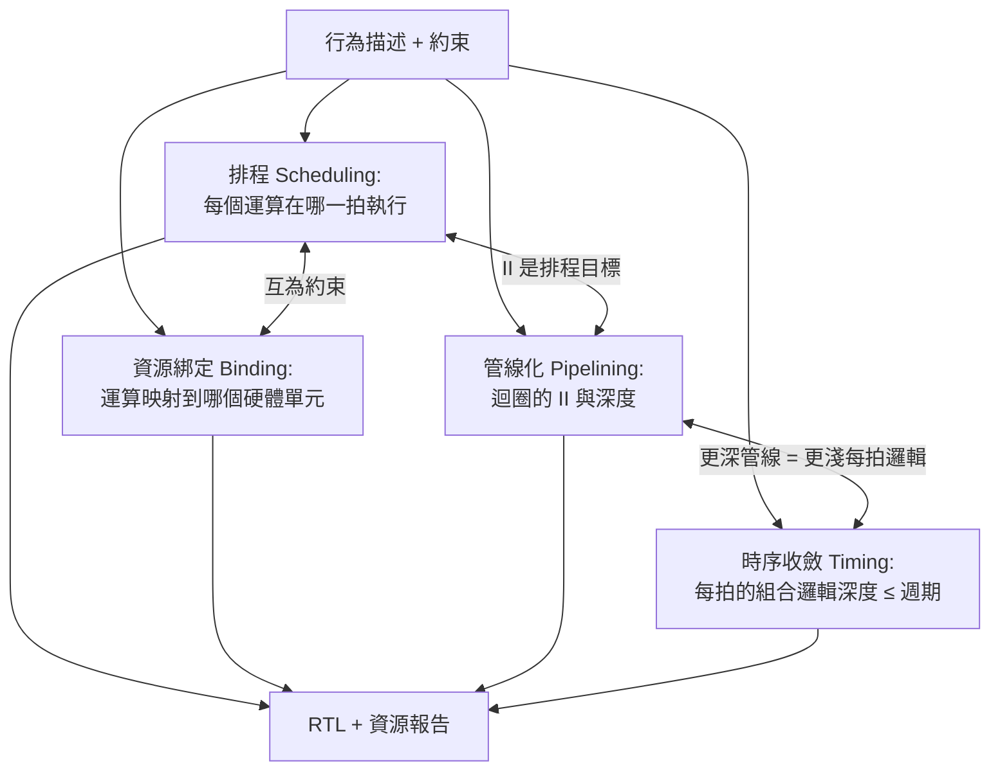
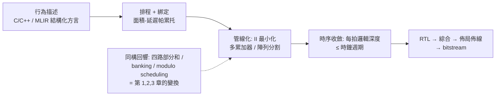

# 11.3 時序收斂、資源估算與管線化排程：HLS 的編譯原理

HLS（High-Level Synthesis）是本書「翻譯契約」的極端形態：輸入是 C/C++（或 MLIR 的結構化方言），輸出是 RTL。它把第 1.2 節的後端四重奏替換為四個硬體特有問題：**排程（何時）、資源綁定（用什麼電路）、管線化（II）、時序收斂（多快）**。本節解剖這四題，並指出它們與前文的深層聯繫。

## 11.3.1 HLS 的問題陳述

輸入：行為描述（C/C++ 函式，或 MLIR 的 `linalg`/`scf` 結構），加上 pragma/屬性（陣列分割、迴圈屬性、介面協議）。

輸出：滿足時鐘約束與資源預算的 RTL，其中：

* 迴圈 → 硬體迭代（FSM）或**空間展開**；
* 陣列 → BRAM/暫存器陣列 + 分割（banking）；
* 運算 → 用多少個硬體乘法器/加法器，什麼位寬；
* 函式 → 管線化的模組或時序呼叫。

四個子問題**互相耦合**（1.2.3 節「排程 vs RA」的耦合在硬體上更強）：

## 11.3.2 排程與資源綁定：時間與空間的聯合分配

**排程**決定每個運算的控制步（control step）。主要演算法家族：

* **ASAP/ALAP**：最早/最晚可行控制步，給出時間窗口；
* **List scheduling（資源受限）**：1.2.4 節同款演算法，以資源約束（乘法器個數）為容量；
* **Modulo scheduling（軟體流水）**：3.2.3 節同款思想——迴圈的 II（Initiation Interval）是核心指標。

**資源綁定**決定運算與硬體單元的映射：3 個乘法器可以服務時間上不重疊的任意多個乘法（時間複用又回來了！）。**資源綁定與排程的耦合**：綁定越少 → 排程越長；排程越緊 → 需要越多電路。這是**面積-延遲的帕累托前沿**，HLS 的本質就是沿著這個前沿搜尋：

$$\min \; (\text{面積}, \text{延遲}) \quad \text{s.t.} \quad \text{行為等價 + 時鐘約束}$$

實務上工程師用 pragma 指定取捨點（`PIPELINE II=1`、`UNROLL factor=4`、`ARRAY_PARTITION cyclic=8`），HLS 在局部求解——**「決策空間的參數化 + 搜尋器」的結構（6.3.5 節）再次出現，只是決策空間變成了 pragma 空間**。

## 11.3.3 管線化：II 作為 DSA/電路世界的「效能貨幣**

迴圈管線化把迴圈的迭代重疊執行（3.2.3 節的雙緩衝是它的記憶體側）。II 的下界：

$$II \ge \max\left(II_{\text{res}},\; II_{\text{dep}}\right)$$

與 3.2.3 節完全同構，但硬體細節不同：

* ** $II_{\text{dep}}$ 的來源**：迴圈攜帶依賴的距離。經典例子：累加器（依賴距離 1，浮點加法延遲 4 → $II_{\text{dep}} = 4$ ）。對策也同構：**多累加器輪替**（1.1.1 節的四路部分和！同一個變換在 CPU、GPU、FPGA 三個世界反覆出現）；
* ** $II_{\text{res}}$ 的來源**：BRAM 讀取埠數（每個 BRAM 每拍最多讀 1–2 次 → 依賴同一陣列的多次並行讀取需要**陣列分割**）、乘法器個數、記憶體頻寬。

**陣列分割（banking）值得展開**：BRAM 的埠數是硬約束，把陣列分割成 $N$ 個 bank 可以並行讀 $N$ 個元素。分割方式（cyclic/block/complete）與索引模式必須匹配——**這正是 GPU bank conflict（2.2.2 節）的同構問題**：swizzle、padding 的解法也一樣。三種硬體、同一個數學。

## 11.3.4 時序收斂：物理世界的最後一關

**時序約束**：時鐘週期 $T_{\text{clk}}$ 必須大於任何寄存器間路徑的組合延遲：

$$T_{\text{clk}} \ge t_{\text{logic}} + t_{\text{route}} + t_{\text{setup}}$$

HLS 的運作方式：以目標頻率為約束，在排程時**限制每拍的邏輯深度**（如「一拍最多一個 16-bit 乘法 + 兩個加法」）。深運算（大位寬乘法、浮點、除法）被拆成多拍。

**時序收斂失敗**（timing violation）的典型根源與修法：

| 根源 | 修法 | 對應的軟體概念 |
|------|------|---------------|
| 一拍內邏輯過深（如 64-bit 比較樹） | 管線切分、位寬縮減 | 「指令延遲」變成可設計的量 |
| 關鍵路徑上多級 BRAM 級聯 | 陣列重分割、暫存器化 | 記憶體階層 |
| 佈線擁塞（高扇出、長距離） | 重定時、區域約束 | （無直接對應——物理世界的獨有約束） |

時序收斂的特殊性：**它是 HLS 之後的佈局佈線階段才最終判定**，HLS 的估算（11.3.5）與最終結果有偏差——**多層估計與最終驗證的落差**，正是 7.3 節「驗證分層」在硬體世界的形態：HLS 報告（快速估）→ 綜合報告（中期估）→ 佈局佈線報告（真值）→ 硬體實測（終審）。

## 11.3.5 資源估算與回饋：把 Roofline 思想帶進電路

HLS 的資源報告（LUT/FF/BRAM/DSP 使用率 + 預估頻率與延遲）構成**設計空間探索（DSE）**的適應度函數：

$$\text{目標}: \max \frac{\text{吞吐量}}{\text{資源}} \quad \text{s.t.} \quad \text{LUT/DSP/BRAM} \le \text{預算},\; f \ge f_{\text{target}}$$

DSE 的結構與 6.3.5/8.3 節完全同構：**決策空間（pragma/位寬/分割）+ 適應度（資源與延遲報告）+ 搜尋者（窮舉/貝氏/LLM）**。GNN-based HLS 預測器（如 2020 年代的多篇工作）與 LLM 輔助的 pragma 生成，都是把「搜尋者」升級的嘗試——**第三部的協作框架（9.3 節）在硬體設計中逐字重演**：模型提議 pragma、估算器/實測驗證、工程師簽名。

## 11.3.6 HLS 的邊界與 MLIR 的介入點

HLS 的工程現實：Vitis HLS / LegUp / Bambu 等工具以 C/C++ 為入口，但**行為描述中的指標、動態分配、不規則控制流是 HLS 的天敵**（要退化為不高效的 FSM 記憶體介面）。這個邊界與 11.1.5 節的「電路範式適用邊界」相同——**資料流化的、仿射的計算才是 HLS 的甜蜜區**。

MLIR 進入 HLS 的價值（12.2 節的主題預告）：**`linalg`/`affine`/`scf` 的結構化形態恰好就是「資料流化的仿射計算」**——它們不僅是張量編譯器的好 IR，也恰好是 HLS 的好輸入。同一份 MLIR：

* 降向 LLVM → CPU/GPU 機器碼；
* 降向 CIRCT → RTL → bitstream。

**「語意空間 → 多層 IR → 多種物理終點」的網狀結構**——第 12 章的主題——在此完成最後一塊拼圖。

## 11.3.7 小結

---

**參考與延伸閱讀**

* De Micheli, *Synthesis and Optimization of Digital Circuits*（排程/綁定理論）.
* Cong et al. (2011). "High-Level Synthesis for FPGAs: From Prototyping to Deployment." *IEEE TCAD*.
* Xilinx/AMD Vitis HLS 文檔（pragma 與 II 分析的實務模型）.
* Pouchet et al., Polyhedral HLS 系列工作（多面體排程在 HLS 中的應用）.
