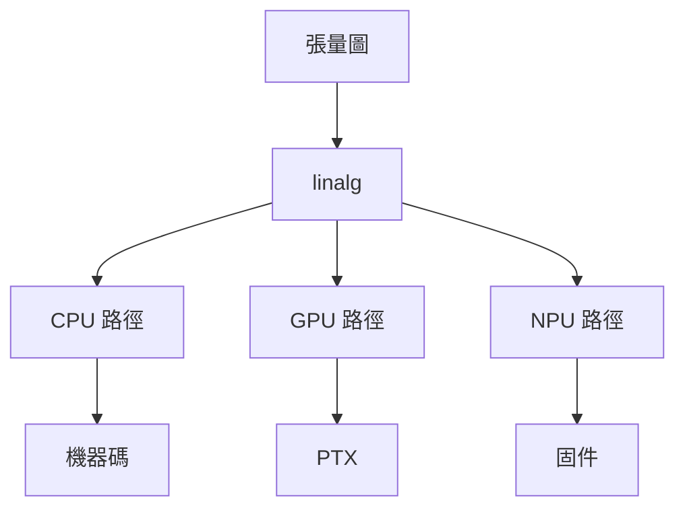
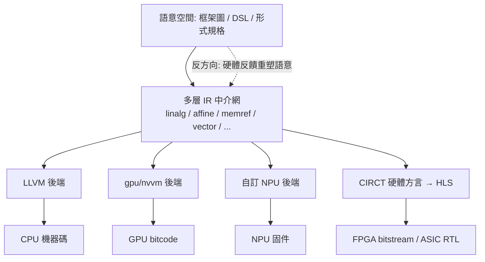
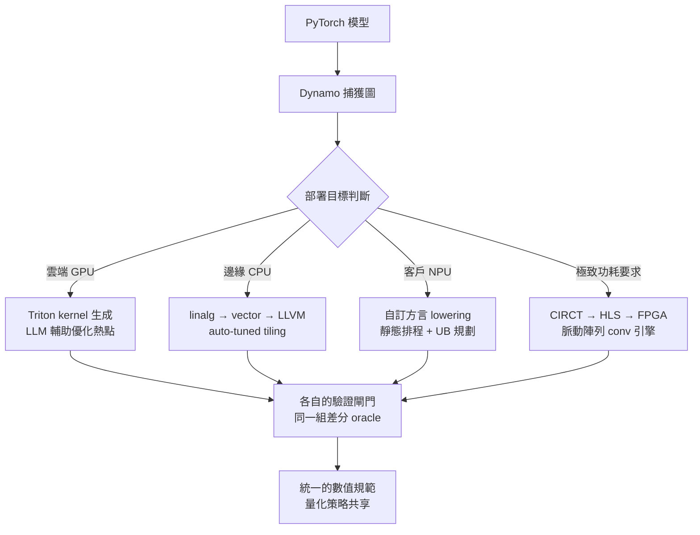
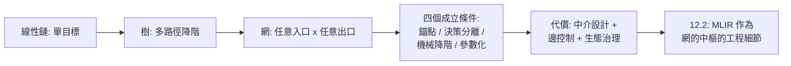

# 12.1 從線性管線到網狀結構：語意空間到多位元流的平行出口

第四部收尾的兩節要把全書合攏。11.1–11.3 節確立了「編譯終點可以是邏輯閘」；本節把視角拉到最高的架構層：**當編譯的出口同時有 CPU 機器碼、GPU bitcode、NPU 固件、FPGA bitstream 時，編譯器管線的形狀應該是什麼？** 答案是「網狀」——而網狀結構的成立條件，正是第二部建立的分層 IR 體系。

## 12.1.1 管線形狀的三次演化

把全書看到的編譯器形狀擺在一起：

**形狀一：線性鏈（第 4.3 節的經典架構）**

單目標時代的形狀。簡潔，但每一條鏈只能服務一種物理終點。

**形狀二：樹（第 6 章的降階路徑）**

同一入口、多條降階路。已經是網狀的雛形——但各路徑之間**不互通**（每條路上的決策不共享）。

**形狀三：網（本節的主張）**

網狀的特徵：**任意語意入口 × 任意物理出口的組合，通過共享的中介層連接**。且箭頭是雙向的——硬體的約束（反饋）可以流回語意層（12.3 節 co-design）。

## 12.1.2 網狀結構成立的四個條件

不是畫張圖就是網狀架構。讓「任意組合」真正成立的條件有四個，每個都對應前文的具體機制：

**條件一：語意的中立錨點。** 進入網的入口必須收斂到中立方言（stablehlo/tosa）——否則每種「入口 × 出口」組合都要各自的翻譯對（ $M \times N$ 問題）。錨點把它壓縮為 $M + N$ （5.2.2 節）。

**條件二：決策的可分離性。** 每類決策（融合/tiling/布局/排程）必須在其黃金高度完成、與其他決策**通過明確的介面交接**——這是 4.2.4 節原則的組織學含義：黃金高度不只是「最佳位置」，還是**模組化的邊界**。

**條件三：降階的機械化與可驗證性。** 跨方言的降階必須是機械的（pattern + conversion）且每步可驗證（verifier）——否則網狀的每條邊都是一個潛在的語意損壞點，組合起來不可控（5.3 節）。

**條件四：決策空間的顯式參數化。** tiling/layout/排程的選擇以參數形式存在（pass 參數、encoding 屬性），使「搜尋器/生成器」可以替換（6.3.5、8.3 節）——這使網不僅是靜態的管道，而是**可調度的決策空間**。

## 12.1.3 網狀的實證：一次部署，多個出口

以一個 LLM 推理服務為例，走一遍網狀管線的真實樣態：

三個值得注意的工程現實：

1. **共享的驗證基建**：四個出口用同一組差分 oracle（與 eager/參考實作比對）與數值規範（量化策略、容差規則）——**驗證體系是網狀架構的粘合劑**（第 7 章的漏斗在每條出口都重複使用）；
2. **決策的分層共享**：融合與量化策略在高層共享（一次決定），tiling 與排程在各出口獨立（各按各的硬體模型）——4.2.4 節對照表的部署級重演；
3. **出口間的互操作**：同一模型的張量在中間經過不同 device（CPU 預處理 → GPU 主計算 → NPU 特定層），跨 device 的資料流由 10.3 節的帶約束計畫管理。

## 12.1.4 網狀架構的代價與治理

誠實列出網狀的成本（4.3.5 節批評的延續與回應）：

* **中介層的設計成本**：每個方言都是長期承諾（語意、變換、驗證、文檔）。linalg 的多次大改版是前車之鑑；
* **邊的數量控制**：方言間的直接 conversion 應該受限（以樞紐方言為橋），否則退回 $O(N^2)$ （5.3.3 節機制的治理含義）；
* **標準化的政治**：中立錨點（stablehlo vs tosa）的競爭、自訂方言的碎片化風險——**生態治理成為架構問題的一部分**。

治理的準則可以概括為：**方言是「語意的行政區」，標準方言管公共地（互通），自訂方言管私有地（硬體特化），邊界以介面與 conversion pattern 明確劃分。**

## 12.1.5 小結

---

**參考與延伸閱讀**

* Lattner et al. (2021). "MLIR." *CGO*（對「管線到生態」轉變的原始論述）.
* OpenXLA 各項目文檔（入口/出口的組合矩陣）.
* 4.3、5.2、5.3、6.3 各節（本章是其架構綜合）.
