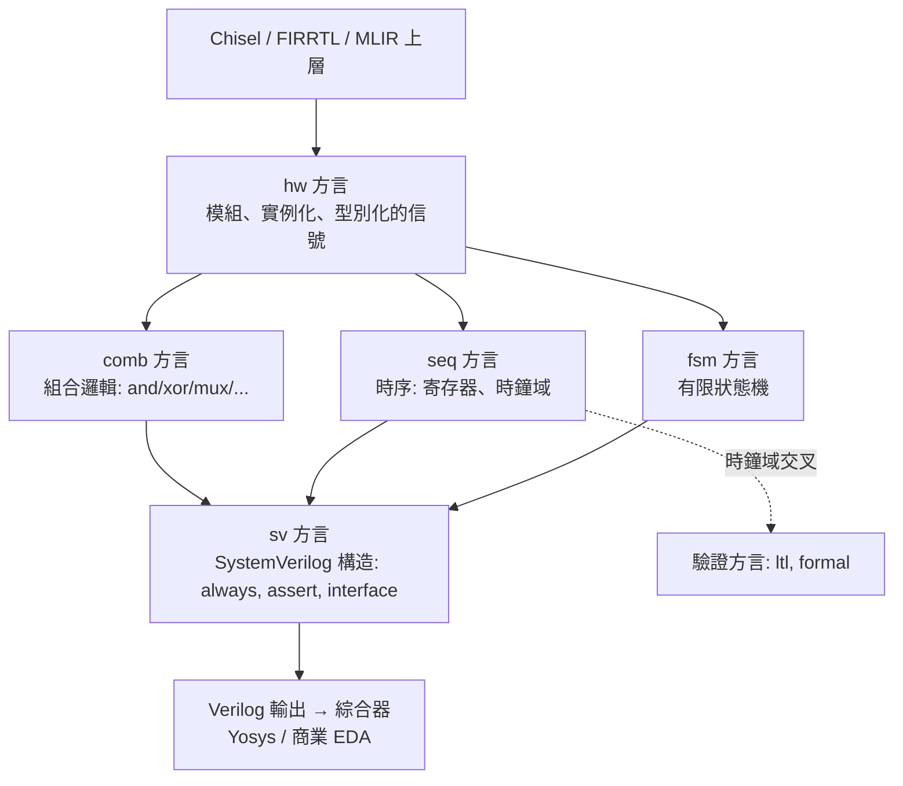
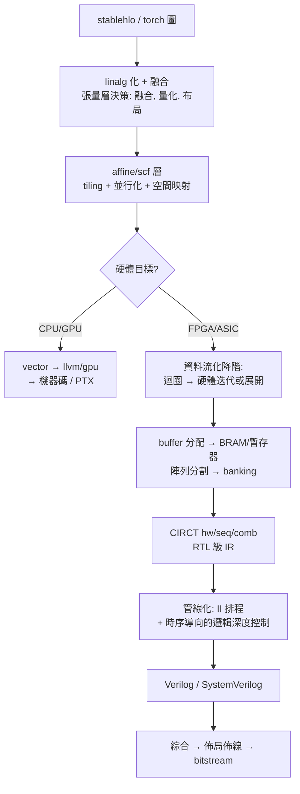
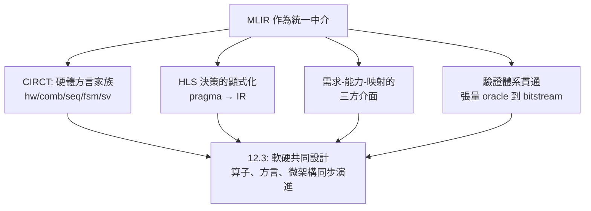

# 12.2 MLIR 作為統一中介層：連接演算法、Pass 與 HLS/HDL 後端

12.1 節畫出了網狀架構的藍圖；本節解剖中樞——**MLIR 如何具體地成為從演算法到 HLS/HDL 的統一中介**。核心案例是 CIRCT 項目，以及「張量方言 → 硬體方言」的降階鏈如何在實務中打通。

## 12.2.1 CIRCT：硬體世界的 MLIR

CIRCT（Circuit IR Compilers and Tools）把 MLIR 的抽象機制移植到硬體設計。它的方言家族構成一條硬體降階鏈：

CIRCT 與傳統流程（Chisel → FIRRTL 編譯器 → Verilog → EDA）的關鍵差異：

* **IR 級的互操作**：`hw`/`comb`/`seq` 是有正式型別與語意的 op——不同的前端（Chisel、Amaranth、直接手寫 MLIR）產出的 IR 可以**在同一層混合與變換**；
* **變換的工程化**：硬體優化（重定時、常數傳播、死代碼消除）用 MLIR 的 pattern 機制寫，享受 verifier 與測試基建；
* **與軟體棧的合流**：同一個 MLIR 基礎設施服務張量編譯與硬體編譯——**第 5 章的全部機制（dialect、interface、conversion）在硬體世界零成本復用**。

## 12.2.2 張量到硬體的降階鏈：一個端到端視圖

把第二部的張量管線與 CIRCT 對接，得到完整的「從張量到邏輯閘」：

與 11.3 節 HLS 的對照：**這條鏈把 HLS 的「黑箱式 C 轉 RTL」拆解為顯式的分層決策**：

| HLS 傳統做法（pragma 隱式） | MLIR 式做法（IR 顯式） |
|---------------------------|----------------------|
| C 代碼 + pragma 指定 unroll | `affine` 變換 pass 顯式展開 |
| 陣列分割靠 pragma | `memref` stride/型別屬性顯式表達 |
| 迴圈轉硬體由工具判斷 | 資料流化決策在 `scf`/`fsm` 層顯式做出 |
| 資源取捨在工具內部 | 排程/綁定決策以 op 形態可見、可 diff |

**從 pragma 到 IR 的轉移，本質上是 4.2.4 節「黃金高度」原則在 HLS 的復仇**：pragma 是藏在註解裡的決策（工具私有語意、不可跨工具移植），IR 是可推理、可驗證、可分享的決策。這也解釋了為什麼研究界（如多項 HLS-MLIR 工作）與 CIRCT 都選擇這條路。

## 12.2.3 介面層：演算法、Pass、硬體單元的同步語言

「統一中介」的第三個面向是**介面的統一**。三類主體通過 MLIR 的 interface 機制對話（5.1.4 節機制的硬體版）：

* **演算法側**：框架/模型宣告需求（形狀、精度、吞吐量）——以型別與屬性表達；
* **Pass 側**：變換宣告能力（`TilingInterface`、硬體版的介面如「這個 op 可被映射到脈動單元」）；
* **硬體單元側**：硬體資源模型（LUT/DSP/BRAM 預算、時鐘域、介面協議 AXI/握手）以屬性或目標描述表達。

Pass 在三者之間做匹配：拿到演算法需求 → 查詢硬體能力 → 生成映射決策。**這個「需求-能力-映射」的三方介面，是 12.3 節 co-design 的技術基礎**：因為需求與能力都被形式化，它們的聯合演化才成為可工程的問題。

## 12.2.4 驗證體系的貫通：從張量到閘門的信任鏈

11.2.2 節指出硬體驗證文化成熟（UVM/SVA）；12.2 的 MLIR 化使**軟體驗證與硬體驗證在同一體系內貫通**：

1. **張量層**：差分測試（與 eager 比對，數值容差）——第 7 章閘門二；
2. **迴圈/硬體層**：多面體/IR verifier（形狀、支配、資源合法性）——閘門一；
3. **RTL 層**：模擬對比（黃金模型 vs 生成 RTL）、形式等價檢查（組合邏輯等價性，SMT/ABC 系工具）、SVA 不變式；
4. **物理層**：時序收斂報告、功耗分析——閘門三的物理版。

最後一環「bitstream 上重跑差分」特別值得注意：**軟體世界的 oracle（張量差分）可以直接用在硬體終點上**——因為輸入輸出都是張量。這使「從張量到邏輯閘」的信任鏈**首尾同構**：起點的驗證工具就是終點的驗證工具。全書的翻譯契約在此獲得最強的形態：**語意錨點（張量語意 + 差分 oracle）從最高層貫穿到最低層。**

## 12.2.5 小結

---

**參考與延伸閱讀**

* CIRCT 項目文檔（circt.org）與 FIRRTL 規範.
* Lattner et al. (2021). "MLIR." *CGO*；Izraelevitz et al. (2017). "Reusability is FIRRTL Ground."
* Vitis HLS 與 MLIR-based HLS 的研究對照（如 ScaleHLS, 2022）.
* 11.3 節（HLS 原理）與 5.3 節（降階機制）.
