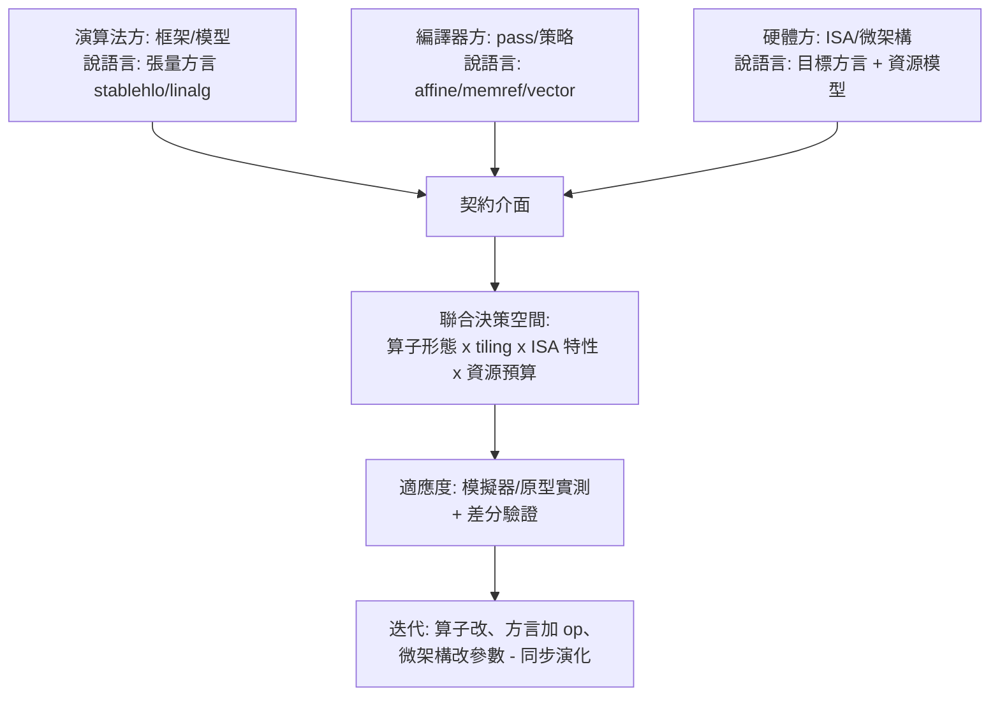

# 12.3 軟硬體共同設計的新範式：算子、方言與微架構同步演進

全書的最後一節。前面十一章建立了一條完整的降階鏈：張量語意 → 多層 IR → 指令流/邏輯閘，以及守護它的驗證體系與協作框架。本節討論這條鏈的終極含義：**當編譯器能精確表達「演算法-編譯器-硬體」三方的契約，軟硬體的共同設計（HW/SW Co-Design）從手工藝變成系統化工程**。

## 12.3.1 Co-Design 的本質：擴大聯合搜尋空間

傳統的設計流程是**序列的**：硬體團隊定 ISA → 編譯器團隊適配 → 演算法團隊使用。每一環只能在上環給定的約束內局部最優。

Co-design 的本質是**聯合搜尋**：把三方的決策變數放進同一個優化問題：

$$\max_{\text{ISA},\ \text{微架構},\ \text{編譯策略},\ \text{算子實現}} \; \text{效能/Watt/成本} \quad \text{s.t.} \quad \text{可製造性、時間表、正確性}$$

歷史的經典案例：

* **GPU tensor core**（Volta, 2017）：演算法（深度學習的矩陣乘主導）→ 硬體（mma 指令）→ 編譯器（cuBLAS/CUTLASS/Triton 的映射）三方共同演化的範本；
* **TPU 的 INT8**（3.1.1 節）：演算法證明 INT8 量化可行 → 硬體做 INT8 脈動陣列 → XLA 的量化 pass——**量化技術是三方共設計的教科書案例**（精度語意跨越 ISA、編譯器、框架三層）；
* **Arm SME**（10.1.3 節）：把 DSA 語意形式化為可程式 ISA，是「編譯器友善的硬體設計」的近期範例。

這些案例的共同點：**成功的 co-design 依賴三方共享一個形式化的契約語言**。tensor core 的契約是「warp 級矩陣片段 + layout 規定」；INT8 的契約是「scale/zp 的數學定義」。**契約越形式化，聯合搜尋的空間越可探索。**

## 12.3.2 方言作為 co-design 的契約語言

MLIR 的方言體系給 co-design 提供了歷史上最完備的契約語言。三方各自的「發言權」通過方言層級分配：

具體的同步演化場景（全書案例的匯流）：

* **新算子出現**（如新的 attention 變體）：演算法方在張量方言表達它 → 編譯器方判斷現有硬體的映射品質（8.3 節的生成迴圈可以給出 kernel 候選與其效能上限）→ 硬體方據此評估「下一代 ISA 是否需要新指令」（例如：可分離卷積的訪存模式是否值得專用單元）；
* **新硬體資源出現**（如更大 SMEM、新的記憶體層級）：硬體方在目標方言擴充資源模型 → 編譯器的 tiling/雙緩衝策略空間擴大 → 演算法方獲得新的設計自由（更大的模型塊、新的融合形態）。

**方言是這個閉環的「接合組織」**：它讓「硬體新增一條指令」的影響可以被編譯器以 conversion pattern 的粒度吸收，讓「演算法新增一個算子」的影響可以被硬體以資源模型的粒度評估。

## 12.3.3 co-design 的評估基建：模擬器、原型與差分的合流

聯合搜尋需要**快速且可信的適應度評估**。第四部建立的三項技術在此合流：

1. **模擬器與 FPGA 原型**（10.1.4 節）：新 ISA/微架構的行為在流片前可測——週期精確模擬器給效能，FPGA 給接近真實的頻率與功耗樣貌；
2. **張量級差分 oracle**（12.2.4 節）：無論設計變到哪一版，正確性的判據不變（與參考實作的數值比對）——**適應度函數的正確性分量是穩定的**；
3. **效能回饋的統一形態**（2.2.5、8.3 節）：Roofline 位置、資源利用率、II——同一套指標語言在 CPU/GPU/NPU/FPGA 之間通用。

這三者的組合使 co-design 的迭代迴圈從「以年計的流片驗證」壓縮到「以天計的原型迭代」。**週期壓縮是範式轉移的實際標誌**——正如 MLIR 把新編譯器後端的開發從「年」壓到「月」，co-design 基建把新硬體代次的聯合調優從「年」壓到「季度」。

## 12.3.4 LLM 在 co-design 中的位置

把第三部的協作框架（9.3 節）投到 co-design 場景，可以預見（部分已是現實）的分工：

| co-design 任務 | LLM 的角色 | 確定性工具的角色 | 人類的角色 |
|---------------|-----------|----------------|-----------|
| 新算子的 kernel 探索 | 生成候選（8.3） | 模擬器實測 + 差分 | 簽名效能結論 |
| ISA 提案的影響分析 | 生成編譯器適配原型（8.1） | IR verifier + 模擬 | 架構判斷 |
| 微架構參數的聯合搜尋 | 提議搜尋方向 | 周期模擬 + 資源估算 | 取捨決策 |
| 契約（方言/ISA spec）的設計 | 草稿與一致性檢查 | 形式語意檢查 | **主導**（9.2.5：核心語意人主導） |

第四行是底線：**契約本身（ISA 語意、方言語意）是 co-design 的憲法**，憲法的制定權在人。9.2 節的論證（全域不變式、信任錨點）在硬體領域更加鐵律——硬體的錯誤不可打補丁，契約錯誤的代價是一次流片的數月與數百萬。

## 12.3.5 全書回望：一條主線與三個原則

### 一條主線

從序章開始的主線現在可以完整地講出來：

> **每一次 IR 降階都是有損壓縮：高階語意的「選擇空間」被換成低階確定的「動作」。好的編譯器體系，把降階切成足夠細的台階，讓每一階可以單獨驗證、單獨最佳化，並在正確性破壞時精確定位。**

全書的技術內容都是這條主線的展開：

* 第一部：每一種硬體（CPU/GPU/DSA/電路）對「選擇空間」的定義不同——所以需要不同的降階高度；
* 第二部：多層 IR 是「按黃金高度組織選擇空間」的工程化；MLIR 是它的工業平台；
* 第三部：LLM 把「提出候選」的環節機率化，但驗證的台階必須保持確定性——信任半徑與簽名鏈是新的架構要素；
* 第四部：降階的終點延伸到邏輯閘，且契約語言（方言）反過來成為軟硬共同演化的接合組織。

### 三個原則

如果只允許從全書帶走三條原則：

**原則一：決策放在資訊最完整的層。** 這是架構設計的第一公理（4.2.4、10.3.2）。它推導出：融合在張量層、tiling 在仿射層、放置在 flow 層、分配在 runtime 層。違反它的症狀是「語義抹除」——決策者找不到需要的資訊。

**原則二：每一層邊界即驗證點。** 這是正確性工程的第一公理（4.2.5、5.3.6、7.3、12.2.4）。它推導出：verifier 生態、差分 oracle 的分層、簽名鏈的貫通。違反它的症狀是「錯誤遠距傳播」——bug 在幾十個 pass 之後才爆發。

**原則三：生成擴大搜尋，工具守住保證。** 這是生成時代的第一公理（7.1.3、9.2、9.3）。它推導出：機率性生成用於候選探索，確定性工具用於不變式，人類用於全域決策與責任錨點。違反它的症狀是「系統性錯誤的不可控傳播」。

### 一個結尾的問題

本書以「從張量到邏輯閘」為題，講的是**降階**。但第四部的 co-design 視角揭示了一個對稱的事實：**最好的降階系統，同時也是最好的升階系統**——硬體的約束沿著同一條方言階梯流回語意層，重塑演算法的設計空間。翻譯契約從來不是單向的：**理解硬體的語言，最終是為了讓硬體學會理解演算法的語言。** 這條雙向的樓梯，就是軟硬體共同設計的全部意義，也是計算機結構這門學科在生成時代的新起點。

---

**參考與延伸閱讀**

* Hennessy & Patterson (2019). "A New Golden Age for Computer Architecture." *CACM*.
* Jouppi et al. (2017, 2023). TPU v1/v4 論文（co-design 的實證範本）.
* 全書各章（本節是其綜合）.
