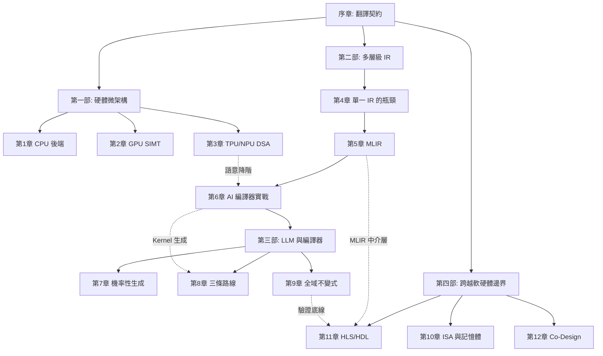

# 從張量到邏輯閘：異質算力、MLIR、HLS 與現代編譯器架構

**副標題：CPU、GPU、NPU 與 TPU 的編譯降階之路**

本書是一本聚焦於「計算語意如何逐層降階並落地到不同物理硬體」的系統與編譯器專書。全書從傳統 CPU 後端出發，經過 GPU 的 SIMT 模型、TPU/NPU 的領域特定架構，深入 MLIR 的多層降階體系，最後抵達 HLS/HDL 的硬體合成終點，並討論 LLM 參與編譯流程後帶來的新張力。

---

## 目錄

### 序章

* [0.1-從指令流到物理算力的翻譯契約](00.1-從指令流到物理算力的翻譯契約.md)

### 第一部：異質硬體微架構與編譯器的對話

* 第1章-CPU 的微架構與經典編譯器後端
    * [1.1-亂序執行、分支預測與快取階層：微架構對代碼生成的約束](01.1-亂序執行分支預測與快取階層對代碼生成的約束.md)
    * [1.2-SSA、指令選擇、暫存器配置與指令排程：CPU 後端的四重奏](01.2-SSA指令選擇暫存器配置與指令排程.md)
    * [1.3-形式驗證與差分測試：編譯器正確性的守門人](01.3-形式驗證與差分測試編譯器正確性的守門人.md)
* 第2章-GPU 架構與 SIMT 編譯模型
    * [2.1-SIMT 與 Warp 排程：一萬個執行緒共用一條指令](02.1-SIMT與Warp排程一萬個執行緒共用一條指令.md)
    * [2.2-分歧控制流、記憶體合併與 Occupancy：GPU 效能三本柱](02.2-分歧控制流記憶體合併與Occupancy.md)
    * [2.3-從 CUDA/PTX 到 Triton：Kernel 生成與效能回饋迴圈](02.3-從CUDAPTX到TritonKernel生成與效能回饋迴圈.md)
* 第3章-TPU 與 NPU：張量引擎與領域特定架構
    * [3.1-脈動陣列與 MXU：為矩陣乘法而生的矽](03.1-脈動陣列與MXU為矩陣乘法而生的矽.md)
    * [3.2-靜態排程、張量分塊與雙緩衝：DSA 編譯器的核心課題](03.2-靜態排程張量分塊與雙緩衝DSA編譯器的核心課題.md)
    * [3.3-算子融合、記憶體布局轉換與靜態記憶體規劃](03.3-算子融合記憶體布局轉換與靜態記憶體規劃.md)

### 第二部：多層級 IR 與張量編譯的演進

* 第4章-單一 IR 的瓶頸與張量語義的流失
    * [4.1-LLVM IR 的純量本位：為什麼它裝不下高維張量](04.1-LLVMIR的純量本位為什麼它裝不下高維張量.md)
    * [4.2-語義抹除：計算圖降階為低階指令時丟失了什麼](04.2-語義抹除計算圖降階為低階指令時丟失了什麼.md)
    * [4.3-從線性管線到多層降階：編譯器架構的範式轉移](04.3-從線性管線到多層降階編譯器架構的範式轉移.md)
* 第5章-MLIR 架構與 Progressive Lowering
    * [5.1-Operation、Region、Block：MLIR 的核心抽象](05.1-OperationRegionBlockMLIR的核心抽象.md)
    * [5.2-Dialect 生態系：從 linalg 與 stablehlo 到 memref 與 llvm](05.2-Dialect生態系從linalg與stablehlo到memref與llvm.md)
    * [5.3-漸進式降階與 Dialect Conversion 的工程實作](05.3-漸進式降階與DialectConversion的工程實作.md)
* 第6章-AI 編譯器堆疊實戰：CPU、GPU、TPU 與 NPU 的降階路徑
    * [6.1-同一份計算圖的三條降階路：CPU、GPU 與 NPU 後端](06.1-同一份計算圖的三條降階路.md)
    * [6.2-Polyhedral Model 與 Loop Transformation 在 MLIR 中的落地](06.2-PolyhedralModel與LoopTransformation在MLIR中的落地.md)
    * [6.3-XLA、IREE 與 Triton 生態中的 MLIR 角色定位](06.3-XLAIREE與Triton生態中的MLIR角色定位.md)

### 第三部：LLM 進入編譯器工坊

* 第7章-機率性生成與編譯確定性的張力
    * [7.1-當模型參與編譯：從確定性語義到機率性候選生成](07.1-當模型參與編譯從確定性語義到機率性候選生成.md)
    * [7.2-版本漂移與非確定性輸出：看似正確卻違反不變式的風險](07.2-版本漂移與非確定性輸出看似正確卻違反不變式的風險.md)
    * [7.3-驗證體系的強化：形式化檢查、差分測試與人工審查簽名鏈](07.3-驗證體系的強化形式化檢查差分測試與人工審查簽名鏈.md)
* 第8章-LLM 在編譯器與 Kernel 工程的三條路線
    * [8.1-輔助開發：Pass 骨架與後端移植樣板的生成](08.1-輔助開發Pass骨架與後端移植樣板的生成.md)
    * [8.2-錯誤搜尋：以生成多樣性挖掘編譯器深層 Bug](08.2-錯誤搜尋以生成多樣性挖掘編譯器深層Bug.md)
    * [8.3-Kernel 生成：效能回饋驅動的迭代式程式合成](08.3-Kernel生成效能回饋驅動的迭代式程式合成.md)
* 第9章-編譯器全域不變式的硬邊界
    * [9.1-跨數十個 Pass 的全域不變式：SSA 支配、別名與生命週期](09.1-跨數十個Pass的全域不變式.md)
    * [9.2-為什麼核心編譯器的 Merge 權限不能交給模型](09.2-為什麼核心編譯器的Merge權限不能交給模型.md)
    * [9.3-人機協作邊界：生成探索、工具守底線、工程師簽名](09.3-人機協作邊界生成探索工具守底線工程師簽名.md)

### 第四部：跨越軟硬體邊界：記憶體、ISA 與 HLS/HDL

* 第10章-開放 ISA 與異質記憶體架構
    * [10.1-RISC-V 自訂擴充：向量、矩陣與 AI 擴充對編譯器的考驗](10.1-RISCV自訂擴充向量矩陣與AI擴充對編譯器的考驗.md)
    * [10.2-CXL 與統一位址空間：異質記憶體間的資料搬移與一致性](10.2-CXL與統一位址空間異質記憶體間的資料搬移與一致性.md)
    * [10.3-編譯器與 Runtime 在異質記憶體階層中的張量管理](10.3-編譯器與Runtime在異質記憶體階層中的張量管理.md)
* 第11章-從軟體編譯到硬體合成：HLS 與 HDL
    * [11.1-編譯終點的轉移：從指令流到邏輯閘與電路拓撲](11.1-編譯終點的轉移從指令流到邏輯閘與電路拓撲.md)
    * [11.2-Verilog、SystemVerilog 與 Chisel：HDL 的三個世代](11.2-VerilogSystemVerilog與ChiselHDL的三個世代.md)
    * [11.3-時序收斂、資源估算與管線化排程：HLS 的編譯原理](11.3-時序收斂資源估算與管線化排程HLS的編譯原理.md)
* 第12章-網狀編譯管線與軟硬體共同設計
    * [12.1-從線性管線到網狀結構：語意空間到多位元流的平行出口](12.1-從線性管線到網狀結構語意空間到多位元流的平行出口.md)
    * [12.2-MLIR 作為統一中介層：連接演算法、Pass 與 HLS/HDL 後端](12.2-MLIR作為統一中介層連接演算法Pass與HLSHDL後端.md)
    * [12.3-軟硬體共同設計的新範式：算子、方言與微架構同步演進](12.3-軟硬體共同設計的新範式算子方言與微架構同步演進.md)

---

## 全書閱讀路線圖

## 本書的技術矩陣

| 層級 | 代表 IR / 語言 | 目標硬體 | 核心課題 |
|------|--------------|---------|---------|
| 張量圖層 | TOSA / StableHLO / ONNX | 無（圖優化） | 算子融合、形狀推導 |
| 結構化張量層 | `linalg` / `tensor` | TPU / NPU | Tiling、布局、緩衝規劃 |
| 迴圈層 | `affine` / `scf` | FPGA / DSA | Polyhedral、雙緩衝 |
| 記憶體層 | `memref` | 所有 | 位址、生命週期 |
| 向量層 | `vector` / RVV | CPU / GPU | SIMD / SIMT 對映 |
| 純量控制流層 | LLVM IR / MLIR `llvm` | CPU | SSA、暫存器配置 |
| 硬體描述層 | CIRCT / HLS C++ / Chisel | FPGA / ASIC | 時序、資源、管線 |
| 物理層 | RTL / Netlist / Bitstream | 邏輯閘 | 面積、功耗、頻率 |

## 前置知識

* 計算機結構基礎（管線、快取、ISA 概念）
* 編譯器原理（語法分析、IR、基本最佳化）
* 線性代數（矩陣乘法、張量概念）
* 一點程式實作經驗（C/C++、Python 皆可）
