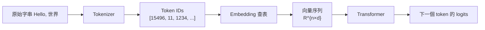

# 1.1 從 Token 到機率分布：理解模型輸出的底層邏輯

## 為什麼要從這裡開始

在動手接 API 之前，先建立一個心智模型：**大語言模型本質上是一個「下一個 Token 的機率分布函數」**。所有上層能力——對話、工具呼叫、Agent 迴圈——都是這個函數被反覆呼叫、串接、包裝後的湧現現象。理解這一層，你才能解釋「為什麼同樣的 prompt 兩次結果不同」、「為什麼 temperature 會改變行為」、「為什麼 token 數直接等於錢與延遲」。

## 文字如何變成數字：分詞（Tokenization）

模型不吃字元，吃的是 **Token**。分詞器（tokenizer）把字串映射為整數序列：

$$
\text{encode}: \Sigma^* \to \mathbb{Z}^n,\qquad \text{decode}: \mathbb{Z}^n \to \Sigma^*
$$

現代主流採用 **BPE（Byte-Pair Encoding）** 或 SentencePiece 類演算法：從位元組開始，反覆合併最常共現的相鄰單元，直到詞表大小達到目標。這帶來幾個工程後果：

- **同一語意、不同長度**：中文、程式碼、罕見字的 token 密度差異很大，直接影響成本與 context 用量。
- **邊界效應**：一個詞可能被切成多個 token，模型看到的不是「字」而是「碎片」，這解釋了拼字、字元計數類任務為何脆弱。
- **不可逆性誤差**：`decode(encode(x))` 在正常情況下等於 `x`，但截斷在 token 邊界時可能產生亂碼。

## 從 Logits 到機率：Softmax

模型最後一層輸出對詞表中每個 token 的分數（logits） $`z \in \mathbb{R}^{|V|}`$，經 softmax 得到機率：

$$
p_i = \frac{\exp(z_i / T)}{\sum_j \exp(z_j / T)}
$$

其中 $`T`$ 為 temperature。這個式子是全書第一個關鍵控制點：$`T \to 0`$ 使分布趨近 one-hot（貪婪），$`T`$ 變大則分布更平坦（更隨機）。

## 自迴歸生成：一次一個 Token

生成是逐 token 的自迴歸過程：

$$
p(x_{1:n}) = \prod_{t=1}^{n} p(x_t \mid x_{<t})
$$

每一步都做一次「前向 → softmax → 取樣 → 接回輸入」。這解釋了三個核心事實：

1. **延遲是累加的**：輸出越長越慢，因為是序列解碼。
2. **沒有真正的「回頭修改」**：已生成的 token 成為後續的條件，錯誤會沿軌跡放大。
3. **KV Cache 的存在**：已算過的注意力鍵值可快取，避免重算，這是串流與成本優化的物理基礎。

$$\text{TTFT} = t_{\text{prefill}},\qquad \text{TPOT} = \frac{t_{\text{total}} - t_{\text{prefill}}}{n_{\text{out}}}$$

- **TTFT（Time To First Token）** 主要受輸入長度（prefill）影響。
- **TPOT（Time Per Output Token）** 主要受模型大小與解碼效率影響。

## 取樣策略： greedy、top-k、top-p

純 softmax 取樣可能抽到極低機率 token。實務上用截斷：

- **Greedy / argmax**：$`x_t = \arg\max_i p_i`$，確定性高但易重複。
- **Top-k**：只在機率最高的 $`k`$ 個 token 中取樣。
- **Top-p（nucleus）**：取累積機率達 $`p`$ 的最小集合，再重新歸一化。

$$
\text{top-}p:\quad S = \min\Big\{ S' : \sum_{i \in S'} p_{(i)} \ge p \Big\}
$$

Top-p 的優勢是**自適應**：分布尖銳時集合小，分布平坦時集合大。

## 為什麼「溫度」與「隨機性」是產品決策而非純技術參數

| 任務型態 | 建議 | 理由 |
|---|---|---|
| 抽取、分類、工具參數 | 低溫（0–0.3） | 需要穩定、可重現 |
| 創意寫作、 brainstorm | 高溫（0.8–1.2） | 需要多樣性 |
| 程式碼生成 | 低中溫（0.2–0.4） | 正確性優先 |
| Agent 決策 | 低溫 | 降低不可預測的軌跡漂移 |

## 與後續章節的關聯

- **第 3 章的成本與延遲**：直接由 token 數與自迴歸解碼決定。
- **第 4 章的工具呼叫**：本質是「讓模型輸出特定結構的 token 序列」。
- **第 7 章的 Agent 迴圈**：只是把「單次生成」包成「多次生成 + 環境回饋」。

> 記住這條主線：**機率分布 → 取樣 → 序列 → 對話 → 工具 → 迴圈 → Agent**。每一步都是前一層的組合，而非魔法。

## 小結

1. 模型輸出的是下一個 token 的機率分布，一切行為源於此。
2. Tokenization 決定成本、延遲與字元級任務的脆弱性。
3. 自迴歸生成讓延遲累加、錯誤放大，是串流與快取設計的根因。
4. Temperature / top-p 是產品層決策，應依任務型態選擇。
