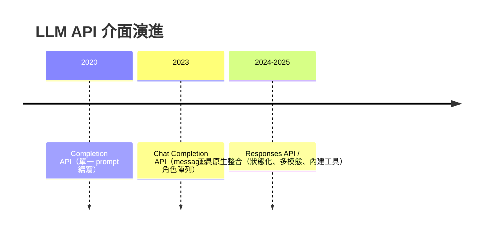
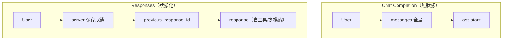

# 1.2 Chat Completion 與 Responses 介面演進：System Prompt、Roles 與 Context Window

## 從 Completion 到 Chat：介面抽象的三次躍遷

LLM API 的歷史，是一部「如何把機率分布包裝成可用產品」的歷史。三次關鍵躍遷：



### 第一代：Completion

輸入就是一段文字，模型續寫：

```
prompt: "Translate to French: hello"
output: "bonjour"
```

問題：**沒有結構**。指令、輸入、範例全混在一個字串裡，模型難以區分「誰在說話」。

### 第二代：Chat Completion（messages 陣列）

引入角色（roles）：

```json
{
  "messages": [
    {"role": "system", "content": "你是嚴謹的翻譯助手。"},
    {"role": "user", "content": "Translate to French: hello"}
  ]
}
```

角色語意：

| Role | 作用 | 工程要點 |
|---|---|---|
| `system` | 設定人格、規則、邊界 | 最高優先，但要防注入覆寫 |
| `user` | 使用者輸入 | 不可信來源，需消毒 |
| `assistant` | 模型回覆 | 可含 tool_calls，歷史的一部分 |
| `tool` | 工具結果回填 | 需與 tool_call_id 對應 |

**這一步的意義**：把「指令」與「資料」在協定層分離，為後續的結構化輸出與工具呼叫鋪路。

### 第三代：Responses API 與原生工具

新世代 API（如 OpenAI Responses、各家 Agent SDK）把「一輪對話」升級為「一個有狀態的回應物件」：

- **狀態化**：可用 `previous_response_id` 串接，不必每次重送全部歷史。
- **原生工具**：web search、file search、code interpreter 直接內建。
- **多模態輸入輸出**：文字、圖像、音訊統一在 response 內。
- **可組合**：response 可含 reasoning、tool calls、多段輸出。



## Context Window：Agent 的「工作記憶容量」

模型一次能看的 token 上限稱為 **context window**。它同時是：

- **能力邊界**：超過就必須截斷或壓縮（見第 3、8 章）。
- **成本因子**：prefill 成本與輸入長度近似線性（或平方，取決於注意力實作）。
- **延遲因子**：TTFT 隨輸入增長。

$$C_{\text{turn}} = C_{\text{system}} + C_{\text{history}} + C_{\text{tools}} + C_{\text{output}} \le C_{\max}$$

在 Agent 場景，**工具定義本身也佔 context**。工具越多、schema 越長，留給推理的空間越少——這是第 4 章「工具瘦身」的動機。

## System Prompt 的工程設計

System prompt 不是「寫得越長越好」，而是「規則的優先級與可執行性」。

好的 system prompt 具備：

1. **角色與目標**：一句話說清楚「你是誰、要達成什麼」。
2. **硬性約束**：用 MUST / NEVER 標明不可違反項。
3. **輸出契約**：格式、語言、長度。
4. **工具使用規則**：何時呼叫、何時不呼叫。
5. **失敗處理**：資訊不足時的行為（詢問 vs. 猜測）。

反模式：
- 把大量資料塞進 system（應放 user 或檢索結果）。
- 用模糊的「盡量」「可能」描述硬性要求。
- 在 system 內放可被使用者覆寫的指示。

## 角色與信任階級

安全模型上，不同 role 代表不同信任等級：

$$
\text{trust}(\text{system}) > \text{trust}(\text{developer}) > \text{trust}(\text{user}) > \text{trust}(\text{tool output})
$$

其中 **tool output 是最危險的**：它可能來自網頁、檔案、第三方 API，內含 prompt injection（見 2.3、13.4）。因此工具結果回填時，必須以「資料」而非「指令」對待。

## 無狀態的本質與「有狀態包裝」

即使 API 宣稱 chat，多數實作仍是**無狀態**：伺服器不記得你上一輪說了什麼，是你每次把整個 `messages` 重送。Responses API 的 `previous_response_id` 只是把「重送」搬到伺服器端。

這帶出第 3 章的核心命題：**如何在無狀態 API 之上，工程化地建立有狀態的對話與 Agent**。

## 介面選型的實務考量

| 需求 | 建議介面 |
|---|---|
| 簡單文字問答 | Chat Completion |
| 需要伺服器端狀態、內建工具 | Responses API |
| 需要完全掌控工具迴圈 | Chat Completion + 自建 loop |
| 多模態即時互動 | Realtime / Responses 多模態 |

## 小結

1. 介面從「字串續寫」演進到「角色陣列」再到「狀態化 response」，本質是**把結構與狀態外顯化**。
2. Context window 是能力、成本、延遲的三重邊界，工具定義也佔額度。
3. System prompt 是規則的優先級設計，而非資料堆疊。
4. 信任階級提醒我們：工具輸出是不可信資料，需防注入。
5. 無狀態 API 是所有有狀態 Agent 的起點，第 3 章將正面處理它。
