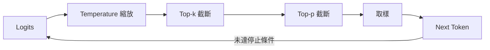

# 1.3 關鍵推論參數解析：Temperature、Top-P、Max Tokens 與停止條件

## 參數是「分布的操作旋鈕」

1.1 說明了模型輸出是機率分布。推論參數（sampling parameters）就是你對這個分布與生成過程的操作旋鈕。理解每個旋鈕的數學作用，才能避免「憑感覺調參」。



## Temperature：控制分布的尖銳度

$$
p_i = \frac{\exp(z_i / T)}{\sum_j \exp(z_j / T)}
$$

- $`T < 1`$：分布更尖銳，高機率 token 更被偏愛，行為更確定。
- $`T = 1`$：原始分布。
- $`T > 1`$：分布更平坦，低機率 token 有機會被選到。

**注意**：temperature 不是「創意旋鈕」的簡單線性映射。低溫仍可能在大量 token 上累積出多樣性；高溫也可能因 top-p 截斷而收斂。兩者需搭配。

## Top-k：固定候選數量

只保留機率最高的 $`k`$ 個 token：

$$
S_k = \{ \text{top-}k \text{ by } p_i \},\qquad p'_i = \frac{p_i}{\sum_{j \in S_k} p_j}
$$

問題：$`k`$ 是固定值，無法適應分布形狀。分布很尖時 $`k=50`$ 太多，分布很平時又太少。

## Top-p（Nucleus Sampling）：自適應候選集

保留累積機率達 $`p`$ 的最小集合：

$$
S_p = \min\Big\{ S : \sum_{i \in S} p_{(i)} \ge p \Big\}
$$

其中 $`p_{(i)}`$ 為降序排列的機率。這是目前最常用的組合：**低溫 + top-p 0.9–0.95** 兼顧穩定與自然。

## Max Tokens：硬上限

限制輸出長度：

$$
\text{len}(x_{\text{out}}) \le n_{\max}
$$

工程要點：
- 設太小 → 回覆被硬切斷（truncated），結構化輸出可能不合法。
- 設太大 → 浪費成本、拉高延遲，且模型可能「話多失焦」。
- 對 JSON 輸出，$`n_{\max}`$ 需留足餘量，或在 schema 上限制欄位。

## 停止條件（Stop Sequences）

指定一串 token，模型生成到它就停：

```json
{"stop": ["\n\n", "###", "</answer>"]}
```

用途：
- 防止模型繼續生成下一個範例（few-shot 洩漏）。
- 控制結構邊界。
- 省 token。

陷阱：stop 序列若出現在正常內容中會被誤切；要選模型不太會自然產生的字串。

## 頻率與存在懲罰（Frequency / Presence Penalty）

- **Frequency penalty**：依 token 已出現次數懲罰，抑制重複。
- **Presence penalty**：只要出現過就懲罰，鼓勵引入新主題。

$$
z'_i = z_i - \alpha \cdot \text{count}(i) - \beta \cdot \mathbb{1}[\text{count}(i) > 0]
$$

對 Agent 場景要小心：過度懲罰會讓模型避免重複必要的關鍵詞（如函式名、參數名），反而傷害工具呼叫正確率。

## Logit Bias：直接改寫特定 token 機率

給特定 token 加上偏置：

$$
z'_i = z_i + b_i
$$

用途：禁止某些 token（大負偏置）、強制格式開頭（如強制輸出 `{`）。這是「軟約束」，不如 2.2 的 guided decoding 嚴格，但成本低。

## 種子（Seed）與可重現性

設定 `seed` 可讓取樣在相同輸入下盡量可重現，但**不保證跨模型版本、跨硬體完全一致**。工程上：
- 評估時固定 seed 以降低變異。
- 不要把 seed 當成「確定性保證」，仍要容忍變異。

## 參數與任務的對應矩陣

| 任務 | Temperature | Top-p | Max tokens | 其他 |
|---|---|---|---|---|
| 分類 / 抽取 | 0.0–0.2 | 0.8–0.9 | 小 | 固定 seed |
| 工具參數生成 | 0.0–0.2 | 0.9 | 中 | 低 frequency penalty |
| 程式碼 | 0.2–0.4 | 0.95 | 大 | — |
| 對話助理 | 0.5–0.8 | 0.9 | 中 | 適度 penalty |
| 創意寫作 | 0.9–1.2 | 0.95 | 大 | — |

## 常見誤解

1. **「temperature=0 就完全確定」**：多數實作仍有浮點與批次非確定性，且不同供應商語意不同。
2. **「top-p 和 top-k 可以隨意疊」**：同時開會讓候選集被兩種規則連續截斷，行為不易預測；建議只主用一種。
3. **「max_tokens 只是成本控制」**：它也是正確性控制，切斷會破壞結構化輸出。

## 與後續章節的關聯

- **2.2 結構化輸出**：max_tokens 與 stop 是 JSON 合法性的第一道防線。
- **3.2 延遲設計**：max_tokens 直接影響 TPOT 總時間。
- **3.3 成本控制**：輸入 token × 單價 + 輸出 token × 單價，參數影響兩端。
- **11.2 評估**：評估時必須固定參數，否則變異會淹沒訊號。

## 小結

1. Temperature 改分布尖銳度，top-p / top-k 改候選集，三者需搭配而非濫疊。
2. Max tokens 與 stop 同時是成本與正確性控制。
3. Logit bias 是輕量軟約束，guided decoding 才是硬約束（見 2.2）。
4. Seed 降低變異但不保證確定性。
5. 參數選擇應由任務型態驅動，並在評估中固定。
