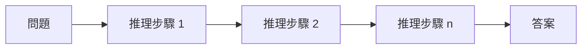

# 2.1 清晰指令設計、少樣本學習（Few-Shot）與思維鏈（Chain-of-Thought）

## 提示工程的本質：降低任務的「描述熵」

模型要從 prompt 推斷你的意圖。若你的描述有歧義，模型只能依訓練分布猜測。提示工程的核心目標是**降低「你想要的任務」與「prompt 所描述的任務」之間的分佈差異（distribution shift）**。

$$
\text{goal} = \arg\min_{\text{prompt}} \; D_{\mathrm{KL}}\big( P_{\text{task}} \,\|\, P_{\text{model}}(\cdot \mid \text{prompt}) \big)
$$

這是一個非正式的類比，但抓住了重點：**prompt 是對任務分布的條件化**。

## 清晰指令的四要素

一個可執行的指令通常包含：

1. **角色（Role）**：你是誰。
2. **任務（Task）**：要做什麼，動詞明確。
3. **輸入規格（Input spec）**：資料在哪、長什麼樣。
4. **輸出規格（Output spec）**：格式、長度、語言、範例。

反例與正例：

```text
# 反例
幫我處理一下這段文字。

# 正例
你是資訊抽取器。從 <text> 中抽出所有「公司名稱」與「收購金額」，
輸出 JSON 陣列，每個元素含 company (string) 與 amount_usd (number)。
若金額單位不是美元，先換算。無資料時輸出 []。
<text>...</text>
```

## 指令設計的實務準則

| 準則 | 說明 |
|---|---|
| 具體動詞 | 「摘要成三點」優於「處理」 |
| 正向表述 | 「只輸出 JSON」優於「不要輸出解釋」 |
| 分隔資料 | 用 `<text>`、`<doc>` 等標籤包住輸入，防混淆 |
| 明確失敗行為 | 「資訊不足時回傳 `{"error": "insufficient"}`」 |
| 一次一任務 | 避免同時要求抽取、翻譯、評論 |

**分隔符的重要性**：它讓模型能區分「指令」與「資料」，這是防 prompt injection 的第一道結構性防線（見 2.3）。

## 少樣本學習（Few-Shot）

在 prompt 中放入輸入輸出範例，讓模型模仿：

```text
<input>I love this movie</input><output>positive</output>
<input>The plot was a mess</input><output>negative</output>
<input>The service was okay, nothing special</input><output>
```

### 為什麼 few-shot 有效

- **隱式指定格式**：範例比描述更能傳達格式細節。
- **界定邊界案例**：給「模糊」範例，教模型如何處理灰區。
- **降低指令歧義**：模型從範例推斷標籤空間。

### Few-shot 的設計要點

1. **範例順序**：模型對最後幾個範例更敏感（recency bias），把最關鍵的放後面。
2. **範例多樣性**：涵蓋不同類別與邊界，避免模型只學到表面模式。
3. **範例數量**：通常 3–8 個即可，過多會擠壓 context 且不一定更好。
4. **標籤平衡**：分類任務避免某一類壓倒性多數。
5. **避免範例洩漏答案**：測試輸入不要與範例過於相似。

### Zero-Shot CoT 與 Few-Shot CoT

- **Zero-shot CoT**：加一句「Let's think step by step」誘導推理。
- **Few-shot CoT**：範例中附上推理過程，模型模仿推理格式。

```text
Q: 小明有 5 顆蘋果，吃了 2 顆，又買了 3 顆，現在幾顆？
A: 5 - 2 = 3，3 + 3 = 6。答案是 6。
Q: ...
```

## 思維鏈（Chain-of-Thought, CoT）

CoT 讓模型在中間產生推理步驟，再給答案。

$$
P(\text{answer} \mid \text{question}) \approx \sum_{\text{reasoning}} P(\text{answer} \mid \text{reasoning}) \, P(\text{reasoning} \mid \text{question})
$$

這可視為對隱藏推理路徑的邊緣化（marginalization）：顯式寫出推理，等於讓模型「外化」中間變數，降低單步跳躍的錯誤率。



### CoT 的效益與邊界

**有效場景**：數學、多步邏輯、需要規劃、需要組合多個事實。

**效益有限的場景**：簡單檢索、直覺分類（CoT 反而增加成本與延遲）。

**風險**：
- **不忠實推理（unfaithful CoT）**：模型寫出的步驟未必是它實際的計算路徑，可能「先有答案再補理由」。
- **錯誤傳播**：早期步驟錯誤會沿鏈放大。
- **洩漏敏感推理**：若推理含內部政策或隱私，直接外顯有風險。

### 實務技巧：把「思考」與「輸出」分離

在 Agent 場景，常讓模型先輸出 `reasoning`，再輸出 `action` 或 `final_answer`。這對應第 7 章的 ReAct 結構，也對應 Responses API 的 reasoning 區塊。

```json
{
  "reasoning": "使用者要查天氣，需要城市與日期。城市已知為台北，日期未給，預設今天。",
  "action": {"tool": "get_weather", "args": {"city": "台北", "date": "today"}}
}
```

## 提示模板的結構化

一個可維護的 prompt 模板應把「固定規則」與「可變資料」分離：

```python
SYSTEM = """你是客服助理。規則：
1. 只根據 <docs> 回答，不得臆測。
2. 若 docs 無答案，回覆「我需要更多資訊」。
3. 回覆使用繁體中文，最多 120 字。"""

USER = """<question>{question}</question>
<docs>{retrieved_docs}</docs>"""
```

這為第 2.3 的版本管理與第 9.3 的上下文工程鋪路：**prompt 是程式碼，需被版本控制與測試**。

## 與後續章節的關聯

- **2.2 結構化輸出**：把「輸出規格」從自然語言升級為 schema。
- **2.3 注入防禦**：分隔符與信任階級在此奠基。
- **7.2 ReAct**：CoT 的工程化版本。
- **9.3 上下文工程**：prompt 組裝的動態化。

## 小結

1. 提示工程是降低任務描述熵，核心是角色、任務、輸入規格、輸出規格。
2. Few-shot 用範例傳達格式與邊界，注意順序、多樣性、平衡。
3. CoT 外化中間推理，對多步任務有效，但有不忠實與成本風險。
4. 把思考與輸出分離，是通往 Agent 的關鍵結構。
5. Prompt 應作為可版本化、可測試的程式碼對待。
