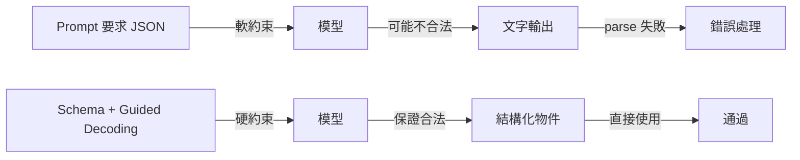
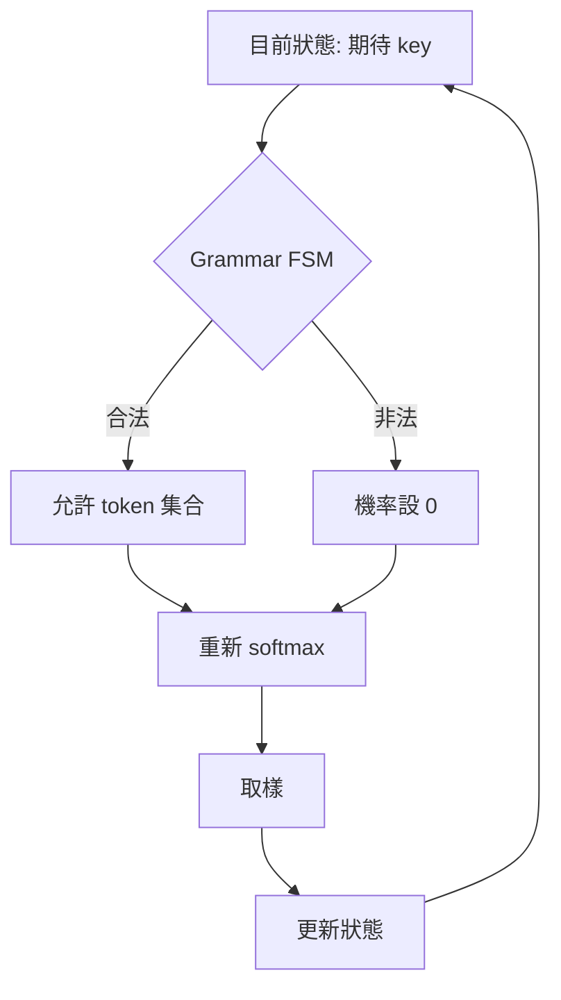
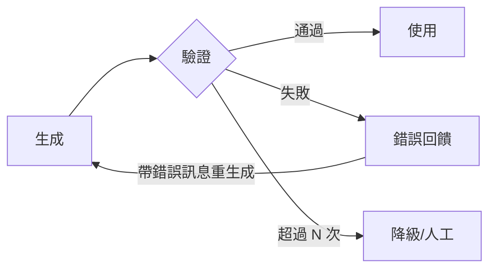

# 2.2 強制結構化輸出：JSON Schema、Guided Decoding 與型別安全驗證

## 為什麼「請輸出 JSON」還不夠

自然語言要求模型輸出 JSON，本質是「軟約束」：模型可能加上 markdown 圍欄、多寫解釋、漏逗號、用單引號。在 Agent 系統中，下游程式要 `json.loads()`，一個格式錯誤就讓整個迴圈崩潰。

這帶出本章核心：**把格式約束從「請求」升級為「保證」**。



## 三個層次：提示 → Schema → 解碼約束

### 層次一：提示層（Prompt-level）

在 prompt 中放 JSON schema 與範例，要求模型遵守。成本低、通用，但**不保證**合法。

### 層次二：API 層（Structured Outputs / JSON Mode）

現代 API 支援 `response_format` 指定 JSON schema，供應商在解碼時施加約束：

```json
{
  "response_format": {
    "type": "json_schema",
    "json_schema": {
      "name": "weather_query",
      "strict": true,
      "schema": {
        "type": "object",
        "properties": {
          "city": {"type": "string"},
          "unit": {"type": "string", "enum": ["celsius", "fahrenheit"]}
        },
        "required": ["city", "unit"],
        "additionalProperties": false
      }
    }
  }
}
```

### 層次三：解碼層（Guided / Constrained Decoding）

在每個 token 取樣前，遮蔽（mask）會使輸出偏離 schema 的 token，只允許合法續寫。

## Guided Decoding 的數學原理

給定上下文 $`x_{<t}`$ 與語法約束 $`\mathcal{G}`$（如 JSON grammar 或 schema 對應的有限狀態機），允許的 token 集合為：

$$
\mathcal{A}(x_{<t}) = \{\, v \in V : \text{prefix}(x_{<t}, v) \text{ 仍是 } \mathcal{G} \text{ 的合法前綴} \,\}
$$

取樣時令非允許 token 的機率為零：

$$
p'_t(v) = \begin{cases}
\dfrac{p_t(v)}{\sum_{u \in \mathcal{A}} p_t(u)} & v \in \mathcal{A} \\
0 & \text{otherwise}
\end{cases}
$$

這保證輸出**必然**符合語法，且盡量保留模型的原始偏好（在合法集合內重新歸一化）。



### 代價與限制

- **延遲**：每步要計算合法 token 集合，grammar 越複雜越慢。
- **品質**：過度約束可能迫使模型在「合法但語意差」的路徑生成。
- **覆蓋**：某些 schema（如遞迴、超大 enum）轉成 FSM 成本高，供應商可能限制。

## Schema 設計的最佳實務

| 原則 | 說明 |
|---|---|
| 欄位少而明確 | 減少生成錯誤面 |
| 用 enum 收斂選項 | 避免自由字串歧義 |
| `additionalProperties: false` | 防止模型亂加欄位 |
| 明確 required | 避免缺欄位 |
| 巢狀淺 | 深巢狀增加錯誤與延遲 |
| 描述欄位用途 | `description` 幫助模型填對 |

## 型別安全驗證：Schema 只是第一關

即使 guided decoding 保證語法合法，**語意仍可能錯誤**（例如金額為負、日期不存在、城市不存在）。因此需要第二層驗證：

```python
from pydantic import BaseModel, Field, field_validator

class WeatherQuery(BaseModel):
    city: str = Field(min_length=1)
    unit: str
    days: int = Field(ge=1, le=14)

    @field_validator("unit")
    @classmethod
    def unit_ok(cls, v):
        if v not in {"celsius", "fahrenheit"}:
            raise ValueError("invalid unit")
        return v
```

三層防護：

1. **語法層**：guided decoding / JSON parse。
2. **型別層**：pydantic / zod / JSON Schema 驗證。
3. **業務層**：自訂規則（範圍、枚舉、交叉欄位、外部查詢）。

$$
\text{valid} = \text{parse}(y) \;\wedge\; \text{typecheck}(y) \;\wedge\; \text{business}(y)
$$

## 失敗處理：重試與回饋迴圈

當驗證失敗，把錯誤訊息結構化回饋給模型，讓它修正：



關鍵：**回饋要具體**（哪個欄位、什麼錯誤），而非只說「格式錯」。

## 結構化輸出與工具呼叫的統一

第 4 章會看到：工具呼叫本質上就是「用 schema 約束模型輸出一個 function name 與 arguments」。因此本章的機制直接支撐工具系統：

$$
\text{tool call} = \text{structured output over } (\text{name}, \text{args\_schema})
$$

這也是 Responses API 把工具原生整合的理論基礎。

## 常見陷阱

1. **schema 太寬鬆**：`additionalProperties: true` 讓模型塞無用欄位。
2. **只驗語法不驗語意**：合法的 `{"age": -5}` 仍可用。
3. **無限重試**：要設上限與降級路径。
4. **忽略供應商差異**：strict schema 支援度、enum 上限各異。

## 與後續章節的關聯

- **4.1 工具定義**：schema 設計直接決定工具可用性。
- **7.3 死迴圈防呆**：重試上限是終止條件的一部分。
- **11.3 失敗模式**：格式錯誤、欄位幻覺是常見失敗類別。

## 小結

1. 「請輸出 JSON」是軟約束，不保證合法。
2. 三層防護：prompt → schema/guided decoding → 型別與業務驗證。
3. Guided decoding 以遮蔽非法 token 保證語法，代價是延遲與品質權衡。
4. Schema 設計應少、窄、深淺適中、enum 收斂。
5. 結構化輸出是工具呼叫的底層機制，串起後續 Agent 能力。
