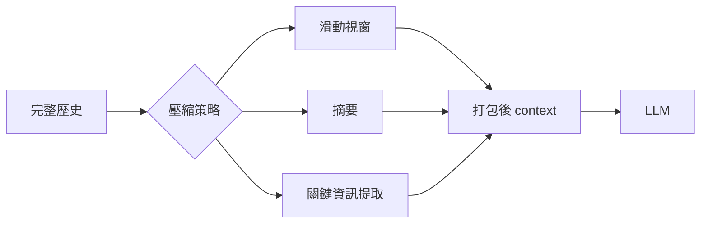
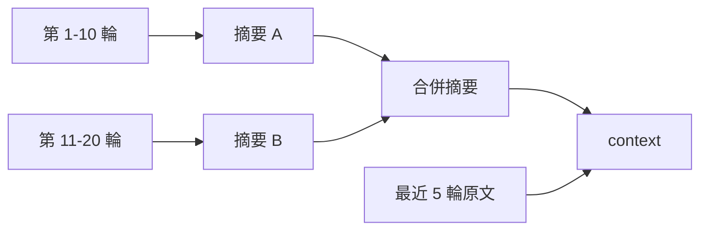
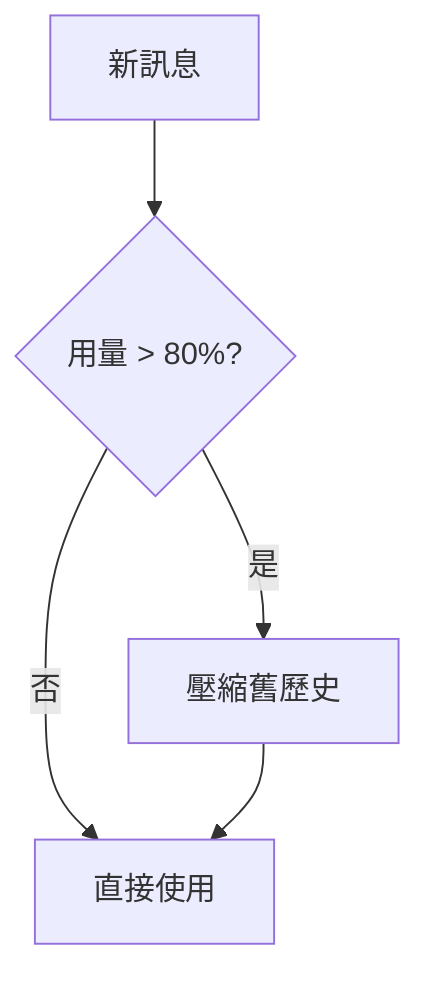

# 3.1 對話歷史管理與 Context 壓縮策略（滑動視窗、摘要、關鍵資訊提取）

## 無狀態 API 的根本矛盾

第 1.2 章指出：多數 LLM API 是**無狀態**的。模型不記得上一輪，是你每次把整個 `messages` 陣列重送。這造成一個根本矛盾：

$$
\text{對話越長} \;\Rightarrow\; \text{歷史越長} \;\Rightarrow\; \begin{cases}
\text{成本} \uparrow \\
\text{延遲} \uparrow \\
\text{超出 context window} \Rightarrow \text{失敗}
\end{cases}
$$

Context 壓縮就是解這個矛盾：**在有限視窗內，保留對當前決策最有用的資訊**。



## 策略一：滑動視窗（Sliding Window）

保留最近 $`k`$ 輪，丟棄更早的：

$$
\text{context}_t = \text{messages}[\,t-k+1 : t\,]
$$

**優點**：簡單、便宜、延遲低、實作容易。

**缺點**：
- 遺失早期關鍵資訊（例如使用者在第一輪給的訂單編號）。
- 可能切斷一組相關的多輪互動。

**改良**：**固定錨點 + 滑動視窗**——永久保留 system prompt 與若干「錨點訊息」（如使用者初始需求、已確認的關鍵事實），其餘滑動。

```python
def build_context(messages, k=10, anchors=None):
    anchors = anchors or messages[:1]  # system
    recent = messages[-k:]
    return anchors + recent
```

## 策略二：摘要（Summarization）

把舊歷史壓成一段摘要，作為新的「記憶」：

$$
\text{summary}_t = \text{LLM}\big(\text{summary}_{t-1} \oplus \text{old\_turns}\big)
$$

**優點**：保留語意而非逐字，壓縮率高。

**缺點**：
- **摘要漂移**：多次摘要會累積失真（類似電話遊戲）。
- **不可逆**：丟失的細節無法找回。
- **額外成本**：摘要本身要呼叫模型。

**改良**：
- **滾動摘要 + 原始緩衝**：保留摘要，但最近 $`k`$ 輪保留原文，兼顧語意與細節。
- **分段摘要**：每 $`n`$ 輪產生一個段落摘要，而非每次都重摘全部。



## 策略三：關鍵資訊提取（Key Information Extraction）

不摘要整段對話，而是抽取**結構化的關鍵事實**：

```json
{
  "user_goal": "預訂台北到東京的機票",
  "constraints": ["預算 < 15000 TWD", "出發日 2026-03-01"],
  "confirmed": {"passport": "已提供", "seat": "window"},
  "open_questions": ["回程日期未定"]
}
```

這就是**中期記憶**的雛形（見第 8 章）：把對話狀態從「逐字歷史」轉為「狀態物件」。

**優點**：穩定、可查詢、不會漂移、節省 token。

**缺點**：需設計 schema；抽取本身可能出錯。

## 三種策略的比較

| 策略 | 壓縮率 | 資訊保真 | 成本 | 適用 |
|---|---|---|---|---|
| 滑動視窗 | 低 | 高（近）低（遠） | 低 | 短對話、工具迴圈 |
| 摘要 | 高 | 中 | 中 | 長對話、客服 |
| 關鍵提取 | 中高 | 高（結構） | 中 | 任務型 Agent |

實務上常**混合**：結構化狀態 + 最近原文 + 摘要背景。

## Context 預算分配

把 context window 視為預算，分配給各區塊：

$$
C_{\max} \ge C_{\text{system}} + C_{\text{state}} + C_{\text{summary}} + C_{\text{recent}} + C_{\text{tools}} + C_{\text{output}}
$$

工程準則：
- **保留輸出餘量**：至少留 $`n_{\max}`$ 給回覆，否則會被截斷。
- **工具 schema 要瘦身**：工具越多，固定成本越高。
- **動態調整**：依任務階段調整各區塊大小（見 9.3 上下文工程）。

```python
BUDGET = {
    "system": 500,
    "state": 500,
    "summary": 800,
    "recent": 2000,
    "tools": 1500,
    "output": 1000,
}
```

## 壓縮的觸發時機

- **閾值觸發**：token 用量超過 $`\alpha C_{\max}`$ 時壓縮。
- **輪次觸發**：每 $`n`$ 輪。
- **事件觸發**：任務階段轉換（如從「收集需求」到「執行」）。



## 壓縮的失敗模式

1. **遺失約束**：丟掉「預算上限」導致後續推薦超預算。
2. **摘要幻覺**：摘要模型自行補出不存在的細節。
3. **切斷因果**：滑動視窗切掉「為什麼要這樣做」的上下文。
4. **狀態不一致**：結構化狀態與原文衝突。

對策：**關鍵欄位釘選（pinning）**——把不可丟失的事實標記為 pinned，永不壓縮。

## 與後續章節的關聯

- **第 8 章記憶系統**：本章是短期記憶，第 8 章是長期記憶。
- **9.3 上下文工程**：把「壓縮」升級為「動態組裝」。
- **3.3 成本控制**：壓縮直接省錢。

## 小結

1. 無狀態 API + 有限 context = 必須壓縮歷史。
2. 滑動視窗簡單但丟遠期；摘要壓縮高但會漂移；關鍵提取穩定但需 schema。
3. 實務混合三者：結構化狀態 + 摘要 + 最近原文。
4. Context 是預算，需分配並保留輸出餘量。
5. 壓縮會遺失約束，需釘選關鍵事實。
