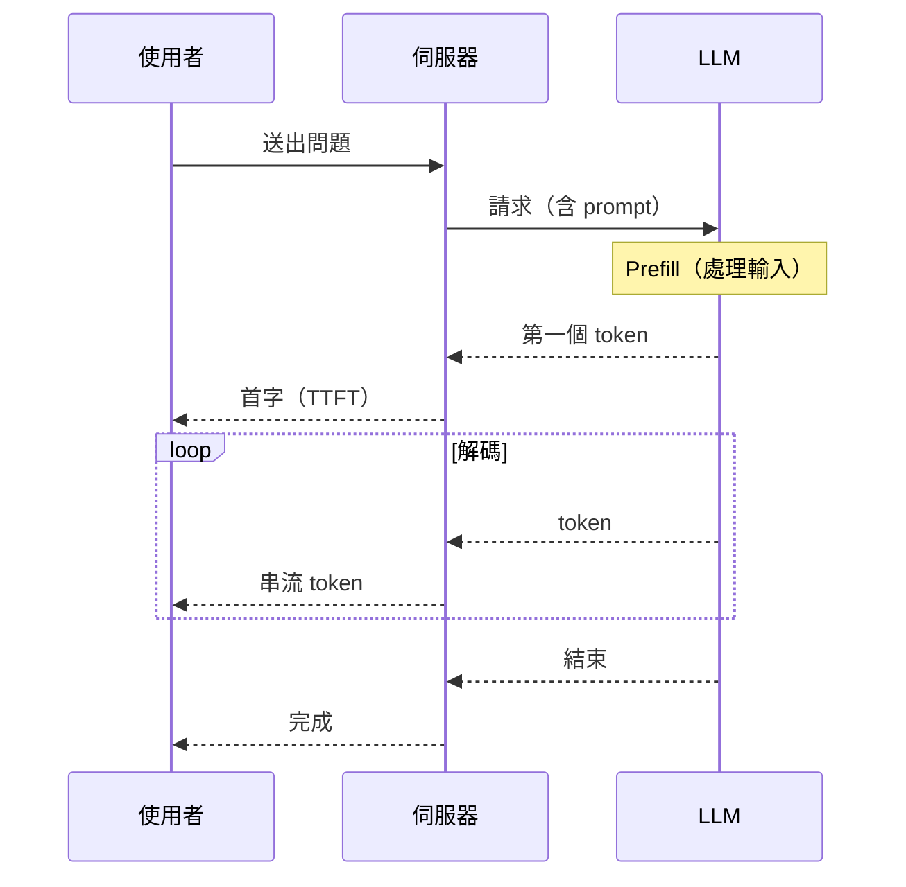
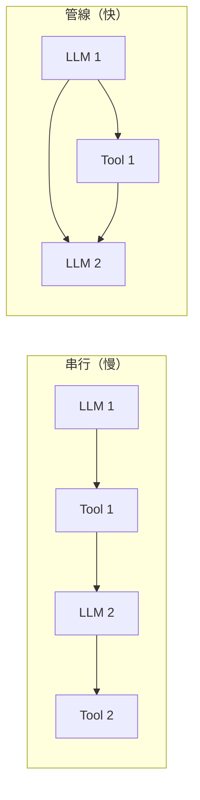
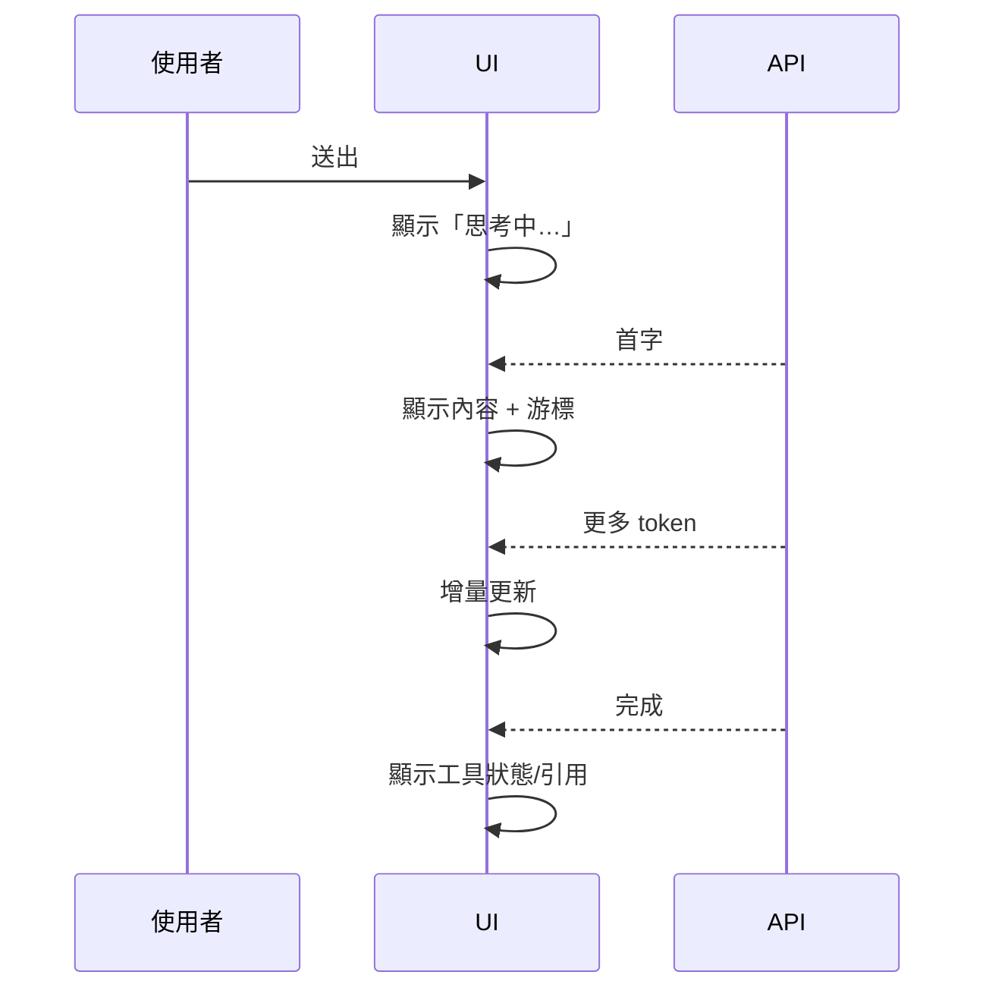

# 3.2 延遲與串流（Streaming）體驗設計：首字延遲（TTFT）與非同步管線

## 延遲為什麼是產品問題，而不只是效能問題

使用者感知的不是「總生成時間」，而是「多久看到第一個字」與「字流是否順暢」。一個總耗時 8 秒但首字 0.5 秒的串流回覆，體驗遠勝於總耗時 5 秒但空白 5 秒才整段吐出。延遲設計的核心，是**管理等待的心理與技術結構**。



## 延遲的分解

$$
T_{\text{total}} = T_{\text{network}} + T_{\text{prefill}} + n_{\text{out}} \cdot T_{\text{decode}}
$$

- **TTFT（Time To First Token）** $`\approx T_{\text{network}} + T_{\text{prefill}}`$
- **TPOT（Time Per Output Token）** $`\approx T_{\text{decode}}`$
- **總時間** $`\approx \text{TTFT} + n_{\text{out}} \cdot \text{TPOT}`$

| 因素 | 影響 TTFT | 影響 TPOT |
|---|---|---|
| 輸入長度 | 強 | 弱 |
| 輸出長度 | 弱 | 強（線性） |
| 模型大小 | 中 | 強 |
| 網路距離 | 中 | 弱 |
| 並發負載 | 強 | 強 |

## 串流（Streaming）的機制

LLM API 以 **Server-Sent Events（SSE）** 串流 token：

```http
POST /v1/chat/completions
Accept: text/event-stream

data: {"choices":[{"delta":{"content":"你"}}]}
data: {"choices":[{"delta":{"content":"好"}}]}
data: [DONE]
```

```python
import httpx, json

async def stream_chat(prompt):
    async with httpx.AsyncClient() as client:
        async with client.stream("POST", url, json=payload) as r:
            async for line in r.aiter_lines():
                if not line.startswith("data: "):
                    continue
                data = line[6:]
                if data == "[DONE]":
                    break
                delta = json.loads(data)["choices"][0]["delta"]
                yield delta.get("content", "")
```

### 串流的工程價值

1. **降低感知延遲**：首字即時顯示。
2. **提前取消**：使用者可中途停止，省成本。
3. **管線化**：下游（TTS、UI、工具）可邊收邊處理。

## 首字延遲（TTFT）的優化

### 1. 縮短輸入

TTFT 主要由 prefill 決定，prefill 與輸入長度相關。因此：
- 精簡 system prompt。
- 壓縮歷史（見 3.1）。
- 工具 schema 瘦身。

### 2. 地理與連線

- 選擇鄰近區域的 API endpoint。
- 保持連線（keep-alive），避免每次 TLS 握手。

### 3. 預填與快取

- **Prompt caching**（見 3.3）：重複的前綴可跳過 prefill。
- **Speculative decoding**：小模型先猜、大模型驗證，降低 decode 延遲。

### 4. 並行化

若有多個獨立子任務，並行呼叫而非串行：

```python
results = await asyncio.gather(
    call_llm(task_a),
    call_llm(task_b),
    call_llm(task_c),
)
```

## 非同步管線設計

Agent 的本質是多次 LLM + 工具呼叫。若全部串行，延遲會爆炸。用非同步管線重疊 I/O 與計算：



### 並行工具呼叫

第 4.3 章會詳談，但關鍵是：模型一次可回傳多個 tool call，可並行執行：

```python
async def run_tools(tool_calls):
    return await asyncio.gather(*[
        execute(tc) for tc in tool_calls
    ])
```

### 串流 + 工具的中介

當模型串流輸出 tool call 的 JSON 時，可邊解析邊準備執行，但要注意 JSON 未完整前不能執行。實務上等 tool call 完整再跑，但 UI 可先顯示「正在準備工具…」。

## 串流的 UI 設計



要點：
- **骨架/佔位**：等待時顯示結構。
- **增量更新**：避免整段重繪造成閃爍。
- **可取消**：提供停止按鈕，觸發 abort。
- **錯誤處理**：串流中途斷線要能重試或提示。

## 延遲預算與 SLA

為每個階段訂立延遲預算：

| 階段 | 預算 | 優化手段 |
|---|---|---|
| TTFT | < 1s | 輸入精簡、快取、就近節點 |
| 首個工具結果 | < 2s | 並行、快取、索引 |
| 完整回覆 | < 10s | 限制輸出長度、串流 |

$$\text{SLA}_{\text{ok}} = \Pr(T_{\text{total}} \le T_{\max}) \ge 0.95$$

用 p50/p95/p99 而非平均，因為尾延遲才是使用者痛點。

## 與後續章節的關聯

- **3.3 成本**：延遲與成本常互相拉扯（大模型快但貴）。
- **4.3 並行工具**：管線化的核心場景。
- **12.1 非同步任務**：長任務改用佇列 + 背景執行。
- **13.2 即時影音**：更低延遲的極端場景。

## 小結

1. 使用者感知的是 TTFT 與流暢度，不只是總時間。
2. 延遲分解為網路 + prefill + decode，各有對應優化。
3. 串流（SSE）降低感知延遲並允許取消。
4. 非同步管線與並行工具呼叫重疊 I/O，是 Agent 效能關鍵。
5. 用 p95/p99 訂 SLA，並為每階段設延遲預算。
