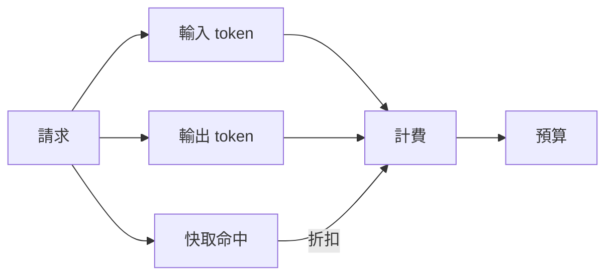
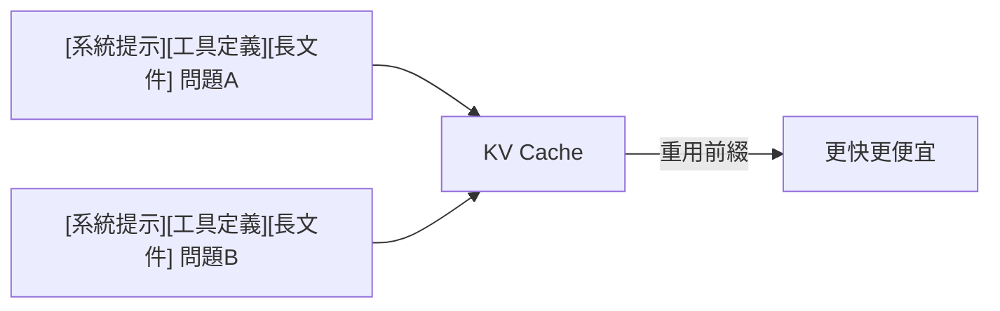
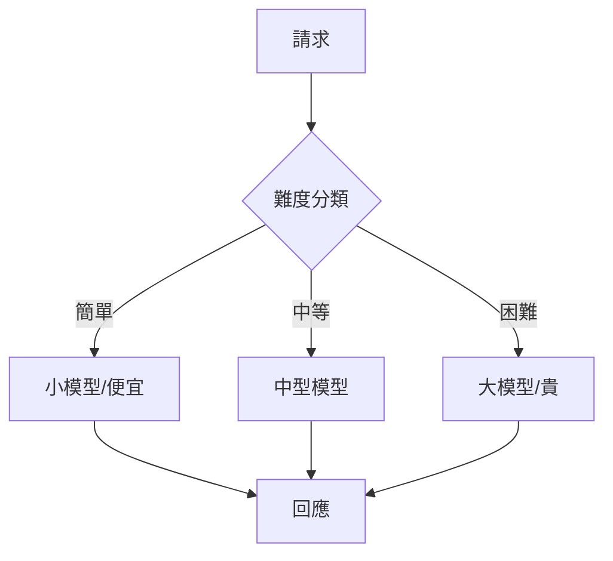
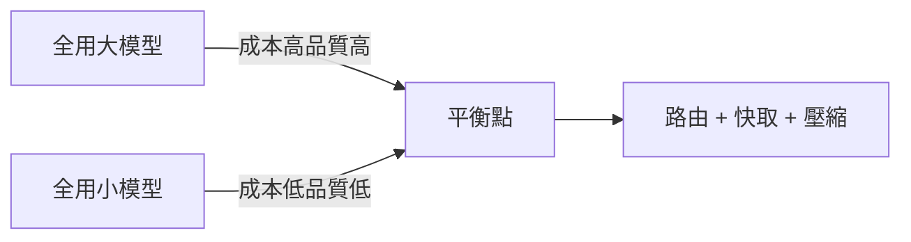

# 3.3 成本控制與快取機制：Token 計費模型、Prompt Caching 與模型路由

## 成本是 Agent 的「氧氣預算」

一個單輪聊天應用的成本很小，但 Agent 會反覆呼叫模型、塞入長 context、跑多個工具。成本會隨「回合數 × context 長度 × 工具數」快速膨脹。沒有成本工程，Agent 很快就會變成燒錢機器。

$$
\text{Cost} = \sum_{i=1}^{N} \Big( n_{\text{in},i} \cdot p_{\text{in}} + n_{\text{out},i} \cdot p_{\text{out}} \Big)
$$

其中 $`N`$ 是模型呼叫次數。注意 $`N`$ 在 Agent 中會隨步數增長——這是成本的真正殺手。



## Token 計費模型

主流計費維度：

| 維度 | 說明 |
|---|---|
| 輸入 token | 通常較便宜 |
| 輸出 token | 通常較貴（2–4 倍） |
| 快取輸入 token | 大幅折扣（常見 50%–90% off） |
| 圖片/音訊 | 依解析度或時長換算 token |
| 工具呼叫 | 部分供應商額外計費 |

**關鍵洞察**：輸出比輸入貴，所以「叫模型多寫」很燒錢；但 Agent 的輸入會因歷史累積而暴增，所以「輸入壓縮」同樣重要。

### 成本的兩個槓桿

$$
\text{Cost} = \underbrace{n_{\text{in}}}_{\text{壓縮/快取}} \cdot p_{\text{in}} + \underbrace{n_{\text{out}}}_{\text{限制長度}} \cdot p_{\text{out}}
$$

- **左槓桿**：減少輸入（3.1 壓縮、快取、工具瘦身）。
- **右槓桿**：減少輸出（max_tokens、精簡回覆、結構化）。

## Prompt Caching（提示快取）

### 原理

Transformer 的 prefill 會為輸入 token 計算 KV（key-value）快取。若多次請求共享相同前綴，伺服器可重用 KV，跳過重複計算，**同時降低延遲與成本**。



### 命中條件

快取通常要求**前綴完全相同**（prefix match）：

$$
\text{hit} \iff \text{prefix}(req_1) = \text{prefix}(req_2)
$$

因此**把穩定內容放前面、變動內容放後面**是關鍵設計：

```text
[穩定] system prompt
[穩定] 工具 schema
[穩定] 長參考文件
[變動] 使用者問題   ← 放最後
```

若把使用者問題放前面，每次都不同，快取永遠不命中。

### 快取的工程實務

- **固定前綴**：system + tools + 靜態知識放最前。
- **快取 TTL**：多數快取有存活時間（分鐘級），高頻請求才划算。
- **成本模型**：首次寫入快取可能加價，後續命中才省。
- **多租戶**：不同租戶的前綴不同，快取不共享，需注意隔離與效率。

```python
# 好：穩定前綴
messages = [
    {"role": "system", "content": LONG_STABLE_SYSTEM},
    {"role": "user", "content": user_question},   # 變動在後
]

# 壞：每輪都改 system → 快取失效
messages = [
    {"role": "system", "content": f"現在時間 {now()}，使用者 {uid}..."},
    {"role": "user", "content": user_question},
]
```

## 模型路由（Model Routing）

不是所有請求都需要最強的模型。路由把請求分派給「夠用的最便宜模型」：



### 路由策略

| 策略 | 說明 |
|---|---|
| 規則路由 | 依任務類型、長度、關鍵字 |
| 分類器路由 | 訓練/提示一個分類器判斷難度 |
| 級聯（Cascade） | 先小模型，信心不足再升級 |
| 成本感知路由 | 依即時預算與 SLA 動態選擇 |

### 級聯的成本邏輯

設小模型成功機率 $`q`$，成本 $`c_s`$；大模型成本 $`c_l`$：

$$
\mathbb{E}[\text{cost}] = c_s + (1-q)\,c_l
$$

只要 $`q`$ 夠高（例如 80%），級聯遠比全部用大模型便宜。

```python
async def cascade(req):
    small = await call("small-model", req)
    if confidence(small) >= 0.8:
        return small
    return await call("large-model", req)
```

## 預算控制與熔斷

成本必須有硬性上限，否則 Agent 可能失控燒錢：

```python
class Budget:
    def __init__(self, limit_usd):
        self.limit = limit_usd
        self.spent = 0.0

    def charge(self, cost):
        if self.spent + cost > self.limit:
            raise BudgetExceeded()
        self.spent += cost
```

三層防護：
1. **單次請求**：max_tokens、輸入長度上限。
2. **單任務**：步數上限、累計 token 上限。
3. **單租戶/全域**：每日預算、熔斷開關。

第 12.2 章會把這升級為生產級治理。

## 其他省錢手段

| 手段 | 效果 | 代價 |
|---|---|---|
| 壓縮歷史 | 高 | 可能遺失資訊 |
| 快取 | 高 | 需穩定前綴 |
| 路由 | 高 | 路由錯誤會降品質 |
| 批次 API | 中（常見 50% off） | 非即時 |
| 限制輸出 | 中 | 可能截斷 |
| 工具瘦身 | 中 | 需設計 |
| 蒸餾/微調小模型 | 長期高 | 前期投入 |

## 成本與品質的權衡曲線



目標不是「最便宜」或「最好」，而是**在品質約束下最小化成本**：

$$
\min \; \text{Cost} \quad \text{s.t.} \quad \text{Quality} \ge Q_{\min}
$$

## 與後續章節的關聯

- **3.1 壓縮**：左槓桿的基礎。
- **3.2 延遲**：快取同時降延遲，是少見的雙贏。
- **11.2 評估**：品質約束需要評估來定義。
- **12.2 治理**：預算熔斷的生產化。
- **12.3 維運飛輪**：用監控數據持續優化路由。

## 小結

1. 成本 = 輸入 token × 單價 + 輸出 token × 單價，Agent 的多次呼叫使成本放大。
2. Prompt caching 靠前綴重用同時降成本與延遲，關鍵是「穩定內容在前」。
3. 模型路由 / 級聯把請求分派給夠用的最便宜模型。
4. 預算熔斷必須有多層上限，防止失控。
5. 目標是在品質約束下最小化成本，而非極端省或極端好。
