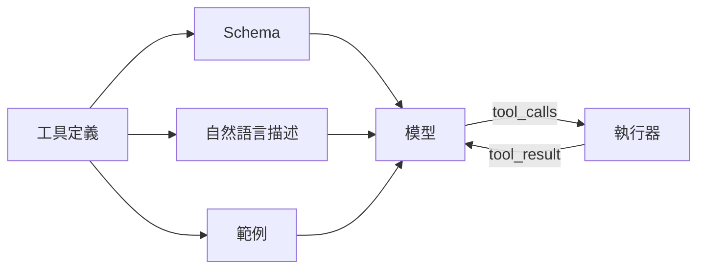

# 4.1 工具定義規格：描述清晰度、參數型別與邊界條件設計

## 工具是 Agent 的「雙手」

LLM 本身只能輸出文字。要讓它「做事」——查資料、寄信、執行程式——就必須給它**工具（tools）**。工具呼叫的本質已於 2.2 揭示：

$$
\text{tool call} = \text{structured output over } (\text{name}, \text{args})
$$

因此，工具定義就是一份**給模型看的 API 文件 + 給程式用的 schema**。定義品質直接決定模型能否正確使用工具。



## 工具定義的組成

一個標準工具定義（以 OpenAI function calling 風格為例）：

```json
{
  "type": "function",
  "function": {
    "name": "search_flights",
    "description": "搜尋指定航線與日期的航班。回傳航班列表，含價格、時間、轉機次數。當使用者詢問機票時使用。",
    "parameters": {
      "type": "object",
      "properties": {
        "origin": {"type": "string", "description": "出發機場 IATA 代碼，如 TPE"},
        "destination": {"type": "string", "description": "目的地機場 IATA 代碼，如 NRT"},
        "date": {"type": "string", "format": "date", "description": "出發日期 YYYY-MM-DD"},
        "max_stops": {"type": "integer", "minimum": 0, "maximum": 2, "default": 1}
      },
      "required": ["origin", "destination", "date"],
      "additionalProperties": false
    }
  }
}
```

三個核心元素：**name、description、parameters schema**。

## 描述清晰度：模型如何「讀懂」工具

模型選擇工具與填參數，全靠 `description`。好的描述回答四個問題：

1. **做什麼**（功能）
2. **何時用**（觸發條件）
3. **回傳什麼**（輸出形狀）
4. **限制/邊界**（不能做什麼）

### 對比

```text
# 差
"description": "搜尋航班"

# 好
"description": "搜尋指定航線與日期的可用航班。當使用者要訂機票、查票價或比較航班時使用。不支援多城市行程。回傳最多 20 筆，依價格排序。"
```

### 描述撰寫準則

| 準則 | 說明 |
|---|---|
| 動詞開頭 | 「搜尋…」「建立…」「刪除…」 |
| 說明觸發時機 | 讓模型知道何時該用 |
| 說明回傳格式 | 避免模型誤解結果 |
| 標明副作用 | 讀取 vs 寫入 |
| 標明限制 | 不支援什麼 |
| 用一致的語言 | 與 system prompt 語言一致 |

## 參數型別設計

### 基本型別

| JSON 型別 | 用途 | 注意 |
|---|---|---|
| `string` | 文字、代碼、日期 | 用 `format` 約束 |
| `integer` / `number` | 數量、金額 | 用 min/max |
| `boolean` | 開關 | 避免模糊語意 |
| `enum` | 有限選項 | 強烈建議用於收斂 |
| `array` | 列表 | 說明元素型別 |
| `object` | 巢狀 | 保持淺層 |

### 用 enum 取代自由字串

```json
"unit": {"type": "string", "enum": ["celsius", "fahrenheit"]}
```

這比 `"unit": {"type": "string"}` 好得多：模型不會亂填「C」「攝氏」等變體，執行器也不用做模糊比對。

### 日期與格式

```json
"date": {"type": "string", "format": "date", "description": "YYYY-MM-DD"}
```

`format` 是 JSON Schema 標準，但**不是所有供應商都強制執行**。仍要在描述中寫明格式，並在執行器驗證。

### 巢狀 vs 扁平

```json
// 扁平（推薦）
{"origin": "TPE", "destination": "NRT", "date": "2026-03-01"}

// 巢狀（較深，易錯）
{"route": {"from": {"code": "TPE"}, "to": {"code": "NRT"}}, "when": {"date": "2026-03-01"}}
```

**扁平的原則**：巢狀越深，模型填錯機率越高，guided decoding 也越慢。

## 邊界條件設計

### 1. 數值範圍

```json
"passengers": {"type": "integer", "minimum": 1, "maximum": 9}
```

### 2. 互斥與依賴

JSON Schema 的 `oneOf` / `anyOf` 可表達，但會增加模型理解負擔。實務上常在描述中說明，並在執行器驗證：

```text
若 round_trip=true，則 return_date 必填。
```

### 3. 預設值

```json
"max_stops": {"type": "integer", "default": 1}
```

模型可不填，執行器補預設。但**不要依賴模型理解 default**，在描述中明說。

### 4. 不可逆操作的標記

```json
"description": "⚠️ 永久刪除訂單，無法復原。僅在確認使用者意圖後呼叫。"
```

這對第 6 章的風險分級與 6.3 的審批閘門至關重要。

## 工具命名

- **動詞_名詞**：`get_weather`、`create_order`、`delete_user`。
- **避免縮寫**：`get_usr` 不如 `get_user`。
- **避免過度相似**：`search` 與 `find` 並存會讓模型混淆。
- **命名空間**：工具多時用前綴，如 `db_query`、`web_search`。

## 工具數量與 context 成本

每個工具定義都佔 context（見 1.2、3.3）。工具太多會：
- 擠壓推理空間。
- 增加模型選擇難度（混淆）。
- 提高成本。

$$\text{tool tokens} = \sum_{i} \big( |\text{name}_i| + |\text{desc}_i| + |\text{schema}_i| \big)$$

**瘦身策略**：
- 相近工具合併（`search_flights` + `search_hotels` → 不行，語意不同；但 `get_weather_today` + `get_weather_forecast` 可合併為帶 `days` 參數）。
- 用 enum 收斂參數，減少描述。
- 動態載入工具（見 5.3、9.3）：只在使用者意圖相關時才暴露。

## 工具定義的測試

工具定義也要測試：給定情境，模型是否選對工具、填對參數？

```python
test_cases = [
    {"input": "幫我查明天台北天氣", "expect_tool": "get_weather"},
    {"input": "取消訂單 A123", "expect_tool": "cancel_order"},
]
```

失敗案例回流成改進描述的依據。這是 2.3 評估與 11.2 的延伸。

## 與後續章節的關聯

- **4.2 決策迴圈**：定義好工具後，模型如何選擇與解析。
- **4.3 並行與回退**：多工具協作。
- **6.2 風險分級**：工具的副作用等級。
- **5.3 MCP**：標準化工具封裝。

## 小結

1. 工具定義 = 給模型的 API 文件 + 給程式的 schema。
2. 描述要回答「做什麼、何時用、回傳什麼、限制」。
3. 參數用 enum、範圍、format 收斂，保持扁平。
4. 邊界條件與不可逆標記是安全設計的一部分。
5. 工具數量有 context 成本，需瘦身與動態載入。
6. 工具定義本身要測試。
