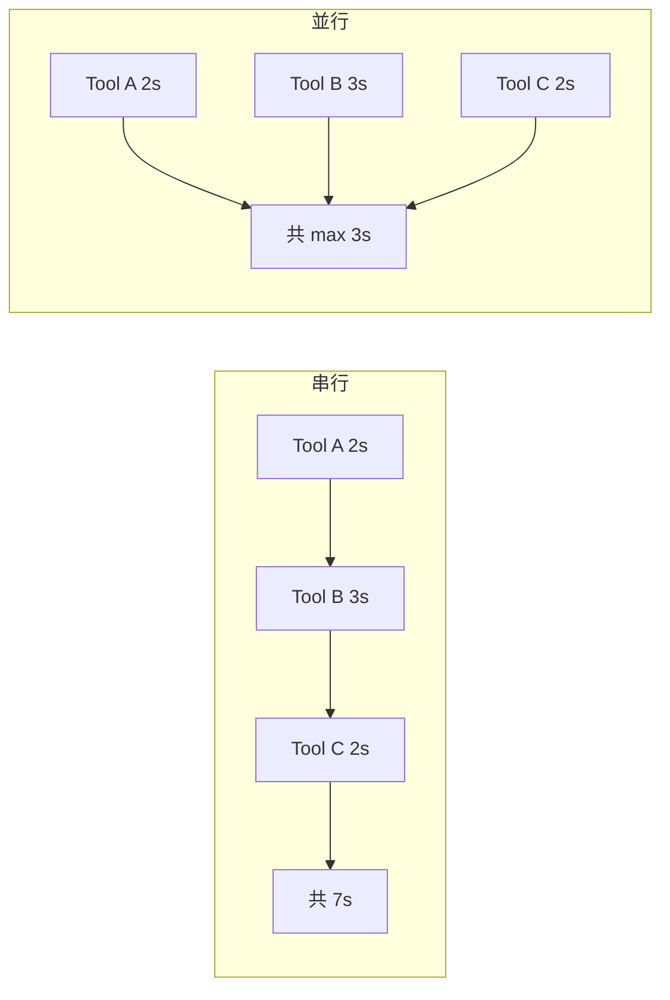
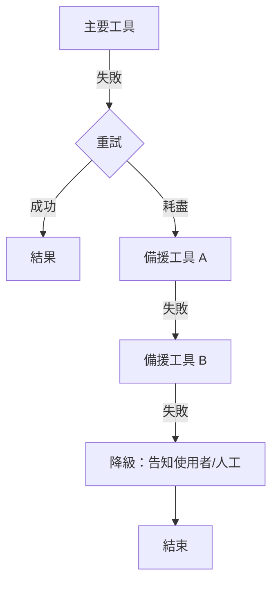
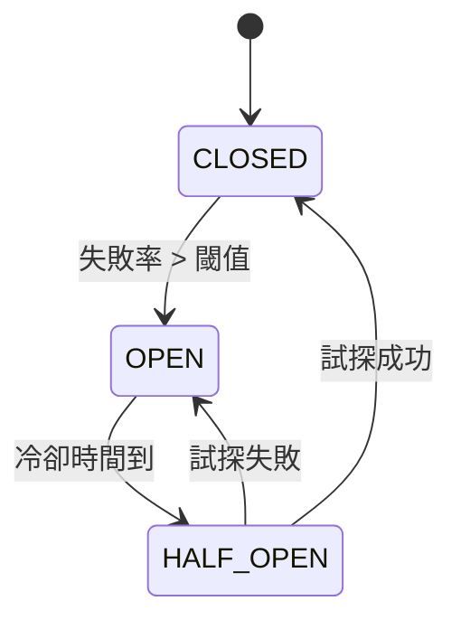

# 4.3 並行工具呼叫、錯誤重試與回退（Fallback）策略

## 為什麼需要並行

Agent 常需同時取得多個獨立資訊：查天氣 + 查航班 + 查飯店。若串行執行，延遲是三者之和；並行則是最大值。

$$
T_{\text{serial}} = \sum_i T_i, \qquad T_{\text{parallel}} = \max_i T_i + T_{\text{coord}}
$$



## 模型的原生並行工具呼叫

現代模型可在一次回應中回傳多個 tool calls：

```json
{
  "tool_calls": [
    {"id": "c1", "function": {"name": "get_weather", "arguments": "{\"city\":\"台北\"}"}},
    {"id": "c2", "function": {"name": "get_flights", "arguments": "{\"from\":\"TPE\",\"to\":\"NRT\"}"}},
    {"id": "c3", "function": {"name": "get_hotels", "arguments": "{\"city\":\"東京\"}"}}
  ]
}
```

這些呼叫彼此獨立，可並行執行：

```python
import asyncio

async def run_parallel(tool_calls):
    tasks = [execute_async(tc) for tc in tool_calls]
    results = await asyncio.gather(*tasks, return_exceptions=True)
    return [
        to_tool_message(tc.id, r if not isinstance(r, Exception) else error(r))
        for tc, r in zip(tool_calls, results)
    ]
```

### 何時不能並行

- **有依賴關係**：B 需要 A 的結果（例如先查訂單再退款）。
- **有副作用且順序敏感**：先扣款再出貨，不能顛倒。
- **共享資源衝突**：同時寫同一檔案。

判斷依賴的責任在模型（它決定一次回傳哪些），但應用層仍應檢查：若工具宣告了依賴，強制串行。

```json
{
  "name": "refund_order",
  "description": "退款。需先有 order_id（來自 get_order）。",
  "x-depends_on": ["get_order"]
}
```

## 錯誤分類

工具錯誤分三類，處理策略不同：

| 類型 | 例子 | 可重試？ | 策略 |
|---|---|---|---|
| 暫時性（transient） | 503、timeout、rate limit | 是 | 指數退避重試 |
| 永久性（permanent） | 404、參數錯誤、權限不足 | 否 | 回饋模型修正或回退 |
| 不確定（ambiguous） | 逾時但可能已執行 | 小心 | 冪等檢查 |

## 重試策略：指數退避 + 抖動

```python
import asyncio, random

async def retry(fn, max_attempts=3, base=0.5, cap=8):
    for attempt in range(max_attempts):
        try:
            return await fn()
        except TransientError as e:
            if attempt == max_attempts - 1:
                raise
            delay = min(cap, base * (2 ** attempt))
            delay *= random.uniform(0.5, 1.5)   # 抖動，避免驚群
            await asyncio.sleep(delay)
```

數學上，重試使成功率提升（獨立失敗機率 $`p`$）：

$$
P_{\text{success}} = 1 - p^{k} \quad (\text{重試 } k \text{ 次})
$$

例如 $`p=0.3`$、重試 3 次，成功率 $`1-0.3^3 = 97.3\%`$。但**只對暫時性錯誤有效**。

### 冪等性（Idempotency）

重試寫入操作可能造成重複執行（重複扣款）。解法：
- **冪等鍵**：每次請求帶唯一 `idempotency_key`，伺服器去重。
- **先查後寫**：重試前查狀態。

```python
await call_api("/refund", json={"order_id": oid}, headers={"Idempotency-Key": uuid4()})
```

## 回退（Fallback）策略

當重試無效，切換備援方案：



常見回退層級：

1. **同功能備援**：主 API 掛了，切備援 API。
2. **降級資料**：即時資料取不到，用快取（標明「可能過期」）。
3. **簡化功能**：完整搜尋失敗，改用基本查詢。
4. **誠實失敗**：告知使用者並提供下一步。

```python
async def search_with_fallback(query):
    try:
        return await primary_search(query)
    except Exception:
        try:
            return await backup_search(query)
        except Exception:
            return {"error": "SEARCH_UNAVAILABLE", "message": "搜尋暫時無法使用，請稍後再試"}
```

## 電路斷路器（Circuit Breaker）

若某工具持續失敗，繼續重試只是浪費資源。斷路器在失敗率過高時「跳開」，快速失敗：

$$
\text{state} \in \{\text{CLOSED}, \text{OPEN}, \text{HALF-OPEN}\}
$$



- **CLOSED**：正常放行。
- **OPEN**：直接失敗，不呼叫。
- **HALF-OPEN**：放行少量試探。

## 並行 + 重試 + 回退的組合

```python
async def robust_execute(tool_call):
    cb = circuit_breaker_for(tool_call.name)
    if cb.is_open():
        return fallback(tool_call)
    try:
        return await retry(lambda: cb.call(tool_call))
    except TransientError:
        return fallback(tool_call)
    except PermanentError as e:
        return {"error": str(e), "retryable": False}
```

## 部分失敗的處理

並行 3 個工具，2 成功 1 失敗，該怎麼辦？

| 策略 | 說明 | 適用 |
|---|---|---|
| 全有全無 | 任一失敗即整體失敗 | 強一致性 |
| 盡力而為 | 用成功的部分，標明缺失 | 資訊查詢 |
| 重試失敗者 | 只重試失敗的那個 | 獨立任務 |

多數 Agent 場景採「盡力而為 + 標明缺失」：

```json
{
  "weather": {"temp_c": 22},
  "flights": {"error": "TIMEOUT"},
  "hotels": {"count": 5}
}
```

讓模型知道哪些資料缺失，自行決定是否還原或告知使用者。

## 與後續章節的關聯

- **4.2 決策迴圈**：本節是迴圈中的執行層強化。
- **6.2 風險分級**：有副作用的操作重試需冪等。
- **7.3 死迴圈**：重試上限是終止條件。
- **12.2 治理**：斷路器與限流是生產標配。

## 小結

1. 獨立工具應並行，延遲從「和」降為「最大值」。
2. 錯誤分暫時/永久/不確定，只有暫時性適合重試。
3. 重試用指數退避 + 抖動，寫入操作需冪等鍵。
4. 回退分層：備援 → 降級資料 → 簡化 → 誠實失敗。
5. 斷路器防止對持續失敗的工具無謂重試。
6. 部分失敗採「盡力而為 + 標明缺失」。
