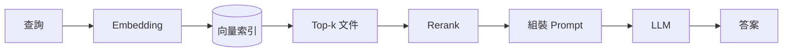
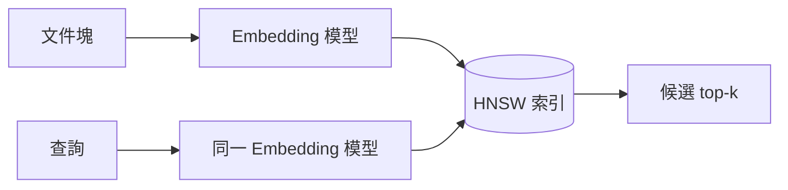
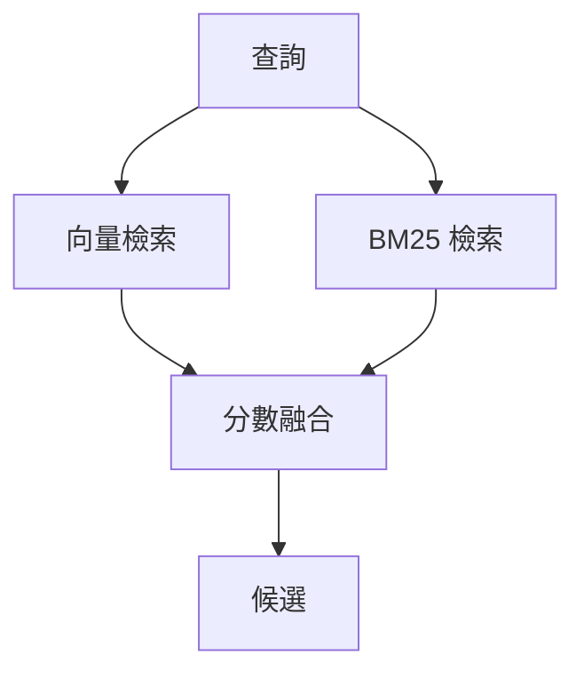
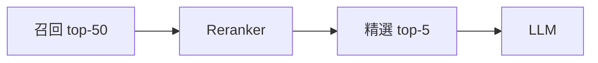

# 5.1 RAG（檢索增強生成）基礎：切塊、向量檢索、混合搜尋與重排序（Reranking）

## 為什麼需要 RAG

LLM 的知識凍結在訓練時，且無法記住你的私有資料。要讓模型回答「我們公司的請假規定是什麼」，有兩條路：微調（貴、慢、易過時）或**檢索增強生成（Retrieval-Augmented Generation, RAG）**——在生成前先檢索相關文件，塞進 context。

$$
P(\text{answer} \mid q) \approx P(\text{answer} \mid q, \text{retrieve}(q))
$$

RAG 把「記憶」外置到可更新的索引，這是第 8 章長期記憶的工程基礎。



## RAG 的五個階段

1. **切塊（Chunking）**：把文件切成小段。
2. **索引（Indexing）**：向量化並存入向量庫。
3. **檢索（Retrieval）**：找出相關段落。
4. **重排（Reranking）**：精選最相關的。
5. **生成（Generation）**：把段落塞進 prompt 生成答案。

## 切塊（Chunking）

文件太長不能整篇塞入，需切塊。切塊策略直接影響檢索品質。

### 策略比較

| 策略 | 說明 | 優缺 |
|---|---|---|
| 固定長度 | 每 N token 切 | 簡單，但可能切斷語意 |
| 按句子/段落 | 依標點切 | 語意完整，長度不一 |
| 遞迴切塊 | 先段落，太長再句子 | 平衡 |
| 語意切塊 | 依 embedding 相似度切 | 品質高，成本高 |
| 結構切塊 | 依標題/Markdown 階層 | 適合文件、程式碼 |

### 重疊（Overlap）

相鄰塊重疊一部分，避免邊界資訊斷裂：

```text
chunk1: [0 ... 500]
chunk2: [400 ... 900]   # 重疊 100
```

$$\text{overlap ratio} = \frac{\text{overlap}}{\text{chunk size}} \approx 10\%\text{–}20\%$$

### 切塊大小的權衡

- **太小**：語意破碎，檢索到片段但缺上下文。
- **太大**：雜訊多，浪費 context，檢索不精準。

經驗值：256–1024 token，視文件型態調整。並在塊中加入**metadata**（來源、標題、章節）。

```json
{
  "text": "員工每年享有 14 天特休...",
  "metadata": {"source": "handbook.pdf", "page": 12, "section": "請假規定"},
  "chunk_id": "handbook-p12-c3"
}
```

## 向量檢索

### Embedding

把文字映射為稠密向量：

$$
f: \text{text} \to \mathbb{R}^d
$$

語意相近的文字，向量距離近。檢索即找最近的塊：

$$
\text{top-}k = \arg\min_{c \in \mathcal{C}} \; \text{sim}(f(q), f(c))
$$

常用相似度：**cosine similarity**：

$$
\text{sim}(a,b) = \frac{a \cdot b}{\|a\| \|b\|}
$$

### 向量索引（ANN）

文件量大時，線性掃描太慢。用**近似最近鄰（ANN）**：

| 索引 | 原理 | 特性 |
|---|---|---|
| HNSW | 分層可導航小世界圖 | 快、記憶體高 |
| IVF | 倒排 + 聚類 | 平衡 |
| PQ | 量化壓縮 | 省記憶體、精度降 |



**注意**：查詢與文件必須用**同一個** embedding 模型，否則向量空間不對齊。

## 混合搜尋（Hybrid Search）

單一向量檢索對「精確關鍵字」不敏感（例如產品編號、人名）。BM25 等關鍵字檢索則對語意泛化差。混合兩者：

$$
\text{score}_{\text{hybrid}} = \alpha \cdot \text{score}_{\text{vector}} + (1-\alpha)\cdot \text{score}_{\text{bm25}}
$$



分數融合方法：
- **加權和**（需正規化）。
- **Reciprocal Rank Fusion（RRF）**：

$$
\text{RRF}(d) = \sum_{r \in \mathcal{R}} \frac{1}{k + \text{rank}_r(d)}
$$

RRF 不需正規化分數，實務上穩健好用。

## 重排序（Reranking）

初步檢索（召回）追求「不漏」，但候選品質參差。用 **cross-encoder** 重排：把查詢與候選一起輸入模型，輸出相關性分數。

$$
s_i = \text{Reranker}(q, c_i)
$$



**關鍵差異**：
- **Bi-encoder（召回）**：查詢與文件分別編碼，快，但交互弱。
- **Cross-encoder（重排）**：一起編碼，慢但準。

兩階段是速度與精度的折衷。

## Context 組裝

選出的塊要塞進 prompt，注意：

1. **標注來源**：讓模型能引用。
2. **排序**：最相關的放前面或後面（模型對兩端較敏感）。
3. **去重**：重疊塊去重。
4. **長度控制**：不超過預算（3.1）。
5. **明確指令**：只依檢索結果回答，無答案時說明。

```text
根據以下資料回答問題。若資料不足，回答「查無相關資訊」。
<context>
[1] (handbook.pdf p12) 員工每年享有 14 天特休...
[2] (handbook.pdf p13) 特休需於前一年底前申請...
</context>
問題：特休有幾天？
```

## RAG 的常見失敗

| 失敗 | 原因 | 對策 |
|---|---|---|
| 檢索不到 | 切塊差、embedding 不匹配 | 改切塊、換模型、混合搜尋 |
| 檢索到錯的 | 語意相近但無關 | 重排、metadata 過濾 |
| 答案幻覺 | 模型忽略 context | 強化指令、要求引用 |
| 多跳問題 | 單次檢索不足 | Agentic RAG（5.2） |
| 過時資料 | 索引未更新 | 增量索引 |

## 與後續章節的關聯

- **5.2 Agentic RAG**：把「一次檢索」升級為「自主多次檢索」。
- **5.3 MCP**：把檢索封裝為標準工具。
- **8.2 語意記憶**：向量檢索是長期記憶的機制。
- **9.3 上下文工程**：檢索結果的動態組裝。

## 小結

1. RAG 用外部檢索補足模型知識，是長期記憶的基礎。
2. 切塊策略影響品質，需重疊並帶 metadata。
3. 向量檢索用 embedding + ANN；查詢與文件需同模型。
4. 混合搜尋結合語意與關鍵字，RRF 是穩健融合法。
5. 兩階段檢索：bi-encoder 召回、cross-encoder 重排。
6. Context 組裝要標來源、去重、控長度、明指令。
