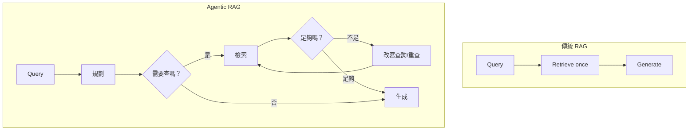
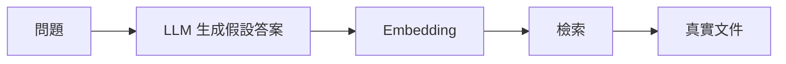
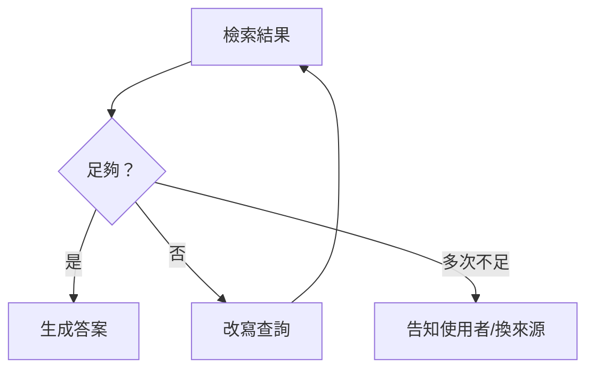
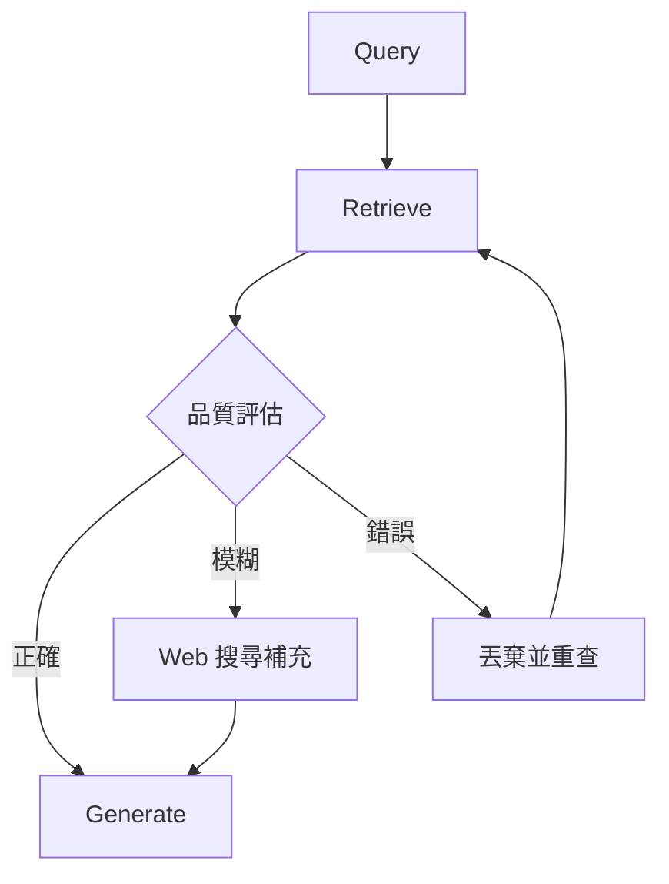

# 5.2 Agentic RAG：讓 Agent 自主決定何時查、查什麼、是否需要重查

## 傳統 RAG 的天花板

5.1 的 RAG 是一個**固定管線**：檢索 → 重排 → 生成。它假設「一次檢索就能拿到所有需要的資訊」。但真實問題常是：

- **多跳（multi-hop）**：「A 公司執行長的大學同學是誰？」需要先查執行長，再查其同學。
- **需要澄清**：「幫我查合約」——哪份合約？
- **檢索結果不足**：第一次查不到，需要換關鍵字或換來源。
- **需要組合**：答案分散在多個文件。

固定管線無法應對，因為**檢索策略本身需要決策**。這正是 Agentic RAG 的出發點：把檢索變成 Agent 可自主呼叫的工具。



## 核心轉變：檢索是「工具」而非「階段」

在 Agentic RAG 中，`retrieve(query)` 就是一個工具（第 4 章）。模型自行決定：

1. **何時查**：問題是否需外部知識。
2. **查什麼**：如何改寫查詢、選哪個索引。
3. **夠不夠**：檢索結果是否足以回答。
4. **要不要重查**：換關鍵字、換來源、拆子問題。

$$
\text{policy}: \text{state} \to \{\text{retrieve}(q), \text{answer}, \text{ask\_user}, \text{stop}\}
$$

## 何時查：避免無謂檢索

不是每個問題都要查。Agent 需判斷：

| 情境 | 動作 |
|---|---|
| 常識/推理題 | 直接回答 |
| 需要私有/即時資料 | 檢索 |
| 問題模糊 | 先澄清 |
| 已有足夠 context | 直接回答 |

在 prompt 中明示：

```text
你有 search_docs 工具。規則：
- 只有當問題需要公司內部資料時才檢索。
- 若問題是通用知識或純推理，直接回答。
- 檢索後若 results 為空或不相關，改寫查詢再試一次，最多 2 次。
```

## 查什麼：查詢改寫（Query Rewriting）

原始使用者問題常不適合直接檢索。改寫策略：

### 1. 拆解（Decomposition）

```
Q: 「比較 2024 和 2025 的營收成長，並說明主因」
→ q1: 「2024 年營收」
→ q2: 「2025 年營收」
→ q3: 「營收成長主因」
```

### 2. 擴展（Expansion）

加入同義詞、縮寫全稱：

```
「LLM 的成本」→「大型語言模型 token 計費 成本」
```

### 3. HyDE（Hypothetical Document Embeddings）

先讓 LLM 生成一個「假設答案」，用假設答案去檢索：



原理：假設答案與真實答案在語意空間更接近，比問題本身更容易命中。

### 4. 多查詢（Multi-Query）

生成多個改寫版本，分別檢索後合併（用 RRF，見 5.1）：

```python
queries = llm.generate_variants(question, n=3)
results = merge([retrieve(q) for q in queries])
```

## 夠不夠：自我評估（Self-Reflection）

檢索後，Agent 需判斷結果是否足夠。方法：

### 1. 相關性評分

用 reranker 或 LLM 判斷每個結果與問題的相關度：

```json
{"relevant": true, "confidence": 0.85, "reason": "直接回答了特休天數"}
```

### 2. 覆蓋度檢查

拆解問題為子問題，檢查每個子問題是否被覆蓋：

$$
\text{coverage} = \frac{\#\{\text{covered sub-questions}\}}{\#\{\text{all sub-questions}\}}
$$

### 3. 答案可行性

若無法從結果推出答案，標記「不足」並重查。



## 要不要重查：重試與升級

重查策略需有上限（避免死迴圈，見 7.3）：

| 嘗試 | 策略 |
|---|---|
| 1 | 原始查詢 |
| 2 | 改寫/擴展查詢 |
| 3 | 換索引/換來源 |
| 4+ | 告知不足或詢問使用者 |

```python
async def agentic_retrieve(question, max_attempts=3):
    query = question
    for attempt in range(max_attempts):
        results = await retrieve(query)
        if await is_sufficient(question, results):
            return results
        query = await rewrite(question, query, results)
    return Insufficient(results)
```

## Corrective RAG（CRAG）

CRAG 是 Agentic RAG 的一個具體架構：檢索後評估品質，分三路：



- **正確**：直接用。
- **模糊**：用外部搜尋（如 web）補充。
- **錯誤**：丟棄，重新檢索或改寫。

## Self-RAG

Self-RAG 讓模型在生成過程中插入「反思 token」，決定是否需要檢索、結果是否相關、答案是否有支持：

$$
\text{generate} \to \text{critique}(\text{relevance, support, usefulness}) \to \text{revise}
$$

這把評估內化到生成流程，是 11.2 評估與 9.2 自我除錯的交會。

## 工具設計：Agentic RAG 的檢索工具

```json
{
  "name": "search_docs",
  "description": "搜尋公司內部文件。回傳最相關的段落與來源。若無結果回傳空陣列。",
  "parameters": {
    "type": "object",
    "properties": {
      "query": {"type": "string", "description": "搜尋查詢，建議用關鍵字而非完整句子"},
      "top_k": {"type": "integer", "default": 5},
      "source_filter": {"type": "string", "enum": ["handbook", "contracts", "faq", "all"], "default": "all"}
    },
    "required": ["query"]
  }
}
```

多個檢索工具（文件、資料庫、web）讓 Agent 依問題類型選擇。

## 成本與延遲的權衡

Agentic RAG 比傳統 RAG 更貴更慢（多次 LLM + 多次檢索）。優化：

- **快取檢索結果**：相同查詢不重查。
- **限制重查次數**：如上限 2–3 次。
- **先用便宜模型判斷是否需要查**，再用強模型生成。
- **平行檢索**：多個子查詢並行（4.3）。

## 失敗模式

| 失敗 | 說明 | 對策 |
|---|---|---|
| 過度檢索 | 什麼都查，浪費 | 明確「何時不查」 |
| 檢索迴圈 | 反覆查同一問題 | 步數上限、查詢去重 |
| 假設答案污染 | HyDE 引入錯誤 | 用真實結果覆蓋 |
| 評估過鬆 | 誤判足夠 | 用獨立 evaluator |
| 來源單一 | 只查一個索引 | 多來源路由 |

## 與後續章節的關聯

- **5.3 MCP**：標準化多來源檢索的接入。
- **7.2 ReAct**：Agentic RAG 就是 ReAct 的特例。
- **9.1 任務拆解**：多跳問題的 DAG 化。
- **11.2 評估**：檢索品質的評估。

## 小結

1. Agentic RAG 把檢索從固定階段變成 Agent 可決策的工具。
2. 四個決策：何時查、查什麼、夠不夠、要不要重查。
3. 查詢改寫（拆解、擴展、HyDE、多查詢）提升召回。
4. 自我評估（相關性、覆蓋度）決定是否重查。
5. CRAG / Self-RAG 是具體架構，核心是「檢索—評估—修正」迴圈。
6. 需控成本、限次數、防檢索迴圈。
