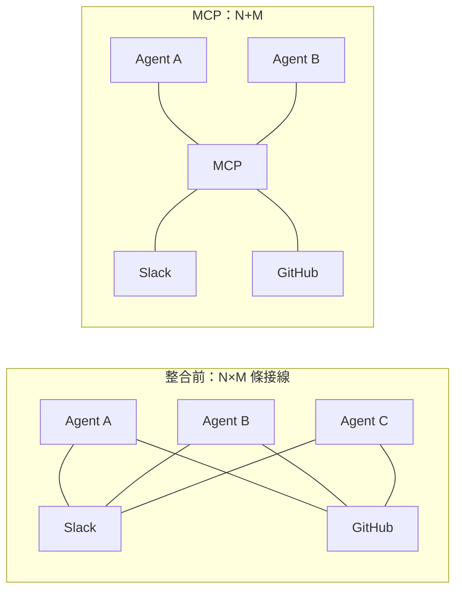
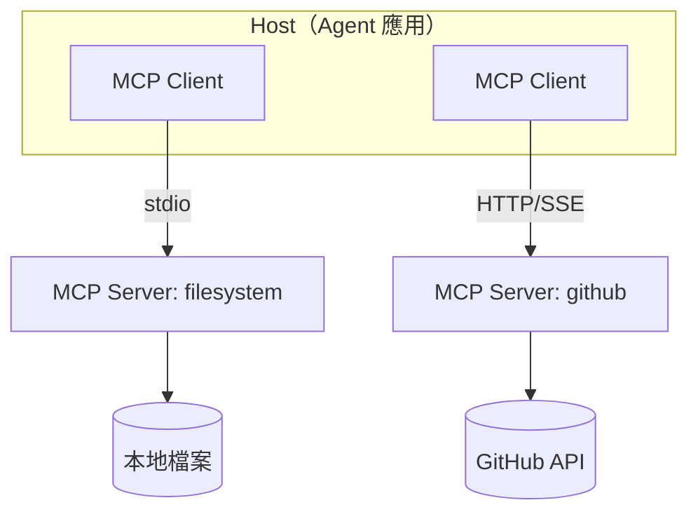
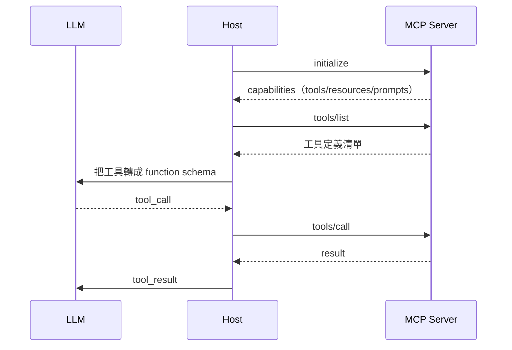
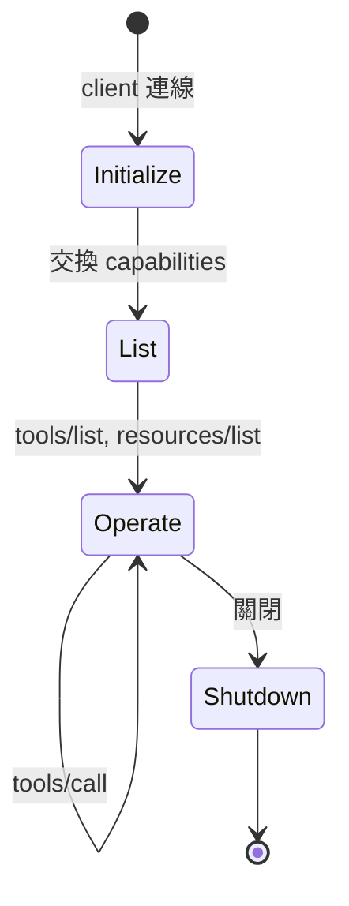
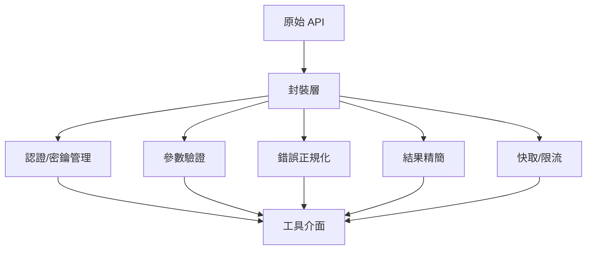

# 5.3 標準化連接協議：MCP（Model Context Protocol）與外部 API 封裝實戰

## 工具整合的「N×M 問題」

每個 Agent 框架都有自己的工具介面，每個外部系統都有自己的 API。若每接一個系統都要重寫，成本是 N 個 Agent × M 個系統。



**MCP（Model Context Protocol）** 就是這個標準化層：用統一的協定描述與呼叫工具、資源、提示，讓任何 Agent 都能接任何 MCP server。

## MCP 的核心概念

| 概念 | 說明 |
|---|---|
| **Server** | 提供能力的一方（如 GitHub MCP server） |
| **Client** | 使用能力的一方（Agent 應用） |
| **Tools** | 可呼叫的動作（有副作用） |
| **Resources** | 可讀取的資料（如檔案、記錄） |
| **Prompts** | 可重用的提示模板 |
| **Transport** | 通訊方式（stdio、HTTP/SSE） |



MCP 把「工具」抽象為三個層次：
- **Tools**：模型主動呼叫（如 `create_issue`）。
- **Resources**：模型被動讀取（如 `file://readme.md`）。
- **Prompts**：預定義的提示模板（如 `code_review`）。

## MCP 與 Function Calling 的關係

Function calling（第 4 章）是「模型如何表達要呼叫工具」；MCP 是「工具如何被發現、描述、呼叫」的傳輸與標準層。兩者互補：

$$
\text{Agent} \xrightarrow{\text{function calling}} \text{MCP Client} \xrightarrow{\text{MCP}} \text{MCP Server} \to \text{外部系統}
$$



## MCP 的生命週期



關鍵訊息：
- `initialize`：協商版本與能力。
- `tools/list`：取得工具定義。
- `tools/call`：呼叫工具。
- `resources/read`：讀取資源。
- `prompts/get`：取得提示模板。

## 實戰：封裝一個外部 API 為 MCP Server

以「天氣 API」為例，用 Python MCP SDK 概念示意：

```python
from mcp.server import Server
from mcp.types import Tool, TextContent
import httpx

app = Server("weather")

@app.list_tools()
async def list_tools():
    return [
        Tool(
            name="get_weather",
            description="查詢指定城市目前天氣。",
            inputSchema={
                "type": "object",
                "properties": {
                    "city": {"type": "string", "description": "城市名稱"},
                    "unit": {"type": "string", "enum": ["c", "f"], "default": "c"},
                },
                "required": ["city"],
            },
        )
    ]

@app.call_tool()
async def call_tool(name, arguments):
    if name == "get_weather":
        async with httpx.AsyncClient() as client:
            r = await client.get(
                "https://api.weather.example/current",
                params={"q": arguments["city"]},
            )
            data = r.json()
        return [TextContent(
            type="text",
            text=f"{data['temp']}°{arguments.get('unit','c')}, {data['cond']}",
        )]
```

要點：
1. **描述要清楚**（4.1）：這是模型選工具的依據。
2. **schema 要嚴謹**：enum、required、範圍。
3. **回傳要精簡**：不要把整個 API 回應倒給模型。
4. **錯誤要結構化**：見 4.2。

## 資源（Resources）的設計

資源是「可讀取的資料」，用 URI 標識：

```json
{
  "uri": "file:///docs/handbook.md",
  "name": "員工手冊",
  "mimeType": "text/markdown"
}
```

Agent 可用資源 URI 讀取內容，而非透過工具呼叫。這適合「大量靜態資料」，避免把資料塞進工具回傳。

## 提示模板（Prompts）

把常用提示封裝成模板，讓不同 Agent 共用：

```json
{
  "name": "summarize",
  "description": "摘要一段文字",
  "arguments": [{"name": "text", "required": true}]
}
```

呼叫時帶參數，server 回傳填好的 prompt。

## MCP 的安全考量

MCP 把外部能力接進來，安全邊界必須清楚：

| 風險 | 對策 |
|---|---|
| 惡意 MCP server | 白名單、簽章、來源審核 |
| 工具權限過大 | 最小權限、範圍限縮 |
| 資源洩漏 | 存取控制、租戶隔離 |
| 注入（透過資源） | 標記不可信資料（2.3） |
| 傳輸竊聽 | TLS、stdio 本地隔離 |

第 6 章與 12.3 會深入。

## MCP vs. 自建工具層

| 面向 | 自建 | MCP |
|---|---|---|
| 控制力 | 高 | 中 |
| 生態 | 自己維護 | 可重用社群 servers |
| 標準化 | 各框架不同 | 統一協定 |
| 學習成本 | 低（熟悉自家） | 需學協定 |
| 適用 | 深度客製 | 多系統整合 |

實務上常混合：核心工具自建，外部系統用 MCP 接。

## 外部 API 封裝的通用準則

無論是否用 MCP，封裝外部 API 都有共同準則：



1. **認證隔離**：密鑰不進模型 context。
2. **參數驗證**：在執行前擋掉非法輸入。
3. **錯誤正規化**：把各種 API 錯誤轉成統一格式。
4. **結果精簡**：只回傳模型需要的欄位。
5. **快取與限流**：降低成本、保護後端（3.3、12.2）。
6. **冪等**：寫入操作支援重試（4.3）。

## 與後續章節的關聯

- **第 4 章**：MCP 工具最終以 function calling 呈現。
- **第 6 章**：MCP 的安全邊界。
- **10.3 Agent 間通訊**：MCP 也可用於 Agent 間共享能力。
- **12.3 治理**：MCP server 的稽核。

## 小結

1. 工具整合有 N×M 問題，MCP 用標準協定降為 N+M。
2. MCP 提供 tools、resources、prompts 三種能力。
3. Function calling 管「模型表達」，MCP 管「工具發現與呼叫」。
4. 封裝外部 API 要認證隔離、驗證、正規化、精簡、快取、冪等。
5. MCP 帶來生態便利，但也帶來新的安全邊界挑戰。
