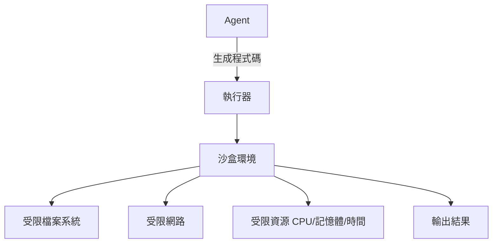
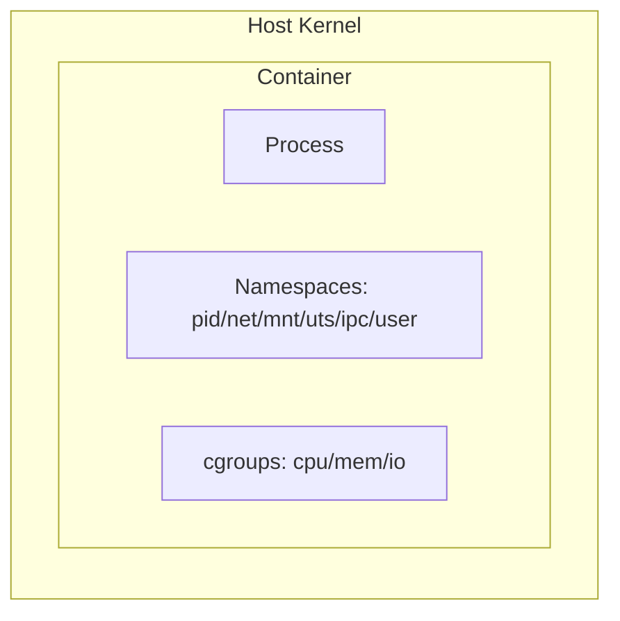
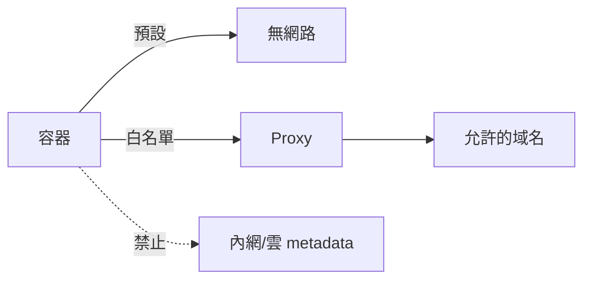

# 6.1 程式碼執行沙盒（Code Interpreter / 容器隔離）與檔案系統權限

## Agent 執行程式碼的誘惑與危險

讓 Agent 執行程式碼，等於給它一台可程式化的電腦。好處巨大：資料分析、檔案轉換、自動化測試。風險也巨大：它能讀寫檔案、發網路請求、消耗資源，甚至逃逸。

**沙盒（sandbox）** 的目標：讓程式碼「能做事，但不能做壞事」。本節談隔離機制與權限。



## 隔離層級

從弱到強：

| 層級 | 機制 | 隔離強度 | 效能 |
|---|---|---|---|
| 程序（process） | 同 OS 不同程序 | 低 | 高 |
| 容器（container） | namespace + cgroup | 中高 | 中 |
| 微虛擬機（microVM） | Firecracker/gVisor | 高 | 中低 |
| 實體隔離 | 獨立機器 | 最高 | 低 |

多數雲端 code interpreter 用**容器或 microVM**。純程序隔離不足以防惡意程式碼。

### 容器隔離的關鍵



- **Namespaces**：隔離視野（看不到其他程序、網路）。
- **cgroups**：限制資源（CPU、記憶體、I/O）。
- **Seccomp**：限制系統呼叫。
- **唯讀根檔案系統**：防止持久化篡改。

## 資源限制：防止 DoS

```yaml
resources:
  limits:
    cpu: "1"
    memory: "512Mi"
timeout_seconds: 30
max_output_bytes: 1048576
```

三類限制缺一不可：
1. **時間**：`timeout`，防無限迴圈。
2. **記憶體**：防 OOM 拖垮宿主。
3. **輸出大小**：防巨量輸出塞爆 context。

$$
\text{cost}_{\text{exec}} \le f(\text{cpu time}, \text{memory}, \text{io}, \text{network})
$$

## 網路隔離

程式碼若可自由上網，可：
- 外洩資料（把檔案 POST 出去）。
- 下載惡意程式。
- 攻擊內網。

策略：
- **預設無網路**。
- **白名單**：只允許特定域名（如套件源）。
- **代理**：所有流量經審計代理。
- **DNS 限制**。



**特別注意**：雲端 metadata endpoint（如 `169.254.169.254`）常是竊取憑證的目標，必須封鎖。

## 檔案系統權限

### 1. 分層檔案系統

```
/workspace      # 可讀寫，任務專屬，隔離
/input          # 唯讀，掛載使用者資料
/tmp            # 可寫，執行後清除
/system         # 唯讀，runtime
```

### 2. 路徑穿越防護

Agent 可能生成 `../../etc/passwd`。必須在執行前解析並限制在 workspace 內：

```python
import os

def safe_path(base, user_path):
    base = os.path.realpath(base)
    target = os.path.realpath(os.path.join(base, user_path))
    if not target.startswith(base + os.sep):
        raise PermissionError("path traversal")
    return target
```

### 3. 權限最小化

- 不以 root 執行。
- 檔案權限 `0600` 或 `0700`。
- 敏感路徑（`~/.ssh`、`/etc`）不可存取。

## 執行模型：一次性 vs. 持久

| 模式 | 說明 | 適用 |
|---|---|---|
| 一次性容器 | 每次執行新容器，結束即毀 | 高隔離、無狀態 |
| 持久會話 | 保留檔案與變數 | 多步分析、需狀態 |
| 快照 | 執行後快照，可回復 | 審計、重現 |

Agent 常見需求是「多步資料分析」需保留變數，因此用持久會話，但仍需資源限制與定期重置。

```mermaid
sequenceDiagram
    participant A as Agent
    participant S as Sandbox
    A->>S: 建立會話
    A->>S: exec: import pandas; df = ...
    S-->>A: ok
    A->>S: exec: df.describe()
    S-->>A: 統計結果
    A->>S: 關閉會話
```

## 輸出處理

執行結果可能巨大或含敏感資訊：

- **截斷**：超過 N bytes 截斷並標記。
- **過濾**：移除密鑰、PII（若政策要求）。
- **結構化**：stdout/stderr/exit code/artifact 分開回傳。

```json
{
  "exit_code": 0,
  "stdout": "...",
  "stderr": "",
  "artifacts": [{"path": "chart.png", "type": "image/png"}],
  "truncated": false
}
```

## 常見逃逸與防禦

| 攻擊 | 說明 | 防禦 |
|---|---|---|
| 容器逃逸 | 核心漏洞 | 及時更新、microVM |
| 路徑穿越 | `../` 讀敏感檔 | realpath 檢查 |
| 資源耗盡 | fork bomb、巨記憶體 | cgroup、ulimit |
| 網路外洩 | POST 資料出去 | 無網路/白名單 |
| 供應鏈 | 安裝惡意套件 | 私有源、鎖版本 |
| 時間側通道 | 推測秘密 | 隔離、限制 |

## 沙盒的「信任邊界」設計

$$
\text{trust}(\text{host}) > \text{trust}(\text{sandbox}) > \text{trust}(\text{agent code})
$$

Agent 生成的程式碼應被視為**不可信輸入**，與使用者輸入同級。因此：
- 沙盒不能掛載 host 的敏感目錄。
- 沙盒不能存取 agent 的密鑰。
- 沙盒的網路與 host 網路隔離。

## 與後續章節的關聯

- **6.2 風險分級**：程式碼執行的副作用等級。
- **6.3 審批閘門**：高風險執行需人工確認。
- **13.3 GUI Agent**：另一種「操作環境」的隔離。
- **15.3 實體安全**：真實世界的沙盒（緊急煞停）。

## 小結

1. 沙盒目標是「能做事不能做壞事」，隔離層級從程序到 microVM。
2. 容器隔離靠 namespace + cgroup + seccomp，需資源與時間限制。
3. 網路預設關閉、白名單、封鎖 metadata endpoint。
4. 檔案系統分層、realpath 防穿越、最小權限。
5. Agent 生成的程式碼是不可信輸入，信任邊界要清楚。
6. 輸出要截斷、過濾、結構化。
