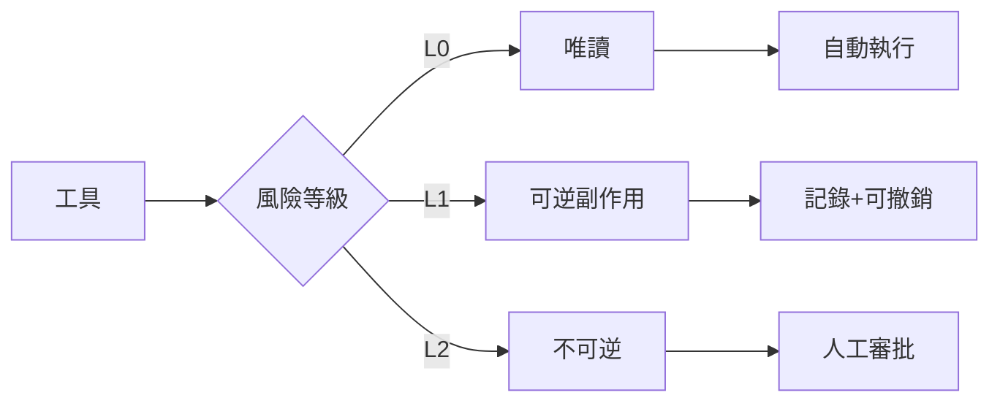
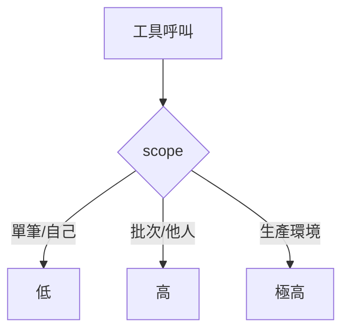
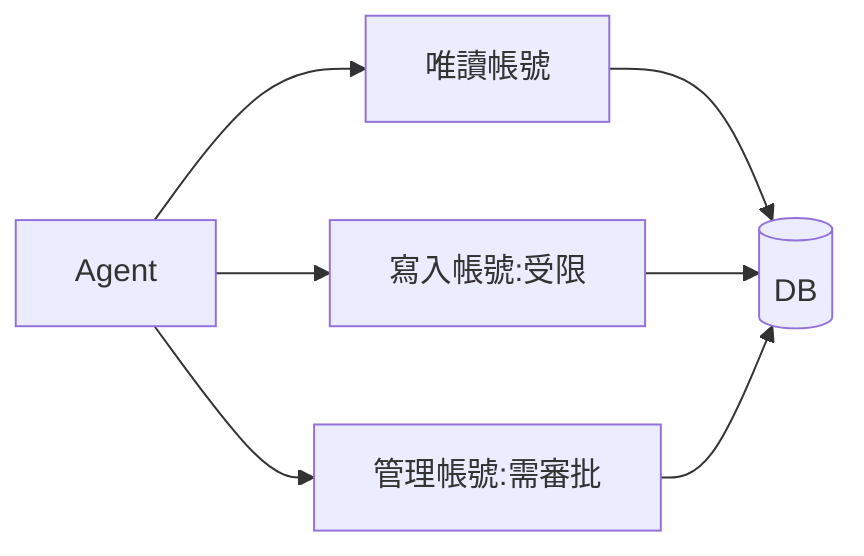
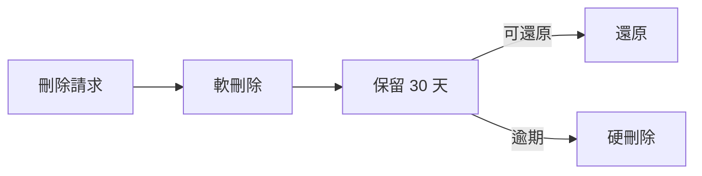

# 6.2 讀寫操作分級：唯讀查詢、副作用動作與不可逆操作辨識

## 為什麼要對工具分級

不是所有工具都一樣危險。查天氣是安全的；刪除資料庫是災難性的。若不區分，Agent 可能因為一次誤判就造成不可挽回的損失。**操作分級**是讓系統在「能力」與「風險」之間取得平衡的基礎。



## 三級分類

### L0：唯讀查詢（Read-only）

不改變任何狀態，只讀取資訊。

- 例：`get_weather`、`search_docs`、`read_file`、`query_db`（SELECT）。
- 特性：**冪等**、無副作用、可任意重試。
- 風險：低（但仍有資訊洩漏風險）。

### L1：可逆副作用（Reversible write）

改變狀態，但可以撤銷或補償。

- 例：`create_draft`、`update_profile`（有歷史）、`send_email`（有草稿/可撤回窗口）、`add_to_cart`。
- 特性：有副作用，但可回復。
- 風險：中（需記錄、可審計、可補償）。

### L2：不可逆操作（Irreversible）

改變狀態且**無法復原**。

- 例：`delete_user`、`transfer_money`、`drop_table`、`send_payment`、`publish_post`。
- 特性：不可逆、影響大。
- 風險：高（必須審批，見 6.3）。

## 形式化分級

給每個工具標記屬性：

```json
{
  "name": "delete_order",
  "annotations": {
    "readOnly": false,
    "destructive": true,
    "idempotent": false,
    "reversible": false,
    "requiresApproval": true,
    "dataSensitivity": "high"
  }
}
```

可定義風險分數：

$$
\text{risk} = w_1 \cdot \text{destructive} + w_2 \cdot (1-\text{reversible}) + w_3 \cdot (1-\text{idempotent}) + w_4 \cdot \text{sensitivity}
$$

依分數決定：自動執行 / 記錄 / 審批 / 禁止。

## 如何辨識不可逆

### 1. 靜態標記（最可靠）

由工具開發者明確標記 `destructive: true`。這是第一手資訊。

### 2. 語意分析

工具名稱含 `delete`、`drop`、`remove`、`transfer`、`pay`、`publish`、`revoke` 等，提高警覺。

```python
DANGEROUS = {"delete", "drop", "remove", "transfer", "pay", "publish", "revoke", "wipe"}
def is_destructive(name):
    return any(k in name.lower() for k in DANGEROUS)
```

但語意分析不可靠（`archive` 是刪除嗎？），只能作為輔助。

### 3. 參數檢查

即使工具本身是 L1，某些參數也可能讓它變 L2：

- `update_user(role="admin")`：權限提升。
- `delete(force=True)`：強制刪除。
- `transfer(amount=大額)`：高額交易。

$$
\text{effective risk} = f(\text{tool}, \text{args})
$$

### 4. 影響範圍

- 單筆 vs. 批次（`delete_one` vs. `delete_all`）。
- 自己的資料 vs. 他人資料。
- 測試環境 vs. 生產環境。



## 讀寫分離的架構

### 1. 獨立工具

```json
{"name": "query_users", "readOnly": true}
{"name": "update_user", "readOnly": false}
{"name": "delete_user", "destructive": true}
```

不要把讀寫混在同一工具（如 `execute_sql`），否則無法分級。

### 2. 資料庫層的讀寫帳號

- Agent 的讀取用唯讀帳號（只有 SELECT 權限）。
- 寫入用受限帳號（只能特定表）。
- 刪除等高風險用獨立流程。



### 3. 權限階梯

$$
\text{read} \subset \text{write-own} \subset \text{write-all} \subset \text{delete} \subset \text{admin}
$$

Agent 預設只有最低階，需要時才升級（且需審批）。

## 冪等性與可逆性的設計

### 讓 L1 盡量可逆

- 軟刪除（`deleted_at` 標記）而非硬刪除。
- 版本歷史（可回滾）。
- 草稿先行（draft → review → publish）。
- 交易記錄（可補償）。



### 讓寫入冪等

用冪等鍵防止重試造成重複：

```python
await api.transfer(amount, idempotency_key=uuid4())
```

## 分級驅動的行為

| 等級 | 自動執行 | 記錄 | 審批 | 可重試 |
|---|---|---|---|---|
| L0 唯讀 | 是 | 輕量 | 否 | 是 |
| L1 可逆 | 是 | 完整 | 否 | 是（冪等） |
| L2 不可逆 | 否 | 完整 | 是 | 否（需冪等） |

```python
def policy(tool, args):
    level = classify(tool, args)
    if level == "L0":
        return Auto()
    if level == "L1":
        return Auto(log=True, compensable=True)
    if level == "L2":
        return RequiresApproval()
```

## 不可逆操作的「雙重確認」

即使有審批，也建議：

1. **明確的意圖確認**：Agent 向使用者複述即將執行的動作。
2. **乾跑（dry-run）**：先模擬，顯示影響。
3. **範圍檢查**：確認影響筆數。
4. **延遲執行**：給使用者取消窗口。

```text
即將刪除 3 筆訂單：
- #A123（金額 500）
- #A124（金額 800）
- #A125（金額 300）
此操作無法復原。請確認 [Y/n]
```

## 與後續章節的關聯

- **6.1 沙盒**：程式碼執行的隔離。
- **6.3 審批閘門**：L2 的人工確認機制。
- **12.3 稽核**：所有寫入操作的日誌。
- **15.3 實體安全**：物理世界的不可逆（碰撞）。

## 小結

1. 工具分三級：L0 唯讀、L1 可逆副作用、L2 不可逆。
2. 分級靠靜態標記（最可靠）+ 語意 + 參數 + 範圍。
3. 讀寫分離、權限階梯、獨立帳號是架構基礎。
4. 讓 L1 盡量可逆（軟刪除、草稿、版本），讓寫入冪等。
5. L2 必須審批 + 雙重確認 + 乾跑 + 延遲執行。
