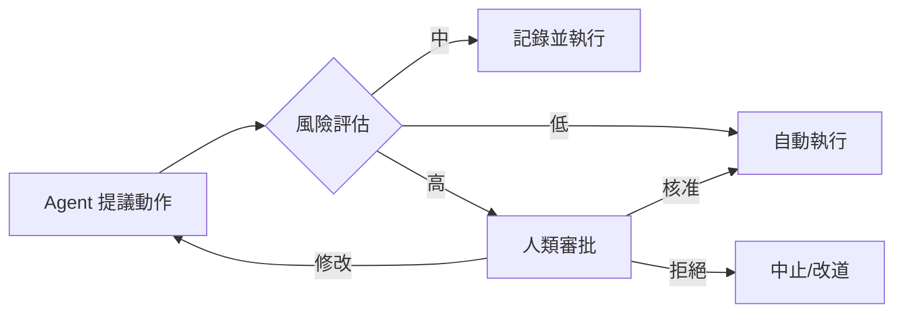
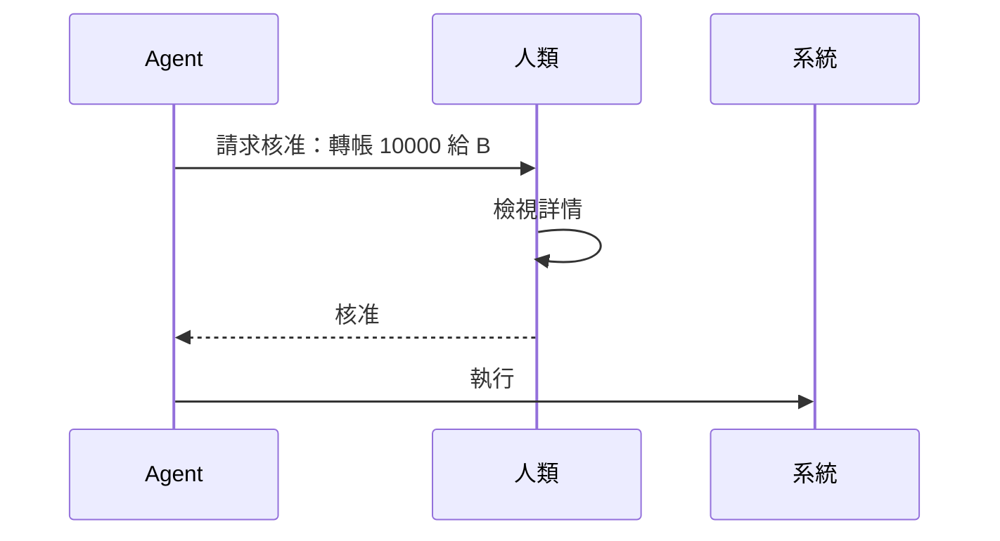
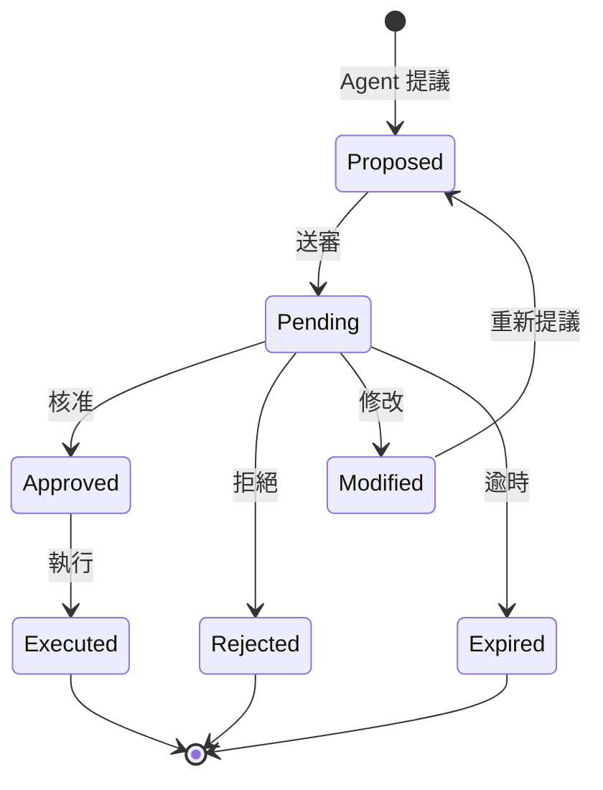
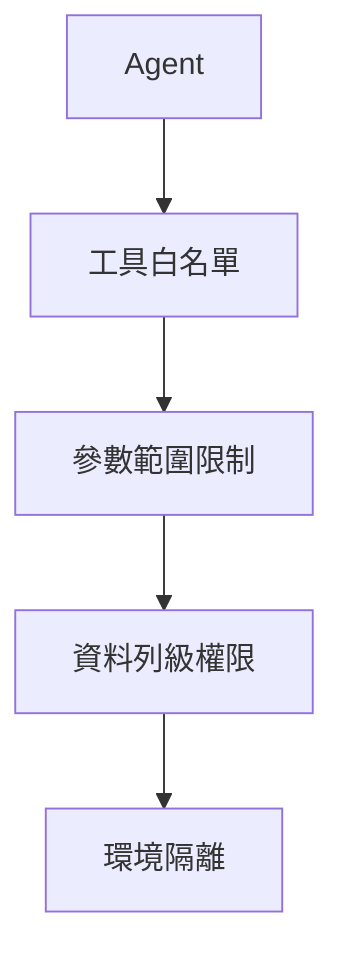
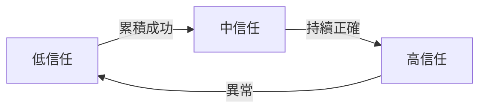

# 6.3 人機協作審批閘門（Human-in-the-Loop）與最小權限原則

## 為什麼需要人

Agent 再聰明，也不該被賦予無限權力。**Human-in-the-Loop（HITL）** 的核心想法：在高風險、不可逆、或模型不確定的時刻，把決策權交回人類。

這不是「不信任 AI」，而是**風險工程**：讓人類成為最後一道可控的保險。



## HITL 的三種模式

### 1. 審批制（Approval）

Agent 提出動作，人類核准或拒絕。適合 L2 不可逆操作。



### 2. 協作制（Collaboration）

Agent 與人類共同完成任務，人類提供方向，Agent 執行。

### 3. 監督制（Supervision）

Agent 自主執行，人類監看並可隨時介入（如中止）。

## 何時觸發審批

審批不是越多越好（會拖慢體驗），也不是越少越好（會失控）。觸發條件：

| 條件 | 例子 |
|---|---|
| 不可逆操作 | 刪除、轉帳、發布 |
| 高金額/高影響 | 大額交易、批次操作 |
| 權限提升 | 改角色、給 admin |
| 低信心 | 模型信心 < 閾值 |
| 異常模式 | 短時間大量操作 |
| 敏感資料 | PII、財務、醫療 |
| 首次操作 | 新工具第一次使用 |

$$
\text{approve} \iff \text{risk}(a) > \tau \;\lor\; \text{confidence}(a) < \theta
$$

## 審批介面的設計

好的審批 UI 要讓人能**快速且正確**地判斷：

1. **清楚描述動作**：不是 `delete_order(id=123)`，而是「刪除訂單 #123（客戶：王小明，金額 500）」。
2. **顯示影響範圍**：影響幾筆、哪些資料。
3. **顯示理由**：Agent 為何要這麼做。
4. **風險提示**：是否可逆。
5. **一鍵操作**：核准 / 拒絕 / 修改 / 要求更多資訊。
6. **逾時處理**：多久沒回應就取消。

```json
{
  "action": "delete_orders",
  "summary": "刪除 3 筆已取消訂單",
  "details": [
    {"id": "A123", "customer": "王小明", "amount": 500},
    {"id": "A124", "customer": "陳大文", "amount": 800},
    {"id": "A125", "customer": "林小美", "amount": 300}
  ],
  "reversible": false,
  "reason": "使用者要求清理已取消訂單",
  "agent_confidence": 0.72
}
```

## 審批的工作流



狀態機確保每個審批都有明確結局，不會懸而未決。

## 審批的執行語意

### 1. 核准後才執行

Agent 的動作在核准前**不得**執行任何副作用。這是硬規則。

```python
async def execute_with_approval(action):
    if requires_approval(action):
        decision = await request_approval(action)
        if decision != "approved":
            return Cancelled(decision)
    return await action.run()
```

### 2. 內容綁定（Content Binding）

核准的是「這個具體動作」，不是「這類動作」。核准後若參數被改，需重新審批（防 TOCTOU：time-of-check to time-of-use）。

```python
approval = {"hash": sha256(canonical(action)), "expires": now + 300}
if sha256(canonical(action)) != approval["hash"]:
    raise TamperedAction()
```

### 3. 逾時即取消

未在期限內回應，視為拒絕（fail-safe）。

## 最小權限原則（Principle of Least Privilege）

HITL 是「事後把關」，最小權限是「事前限縮」。兩者互補。

$$
\text{permissions}(\text{agent}) = \text{exactly what is needed, nothing more}
$$

### 實作方式

1. **工具層**：只暴露任務需要的工具。
2. **參數層**：限制可操作的範圍（如只能查自己的資料）。
3. **資料層**：Row-level security、欄位遮罩。
4. **時間層**：權限有期限（短期 token）。
5. **環境層**：測試/生產隔離。



### 動態權限

權限可隨任務階段調整：

```python
permissions = {
    "phase": "read_analysis",
    "allowed": ["search_docs", "read_file", "query_db_readonly"],
}
# 進入執行階段才授予寫入
permissions["allowed"] += ["create_draft"]
```

## 權限與信任的動態平衡



- 新 Agent/新工具：嚴格限制 + 審批。
- 長期正確：放寬自動執行範圍。
- 出現異常：立即降級。

這對應 12.3 的「維運飛輪」。

## 常見反模式

| 反模式 | 問題 | 對策 |
|---|---|---|
| 審批疲勞 | 太多審批導致隨便按 | 分級、只審高風險 |
| 審批形同虛設 | 資訊不足無法判斷 | 提供清楚摘要 |
| 核准後可改參數 | TOCTOU 攻擊 | 內容綁定 |
| 權限一次給足 | 爆炸半徑大 | 最小權限、動態授予 |
| 無逾時 | 永遠卡住 | 逾時取消 |
| 無審計 | 出事無法追 | 記錄所有決策 |

## 與後續章節的關聯

- **6.2 分級**：審批的觸發依據。
- **12.3 稽核**：審批記錄是稽核核心。
- **13.4 跨模態**：GUI 操作的審批。
- **15.3 實體**：緊急煞停是最極端的 HITL。

## 小結

1. HITL 是高風險時刻把決策交回人類，是風險工程而非不信任。
2. 三模式：審批、協作、監督；觸發條件包含不可逆、高影響、低信心。
3. 審批 UI 要清楚描述動作、影響、理由、風險。
4. 核准後才執行，內容綁定防 TOCTOU，逾時即取消。
5. 最小權限是事前限縮，與 HITL 互補；權限可動態調整。
6. 避免審批疲勞與形同虛設。
