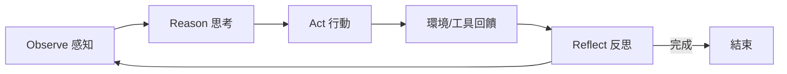
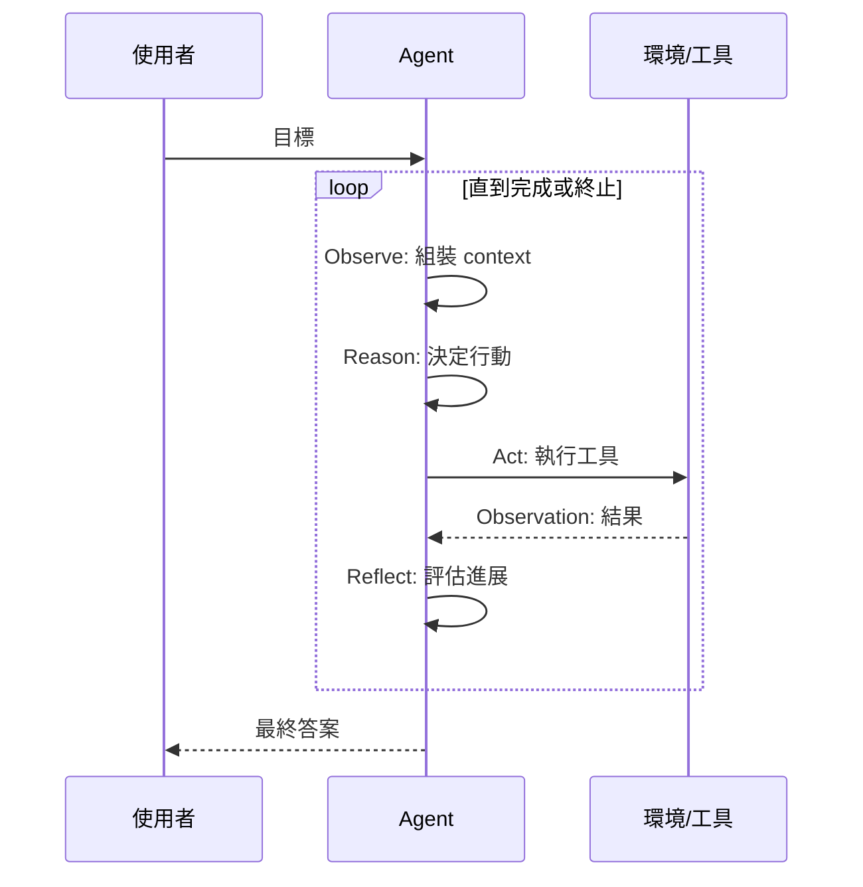

# 7.1 感知（Observe）— 思考（Reason）— 行動（Act）— 反思（Reflect）迴圈

## Agent 的定義：會「循環」的 LLM

單純的 LLM 是 `輸入 → 輸出` 的函數。Agent 則是**把這個函數放進一個帶有環境回饋的迴圈**：

$$
\text{Agent}: \text{state}_{t+1} = \text{LLM}(\text{state}_t) \to \text{action} \to \text{observation}
$$

差別不在模型，而在**循環**：Agent 能根據行動的結果調整下一步，直到達成目標。



## 四個階段的拆解

### 1. Observe（感知）

Agent 接收當前狀態：

- 使用者訊息
- 工具回傳結果
- 系統狀態（時間、錯誤、預算）
- 記憶（短期/長期，見第 8 章）

感知的本質是**把環境壓縮成模型能讀的 context**。這正是 9.3 上下文工程的工作。

$$
\text{obs}_t = \text{assemble}(\text{user}, \text{tool results}, \text{memory}, \text{state})
$$

### 2. Reason（思考）

根據感知，決定要做什麼：

- 目標是否已達成？
- 下一步是什麼？
- 需要哪個工具、什麼參數？

這一步就是 2.1 的 CoT 與 2.2 的結構化輸出，只是被嵌入迴圈。

$$
\text{plan}_t = \text{LLM}_{\text{reason}}(\text{obs}_t, \text{goal})
$$

### 3. Act（行動）

執行動作：

- 呼叫工具（第 4 章）
- 執行程式碼（6.1）
- 回覆使用者
- 更新記憶（第 8 章）

行動可能產生副作用，需風險分級（6.2）。

### 4. Reflect（反思）

檢視行動結果：

- 成功還是失敗？
- 是否朝目標前進？
- 需要修正計畫嗎？

反思是 Agent 與「盲目呼叫迴圈」的關鍵差異。它讓 Agent 能從錯誤中學習（至少在同一任務內）。

$$
\text{reflection}_t = \text{evaluate}(\text{obs}_{t+1}, \text{goal}, \text{plan}_t)
$$

## 迴圈的整體流程



## 為什麼需要「反思」而非只是「再想一次」

缺乏反思的迴圈容易：

- **重複同樣的錯誤**：模型不知道上次失敗了。
- **無法察覺偏離目標**：埋頭執行卻離題。
- **錯過終止時機**：不知道已達成。

反思把「結果」轉為「對計畫的評價」，形成負回饋控制：

$$
\text{plan}_{t+1} = \begin{cases}
\text{plan}_t & \text{成功} \\
\text{revise}(\text{plan}_t, \text{error}) & \text{失敗}
\end{cases}
$$

## 控制理論的類比

Agent 迴圈可類比為**閉環控制系統**：

| 控制概念 | Agent 對應 |
|---|---|
| 目標（setpoint） | 使用者任務 |
| 感測器（sensor） | 工具回傳、環境狀態 |
| 控制器（controller） | LLM 推理 |
| 致動器（actuator） | 工具執行 |
| 誤差（error） | 當前狀態與目標差距 |
| 回饋（feedback） | 反思 |

$$
e_t = \text{goal} - \text{state}_t, \qquad \text{action}_t = \pi(e_t)
$$

這解釋了為何 Agent 需要「觀察」與「反思」：沒有回饋的開環系統無法穩定達成目標。

## 與 ReAct 的關係

ReAct（7.2）是這個迴圈的文字化版本：

```text
Thought: 我需要查天氣
Action: get_weather(city="台北")
Observation: 22°C 晴
Thought: 已有資訊，可以回答
Final Answer: 台北現在 22°C 晴
```

Observe = Observation，Reason = Thought，Act = Action，Reflect 隱含在下一輪 Thought。

## 迴圈的工程實作

```python
async def agent_loop(goal, tools, max_steps=15):
    state = init_state(goal)
    for step in range(max_steps):
        obs = assemble_context(state)          # Observe
        decision = await llm_reason(obs, tools) # Reason
        if decision.type == "final":
            return decision.answer
        result = await act(decision.action)     # Act
        state = update_state(state, decision, result)
        critique = await reflect(obs, decision, result)  # Reflect
        if critique.should_stop:
            return critique.final_answer or state.best_answer
    return state.best_answer
```

## 各階段的失敗模式

| 階段 | 失敗 | 症狀 |
|---|---|---|
| Observe | context 缺關鍵資訊 | 模型問已回答過的問題 |
| Reason | 計畫錯誤 | 朝錯誤方向執行 |
| Act | 工具誤用 | 參數錯、選錯工具 |
| Reflect | 誤判成功 | 提早結束或無限迴圈 |

對應章節：Observe → 9.3；Reason → 9.1；Act → 第 4 章；Reflect → 9.2、11.3。

## 與後續章節的關聯

- **7.2**：三種迴圈架構的具體形式。
- **7.3**：迴圈的終止與防呆。
- **第 8 章**：記憶支撐 Observe。
- **第 9 章**：規劃與自我除錯支撐 Reason/Reflect。
- **第 11 章**：追蹤整個迴圈。

## 小結

1. Agent = LLM + 帶環境回饋的迴圈。
2. 四階段：感知組裝 context、思考決策、行動執行、反思評估。
3. 反思形成負回饋，讓 Agent 能修正而非重複錯誤。
4. Agent 迴圈可類比閉環控制系統，強調回饋與穩定。
5. ReAct 是此迴圈的文字化形式。
6. 每個階段都有對應的失敗模式與後續章節。
