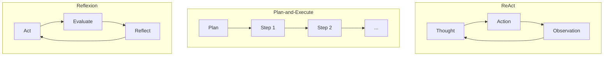
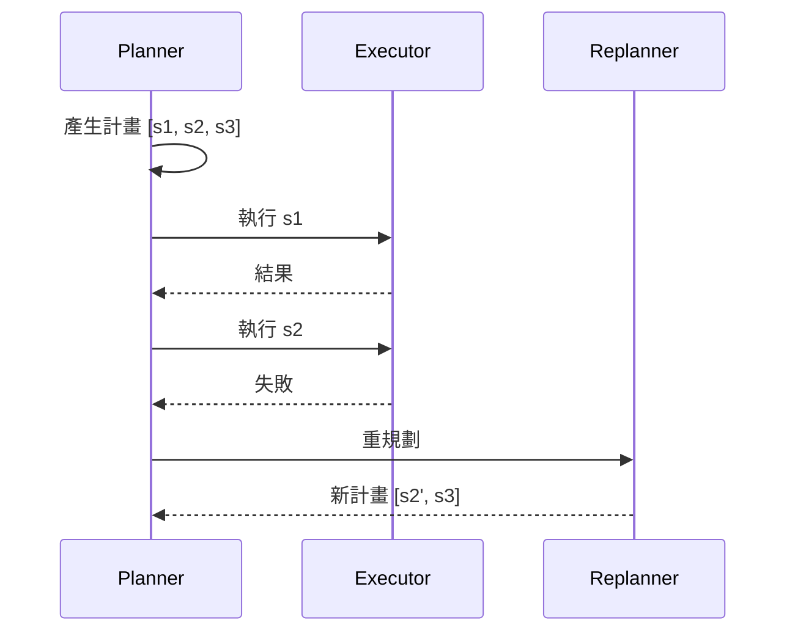
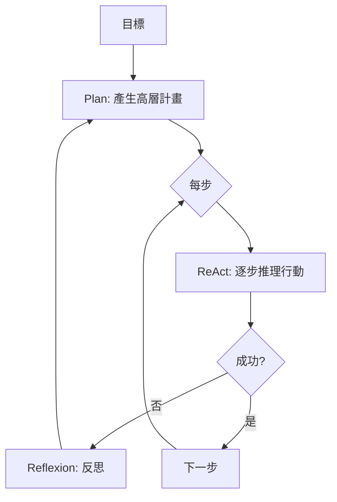
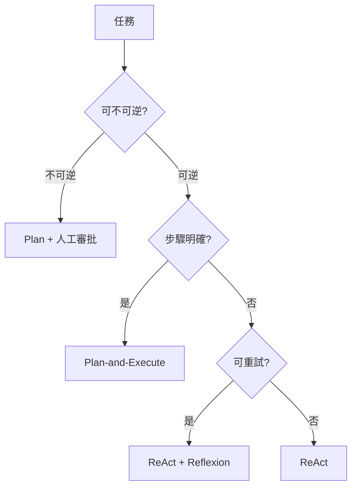

# 7.2 ReAct、Plan-and-Execute 與 Reflexion 架構比較與選型

## 三種主流 Agent 架構

7.1 的四階段迴圈是骨架，實際落地有三種常見架構，各有取捨：

1. **ReAct**：邊想邊做，交錯推理與行動。
2. **Plan-and-Execute**：先規劃完整計畫，再逐步執行。
3. **Reflexion**：執行後反思，把經驗回饋到下一輪。



## ReAct（Reasoning + Acting）

### 原理

ReAct 讓模型在每一步交錯輸出「思考」與「行動」，行動結果作為觀察回饋：

```text
Thought: 使用者問台北天氣，我需要查詢
Action: get_weather(city="台北")
Observation: {"temp_c": 22, "condition": "晴"}
Thought: 已取得天氣，可以回答
Final Answer: 台北現在 22°C，天氣晴。
```

形式上，這是把推理軌跡與行動軌跡交錯生成：

$$
\tau = (t_1, a_1, o_1, t_2, a_2, o_2, \dots, a_n)
$$

### 優點

- **靈活**：可根據中間結果動態調整。
- **簡單**：不需要預先規劃。
- **透明**：思考過程可觀察（利於除錯）。

### 缺點

- **短視**：只看下一步，可能缺乏全局視角。
- **步數多**：每步都要呼叫模型，成本高。
- **易繞路**：可能反覆試錯。

### 適用

- 探索性任務（資訊不確定）。
- 工具結果會顯著改變計畫的任務。
- 步數不多的任務。

## Plan-and-Execute

### 原理

先讓模型產生完整計畫（步驟清單），再依序執行。必要時重規劃。



```json
{
  "plan": [
    {"step": 1, "action": "search_flights", "args": {"from": "TPE", "to": "NRT"}},
    {"step": 2, "action": "search_hotels", "args": {"city": "東京"}},
    {"step": 3, "action": "compose_itinerary", "args": {}}
  ]
}
```

### 優點

- **全局視角**：計畫完整，不易迷路。
- **可平行**：獨立步驟可並行（4.3）。
- **可審查**：計畫可先給人看（6.3）。

### 缺點

- **僵化**：環境變化時計畫可能失效。
- **規劃錯誤傳播**：錯誤計畫導致全盤皆錯。
- **前期延遲**：要先規劃才能開始。

### 適用

- 步驟明確、可預測的任務。
- 長流程（如資料處理管線）。
- 需要人類事先審批計畫的場景。

## Reflexion

### 原理

執行任務後，模型反思失敗原因，把反思存入記憶，下一輪帶著反思重試：


Reflexion 的關鍵是**跨嘗試的學習**：

$$
\text{attempt}_{k+1} = \text{Agent}(\text{task}, \text{reflections}_{1:k})
$$

```text
反思：上次失敗是因為沒有先確認使用者預算就推薦了超預算航班。
下次應先詢問預算。
```

### 優點

- **自我改進**：從錯誤中學習。
- **適合可重試任務**：如程式碼生成、解題。

### 缺點

- **需要多次嘗試**：成本高。
- **反思可能錯誤**：歸因錯誤會誤導下次。
- **不適合不可逆操作**：不能「重試」轉帳。

### 適用

- 可重複嘗試的任務（生成、解題、測試）。
- 有明確成功判準（測試通過、答案正確）。

## 三者比較

| 面向 | ReAct | Plan-and-Execute | Reflexion |
|---|---|---|---|
| 全局觀 | 低 | 高 | 中 |
| 靈活性 | 高 | 低 | 中 |
| 成本 | 中 | 中低（可平行） | 高（多次嘗試） |
| 除錯性 | 高（透明） | 中 | 中 |
| 適合不可逆 | 需小心 | 需審批 | 不適合 |
| 典型場景 | 探索、問答 | 長流程、管線 | 生成、解題 |

## 混合架構：實務最常見

真實系統常混合三者的優點：



即：**高層用 Plan，執行用 ReAct，失敗用 Reflexion**。

```python
async def hybrid_agent(goal):
    plan = await make_plan(goal)
    reflections = []
    for step in plan:
        result = await react_execute(step, reflections)
        if not result.ok:
            reflection = await reflect(step, result)
            reflections.append(reflection)
            plan = await replan(goal, plan, reflection)
    return compose(plan)
```

## 選型決策樹



## 成本與延遲考量

$$
\text{cost}_{\text{ReAct}} \approx n_{\text{steps}} \cdot c_{\text{call}}
$$
$$
\text{cost}_{\text{Plan}} \approx c_{\text{plan}} + \sum_i c_{\text{exec}_i}
$$
$$
\text{cost}_{\text{Reflexion}} \approx k_{\text{attempts}} \cdot \text{cost}_{\text{base}}
$$

Reflexion 的成本是基準的 $`k`$ 倍，只在「重試有價值」時使用。

## 與後續章節的關聯

- **7.3 終止條件**：三種架構都需要防死迴圈。
- **9.1 任務拆解**：Plan 的基礎。
- **9.2 自我除錯**：Reflexion 的基礎。
- **11.1 追蹤**：記錄 ReAct 軌跡。

## 小結

1. ReAct 邊想邊做，靈活但短視。
2. Plan-and-Execute 先規劃再執行，全局但僵化。
3. Reflexion 從失敗反思重試，適合可重試任務。
4. 實務常混合：高層 Plan、執行 ReAct、失敗 Reflexion。
5. 選型取決於可逆性、步驟明確度、可重試性與成本。
