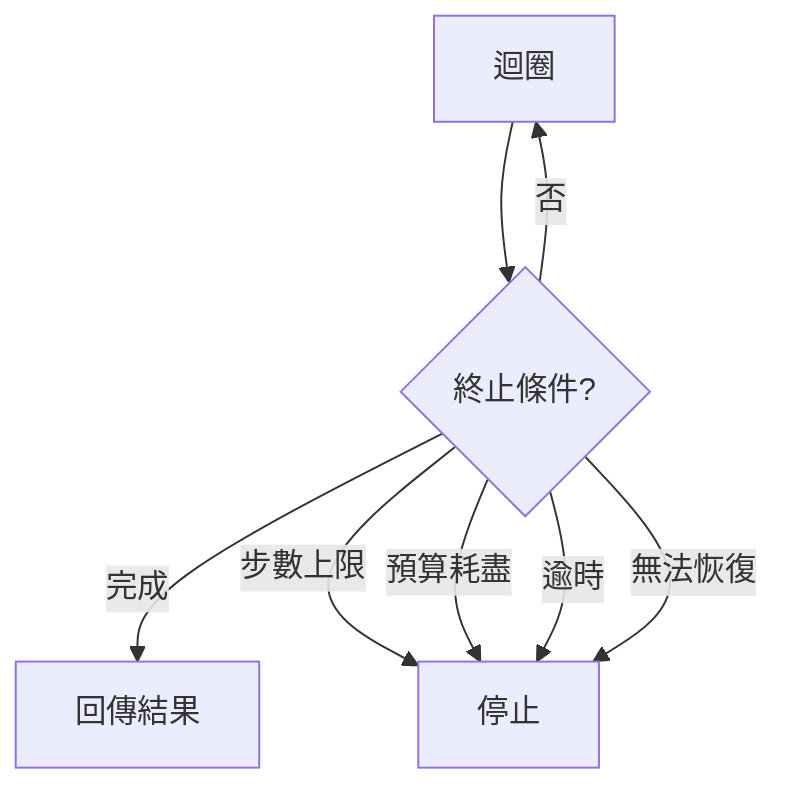
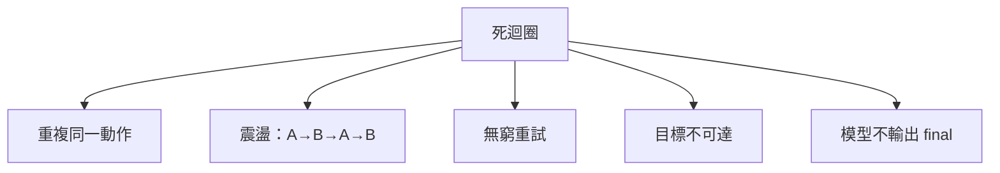
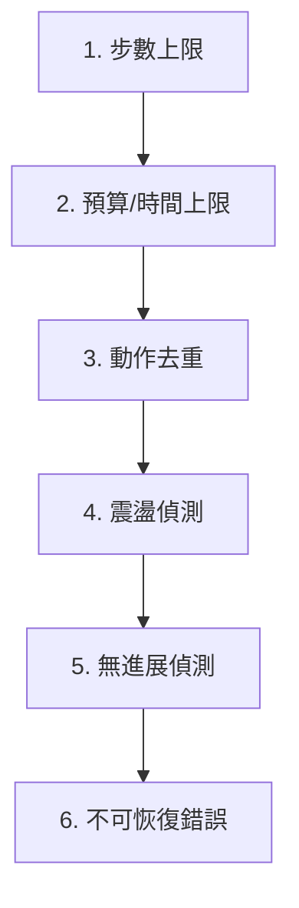

# 7.3 終止條件、最大步數限制與死迴圈防呆設計

## 迴圈沒有終止條件，就是事故

Agent 迴圈的威力來自「可以一直做」，但這也正是危險所在。沒有終止條件，Agent 可能：

- 無限呼叫同一工具。
- 反覆重試失敗操作，燒光預算。
- 陷入「思考—行動」的震盪。
- 永遠等不到「完成」。

**終止條件是 Agent 安全的第一道防線**，比任何 prompt 都重要。



## 六類終止條件

### 1. 成功終止（Success）

Agent 達成了目標：回傳最終答案、任務完成。

```python
if decision.type == "final_answer":
    return decision.answer
```

模型需能**判斷「完成」**，這本身是能力問題（見 9.2）。

### 2. 步數上限（Max Steps）

最簡單也最重要：

```python
for step in range(max_steps):
    ...
raise MaxStepsExceeded()
```

$`N_{\text{steps}} \le N_{\max}`$

設定原則：
- 簡單任務：3–5 步。
- 中等任務：10–15 步。
- 複雜任務：30–50 步。
- **永遠不設無限**。

### 3. 預算上限（Budget）

成本或 token 上限（見 3.3、12.2）：

$$
\sum_i \text{cost}_i \le B_{\max}
$$

預算耗盡時，停止並回傳「部分結果 + 說明」。

### 4. 時間上限（Timeout）

```python
async with asyncio.timeout(300):  # 5 分鐘
    await agent_loop(...)
```

牆鐘時間上限，防止慢速迴圈。

### 5. 無進展終止（No Progress）

若連續 $`k`$ 步狀態沒有實質變化，停止：

$$
\text{progress}_t = \text{sim}(\text{state}_t, \text{state}_{t-k}) > \epsilon
$$

```python
if is_repeating(recent_actions, window=3):
    return stop("no_progress")
```

### 6. 錯誤終止（Unrecoverable）

遇到不可恢復錯誤：權限拒絕、關鍵工具持續失敗、違反安全策略。

```python
except UnrecoverableError as e:
    return stop(e, reason="unrecoverable")
```

## 死迴圈的五種成因



### 成因一：重複同一動作

模型沒意識到已做過，或工具結果沒被正確回饋。

**對策**：動作去重（hash action，若重複則警告）。

```python
seen = set()
key = hash_action(action)
if key in seen:
    remind("你已執行過此動作，請換策略")
seen.add(key)
```

### 成因二：震盪（Oscillation）

在兩個動作間來回：先增加再減少，再增加…

**對策**：偵測循環模式，強制改變策略。

```python
if recent_actions[-4:] == [a, b, a, b]:
    force("請採用完全不同的方法")
```

### 成因三：無窮重試

工具一直失敗，模型一直重試。

**對策**：重試上限（4.3）+ 斷路器。

### 成因四：目標不可達

任務本質上做不到（如查不存在的資料），但模型不放棄。

**對策**：明確的「放棄」指令。

```text
若嘗試 3 次仍無法取得資訊，請回報「無法完成」並說明原因，
不要繼續嘗試。
```

### 成因五：模型不輸出 final

模型一直輸出 tool_calls，從不給最終答案。

**對策**：步數上限 + 在接近上限時提示「請給出最終答案」。

```python
if step == max_steps - 1:
    messages.append({"role": "system", "content": "這是最後一步，請給出最終答案。"})
```

## 進度追蹤

要判斷「有沒有進展」，需要定義進度指標：

| 任務類型 | 進度指標 |
|---|---|
| 資訊查詢 | 已取得的事實數量 |
| 計畫執行 | 完成的子任務數 |
| 除錯 | 錯誤數是否下降 |
| 生成 | 距離目標的相似度 |

$$
\Delta_t = \text{progress}(state_t) - \text{progress}(state_{t-1})
$$

若 $`\Delta_t \le 0`$ 連續多次，考慮終止。

## 終止的「優雅降級」

終止不代表失敗，而是**帶著部分成果退出**：

```python
def graceful_stop(state, reason):
    return {
        "status": "partial",
        "reason": reason,
        "best_answer": state.best_so_far,
        "completed_steps": state.done,
        "pending": state.remaining,
        "suggestion": "需要人工接手或提供更多資訊",
    }
```

這比直接拋錯好：使用者能知道進度與下一步。

## 迴圈防呆的層次



多層疊加，任何一層觸發即停止。

## 實作：完整的迴圈守衛

```python
class LoopGuard:
    def __init__(self, max_steps=15, budget=1.0, timeout=300):
        self.steps = 0
        self.cost = 0.0
        self.start = time.time()
        self.seen = {}
        self.history = []
        self.max_steps = max_steps
        self.budget = budget
        self.timeout = timeout

    def check(self, action=None):
        self.steps += 1
        if self.steps > self.max_steps:
            raise Stop("max_steps")
        if self.cost > self.budget:
            raise Stop("budget")
        if time.time() - self.start > self.timeout:
            raise Stop("timeout")
        if action:
            key = hash_action(action)
            self.seen[key] = self.seen.get(key, 0) + 1
            if self.seen[key] > 2:
                raise Stop("repeated_action")
            self.history.append(key)
            if len(self.history) >= 4 and self.history[-4:] == self.history[-2:] * 2:
                raise Stop("oscillation")
```

## 與後續章節的關聯

- **4.3 重試**：重試上限是終止條件的一部分。
- **9.2 自我除錯**：正確判斷「完成」需要除錯能力。
- **11.3 失敗模式**：死迴圈是常見失敗。
- **12.2 治理**：預算熔斷在生產層。

## 小結

1. 沒有終止條件的 Agent 是事故，步數上限是最基本的防線。
2. 六類終止：成功、步數、預算、時間、無進展、不可恢復錯誤。
3. 死迴圈五成因：重複、震盪、無窮重試、目標不可達、不輸出 final。
4. 用動作去重、震盪偵測、進度追蹤來防呆。
5. 終止要優雅降級，回傳部分成果與下一步建議。
6. 多層守衛疊加，任一觸發即停止。
