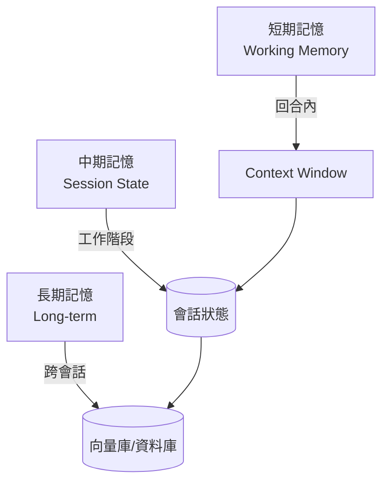
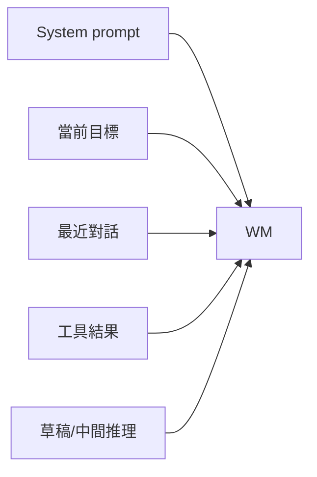
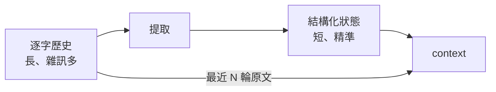
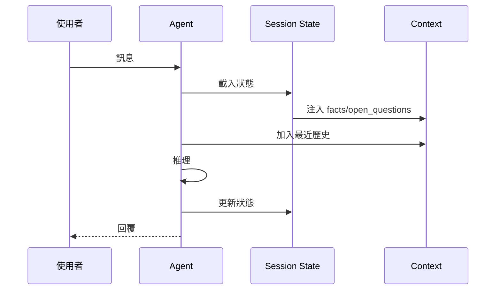

# 8.1 短期記憶（Working Memory）與中期會話狀態管理

## 記憶的層級

Agent 的記憶不是單一東西，而是一組不同時間尺度的儲存：



- **短期（Working）**：當前推理所需，存在 context 中。
- **中期（Session）**：整個工作階段的狀態，跨多輪。
- **長期（Long-term）**：跨工作階段，見 8.2。

本節談前兩者。

## 短期記憶：Context 即工作記憶

短期記憶就是**當前 context window 裡的內容**，類比人類的「工作記憶」——正在思考時腦中持有的資訊。

$$
\text{WM}_t \subseteq \text{context window}
$$

它的特性：
- **容量有限**（見 1.2）。
- **易失**：一壓縮就沒了。
- **高速**：直接參與推理。

### 短期記憶的組成



### Scratchpad（草稿區）

Agent 常需要「暫存中間結果」。可在 context 中保留一個 scratchpad 區塊：

```text
<scratchpad>
已確認：
- 目的地：東京
- 出發日：2026-03-01
待確認：
- 回程日
- 預算
</scratchpad>
```

這比讓模型從長歷史中自己提取更穩定。

## 中期記憶：會話狀態（Session State）

跨多輪對話，需要一個**結構化的狀態物件**，而非只靠歷史：

```json
{
  "session_id": "s_123",
  "created_at": "2026-03-01T10:00:00Z",
  "user": {"id": "u_456", "locale": "zh-TW"},
  "goal": "預訂台北到東京的來回機票",
  "facts": {
    "destination": "東京",
    "depart_date": "2026-03-01",
    "return_date": null,
    "budget_twd": 15000
  },
  "open_questions": ["回程日期"],
  "completed_steps": ["search_flights"],
  "pending_steps": ["confirm_return_date", "book"]
}
```

這個狀態物件的好處：

| 好處 | 說明 |
|---|---|
| 穩定 | 不受摘要漂移影響 |
| 可查詢 | 程式可讀取特定欄位 |
| 可恢復 | 斷線後能續跑（12.1） |
| 省 token | 比逐字歷史短 |

### 狀態 vs. 歷史



實務上**兩者並存**：狀態提供穩定事實，最近歷史提供語氣與細節。

## 狀態管理的最佳實務

### 1. 明確定義 schema

```python
from pydantic import BaseModel

class SessionState(BaseModel):
    goal: str
    facts: dict
    open_questions: list[str]
    completed_steps: list[str]
    pending_steps: list[str]
```

### 2. 每輪更新狀態

模型在回覆時同時輸出狀態更新：

```json
{
  "reply": "好的，已記下出發日 3/1。請問回程日期？",
  "state_update": {
    "facts": {"depart_date": "2026-03-01"},
    "open_questions": ["回程日期"]
  }
}
```

### 3. 狀態驗證

更新也要驗證（2.2）：日期格式、金額範圍、枚舉值。

### 4. 版本與衝突

多輪更新可能衝突（使用者改主意）。用「最後寫入 wins」或保留歷史：

```json
{
  "budget_twd": {"value": 15000, "updated_at": "...", "source": "user"}
}
```

### 5. 狀態持久化

存到資料庫/Redis，支援斷點續跑（12.1）。

```python
await redis.set(f"session:{sid}", state.model_dump_json(), ex=3600)
```

## 短期與中期的互動



每一輪：**狀態 → context → 推理 → 更新狀態**。

## 中期記憶的壓縮

當會話很長，狀態本身也可能膨脹（facts 太多）。策略：

- **只保留與當前目標相關的 facts**。
- **歸檔已完成的部分**到長期記憶（8.2）。
- **摘要舊的 open_questions**。

$$
\text{state}_{\text{active}} = \text{filter}(\text{state}, \text{relevant to goal})
$$

## 常見失敗

| 失敗 | 原因 | 對策 |
|---|---|---|
| 忘記已確認事實 | 狀態未更新 | 強制每輪更新 |
| 狀態與歷史衝突 | 不同步 | 以狀態為準，歷史為輔 |
| 狀態膨脹 | 什麼都存 | 相關性過濾、歸檔 |
| 斷線遺失 | 未持久化 | 存 DB/Redis |
| 併發衝突 | 多請求同時改 | 鎖/版本號 |

## 與後續章節的關聯

- **3.1 Context 壓縮**：短期記憶的管理。
- **8.2 長期記憶**：跨會話的記憶。
- **8.3 寫入篩選**：什麼該存。
- **12.1 狀態持久化**：中期記憶的生產化。

## 小結

1. 記憶分短期（context）、中期（session state）、長期（跨會話）。
2. 短期記憶是當前 context，容量有限、易失，可用 scratchpad 輔助。
3. 中期記憶用結構化狀態物件，穩定、可查詢、可恢復、省 token。
4. 狀態與歷史並存：狀態給事實，歷史給細節。
5. 狀態需 schema、驗證、版本、持久化。
6. 長會話要過濾與歸檔狀態，避免膨脹。
