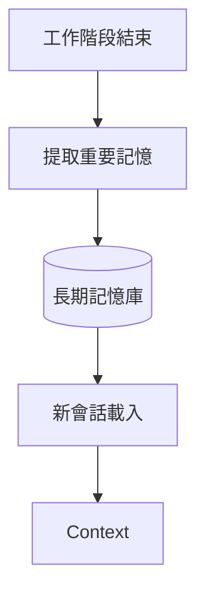
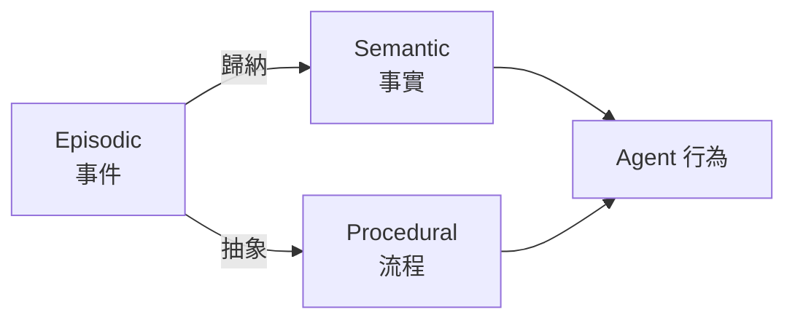
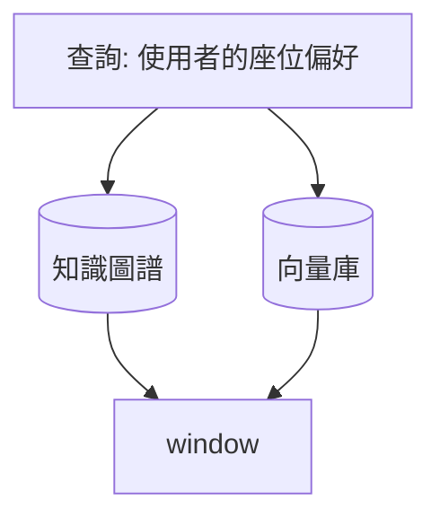
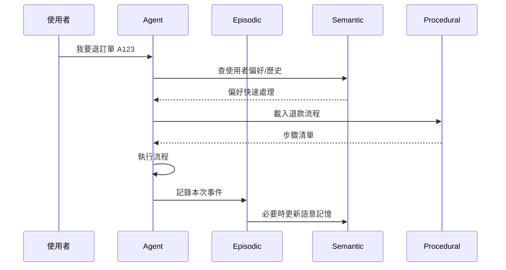
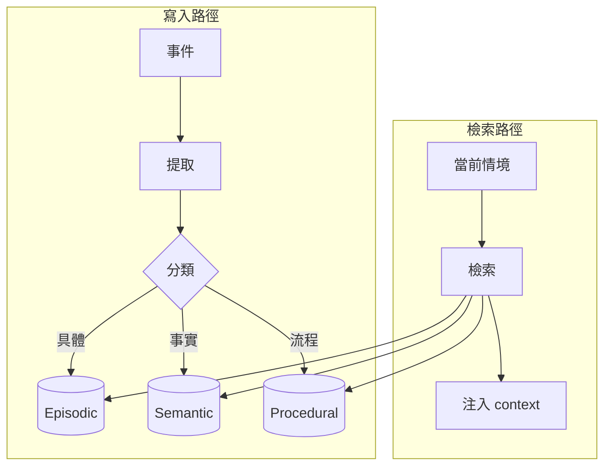

# 8.2 長期記憶設計：情節記憶（Episodic）、語意記憶（Semantic）與程序記憶（Procedural）

## 為什麼需要長期記憶

短期與中期記憶（8.1）只在工作階段內有效。當會話結束，Agent 就「失憶」了。要讓 Agent 越用越聰明、記得使用者偏好、記得過去任務，就需要**長期記憶**——跨工作階段持久保存的知識。



## 三種長期記憶（借鏡認知科學）

心理學將記憶分為三類，Agent 也適用：

| 類型 | 內容 | 例子 |
|---|---|---|
| **情節記憶（Episodic）** | 具體事件與經驗 | 「上週使用者要求退款，因商品瑕疵」 |
| **語意記憶（Semantic）** | 事實與概念 | 「使用者偏好靠窗座位」 |
| **程序記憶（Procedural）** | 技能與流程 | 「退款流程：驗證訂單 → 檢查政策 → 執行」 |



## 情節記憶（Episodic Memory）

### 定義

記錄**具體發生過的事件**，帶時間、參與者、情境。

```json
{
  "type": "episodic",
  "id": "ep_001",
  "timestamp": "2026-02-20T14:30:00Z",
  "session_id": "s_123",
  "summary": "使用者要求退款訂單 A123，因商品有瑕疵。已核准並退款 500 元。",
  "entities": ["user:u456", "order:A123"],
  "outcome": "success",
  "embedding": [0.12, -0.45, ...]
}
```

### 用途

- **回憶類似情境**：「上次類似問題怎麼處理的？」
- **個人化**：「使用者上次也問過這個。」
- **審計**：發生過什麼。

### 檢索方式

主要靠**向量檢索**（5.1）：把當前情境 embedding，找相似的過去事件。

$$
\text{relevant episodes} = \text{top-}k \cos(f(q), f(e_i))
$$

## 語意記憶（Semantic Memory）

### 定義

從情節中**抽象出的事實**，不綁定具體時間。

```json
{
  "type": "semantic",
  "id": "sem_001",
  "subject": "user:u456",
  "predicate": "seat_preference",
  "object": "window",
  "confidence": 0.9,
  "source_episodes": ["ep_001", "ep_017"],
  "updated_at": "2026-02-25"
}
```

也可表示為三元組（知識圖譜）：

$$
(\text{subject}, \text{predicate}, \text{object})
$$

例如 `(user:u456, prefers, window_seat)`。

### 用途

- **個人化**：記住偏好、限制。
- **知識累積**：從經驗中學到的一般規則。
- **快速查詢**：結構化，不需向量檢索。

### 儲存

- **知識圖譜**：適合關係查詢。
- **向量庫**：適合語意檢索。
- **混合**：實務常見。



### 更新與衝突

語意記憶可能衝突（舊偏好 vs. 新偏好）。策略：
- **時間戳**：新者優先。
- **信心分數**：高信心優先。
- **來源追蹤**：可回溯到情節。

```json
{"predicate": "seat_preference", "values": [
  {"object": "aisle", "since": "2025-01", "until": "2026-01"},
  {"object": "window", "since": "2026-02"}
]}
```

## 程序記憶（Procedural Memory）

### 定義

**如何做某事**的知識：流程、策略、工具使用模式。

```json
{
  "type": "procedural",
  "id": "proc_refund",
  "name": "退款流程",
  "steps": [
    "取得訂單詳情",
    "檢查退款政策（7 天內、未使用）",
    "若符合，呼叫 refund_order",
    "通知使用者"
  ],
  "conditions": "使用者要求退款",
  "success_rate": 0.95
}
```

### 用途

- **重用成功流程**：不必每次重新規劃。
- **避免重複錯誤**：記錄失敗的教訓。
- **技能累積**：Agent 越用越熟練。

### 形式

程序記憶可以是：
- **文字流程**（給模型讀）。
- **程式碼/工作流**（直接執行）。
- **few-shot 範例**（教模型怎麼做）。

```python
# 程序記憶作為可執行工作流
refund_workflow = {
    "trigger": "refund_request",
    "steps": [
        {"tool": "get_order", "args": {"id": "{{order_id}}"}},
        {"check": "policy.refundable"},
        {"tool": "refund_order", "args": {"id": "{{order_id}}"}},
    ],
}
```

## 三種記憶的協作



## 記憶的寫入與檢索架構



## 長期記憶的工程挑戰

| 挑戰 | 說明 | 對策 |
|---|---|---|
| 寫什麼 | 全部存會爆炸 | 篩選（8.3） |
| 怎麼存 | 結構 vs. 向量 | 混合 |
| 怎麼找 | 相關性 | 向量 + metadata |
| 衝突 | 新舊矛盾 | 時間戳、信心 |
| 遺忘 | 過時/隱私 | TTL、刪除（8.3） |
| 一致性 | 跨會話 | 唯一 ID、版本 |

## 與 RAG 的關係

長期記憶的檢索本質就是 RAG（5.1）：把記憶當文件，embedding 檢索。差別在：

- RAG 檢索**外部知識**。
- 記憶檢索**自身經驗**。

兩者可共用同一套向量基礎設施。

## 與後續章節的關聯

- **8.3 寫入篩選與遺忘**：記憶的生命週期。
- **9.3 上下文工程**：記憶如何注入 context。
- **11.2 評估**：記憶是否提升任務成功率。

## 小結

1. 長期記憶跨會話持久，讓 Agent 越用越聰明。
2. 三類：情節（事件）、語意（事實）、程序（流程）。
3. 情節靠向量檢索，語意常用知識圖譜，程序可為可執行工作流。
4. 三類協作：事件歸納為事實與流程，事實與流程指導行為。
5. 記憶檢索本質是 RAG，可共用向量基礎設施。
6. 挑戰在寫入、檢索、衝突、遺忘與一致性。
